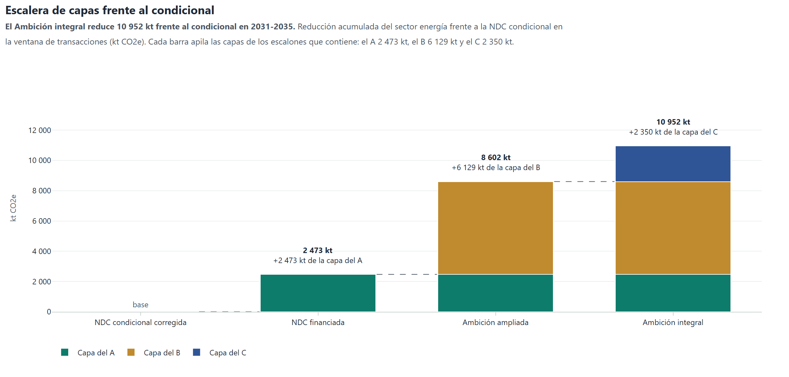
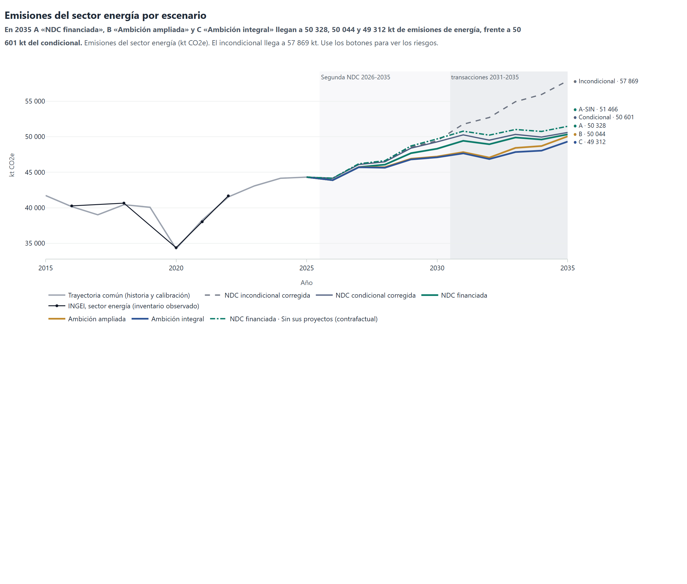
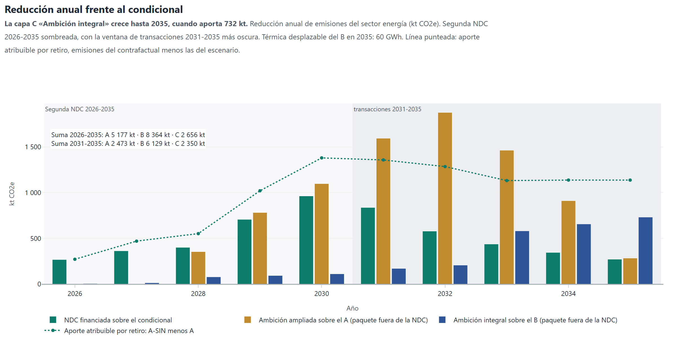
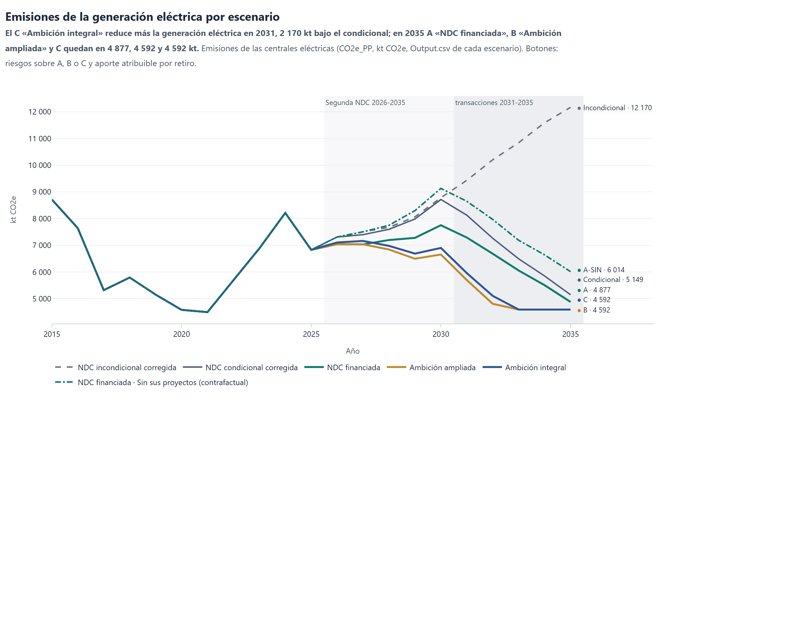
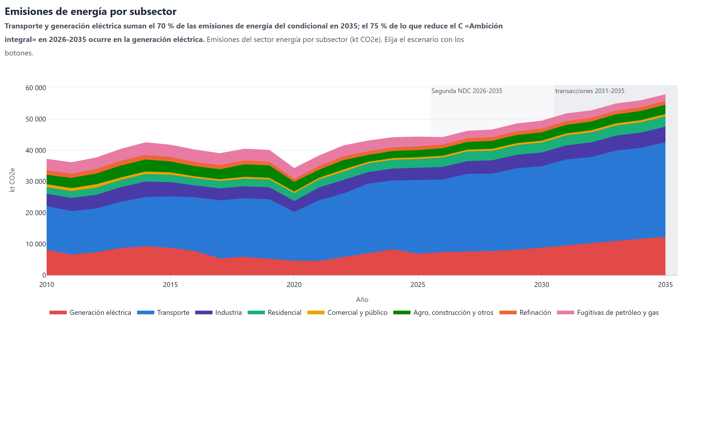
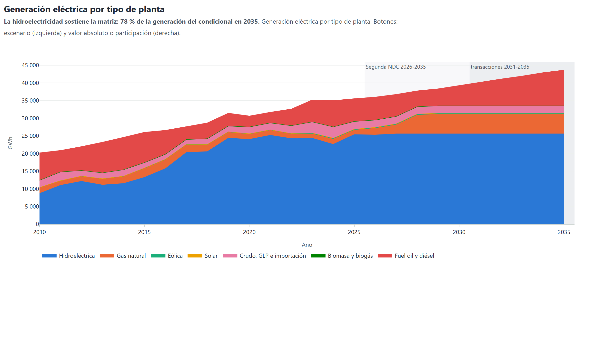
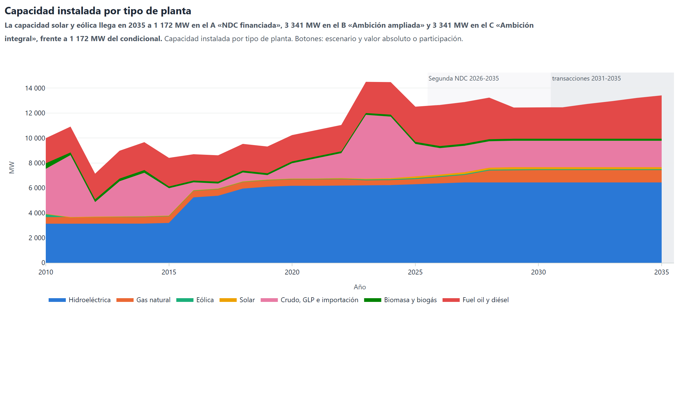
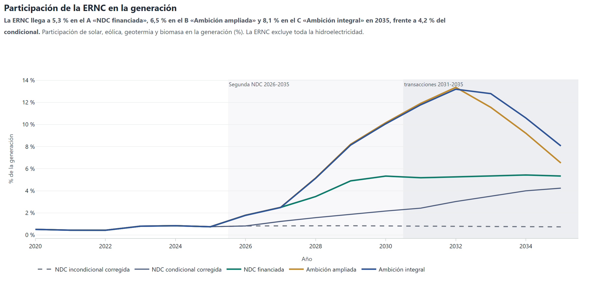

# Resultados del modelo

Las gráficas salen del modelo OSeMOSYS de la Segunda NDC con la base corregida. Usan los escenarios de
`Energy/B1_Scenario_Config.xlsx` y las salidas de cada escenario en `Energy/Executables`. También
están en el tablero [tablero_art6.html](https://ecmaedmcc.github.io/EnergyArt6/_static/tablero_art6.html), un solo archivo que funciona
sin internet.

## Emisiones del sector energía

Escalera de capas frente al condicional

El Ambición integral reduce 10 952 kt frente al condicional en 2031-2035. Reducción acumulada del sector energía frente a la NDC condicional en la ventana de transacciones (kt CO2e). Cada barra apila las capas de los escalones que contiene: el A 2 473 kt, el B 6 129 kt y el C 2 350 kt.

#### Qué muestra

Reducción acumulada del sector energía frente a la NDC condicional en la ventana de transacciones 2031-2035 (kt CO₂e), escalón por escalón: el A, el B y el C.

#### Cómo leerla

Cada barra apila las capas de los escalones que contiene, con el color de cada capa. La cifra en negrita es la reducción total del escalón frente al condicional y la línea inferior, lo que añade su última capa. La línea discontinua marca el nivel del escalón anterior.

#### Qué dice el modelo

el A suma 2 473 kt, el B suma 8 602 kt y el C suma 10 952 kt.

#### Para la decisión

Cada capa tiene su propia consecuencia contable: la del A pertenece al tramo condicional y descuenta de esa meta si se transfiere; las del B y del C están fuera de la NDC y no consumen ninguna meta si demuestran su adicionalidad.

Emisiones del sector energía por escenario

En 2035 A «NDC financiada», B «Ambición ampliada» y C «Ambición integral» llegan a 50 328, 50 044 y 49 312 kt de emisiones de energía, frente a 50 601 kt del condicional. Emisiones del sector energía (kt CO2e). El incondicional llega a 57 869 kt. Use los botones para ver los riesgos.

#### Qué muestra

Emisiones totales del sector energía en kt CO₂e: demanda final, generación eléctrica, fugitivas y refinación, según el Output.csv de cada escenario.

#### Cómo leerla

Cada línea es un escenario y la etiqueta final da su valor de 2035. Los botones agregan los riesgos sobre A, B o C y el riesgo de operación (sin pisos térmicos (K16 en PPFOI; Modelo CLG en PPDSL y PPNGS) y sin la expansión a gas declarada (sobre CONA6G)). El deslizador inferior acota los años.

#### Qué dice el modelo

En 2035 el incondicional llega a 57 869 kt y el condicional a 50 601 kt; el A queda en 50 328 kt, el B en 50 044 kt y el C en 49 312 kt. Con la salida de la clase de Coca Codo y el año seco severo, el A llega a 62 241 kt, el B a 58 977 kt y el C a 58 080 kt, por encima del incondicional.

#### Para la decisión

En 2035 el tramo condicional baja 7 268 kt; la capa A, 272 kt, la capa B, 284 kt y la capa C, 732 kt. Con la salida de la clase de Coca Codo y el año seco severo, las emisiones del A suben 11 912 kt. La mayor caída la produce el tramo condicional, con las iniciativas Proyecto Hidroeléctrico Santiago y Proyecto hidroeléctrico Cardenillo, que reúnen el 88 % de la reducción anual declarada de las condicionales.

Reducción anual frente al condicional

La capa C «Ambición integral» crece hasta 2035, cuando aporta 732 kt. Reducción anual de emisiones del sector energía (kt CO2e). Segunda NDC 2026-2035 sombreada, con la ventana de transacciones 2031-2035 más oscura. Térmica desplazable del B en 2035: 60 GWh. Línea punteada: aporte atribuible por retiro, emisiones del contrafactual menos las del escenario.

#### Qué muestra

Reducción anual de emisiones del sector energía (kt CO₂e) de cada capa: el A frente al condicional, el B frente al A y el C frente al B.

#### Cómo leerla

Barras verdes: capa A. Barras ocre: capa B. Barras moradas: capa C. Una barra bajo cero indica que la capa emite más que su referencia ese año. La línea punteada es el aporte atribuible por retiro: emisiones del contrafactual, el escenario sin sus actividades, menos las del escenario.

#### Qué dice el modelo

La capa C crece hasta 2035, cuando aporta 732 kt. La capa A suma 2 473 kt en la ventana 2031-2035 y la capa B suma 6 129 kt en la ventana 2031-2035.

#### Para la decisión

El paquete fuera de la NDC crece hasta 2035, cuando aporta 732 kt; ese año la térmica desplazable del B es de 60 GWh.

Emisiones de la generación eléctrica por escenario

El C «Ambición integral» reduce más la generación eléctrica en 2031, 2 170 kt bajo el condicional; en 2035 A «NDC financiada», B «Ambición ampliada» y C quedan en 4 877, 4 592 y 4 592 kt. Emisiones de las centrales eléctricas (CO2e_PP, kt CO2e, Output.csv de cada escenario). Botones: riesgos sobre A, B o C y aporte atribuible por retiro.

#### Qué muestra

Emisiones de las centrales eléctricas (componente CO2e_PP del Output.csv de cada escenario, kt CO₂e).

#### Cómo leerla

Hasta 2025 las cinco líneas de la vista inicial coinciden; desde 2026 cada una refleja cuánta electricidad térmica necesita el escenario. Los botones muestran los riesgos sobre A, B o C.

#### Qué dice el modelo

Sin el tramo condicional, las emisiones de la generación llegan a 12 170 kt en 2035. El condicional las baja a 5 149 kt. El A queda en 4 877 kt, el B en 4 592 kt y el C en 4 592 kt. En 2035 la generación del C y la del B emiten lo mismo. La térmica desplazable del B en 2035 es de 60 GWh. Con la salida de la clase de Coca Codo y el año seco severo, la generación del C emite 13 360 kt en 2035.

#### Para la decisión

El valor de la capa C se concentra en 2033-2035 y crece en los años de estrés hidroeléctrico; en 2035, con el sistema intacto, su efecto sobre las emisiones del sector es de 732 kt.

Emisiones de energía por subsector

Transporte y generación eléctrica suman el 70 % de las emisiones de energía del condicional en 2035; el 75 % de lo que reduce el C «Ambición integral» en 2026-2035 ocurre en la generación eléctrica. Emisiones del sector energía por subsector (kt CO2e). Elija el escenario con los botones.

#### Qué muestra

Emisiones del sector energía por subsector del inventario (kt CO₂e, áreas apiladas), calculadas con las emisiones por tecnología del Output.csv de cada escenario.

#### Cómo leerla

Cada franja es un subsector y la altura total es la emisión del sector. Los botones cambian de escenario.

#### Qué dice el modelo

En 2035, en el condicional, el transporte emite 30 116 kt (59,5 % del sector), la generación eléctrica emite 5 149 kt (10,2 % del sector) y la industria emite 4 970 kt (9,8 % del sector).

#### Para la decisión

El 75 % de lo que reduce el C frente al condicional en 2026-2035 ocurre en la generación eléctrica. Las cinco iniciativas de la NDC que el modelo no representa se cuentan con su volumen declarado.

*Tabla. Emisiones del sector energía por escenario (kt CO2e)*

| anio | NDCINC | NDCCON | INCA6 | CONA6 | CONA6G | CONA6P | CONA6I | A | A-CCOFF | A-CCSOLO | A-CCDER | A-ANOSECO | A-ANOSEC3 | A-ANOSECM | A-CCOFFANOSECO | A-FOI | A-IMP0 | A-ACT | A-ACTDEM | A-GAS | A-SIN | B | B-CCOFF | B-CCSOLO | B-CCDER | B-ANOSECO | B-ANOSEC3 | B-ANOSECM | B-CCOFFANOSECO | B-FOI | B-IMP0 | B-ACT | B-ACTDEM | B-GAS | C | C-CCOFF | C-CCSOLO | C-CCDER | C-ANOSECO | C-ANOSEC3 | C-ANOSECM | C-CCOFFANOSECO | C-IMP0 | C-ACT | C-ACTDEM | C-GAS | A-V7 | B-V7 | C-V7 |
|---|---|---|---|---|---|---|---|---|---|---|---|---|---|---|---|---|---|---|---|---|---|---|---|---|---|---|---|---|---|---|---|---|---|---|---|---|---|---|---|---|---|---|---|---|---|---|---|---|---|
| 2010 | 37183.9 | 37183.9 | 37183.9 | 37183.9 | 37183.9 | 37183.9 | 37183.9 | 37183.9 | 37183.9 | 37183.9 | 37183.9 | 37183.9 | 37183.9 | 37183.9 | 37183.9 | 37183.9 | 37183.9 | 37183.9 | 37183.9 | 37183.9 | 37183.9 | 37183.9 | 37183.9 | 37183.9 | 37183.9 | 37183.9 | 37183.9 | 37183.9 | 37183.9 | 37183.9 | 37183.9 | 37183.9 | 37183.9 | 37183.9 | 37183.8 | 37183.8 | 37183.8 | 37183.8 | 37183.8 | 37183.8 | 37183.8 | 37183.8 | 37183.8 | 37183.8 | 37183.8 | 37183.8 | 37183.9 | 37183.9 | 37183.8 |
| 2011 | 36596.5 | 36596.5 | 36100.9 | 36100.9 | 36100.9 | 36100.9 | 36100.9 | 36100.9 | 36100.9 | 36100.9 | 36100.9 | 36100.9 | 36100.9 | 36100.9 | 36100.9 | 36100.9 | 36100.9 | 36100.9 | 36100.9 | 36100.9 | 36100.9 | 36100.9 | 36100.9 | 36100.9 | 36100.9 | 36100.9 | 36100.9 | 36100.9 | 36100.9 | 36100.9 | 36100.9 | 36100.9 | 36100.9 | 36100.9 | 36100.9 | 36100.9 | 36100.9 | 36100.9 | 36100.9 | 36100.9 | 36100.9 | 36100.9 | 36100.9 | 36100.9 | 36100.9 | 36100.9 | 36100.9 | 36100.9 | 36100.9 |
| 2012 | 37641.5 | 37641.5 | 37640.2 | 37640.2 | 37640.2 | 37640.2 | 37640.2 | 37640.2 | 37640.2 | 37640.2 | 37640.2 | 37640.2 | 37640.2 | 37640.2 | 37640.2 | 37640.2 | 37640.2 | 37640.2 | 37640.2 | 37640.2 | 37640.2 | 37640.2 | 37640.2 | 37640.2 | 37640.2 | 37640.2 | 37640.2 | 37640.2 | 37640.2 | 37640.2 | 37640.2 | 37640.2 | 37640.2 | 37640.2 | 37640.2 | 37640.2 | 37640.2 | 37640.2 | 37640.2 | 37640.2 | 37640.2 | 37640.2 | 37640.2 | 37640.2 | 37640.2 | 37640.2 | 37640.2 | 37640.2 | 37640.2 |
| 2013 | 40543.6 | 40543.6 | 40391.8 | 40391.8 | 40391.8 | 40391.8 | 40391.8 | 40391.8 | 40391.8 | 40391.8 | 40391.8 | 40391.8 | 40391.8 | 40391.8 | 40391.8 | 40391.8 | 40391.8 | 40391.8 | 40391.8 | 40391.8 | 40391.8 | 40391.8 | 40391.8 | 40391.8 | 40391.8 | 40391.8 | 40391.8 | 40391.8 | 40391.8 | 40391.8 | 40391.8 | 40391.8 | 40391.8 | 40391.8 | 40391.8 | 40391.8 | 40391.8 | 40391.8 | 40391.8 | 40391.8 | 40391.8 | 40391.8 | 40391.8 | 40391.8 | 40391.8 | 40391.8 | 40391.8 | 40391.8 | 40391.8 |
| 2014 | 42534.1 | 42534.1 | 42500.0 | 42500.0 | 42500.0 | 42500.0 | 42500.0 | 42500.0 | 42500.0 | 42500.0 | 42500.0 | 42500.0 | 42500.0 | 42500.0 | 42500.0 | 42500.0 | 42500.0 | 42500.0 | 42500.0 | 42500.0 | 42500.0 | 42500.0 | 42500.0 | 42500.0 | 42500.0 | 42500.0 | 42500.0 | 42500.0 | 42500.0 | 42500.0 | 42500.0 | 42500.0 | 42500.0 | 42500.0 | 42500.0 | 42500.0 | 42500.0 | 42500.0 | 42500.0 | 42500.0 | 42500.0 | 42500.0 | 42500.0 | 42500.0 | 42500.0 | 42500.0 | 42500.0 | 42500.0 | 42500.0 |
| 2015 | 42893.2 | 42893.2 | 41721.1 | 41721.1 | 41721.1 | 41721.1 | 41721.1 | 41721.1 | 41721.1 | 41721.1 | 41721.1 | 41721.1 | 41721.1 | 41721.1 | 41721.1 | 41721.1 | 41721.1 | 41721.1 | 41721.1 | 41721.1 | 41721.1 | 41721.1 | 41721.1 | 41721.1 | 41721.1 | 41721.1 | 41721.1 | 41721.1 | 41721.1 | 41721.1 | 41721.1 | 41721.1 | 41721.1 | 41721.1 | 41721.2 | 41721.2 | 41721.2 | 41721.2 | 41721.2 | 41721.2 | 41721.2 | 41721.2 | 41721.2 | 41721.2 | 41721.2 | 41721.2 | 41721.1 | 41721.1 | 41721.2 |
| 2016 | 41907.7 | 41907.7 | 40161.4 | 40161.4 | 40161.4 | 40161.4 | 40161.4 | 40161.4 | 40161.4 | 40161.4 | 40161.4 | 40161.4 | 40161.4 | 40161.4 | 40161.4 | 40161.4 | 40161.4 | 40161.4 | 40161.4 | 40161.4 | 40161.4 | 40161.4 | 40161.4 | 40161.4 | 40161.4 | 40161.4 | 40161.4 | 40161.4 | 40161.4 | 40161.4 | 40161.4 | 40161.4 | 40161.4 | 40161.4 | 40161.4 | 40161.4 | 40161.4 | 40161.4 | 40161.4 | 40161.4 | 40161.4 | 40161.4 | 40161.4 | 40161.4 | 40161.4 | 40161.4 | 40161.4 | 40161.4 | 40161.4 |
| 2017 | 41693.1 | 41693.1 | 39008.8 | 39008.8 | 39008.8 | 39008.8 | 39008.8 | 39008.8 | 39008.8 | 39008.8 | 39008.8 | 39008.8 | 39008.8 | 39008.8 | 39008.8 | 39008.8 | 39008.8 | 39008.8 | 39008.8 | 39008.8 | 39008.8 | 39008.8 | 39008.8 | 39008.8 | 39008.8 | 39008.8 | 39008.8 | 39008.8 | 39008.8 | 39008.8 | 39008.8 | 39008.8 | 39008.8 | 39008.8 | 39008.8 | 39008.8 | 39008.8 | 39008.8 | 39008.8 | 39008.8 | 39008.8 | 39008.8 | 39008.8 | 39008.8 | 39008.8 | 39008.8 | 39008.8 | 39008.8 | 39008.8 |
| 2018 | 43291.6 | 43291.6 | 40429.6 | 40429.6 | 40429.6 | 40429.6 | 40429.6 | 40429.6 | 40429.6 | 40429.6 | 40429.6 | 40429.6 | 40429.6 | 40429.6 | 40429.6 | 40429.6 | 40429.6 | 40429.6 | 40429.6 | 40429.6 | 40429.6 | 40429.6 | 40429.6 | 40429.6 | 40429.6 | 40429.6 | 40429.6 | 40429.6 | 40429.6 | 40429.6 | 40429.6 | 40429.6 | 40429.6 | 40429.6 | 40429.6 | 40429.6 | 40429.6 | 40429.6 | 40429.6 | 40429.6 | 40429.6 | 40429.6 | 40429.6 | 40429.6 | 40429.6 | 40429.6 | 40429.6 | 40429.6 | 40429.6 |
| 2019 | 41495.9 | 41495.9 | 40072.0 | 40072.0 | 40072.0 | 40072.0 | 40072.0 | 40072.0 | 40072.0 | 40072.0 | 40072.0 | 40072.0 | 40072.0 | 40072.0 | 40072.0 | 40072.0 | 40072.0 | 40072.0 | 40072.0 | 40072.0 | 40072.0 | 40072.0 | 40072.0 | 40072.0 | 40072.0 | 40072.0 | 40072.0 | 40072.0 | 40072.0 | 40072.0 | 40072.0 | 40072.0 | 40072.0 | 40072.0 | 40072.0 | 40072.0 | 40072.0 | 40072.0 | 40072.0 | 40072.0 | 40072.0 | 40072.0 | 40072.0 | 40072.0 | 40072.0 | 40072.0 | 40072.0 | 40072.0 | 40072.0 |
| 2020 | 36293.3 | 36293.3 | 34229.3 | 34229.3 | 34229.3 | 34229.3 | 34229.3 | 34229.3 | 34229.3 | 34229.3 | 34229.3 | 34229.3 | 34229.3 | 34229.3 | 34229.3 | 34229.3 | 34229.3 | 34229.3 | 34229.3 | 34229.3 | 34229.3 | 34229.3 | 34229.3 | 34229.3 | 34229.3 | 34229.3 | 34229.3 | 34229.3 | 34229.3 | 34229.3 | 34229.3 | 34229.3 | 34229.3 | 34229.3 | 34229.3 | 34229.3 | 34229.3 | 34229.3 | 34229.3 | 34229.3 | 34229.3 | 34229.3 | 34229.3 | 34229.3 | 34229.3 | 34229.3 | 34229.3 | 34229.3 | 34229.3 |
| 2021 | 40781.5 | 40781.5 | 38260.1 | 38260.1 | 38260.1 | 38260.1 | 38260.1 | 38260.1 | 38260.1 | 38260.1 | 38260.1 | 38260.1 | 38260.1 | 38260.1 | 38260.1 | 38260.1 | 38260.1 | 38260.1 | 38260.1 | 38260.1 | 38260.1 | 38260.1 | 38260.1 | 38260.1 | 38260.1 | 38260.1 | 38260.1 | 38260.1 | 38260.1 | 38260.1 | 38260.1 | 38260.1 | 38260.1 | 38260.1 | 38260.1 | 38260.1 | 38260.1 | 38260.1 | 38260.1 | 38260.1 | 38260.1 | 38260.1 | 38260.1 | 38260.1 | 38260.1 | 38260.1 | 38260.1 | 38260.1 | 38260.1 |
| 2022 | 44076.6 | 44076.6 | 41521.5 | 41521.5 | 41521.5 | 41521.5 | 41521.5 | 41521.5 | 41521.5 | 41521.5 | 41521.5 | 41521.5 | 41521.5 | 41521.5 | 41521.5 | 41521.5 | 41521.5 | 41521.5 | 41521.5 | 41521.5 | 41521.5 | 41521.5 | 41521.5 | 41521.5 | 41521.5 | 41521.5 | 41521.5 | 41521.5 | 41521.5 | 41521.5 | 41521.5 | 41521.5 | 41521.5 | 41521.5 | 41521.5 | 41521.5 | 41521.5 | 41521.5 | 41521.5 | 41521.5 | 41521.5 | 41521.5 | 41521.5 | 41521.5 | 41521.5 | 41521.5 | 41521.5 | 41521.5 | 41521.5 |
| 2023 | 45923.6 | 45923.6 | 43075.8 | 43075.8 | 43075.8 | 43075.8 | 43075.8 | 43075.8 | 43075.8 | 43075.8 | 43075.8 | 43075.8 | 43075.8 | 43075.8 | 43075.8 | 43075.8 | 43075.8 | 43075.8 | 43075.8 | 43075.8 | 43075.8 | 43075.8 | 43075.8 | 43075.8 | 43075.8 | 43075.8 | 43075.8 | 43075.8 | 43075.8 | 43075.8 | 43075.8 | 43075.8 | 43075.8 | 43075.8 | 43075.8 | 43075.8 | 43075.8 | 43075.8 | 43075.8 | 43075.8 | 43075.8 | 43075.8 | 43075.8 | 43075.8 | 43075.8 | 43075.8 | 43075.8 | 43075.8 | 43075.8 |
| 2024 | 46457.6 | 46457.6 | 44150.9 | 44150.9 | 44150.9 | 44150.9 | 44150.9 | 44150.9 | 44150.9 | 44150.9 | 44150.9 | 44150.9 | 44150.9 | 44150.9 | 44150.9 | 44150.9 | 44150.9 | 44150.9 | 44150.9 | 44150.9 | 44150.9 | 44150.9 | 44150.9 | 44150.9 | 44150.9 | 44150.9 | 44150.9 | 44150.9 | 44150.9 | 44150.9 | 44150.9 | 44150.9 | 44150.9 | 44150.9 | 44150.9 | 44150.9 | 44150.9 | 44150.9 | 44150.9 | 44150.9 | 44150.9 | 44150.9 | 44150.9 | 44150.9 | 44150.9 | 44150.9 | 44150.9 | 44150.9 | 44150.9 |
| 2025 | 48283.9 | 48283.9 | 44316.8 | 44316.8 | 44316.8 | 44316.8 | 44316.8 | 44316.8 | 44316.8 | 44316.8 | 44316.8 | 44316.8 | 44316.8 | 44316.8 | 44316.8 | 44316.8 | 44316.8 | 44316.8 | 44316.8 | 44316.8 | 44316.8 | 44316.8 | 44316.8 | 44316.8 | 44316.8 | 44316.8 | 44316.8 | 44316.8 | 44316.8 | 44316.8 | 44316.8 | 44316.8 | 44316.8 | 44316.8 | 44316.8 | 44316.8 | 44316.8 | 44316.8 | 44316.8 | 44316.8 | 44316.8 | 44316.8 | 44316.8 | 44316.8 | 44316.8 | 44316.8 | 44316.8 | 44316.8 | 44316.8 |
| 2026 | 46549.2 | 46549.2 | 44159.4 | 44158.8 | 44276.9 | 44158.8 | 44536.6 | 43890.8 | 43890.8 | 43890.8 | 43890.8 | 47870.7 | 47870.7 | 45569.3 | 47870.7 | 43890.8 | 44268.6 | 45772.7 | 45772.7 | 44008.8 | 44162.5 | 43890.8 | 43890.8 | 43890.8 | 43890.8 | 47870.7 | 47870.7 | 45569.3 | 47870.7 | 43890.8 | 44268.6 | 45772.7 | 45772.7 | 44008.8 | 43884.5 | 43884.5 | 43884.5 | 43884.5 | 47864.3 | 47864.3 | 45562.9 | 47864.3 | 44262.2 | 45773.8 | 45773.8 | 44002.5 | 44031.5 | 44031.5 | 44025.2 |
| 2027 | 48133.4 | 48015.2 | 46198.5 | 46085.6 | 46354.2 | 46085.6 | 46463.4 | 45722.2 | 45722.2 | 45722.2 | 46778.0 | 49717.1 | 45701.3 | 47422.6 | 49717.1 | 45722.2 | 46100.0 | 46099.9 | 49438.1 | 45990.8 | 46192.5 | 45722.2 | 45722.2 | 45722.2 | 46778.0 | 49717.1 | 45701.3 | 47422.6 | 49717.1 | 45722.2 | 46100.0 | 46099.9 | 49438.1 | 45990.8 | 45707.5 | 45707.5 | 45707.5 | 46763.2 | 49702.4 | 45686.6 | 47407.8 | 49702.4 | 46085.2 | 46085.2 | 49438.1 | 45976.1 | 45869.2 | 45869.2 | 45854.5 |
| 2028 | 48527.3 | 48389.4 | 46577.0 | 46472.2 | 47311.8 | 46388.6 | 46766.3 | 46070.5 | 46070.5 | 46070.5 | 46884.6 | 49824.9 | 46055.5 | 47529.6 | 49824.9 | 45828.8 | 46341.6 | 46341.6 | 49647.1 | 46752.1 | 46623.0 | 45715.6 | 45715.6 | 45715.6 | 46473.4 | 49330.4 | 45700.6 | 47035.2 | 49330.4 | 45409.0 | 45986.7 | 45986.7 | 49152.6 | 46257.7 | 45636.3 | 45636.3 | 45636.3 | 46394.0 | 49304.2 | 45621.3 | 47008.9 | 49304.2 | 45907.4 | 45907.4 | 49148.1 | 46231.4 | 46182.9 | 45839.4 | 45760.1 |
| 2029 | 50354.3 | 50204.7 | 48536.5 | 48390.5 | 48653.1 | 48390.5 | 48768.3 | 47683.4 | 53667.5 | 51689.3 | 48544.2 | 51189.7 | 51189.7 | 49189.4 | 57069.7 | 47488.4 | 47954.5 | 51177.4 | 54704.4 | 48411.8 | 48703.8 | 46901.1 | 52678.6 | 50700.4 | 47654.9 | 50495.6 | 50495.6 | 48200.5 | 56080.8 | 46590.5 | 47170.8 | 50188.6 | 53715.5 | 47422.9 | 46807.5 | 52641.6 | 50663.5 | 47561.3 | 50458.7 | 50458.7 | 48163.6 | 56043.9 | 47077.2 | 50151.6 | 53707.4 | 47385.9 | 47799.9 | 47044.9 | 46951.3 |
| 2030 | 51293.9 | 51125.6 | 49438.5 | 49273.2 | 49381.3 | 49273.2 | 49651.0 | 48309.9 | 53819.5 | 51841.3 | 49357.3 | 51341.7 | 47849.1 | 49913.8 | 57221.7 | 48301.5 | 48679.2 | 47635.4 | 51224.4 | 49224.8 | 49689.8 | 47212.0 | 52830.6 | 50852.4 | 47965.8 | 50814.3 | 47043.4 | 48519.2 | 56232.8 | 46901.4 | 47481.7 | 46556.0 | 49741.1 | 47741.5 | 47100.0 | 52720.4 | 50742.3 | 47853.8 | 50761.5 | 46904.1 | 48466.5 | 56122.7 | 47369.7 | 46416.7 | 49723.8 | 47688.8 | 48469.5 | 47376.3 | 47260.7 |
| 2031 | 53655.4 | 52081.5 | 51766.1 | 50259.8 | 50955.6 | 50259.8 | 50637.6 | 49422.2 | 55393.8 | 53415.6 | 50447.1 | 52916.0 | 49395.4 | 51212.2 | 58973.2 | 49391.4 | 49775.4 | 49755.6 | 53473.2 | 50314.7 | 50779.6 | 47828.3 | 54410.0 | 52431.8 | 48586.1 | 51748.4 | 47813.4 | 49139.5 | 57812.2 | 47500.5 | 48099.5 | 48084.5 | 51351.6 | 48193.1 | 47656.8 | 54226.7 | 52248.6 | 48414.5 | 51679.5 | 47641.8 | 49048.6 | 57629.0 | 47927.9 | 47912.9 | 51324.7 | 48124.2 | 49575.5 | 48024.5 | 47852.9 |
| 2032 | 54636.8 | 51268.5 | 52707.4 | 49518.4 | 50395.9 | 49493.4 | 49878.5 | 48939.0 | 55518.4 | 53540.2 | 49835.4 | 53040.6 | 53040.6 | 50724.5 | 59117.6 | 48778.2 | 49210.1 | 53225.4 | 57039.0 | 49693.5 | 50223.8 | 47062.8 | 53390.0 | 51411.9 | 47820.5 | 51143.5 | 51143.5 | 48469.8 | 57413.4 | 46735.0 | 47333.9 | 51521.2 | 55334.8 | 47105.8 | 46855.0 | 53300.0 | 51321.8 | 47612.7 | 51053.4 | 51053.4 | 48261.9 | 57323.4 | 47126.1 | 51431.1 | 55293.0 | 46996.3 | 49061.2 | 47272.0 | 47064.1 |
| 2033 | 56887.2 | 51804.7 | 54924.1 | 50324.8 | 50983.7 | 50101.6 | 50595.9 | 49886.8 | 56707.0 | 54728.8 | 50644.6 | 54616.6 | 49871.9 | 51560.9 | 60693.6 | 49559.0 | 50158.0 | 50143.0 | 53715.2 | 50394.3 | 51018.6 | 48423.9 | 53875.0 | 51896.9 | 48613.5 | 52139.2 | 48423.9 | 49358.5 | 58409.2 | 47527.9 | 48423.9 | 48423.9 | 50917.1 | 48423.9 | 47842.4 | 53764.5 | 51786.4 | 48370.0 | 52028.7 | 47842.4 | 49115.0 | 58298.6 | 47924.4 | 47923.7 | 50836.6 | 47842.4 | 50010.7 | 48423.9 | 47915.0 |
| 2034 | 57944.3 | 51132.0 | 55942.2 | 49951.8 | 50357.8 | 49624.0 | 50223.0 | 49605.7 | 56209.2 | 54231.0 | 50363.5 | 54886.8 | 49590.8 | 51226.0 | 60963.8 | 49277.9 | 49876.8 | 49861.9 | 53303.3 | 49896.4 | 50742.9 | 48694.0 | 53161.4 | 51215.6 | 48694.0 | 51936.2 | 48694.0 | 49018.3 | 58206.3 | 47218.8 | 48694.0 | 48694.0 | 50527.7 | 48694.0 | 48036.8 | 53024.9 | 51055.0 | 48036.8 | 51799.8 | 48036.8 | 48734.8 | 58069.8 | 48036.8 | 48036.8 | 50287.4 | 48036.8 | 49731.2 | 48694.0 | 48036.8 |
| 2035 | 59901.1 | 51453.7 | 57868.8 | 50600.6 | 50737.5 | 50272.7 | 50871.7 | 50328.5 | 56685.2 | 54707.0 | 51086.3 | 55970.8 | 55970.8 | 52018.5 | 62240.8 | 50000.7 | 50599.6 | 56348.6 | 60240.7 | 50396.0 | 51465.7 | 50044.2 | 53421.6 | 51761.4 | 50044.2 | 52731.6 | 52731.6 | 50044.2 | 58977.2 | 48569.0 | 50044.2 | 53091.8 | 57124.7 | 50044.2 | 49312.0 | 52523.9 | 50910.4 | 49312.0 | 51841.6 | 51841.6 | 49312.0 | 58079.5 | 49312.0 | 52201.8 | 56293.1 | 49312.0 | 50420.9 | 50044.2 | 49312.0 |

*Tabla. Descomposición de las reducciones, 2031-2035 (kt CO2e)*

| componente | referencia | escenario | 2031 | 2032 | 2033 | 2034 | 2035 | total_2031_2035 |
|---|---|---|---|---|---|---|---|---|
| Corrección de la base, condicional (NDCCON del Modelo CLG menos CONA6) | NDCCON | CONA6 | 1821.7 | 1750.2 | 1479.9 | 1180.1 | 853.1 | 7085.0 |
| Corrección de la base, incondicional (NDCINC del Modelo CLG menos INCA6) | NDCINC | INCA6 | 1889.3 | 1929.5 | 1963.1 | 2002.1 | 2032.3 | 9816.3 |
| Tramo condicional de la base corregida (INCA6 menos CONA6) | INCA6 | CONA6 | 1506.3 | 3189.0 | 4599.3 | 5990.3 | 7268.2 | 22553.1 |
| Tramo condicional del Modelo CLG (NDCINC menos NDCCON) | NDCINC | NDCCON | 1573.9 | 3368.3 | 5082.5 | 6812.3 | 8447.4 | 25284.5 |
| Proyectos de la NDC financiada (sobre el condicional) | CONA6 | A | 837.6 | 579.4 | 438.0 | 346.1 | 272.0 | 2473.1 |
| Paquete fuera de la NDC (B sobre A) | A | B | 1593.9 | 1876.2 | 1462.9 | 911.7 | 284.3 | 6129.0 |
| Paquete fuera de la NDC (C sobre B) | B | C | 171.6 | 207.8 | 581.5 | 657.2 | 732.2 | 2350.3 |
| Efecto de la referencia del estado FOI (CONA6 menos CONA6P) | CONA6 | CONA6P | 0.0 | 24.9 | 223.2 | 327.8 | 327.8 | 903.8 |
| Efecto de la referencia del estado IMP0 (CONA6 menos CONA6I) | CONA6 | CONA6I | -377.8 | -360.2 | -271.1 | -271.1 | -271.1 | -1551.3 |
| Efecto de la referencia del estado GAS (CONA6 menos CONA6G) | CONA6 | CONA6G | -695.8 | -877.5 | -658.9 | -405.9 | -136.9 | -2775.0 |
| Sin pisos térmicos en el A (riesgo de operación) | A | A-FOI | 30.9 | 160.7 | 327.9 | 327.8 | 327.8 | 1175.1 |
| Sin pisos térmicos en el B (riesgo de operación) | B | B-FOI | 327.8 | 327.8 | 896.0 | 1475.2 | 1475.2 | 4502.1 |
| Sin la expansión a gas declarada en el A (sensibilidad de la base) | A | A-GAS | -892.5 | -754.5 | -507.5 | -290.7 | -67.5 | -2512.7 |
| Sin la expansión a gas declarada en el B (sensibilidad de la base) | B | B-GAS | -364.7 | -43.0 | 0.0 | 0.0 | 0.0 | -407.7 |
| Sin la expansión a gas declarada en el C (sensibilidad de la base) | C | C-GAS | -467.4 | -141.3 | 0.0 | 0.0 | 0.0 | -608.7 |
| Sin sus proyectos en el A (contrafactual) | A | A-SIN | -1357.4 | -1284.8 | -1131.8 | -1137.2 | -1137.2 | -6048.4 |

*Tabla. Marco 2026-2035: corrección de la base y capas de cada escalón (kt CO2-eq)*

| componente | referencia | escenario | 2026 | 2027 | 2028 | 2029 | 2030 | 2031 | 2032 | 2033 | 2034 | 2035 | total_2026_2030 | total_2031_2035 | total_2026_2035 |
|---|---|---|---|---|---|---|---|---|---|---|---|---|---|---|---|
| Corrección de la base, condicional (NDCCON del Modelo CLG menos CONA6) | NDCCON | CONA6 | 2390.3 | 1929.6 | 1917.2 | 1814.2 | 1852.4 | 1821.7 | 1750.2 | 1479.9 | 1180.1 | 853.1 | 9903.7 | 7085.0 | 16988.6 |
| Corrección de la base, incondicional (NDCINC del Modelo CLG menos INCA6) | NDCINC | INCA6 | 2389.8 | 1934.9 | 1950.3 | 1817.9 | 1855.3 | 1889.3 | 1929.5 | 1963.1 | 2002.1 | 2032.3 | 9948.2 | 9816.3 | 19764.6 |
| Tramo condicional de la base corregida (INCA6 menos CONA6) | INCA6 | CONA6 | 0.5 | 112.8 | 104.8 | 145.9 | 165.3 | 1506.3 | 3189.0 | 4599.3 | 5990.3 | 7268.2 | 529.4 | 22553.1 | 23082.6 |
| Tramo condicional del Modelo CLG (NDCINC menos NDCCON) | NDCINC | NDCCON | 0.0 | 118.2 | 137.9 | 149.6 | 168.3 | 1573.9 | 3368.3 | 5082.5 | 6812.3 | 8447.4 | 574.0 | 25284.5 | 25858.5 |
| Proyectos de la NDC financiada (sobre el condicional) | CONA6 | A | 268.0 | 363.4 | 401.7 | 707.1 | 963.3 | 837.6 | 579.4 | 438.0 | 346.1 | 272.0 | 2703.7 | 2473.1 | 5176.8 |
| Paquete fuera de la NDC (B sobre A) | A | B | 0.0 | 0.0 | 354.9 | 782.2 | 1097.8 | 1593.9 | 1876.2 | 1462.9 | 911.7 | 284.3 | 2235.0 | 6129.0 | 8364.0 |
| Paquete fuera de la NDC (C sobre B) | B | C | 6.4 | 14.7 | 79.3 | 93.6 | 112.0 | 171.6 | 207.8 | 581.5 | 657.2 | 732.2 | 306.0 | 2350.3 | 2656.3 |
| Efecto de la referencia del estado FOI (CONA6 menos CONA6P) | CONA6 | CONA6P | 0.0 | 0.0 | 83.7 | 0.0 | 0.0 | 0.0 | 24.9 | 223.2 | 327.8 | 327.8 | 83.7 | 903.8 | 987.5 |
| Efecto de la referencia del estado IMP0 (CONA6 menos CONA6I) | CONA6 | CONA6I | -377.8 | -377.8 | -294.1 | -377.7 | -377.8 | -377.8 | -360.2 | -271.1 | -271.1 | -271.1 | -1805.1 | -1551.3 | -3356.3 |
| Efecto de la referencia del estado GAS (CONA6 menos CONA6G) | CONA6 | CONA6G | -118.0 | -268.6 | -839.6 | -262.6 | -108.1 | -695.8 | -877.5 | -658.9 | -405.9 | -136.9 | -1596.9 | -2775.0 | -4371.9 |
| Sin pisos térmicos en el A (riesgo de operación) | A | A-FOI | 0.0 | 0.0 | 241.7 | 195.0 | 8.4 | 30.9 | 160.7 | 327.9 | 327.8 | 327.8 | 445.0 | 1175.1 | 1620.2 |
| Sin pisos térmicos en el B (riesgo de operación) | B | B-FOI | 0.0 | 0.0 | 306.6 | 310.6 | 310.6 | 327.8 | 327.8 | 896.0 | 1475.2 | 1475.2 | 927.8 | 4502.1 | 5430.0 |
| Sin la expansión a gas declarada en el A (sensibilidad de la base) | A | A-GAS | -118.0 | -268.6 | -681.6 | -728.4 | -915.0 | -892.5 | -754.5 | -507.5 | -290.7 | -67.5 | -2711.6 | -2512.7 | -5224.2 |
| Sin la expansión a gas declarada en el B (sensibilidad de la base) | B | B-GAS | -118.0 | -268.6 | -542.0 | -521.7 | -529.5 | -364.7 | -43.0 | 0.0 | 0.0 | 0.0 | -1979.9 | -407.7 | -2387.5 |
| Sin la expansión a gas declarada en el C (sensibilidad de la base) | C | C-GAS | -118.0 | -268.6 | -595.1 | -578.4 | -588.8 | -467.4 | -141.3 | 0.0 | 0.0 | 0.0 | -2148.9 | -608.7 | -2757.6 |
| Aporte atribuible por retiro de la NDC financiada | A-SIN | A | 271.7 | 470.3 | 552.5 | 1020.5 | 1379.9 | 1357.4 | 1284.8 | 1131.8 | 1137.2 | 1137.2 | 3694.8 | 6048.4 | 9743.2 |

*Tabla. Capas de cada escalón bajo cada estado (kt CO2-eq)*

| estado | sufijo | grupo | capa | escenario | base | mide | 2026 | 2027 | 2028 | 2029 | 2030 | 2031 | 2032 | 2033 | 2034 | 2035 | total_2026_2030 | total_2031_2035 | total_2026_2035 |
|---|---|---|---|---|---|---|---|---|---|---|---|---|---|---|---|---|---|---|---|
| Intacto |  | Intacto | A | A | CONA6 | capa frente a la referencia del estado | 268.0 | 363.4 | 401.7 | 707.1 | 963.3 | 837.6 | 579.4 | 438.0 | 346.1 | 272.0 | 2703.7 | 2473.1 | 5176.8 |
| Intacto |  | Intacto | B | B | A | capa frente al escalón previo en el mismo estado | 0.0 | 0.0 | 354.9 | 782.2 | 1097.8 | 1593.9 | 1876.2 | 1462.9 | 911.7 | 284.3 | 2235.0 | 6129.0 | 8364.0 |
| Intacto |  | Intacto | C | C | B | capa frente al escalón previo en el mismo estado | 6.4 | 14.7 | 79.3 | 93.6 | 112.0 | 171.6 | 207.8 | 581.5 | 657.2 | 732.2 | 306.0 | 2350.3 | 2656.3 |
| Salida de Coca Codo y Sopladora | CCOFF | Riesgo | A | A-CCOFF | CONA6 | escenario en el estado frente a CONA6 intacto: incluye el efecto del estado (no es capa) | 268.0 | 363.4 | 401.7 | -5277.0 | -4546.3 | -5133.9 | -6000.1 | -6382.2 | -6257.3 | -6084.6 | -8790.0 | -29858.2 | -38648.2 |
| Salida de Coca Codo y Sopladora | CCOFF | Riesgo | B | B-CCOFF | A-CCOFF | capa frente al escalón previo en el mismo estado | 0.0 | 0.0 | 354.9 | 988.9 | 988.9 | 983.7 | 2128.4 | 2832.0 | 3047.8 | 3263.6 | 2332.7 | 12255.5 | 14588.2 |
| Salida de Coca Codo y Sopladora | CCOFF | Riesgo | C | C-CCOFF | B-CCOFF | capa frente al escalón previo en el mismo estado | 6.4 | 14.7 | 79.3 | 37.0 | 110.2 | 183.4 | 90.1 | 110.5 | 136.4 | 897.7 | 247.6 | 1418.1 | 1665.7 |
| Salida de Coca Codo sola | CCSOLO | Riesgo | A | A-CCSOLO | CONA6 | escenario en el estado frente a CONA6 intacto: incluye el efecto del estado (no es capa) | 268.0 | 363.4 | 401.7 | -3298.8 | -2568.1 | -3155.7 | -4021.9 | -4404.0 | -4279.1 | -4106.4 | -4833.7 | -19967.2 | -24800.8 |
| Salida de Coca Codo sola | CCSOLO | Riesgo | B | B-CCSOLO | A-CCSOLO | capa frente al escalón previo en el mismo estado | 0.0 | 0.0 | 354.9 | 988.9 | 988.9 | 983.7 | 2128.3 | 2831.9 | 3015.3 | 2945.6 | 2332.7 | 11904.9 | 14237.6 |
| Salida de Coca Codo sola | CCSOLO | Riesgo | C | C-CCSOLO | B-CCSOLO | capa frente al escalón previo en el mismo estado | 6.4 | 14.7 | 79.3 | 36.9 | 110.1 | 183.3 | 90.1 | 110.5 | 160.6 | 851.0 | 247.4 | 1395.5 | 1642.9 |
| Derrateo de Coca Codo | CCDER | Riesgo | A | A-CCDER | CONA6 | escenario en el estado frente a CONA6 intacto: incluye el efecto del estado (no es capa) | 268.0 | -692.3 | -412.3 | -153.6 | -84.0 | -187.3 | -317.0 | -319.7 | -411.6 | -485.7 | -1074.3 | -1721.4 | -2795.7 |
| Derrateo de Coca Codo | CCDER | Riesgo | B | B-CCDER | A-CCDER | capa frente al escalón previo en el mismo estado | 0.0 | 0.0 | 411.2 | 889.2 | 1391.5 | 1861.0 | 2014.9 | 2031.1 | 1669.4 | 1042.1 | 2691.9 | 8618.5 | 11310.4 |
| Derrateo de Coca Codo | CCDER | Riesgo | C | C-CCDER | B-CCDER | capa frente al escalón previo en el mismo estado | 6.4 | 14.7 | 79.3 | 93.6 | 112.0 | 171.6 | 207.8 | 243.5 | 657.2 | 732.2 | 306.0 | 2012.2 | 2318.3 |
| Año seco severo | ANOSECO | Riesgo | A | A-ANOSECO | CONA6 | escenario en el estado frente a CONA6 intacto: incluye el efecto del estado (no es capa) | -3711.9 | -3631.4 | -3352.6 | -2799.2 | -2068.5 | -2656.1 | -3522.3 | -4291.8 | -4934.9 | -5370.2 | -15563.6 | -20775.4 | -36338.9 |
| Año seco severo | ANOSECO | Riesgo | B | B-ANOSECO | A-ANOSECO | capa frente al escalón previo en el mismo estado | 0.0 | 0.0 | 494.5 | 694.1 | 527.4 | 1167.5 | 1897.2 | 2477.4 | 2950.5 | 3239.2 | 1716.0 | 11731.8 | 13447.8 |
| Año seco severo | ANOSECO | Riesgo | C | C-ANOSECO | B-ANOSECO | capa frente al escalón previo en el mismo estado | 6.4 | 14.7 | 26.2 | 36.9 | 52.8 | 68.9 | 90.1 | 110.5 | 136.4 | 890.0 | 137.0 | 1295.9 | 1432.9 |
| Un año seco cada tres | ANOSEC3 | Riesgo | A | A-ANOSEC3 | CONA6 | escenario en el estado frente a CONA6 intacto: incluye el efecto del estado (no es capa) | -3711.9 | 384.3 | 416.7 | -2799.2 | 1424.1 | 864.5 | -3522.3 | 453.0 | 361.1 | -5370.2 | -4285.9 | -7214.0 | -11499.9 |
| Un año seco cada tres | ANOSEC3 | Riesgo | B | B-ANOSEC3 | A-ANOSEC3 | capa frente al escalón previo en el mismo estado | 0.0 | 0.0 | 354.9 | 694.1 | 805.7 | 1582.0 | 1897.2 | 1448.0 | 896.7 | 3239.2 | 1854.6 | 9063.1 | 10917.7 |
| Un año seco cada tres | ANOSEC3 | Riesgo | C | C-ANOSEC3 | B-ANOSEC3 | capa frente al escalón previo en el mismo estado | 6.4 | 14.7 | 79.3 | 36.9 | 139.3 | 171.6 | 90.1 | 581.5 | 657.2 | 890.0 | 276.6 | 2390.3 | 2667.0 |
| Año seco moderado | ANOSECM | Riesgo | A | A-ANOSECM | CONA6 | escenario en el estado frente a CONA6 intacto: incluye el efecto del estado (no es capa) | -1410.4 | -1336.9 | -1057.4 | -798.9 | -640.6 | -952.4 | -1206.1 | -1236.1 | -1274.1 | -1418.0 | -5244.2 | -6086.7 | -11331.0 |
| Año seco moderado | ANOSECM | Riesgo | B | B-ANOSECM | A-ANOSECM | capa frente al escalón previo en el mismo estado | 0.0 | 0.0 | 494.4 | 988.9 | 1394.6 | 2072.7 | 2254.7 | 2202.4 | 2207.7 | 1974.3 | 2878.0 | 10711.8 | 13589.8 |
| Año seco moderado | ANOSECM | Riesgo | C | C-ANOSECM | B-ANOSECM | capa frente al escalón previo en el mismo estado | 6.4 | 14.7 | 26.3 | 37.0 | 52.7 | 90.9 | 207.8 | 243.5 | 283.4 | 732.2 | 137.0 | 1557.8 | 1694.8 |
| Salida de Coca Codo y año seco severo | CCOFFANOSECO | Riesgo | A | A-CCOFFANOSECO | CONA6 | escenario en el estado frente a CONA6 intacto: incluye el efecto del estado (no es capa) | -3711.9 | -3631.4 | -3352.6 | -8679.2 | -7948.5 | -8713.4 | -9599.3 | -10368.8 | -11011.9 | -11640.2 | -27323.6 | -51333.7 | -78657.2 |
| Salida de Coca Codo y año seco severo | CCOFFANOSECO | Riesgo | B | B-CCOFFANOSECO | A-CCOFFANOSECO | capa frente al escalón previo en el mismo estado | 0.0 | 0.0 | 494.5 | 988.9 | 988.9 | 1161.0 | 1704.2 | 2284.4 | 2757.5 | 3263.6 | 2472.3 | 11170.7 | 13643.0 |
| Salida de Coca Codo y año seco severo | CCOFFANOSECO | Riesgo | C | C-CCOFFANOSECO | B-CCOFFANOSECO | capa frente al escalón previo en el mismo estado | 6.4 | 14.7 | 26.2 | 36.9 | 110.1 | 183.3 | 90.1 | 110.6 | 136.5 | 897.7 | 194.3 | 1418.2 | 1612.5 |
| Sin pisos térmicos | FOI | Sensibilidad | A | A-FOI | CONA6P | capa frente a la referencia del estado | 268.0 | 363.4 | 559.7 | 902.1 | 971.7 | 868.5 | 715.2 | 542.7 | 346.1 | 272.0 | 3065.0 | 2744.4 | 5809.4 |
| Sin pisos térmicos | FOI | Sensibilidad | B | B-FOI | A-FOI | capa frente al escalón previo en el mismo estado | 0.0 | 0.0 | 419.8 | 897.9 | 1400.1 | 1890.9 | 2043.3 | 2031.1 | 2059.1 | 1431.7 | 2717.8 | 9456.0 | 12173.8 |
| Sin importación desde Colombia | IMP0 | Riesgo | A | A-IMP0 | CONA6I | capa frente a la referencia del estado | 268.0 | 363.4 | 424.7 | 813.8 | 971.7 | 862.1 | 668.5 | 438.0 | 346.1 | 272.0 | 2841.6 | 2586.7 | 5428.3 |
| Sin importación desde Colombia | IMP0 | Riesgo | B | B-IMP0 | A-IMP0 | capa frente al escalón previo en el mismo estado | 0.0 | 0.0 | 354.9 | 783.7 | 1197.5 | 1676.0 | 1876.2 | 1734.1 | 1182.8 | 555.4 | 2336.1 | 7024.5 | 9360.5 |
| Sin importación desde Colombia | IMP0 | Riesgo | C | C-IMP0 | B-IMP0 | capa frente al escalón previo en el mismo estado | 6.4 | 14.7 | 79.3 | 93.6 | 112.0 | 171.6 | 207.8 | 499.5 | 657.2 | 732.2 | 306.0 | 2268.3 | 2574.3 |
| Situación actual 2026 con choque de demanda transitorio | ACT | Riesgo | A | A-ACT | CONA6 | escenario en el estado frente a CONA6 intacto: incluye el efecto del estado (no es capa) | -1613.9 | -14.3 | 130.6 | -2786.9 | 1637.8 | 504.3 | -3707.0 | 181.8 | 90.0 | -5748.0 | -2646.6 | -8678.9 | -11325.5 |
| Situación actual 2026 con choque de demanda transitorio | ACT | Riesgo | B | B-ACT | A-ACT | capa frente al escalón previo en el mismo estado | 0.0 | 0.0 | 354.9 | 988.8 | 1079.4 | 1671.1 | 1704.1 | 1719.1 | 1167.8 | 3256.8 | 2423.1 | 9518.9 | 11942.1 |
| Situación actual 2026 con choque de demanda transitorio | ACT | Riesgo | C | C-ACT | B-ACT | capa frente al escalón previo en el mismo estado | -1.1 | 14.7 | 79.3 | 37.0 | 139.3 | 171.6 | 90.1 | 500.2 | 657.2 | 890.0 | 269.2 | 2309.0 | 2578.2 |
| Situación actual 2026 con demanda persistente | ACTDEM | Riesgo | A | A-ACTDEM | CONA6 | escenario en el estado frente a CONA6 intacto: incluye el efecto del estado (no es capa) | -1613.9 | -3352.4 | -3174.8 | -6313.9 | -1951.2 | -3213.4 | -7520.7 | -3390.3 | -3351.5 | -9640.1 | -16406.2 | -27116.1 | -43522.2 |
| Situación actual 2026 con demanda persistente | ACTDEM | Riesgo | B | B-ACTDEM | A-ACTDEM | capa frente al escalón previo en el mismo estado | 0.0 | 0.0 | 494.5 | 988.9 | 1483.3 | 2121.7 | 1704.2 | 2798.1 | 2775.7 | 3116.0 | 2966.7 | 12515.6 | 15482.3 |
| Situación actual 2026 con demanda persistente | ACTDEM | Riesgo | C | C-ACTDEM | B-ACTDEM | capa frente al escalón previo en el mismo estado | -1.1 | 0.0 | 4.5 | 8.1 | 17.3 | 26.9 | 41.9 | 80.5 | 240.3 | 831.6 | 28.8 | 1221.2 | 1250.0 |
| Sin la expansión a gas declarada | GAS | Sensibilidad | A | A-GAS | CONA6G | capa frente a la referencia del estado | 268.0 | 363.4 | 559.7 | 241.3 | 156.5 | 640.9 | 702.4 | 589.4 | 461.4 | 341.5 | 1589.0 | 2735.5 | 4324.5 |
| Sin la expansión a gas declarada | GAS | Sensibilidad | B | B-GAS | A-GAS | capa frente al escalón previo en el mismo estado | 0.0 | 0.0 | 494.4 | 988.9 | 1483.3 | 2121.7 | 2587.7 | 1970.4 | 1202.4 | 351.8 | 2966.7 | 8234.0 | 11200.7 |
| Sin la expansión a gas declarada | GAS | Sensibilidad | C | C-GAS | B-GAS | capa frente al escalón previo en el mismo estado | 6.4 | 14.7 | 26.3 | 37.0 | 52.7 | 68.9 | 109.5 | 581.5 | 657.2 | 732.2 | 137.0 | 2149.3 | 2286.3 |

*Tabla. Puentes V7: capas de la versión del 08-10-2026, de las mismas palancas sobre CONA6 y de los escenarios vigentes (kt CO2-eq)*

| familia | base_nueva | puente | base_puente | capa_sandbox_2031_2035 | capa_V7_2031_2035 | capa_nueva_2031_2035 | efecto_base_2031_2035 | efecto_decisiones_2031_2035 | capa_sandbox_2035 | capa_V7_2035 | capa_nueva_2035 | emisiones_sandbox_2031_2035 | emisiones_V7_2031_2035 | emisiones_nueva_2031_2035 |
|---|---|---|---|---|---|---|---|---|---|---|---|---|---|---|
| A | CONA6 | A-V7 | CONA6 | 2997.8 | 1855.9 | 2473.1 | -1141.9 | 617.2 | 324.7 | 179.7 | 272.0 | 254742.6 | 248799.5 | 248182.3 |
| B | A | B-V7 | A-V7 | 7347.5 | 6340.9 | 6129.0 | -1006.6 | -211.9 | 63.9 | 376.7 | 284.3 | 247395.2 | 242458.6 | 242053.3 |
| C | B | C-V7 | B-V7 | 2208.4 | 2277.6 | 2350.3 | 69.2 | 72.6 | 732.2 | 732.2 | 732.2 | 245186.8 | 240180.9 | 239703.0 |

## Matriz eléctrica

Generación eléctrica por tipo de planta

La hidroelectricidad sostiene la matriz: 78 % de la generación del condicional en 2035. Generación eléctrica por tipo de planta. Botones: escenario (izquierda) y valor absoluto o participación (derecha).

#### Qué muestra

Generación eléctrica por tipo de planta (GWh, áreas apiladas), desde ProductionByTechnology del Output.csv de cada escenario.

#### Cómo leerla

Botones de la izquierda: escenario. Botones de la derecha: valor absoluto o participación en el total.

#### Qué dice el modelo

En 2035 la hidroelectricidad produce el 78,5 % de la generación del condicional y el fuel oil y el diésel, el 7,8 %. La solar y la eólica suman 2 289 GWh en el C, frente a 1 484 GWh en el condicional.

#### Para la decisión

La matriz depende de la hidroelectricidad; de ahí el peso de los riesgos hidrológicos en el resultado.

Capacidad instalada por tipo de planta

La capacidad solar y eólica llega en 2035 a 1 172 MW en el A «NDC financiada», 3 341 MW en el B «Ambición ampliada» y 3 341 MW en el C «Ambición integral», frente a 1 172 MW del condicional. Capacidad instalada por tipo de planta. Botones: escenario y valor absoluto o participación.

#### Qué muestra

Capacidad instalada por tipo de planta (MW), desde TotalCapacityAnnual del Output.csv de cada escenario.

#### Cómo leerla

Botones de la izquierda: escenario. Botones de la derecha: valor absoluto o participación.

#### Qué dice el modelo

En 2035 la capacidad solar llega a 870 MW en el condicional, 870 MW en el A, 2 454 MW en el B y 2 454 MW en el C; la eólica, a 302 MW en el condicional, 302 MW en el A, 886 MW en el B y 886 MW en el C.

#### Para la decisión

Capacidad instalada y generación son cosas distintas: en el condicional, la eólica instalada genera con un factor de planta de 16,2 % porque su techo de actividad la limita, y el A levanta ese techo.

Participación de la ERNC en la generación

La ERNC llega a 5,3 % en el A «NDC financiada», 6,5 % en el B «Ambición ampliada» y 8,1 % en el C «Ambición integral» en 2035, frente a 4,2 % del condicional. Participación de solar, eólica, geotermia y biomasa en la generación (%). La ERNC excluye toda la hidroelectricidad.

#### Qué muestra

Participación de la ERNC (solar, eólica, biomasa y geotermia) en la generación eléctrica, en %. La hidroelectricidad no se cuenta como ERNC.

#### Cómo leerla

Cada línea es un escenario; el cursor muestra el valor de cada año.

#### Qué dice el modelo

En 2035 la ERNC llega al 4,2 % en el condicional; al 5,3 % en el A, al 6,5 % en el B y al 8,1 % en el C.

#### Para la decisión

Aun con el A, el B y el C, la ERNC no supera el 8,1 % de la generación en 2035.

*Tabla. Cuota de la ERNC en la generación (%)*

| anio | NDCINC | NDCCON | INCA6 | CONA6 | CONA6G | CONA6P | CONA6I | A | A-CCOFF | A-CCSOLO | A-CCDER | A-ANOSECO | A-ANOSEC3 | A-ANOSECM | A-CCOFFANOSECO | A-FOI | A-IMP0 | A-ACT | A-ACTDEM | A-GAS | A-SIN | B | B-CCOFF | B-CCSOLO | B-CCDER | B-ANOSECO | B-ANOSEC3 | B-ANOSECM | B-CCOFFANOSECO | B-FOI | B-IMP0 | B-ACT | B-ACTDEM | B-GAS | C | C-CCOFF | C-CCSOLO | C-CCDER | C-ANOSECO | C-ANOSEC3 | C-ANOSECM | C-CCOFFANOSECO | C-IMP0 | C-ACT | C-ACTDEM | C-GAS | A-V7 | B-V7 | C-V7 |
|---|---|---|---|---|---|---|---|---|---|---|---|---|---|---|---|---|---|---|---|---|---|---|---|---|---|---|---|---|---|---|---|---|---|---|---|---|---|---|---|---|---|---|---|---|---|---|---|---|---|
| 2010 | 0.02 | 0.02 | 0.02 | 0.02 | 0.02 | 0.02 | 0.02 | 0.02 | 0.02 | 0.02 | 0.02 | 0.02 | 0.02 | 0.02 | 0.02 | 0.02 | 0.02 | 0.02 | 0.02 | 0.02 | 0.02 | 0.02 | 0.02 | 0.02 | 0.02 | 0.02 | 0.02 | 0.02 | 0.02 | 0.02 | 0.02 | 0.02 | 0.02 | 0.02 | 0.02 | 0.02 | 0.02 | 0.02 | 0.02 | 0.02 | 0.02 | 0.02 | 0.02 | 0.02 | 0.02 | 0.02 | 0.02 | 0.02 | 0.02 |
| 2011 | 0.02 | 0.02 | 0.02 | 0.02 | 0.02 | 0.02 | 0.02 | 0.02 | 0.02 | 0.02 | 0.02 | 0.02 | 0.02 | 0.02 | 0.02 | 0.02 | 0.02 | 0.02 | 0.02 | 0.02 | 0.02 | 0.02 | 0.02 | 0.02 | 0.02 | 0.02 | 0.02 | 0.02 | 0.02 | 0.02 | 0.02 | 0.02 | 0.02 | 0.02 | 0.02 | 0.02 | 0.02 | 0.02 | 0.02 | 0.02 | 0.02 | 0.02 | 0.02 | 0.02 | 0.02 | 0.02 | 0.02 | 0.02 | 0.02 |
| 2012 | 0.02 | 0.02 | 0.02 | 0.02 | 0.02 | 0.02 | 0.02 | 0.02 | 0.02 | 0.02 | 0.02 | 0.02 | 0.02 | 0.02 | 0.02 | 0.02 | 0.02 | 0.02 | 0.02 | 0.02 | 0.02 | 0.02 | 0.02 | 0.02 | 0.02 | 0.02 | 0.02 | 0.02 | 0.02 | 0.02 | 0.02 | 0.02 | 0.02 | 0.02 | 0.02 | 0.02 | 0.02 | 0.02 | 0.02 | 0.02 | 0.02 | 0.02 | 0.02 | 0.02 | 0.02 | 0.02 | 0.02 | 0.02 | 0.02 |
| 2013 | 0.28 | 0.28 | 0.28 | 0.28 | 0.28 | 0.28 | 0.28 | 0.28 | 0.28 | 0.28 | 0.28 | 0.28 | 0.28 | 0.28 | 0.28 | 0.28 | 0.28 | 0.28 | 0.28 | 0.28 | 0.28 | 0.28 | 0.28 | 0.28 | 0.28 | 0.28 | 0.28 | 0.28 | 0.28 | 0.28 | 0.28 | 0.28 | 0.28 | 0.28 | 0.28 | 0.28 | 0.28 | 0.28 | 0.28 | 0.28 | 0.28 | 0.28 | 0.28 | 0.28 | 0.28 | 0.28 | 0.28 | 0.28 | 0.28 |
| 2014 | 0.37 | 0.37 | 0.36 | 0.36 | 0.36 | 0.36 | 0.36 | 0.36 | 0.36 | 0.36 | 0.36 | 0.36 | 0.36 | 0.36 | 0.36 | 0.36 | 0.36 | 0.36 | 0.36 | 0.36 | 0.36 | 0.36 | 0.36 | 0.36 | 0.36 | 0.36 | 0.36 | 0.36 | 0.36 | 0.36 | 0.36 | 0.36 | 0.36 | 0.36 | 0.36 | 0.36 | 0.36 | 0.36 | 0.36 | 0.36 | 0.36 | 0.36 | 0.36 | 0.36 | 0.36 | 0.36 | 0.36 | 0.36 | 0.36 |
| 2015 | 0.42 | 0.42 | 0.52 | 0.52 | 0.52 | 0.52 | 0.52 | 0.52 | 0.52 | 0.52 | 0.52 | 0.52 | 0.52 | 0.52 | 0.52 | 0.52 | 0.52 | 0.52 | 0.52 | 0.52 | 0.52 | 0.52 | 0.52 | 0.52 | 0.52 | 0.52 | 0.52 | 0.52 | 0.52 | 0.52 | 0.52 | 0.52 | 0.52 | 0.52 | 0.52 | 0.52 | 0.52 | 0.52 | 0.52 | 0.52 | 0.52 | 0.52 | 0.52 | 0.52 | 0.52 | 0.52 | 0.52 | 0.52 | 0.52 |
| 2016 | 0.36 | 0.36 | 0.51 | 0.51 | 0.51 | 0.5 | 0.51 | 0.51 | 0.51 | 0.51 | 0.51 | 0.51 | 0.51 | 0.51 | 0.51 | 0.51 | 0.51 | 0.51 | 0.51 | 0.51 | 0.51 | 0.51 | 0.51 | 0.51 | 0.51 | 0.51 | 0.51 | 0.51 | 0.51 | 0.51 | 0.51 | 0.51 | 0.51 | 0.51 | 0.51 | 0.51 | 0.51 | 0.51 | 0.51 | 0.51 | 0.51 | 0.51 | 0.51 | 0.51 | 0.51 | 0.51 | 0.51 | 0.51 | 0.51 |
| 2017 | 0.31 | 0.31 | 0.5 | 0.5 | 0.5 | 0.5 | 0.5 | 0.5 | 0.5 | 0.5 | 0.5 | 0.5 | 0.5 | 0.5 | 0.5 | 0.5 | 0.5 | 0.5 | 0.5 | 0.5 | 0.5 | 0.5 | 0.5 | 0.5 | 0.5 | 0.5 | 0.5 | 0.5 | 0.5 | 0.5 | 0.5 | 0.5 | 0.5 | 0.5 | 0.5 | 0.5 | 0.5 | 0.5 | 0.5 | 0.5 | 0.5 | 0.5 | 0.5 | 0.5 | 0.5 | 0.5 | 0.5 | 0.5 | 0.5 |
| 2018 | 0.32 | 0.32 | 0.57 | 0.57 | 0.57 | 0.57 | 0.57 | 0.57 | 0.57 | 0.57 | 0.57 | 0.57 | 0.57 | 0.57 | 0.57 | 0.57 | 0.57 | 0.57 | 0.57 | 0.57 | 0.57 | 0.57 | 0.57 | 0.57 | 0.57 | 0.57 | 0.57 | 0.57 | 0.57 | 0.57 | 0.57 | 0.57 | 0.57 | 0.57 | 0.57 | 0.57 | 0.57 | 0.57 | 0.57 | 0.57 | 0.57 | 0.57 | 0.57 | 0.57 | 0.57 | 0.57 | 0.57 | 0.57 | 0.57 |
| 2019 | 0.33 | 0.33 | 0.52 | 0.52 | 0.52 | 0.52 | 0.52 | 0.52 | 0.52 | 0.52 | 0.52 | 0.52 | 0.52 | 0.52 | 0.52 | 0.52 | 0.52 | 0.52 | 0.52 | 0.52 | 0.52 | 0.52 | 0.52 | 0.52 | 0.52 | 0.52 | 0.52 | 0.52 | 0.52 | 0.52 | 0.52 | 0.52 | 0.52 | 0.52 | 0.52 | 0.52 | 0.52 | 0.52 | 0.52 | 0.52 | 0.52 | 0.52 | 0.52 | 0.52 | 0.52 | 0.52 | 0.52 | 0.52 | 0.52 |
| 2020 | 0.3 | 0.3 | 0.51 | 0.51 | 0.51 | 0.51 | 0.51 | 0.51 | 0.51 | 0.51 | 0.51 | 0.51 | 0.51 | 0.51 | 0.51 | 0.51 | 0.51 | 0.51 | 0.51 | 0.51 | 0.51 | 0.51 | 0.51 | 0.51 | 0.51 | 0.51 | 0.51 | 0.51 | 0.51 | 0.51 | 0.51 | 0.51 | 0.51 | 0.51 | 0.51 | 0.51 | 0.51 | 0.51 | 0.51 | 0.51 | 0.51 | 0.51 | 0.51 | 0.51 | 0.51 | 0.51 | 0.51 | 0.51 | 0.51 |
| 2021 | 0.23 | 0.23 | 0.44 | 0.44 | 0.44 | 0.44 | 0.44 | 0.44 | 0.44 | 0.44 | 0.44 | 0.44 | 0.44 | 0.44 | 0.44 | 0.44 | 0.44 | 0.44 | 0.44 | 0.44 | 0.44 | 0.44 | 0.44 | 0.44 | 0.44 | 0.44 | 0.44 | 0.44 | 0.44 | 0.44 | 0.44 | 0.44 | 0.44 | 0.44 | 0.44 | 0.44 | 0.44 | 0.44 | 0.44 | 0.44 | 0.44 | 0.44 | 0.44 | 0.44 | 0.44 | 0.44 | 0.44 | 0.44 | 0.44 |
| 2022 | 0.23 | 0.23 | 0.43 | 0.43 | 0.43 | 0.43 | 0.43 | 0.43 | 0.43 | 0.43 | 0.43 | 0.43 | 0.43 | 0.43 | 0.43 | 0.43 | 0.43 | 0.43 | 0.43 | 0.43 | 0.43 | 0.43 | 0.43 | 0.43 | 0.43 | 0.43 | 0.43 | 0.43 | 0.43 | 0.43 | 0.43 | 0.43 | 0.43 | 0.43 | 0.43 | 0.43 | 0.43 | 0.43 | 0.43 | 0.43 | 0.43 | 0.43 | 0.43 | 0.43 | 0.43 | 0.43 | 0.43 | 0.43 | 0.43 |
| 2023 | 0.22 | 0.22 | 0.8 | 0.8 | 0.8 | 0.8 | 0.8 | 0.8 | 0.8 | 0.8 | 0.8 | 0.8 | 0.8 | 0.8 | 0.8 | 0.8 | 0.8 | 0.8 | 0.8 | 0.8 | 0.8 | 0.8 | 0.8 | 0.8 | 0.8 | 0.8 | 0.8 | 0.8 | 0.8 | 0.8 | 0.8 | 0.8 | 0.8 | 0.8 | 0.8 | 0.8 | 0.8 | 0.8 | 0.8 | 0.8 | 0.8 | 0.8 | 0.8 | 0.8 | 0.8 | 0.8 | 0.8 | 0.8 | 0.8 |
| 2024 | 0.22 | 0.22 | 0.84 | 0.84 | 0.84 | 0.84 | 0.84 | 0.84 | 0.84 | 0.84 | 0.84 | 0.84 | 0.84 | 0.84 | 0.84 | 0.84 | 0.84 | 0.84 | 0.84 | 0.84 | 0.84 | 0.84 | 0.84 | 0.84 | 0.84 | 0.84 | 0.84 | 0.84 | 0.84 | 0.84 | 0.84 | 0.84 | 0.84 | 0.84 | 0.84 | 0.84 | 0.84 | 0.84 | 0.84 | 0.84 | 0.84 | 0.84 | 0.84 | 0.84 | 0.84 | 0.84 | 0.84 | 0.84 | 0.84 |
| 2025 | 0.21 | 0.21 | 0.75 | 0.75 | 0.75 | 0.75 | 0.75 | 0.75 | 0.75 | 0.75 | 0.75 | 0.75 | 0.75 | 0.75 | 0.75 | 0.75 | 0.75 | 0.75 | 0.75 | 0.75 | 0.75 | 0.75 | 0.75 | 0.75 | 0.75 | 0.75 | 0.75 | 0.75 | 0.75 | 0.75 | 0.75 | 0.75 | 0.75 | 0.75 | 0.75 | 0.75 | 0.75 | 0.75 | 0.75 | 0.75 | 0.75 | 0.75 | 0.75 | 0.75 | 0.75 | 0.75 | 0.75 | 0.75 | 0.75 |
| 2026 | 0.21 | 0.21 | 0.82 | 0.82 | 0.82 | 0.82 | 0.82 | 1.79 | 1.79 | 1.79 | 1.79 | 1.79 | 1.79 | 1.79 | 1.79 | 1.79 | 1.79 | 1.6 | 1.6 | 1.79 | 0.81 | 1.79 | 1.79 | 1.79 | 1.79 | 1.79 | 1.79 | 1.79 | 1.79 | 1.79 | 1.79 | 1.6 | 1.6 | 1.79 | 1.78 | 1.78 | 1.78 | 1.78 | 1.78 | 1.78 | 1.78 | 1.78 | 1.78 | 1.59 | 1.59 | 1.78 | 1.28 | 1.28 | 1.28 |
| 2027 | 0.23 | 0.63 | 0.83 | 1.23 | 1.23 | 1.23 | 1.23 | 2.5 | 2.5 | 2.5 | 2.5 | 2.5 | 2.5 | 2.5 | 2.5 | 2.5 | 2.5 | 2.5 | 2.24 | 2.5 | 0.85 | 2.5 | 2.5 | 2.5 | 2.5 | 2.5 | 2.5 | 2.5 | 2.5 | 2.5 | 2.5 | 2.5 | 2.24 | 2.5 | 2.49 | 2.49 | 2.49 | 2.49 | 2.49 | 2.49 | 2.49 | 2.49 | 2.49 | 2.49 | 2.23 | 2.49 | 1.99 | 1.99 | 1.98 |
| 2028 | 0.25 | 0.99 | 0.83 | 1.57 | 1.57 | 1.57 | 1.57 | 3.48 | 3.48 | 3.48 | 3.48 | 3.48 | 3.48 | 3.48 | 3.48 | 3.48 | 3.48 | 3.48 | 3.11 | 3.48 | 0.85 | 5.16 | 5.16 | 5.16 | 5.16 | 5.16 | 5.16 | 5.16 | 5.16 | 5.16 | 5.16 | 5.16 | 4.62 | 5.16 | 5.13 | 5.13 | 5.13 | 5.13 | 5.13 | 5.13 | 5.13 | 5.13 | 5.13 | 5.13 | 4.59 | 5.13 | 2.94 | 4.58 | 4.55 |
| 2029 | 0.27 | 1.31 | 0.84 | 1.88 | 1.88 | 1.88 | 1.88 | 4.9 | 4.9 | 4.9 | 4.9 | 4.9 | 4.9 | 4.9 | 4.9 | 4.9 | 4.9 | 4.9 | 4.38 | 4.9 | 0.84 | 8.21 | 8.21 | 8.21 | 8.21 | 8.21 | 8.21 | 8.21 | 8.21 | 8.21 | 8.21 | 8.21 | 7.34 | 8.21 | 8.14 | 8.14 | 8.14 | 8.14 | 8.14 | 8.14 | 8.14 | 8.14 | 8.14 | 8.14 | 7.28 | 8.14 | 4.36 | 7.56 | 7.5 |
| 2030 | 0.26 | 1.61 | 0.82 | 2.17 | 2.17 | 2.17 | 2.17 | 5.33 | 5.33 | 5.33 | 5.33 | 5.33 | 5.33 | 5.33 | 5.33 | 5.33 | 5.33 | 5.33 | 4.77 | 5.33 | 0.81 | 10.16 | 10.16 | 10.16 | 10.16 | 10.15 | 10.16 | 10.16 | 10.15 | 10.16 | 10.16 | 10.16 | 9.09 | 10.16 | 10.06 | 10.06 | 10.06 | 10.06 | 10.05 | 10.06 | 10.06 | 10.05 | 10.06 | 10.06 | 9.0 | 10.06 | 4.78 | 9.46 | 9.36 |
| 2031 | 0.26 | 1.89 | 0.81 | 2.43 | 2.43 | 2.43 | 2.43 | 5.18 | 5.18 | 5.18 | 5.18 | 5.18 | 5.18 | 5.18 | 5.18 | 5.18 | 5.18 | 5.18 | 4.64 | 5.18 | 0.79 | 11.91 | 11.91 | 11.91 | 11.91 | 11.91 | 11.91 | 11.91 | 11.91 | 11.91 | 11.91 | 11.91 | 10.65 | 11.91 | 11.78 | 11.78 | 11.78 | 11.78 | 11.77 | 11.78 | 11.77 | 11.77 | 11.78 | 11.78 | 10.53 | 11.78 | 4.65 | 11.04 | 10.91 |
| 2032 | 0.25 | 2.5 | 0.79 | 3.03 | 3.03 | 3.03 | 3.03 | 5.26 | 5.26 | 5.26 | 5.26 | 5.26 | 5.26 | 5.26 | 5.26 | 5.26 | 5.26 | 5.26 | 4.7 | 5.26 | 0.77 | 13.36 | 13.36 | 13.36 | 13.36 | 13.35 | 13.35 | 13.35 | 13.35 | 13.36 | 13.36 | 13.35 | 11.94 | 13.36 | 13.19 | 13.19 | 13.19 | 13.19 | 13.18 | 13.18 | 13.18 | 13.18 | 13.19 | 13.18 | 11.79 | 13.19 | 4.73 | 12.45 | 12.29 |
| 2033 | 0.25 | 2.99 | 0.77 | 3.51 | 3.51 | 3.51 | 3.51 | 5.36 | 5.36 | 5.36 | 5.36 | 5.35 | 5.36 | 5.36 | 5.35 | 5.36 | 5.36 | 5.36 | 4.79 | 5.36 | 0.76 | 11.55 | 13.95 | 13.95 | 13.95 | 13.94 | 12.1 | 13.95 | 13.94 | 13.95 | 13.18 | 13.18 | 12.48 | 11.55 | 12.79 | 13.75 | 13.75 | 13.75 | 13.75 | 13.3 | 13.75 | 13.75 | 13.57 | 13.51 | 12.3 | 12.79 | 4.83 | 11.55 | 12.53 |
| 2034 | 0.24 | 3.5 | 0.75 | 4.0 | 4.0 | 4.0 | 4.0 | 5.43 | 5.43 | 5.43 | 5.43 | 5.43 | 5.43 | 5.43 | 5.43 | 5.43 | 5.43 | 5.43 | 4.86 | 5.43 | 0.74 | 9.21 | 14.47 | 14.47 | 12.84 | 14.47 | 9.75 | 14.47 | 14.47 | 13.94 | 10.81 | 10.81 | 12.95 | 9.21 | 10.59 | 14.25 | 14.25 | 13.81 | 14.25 | 11.12 | 14.25 | 14.25 | 12.17 | 12.17 | 12.75 | 10.59 | 4.91 | 9.21 | 10.59 |
| 2035 | 0.24 | 3.74 | 0.74 | 4.24 | 4.24 | 4.24 | 4.24 | 5.34 | 5.34 | 5.34 | 5.34 | 5.34 | 5.34 | 5.34 | 5.34 | 5.34 | 5.34 | 5.34 | 4.78 | 5.34 | 0.73 | 6.52 | 14.86 | 14.86 | 10.08 | 14.85 | 14.85 | 13.79 | 14.85 | 11.16 | 8.1 | 14.85 | 13.29 | 6.52 | 8.06 | 16.73 | 16.73 | 11.07 | 16.72 | 16.72 | 14.8 | 16.72 | 9.14 | 16.72 | 14.96 | 8.06 | 4.97 | 6.52 | 8.06 |

*Tabla. Térmica desplazable por escenario (GWh)*

| anio | NDCINC | NDCCON | INCA6 | CONA6 | CONA6G | CONA6P | CONA6I | A | A-CCOFF | A-CCSOLO | A-CCDER | A-ANOSECO | A-ANOSEC3 | A-ANOSECM | A-CCOFFANOSECO | A-FOI | A-IMP0 | A-ACT | A-ACTDEM | A-GAS | A-SIN | B | B-CCOFF | B-CCSOLO | B-CCDER | B-ANOSECO | B-ANOSEC3 | B-ANOSECM | B-CCOFFANOSECO | B-FOI | B-IMP0 | B-ACT | B-ACTDEM | B-GAS | C | C-CCOFF | C-CCSOLO | C-CCDER | C-ANOSECO | C-ANOSEC3 | C-ANOSECM | C-CCOFFANOSECO | C-IMP0 | C-ACT | C-ACTDEM | C-GAS | A-V7 | B-V7 | C-V7 |
|---|---|---|---|---|---|---|---|---|---|---|---|---|---|---|---|---|---|---|---|---|---|---|---|---|---|---|---|---|---|---|---|---|---|---|---|---|---|---|---|---|---|---|---|---|---|---|---|---|---|
| 2010 | 3619.9 | 3619.9 | 3619.9 | 3619.9 | 3619.9 | 3619.9 | 3619.9 | 3619.9 | 3619.9 | 3619.9 | 3619.9 | 3619.9 | 3619.9 | 3619.9 | 3619.9 | 3619.9 | 3619.9 | 3619.9 | 3619.9 | 3619.9 | 3619.9 | 3619.9 | 3619.9 | 3619.9 | 3619.9 | 3619.9 | 3619.9 | 3619.9 | 3619.9 | 3619.9 | 3619.9 | 3619.9 | 3619.9 | 3619.9 | 3619.9 | 3619.9 | 3619.9 | 3619.9 | 3619.9 | 3619.9 | 3619.9 | 3619.9 | 3619.9 | 3619.9 | 3619.9 | 3619.9 | 3619.9 | 3619.9 | 3619.9 |
| 2011 | 3232.8 | 3232.8 | 2784.7 | 2784.7 | 2784.7 | 2784.7 | 2784.7 | 2784.7 | 2784.7 | 2784.7 | 2784.7 | 2784.7 | 2784.7 | 2784.7 | 2784.7 | 2784.7 | 2784.7 | 2784.7 | 2784.7 | 2784.7 | 2784.7 | 2784.7 | 2784.7 | 2784.7 | 2784.7 | 2784.7 | 2784.7 | 2784.7 | 2784.7 | 2784.7 | 2784.7 | 2784.7 | 2784.7 | 2784.7 | 2784.7 | 2784.7 | 2784.7 | 2784.7 | 2784.7 | 2784.7 | 2784.7 | 2784.7 | 2784.7 | 2784.7 | 2784.7 | 2784.7 | 2784.7 | 2784.7 | 2784.7 |
| 2012 | 2503.9 | 2503.9 | 2503.9 | 2503.9 | 2503.9 | 2503.9 | 2503.9 | 2503.9 | 2503.9 | 2503.9 | 2503.9 | 2503.9 | 2503.9 | 2503.9 | 2503.9 | 2503.9 | 2503.9 | 2503.9 | 2503.9 | 2503.9 | 2503.9 | 2503.9 | 2503.9 | 2503.9 | 2503.9 | 2503.9 | 2503.9 | 2503.9 | 2503.9 | 2503.9 | 2503.9 | 2503.9 | 2503.9 | 2503.9 | 2503.9 | 2503.9 | 2503.9 | 2503.9 | 2503.9 | 2503.9 | 2503.9 | 2503.9 | 2503.9 | 2503.9 | 2503.9 | 2503.9 | 2503.9 | 2503.9 | 2503.9 |
| 2013 | 3712.4 | 3712.4 | 3566.8 | 3566.8 | 3566.8 | 3566.8 | 3566.8 | 3566.8 | 3566.8 | 3566.8 | 3566.8 | 3566.8 | 3566.8 | 3566.8 | 3566.8 | 3566.8 | 3566.8 | 3566.8 | 3566.8 | 3566.8 | 3566.8 | 3566.8 | 3566.8 | 3566.8 | 3566.8 | 3566.8 | 3566.8 | 3566.8 | 3566.8 | 3566.8 | 3566.8 | 3566.8 | 3566.8 | 3566.8 | 3566.8 | 3566.8 | 3566.8 | 3566.8 | 3566.8 | 3566.8 | 3566.8 | 3566.8 | 3566.8 | 3566.8 | 3566.8 | 3566.8 | 3566.8 | 3566.8 | 3566.8 |
| 2014 | 4041.1 | 4041.1 | 4041.1 | 4041.1 | 4041.1 | 4041.1 | 4041.1 | 4041.1 | 4041.1 | 4041.1 | 4041.1 | 4041.1 | 4041.1 | 4041.1 | 4041.1 | 4041.1 | 4041.1 | 4041.1 | 4041.1 | 4041.1 | 4041.1 | 4041.1 | 4041.1 | 4041.1 | 4041.1 | 4041.1 | 4041.1 | 4041.1 | 4041.1 | 4041.1 | 4041.1 | 4041.1 | 4041.1 | 4041.1 | 4041.1 | 4041.1 | 4041.1 | 4041.1 | 4041.1 | 4041.1 | 4041.1 | 4041.1 | 4041.1 | 4041.1 | 4041.1 | 4041.1 | 4041.1 | 4041.1 | 4041.1 |
| 2015 | 4679.0 | 4679.0 | 3092.4 | 3092.4 | 3092.4 | 3092.4 | 3092.4 | 3092.4 | 3092.4 | 3092.4 | 3092.4 | 3092.4 | 3092.4 | 3092.4 | 3092.4 | 3092.4 | 3092.4 | 3092.4 | 3092.4 | 3092.4 | 3092.4 | 3092.4 | 3092.4 | 3092.4 | 3092.4 | 3092.4 | 3092.4 | 3092.4 | 3092.4 | 3092.4 | 3092.4 | 3092.4 | 3092.4 | 3092.4 | 3092.5 | 3092.5 | 3092.5 | 3092.5 | 3092.5 | 3092.5 | 3092.5 | 3092.5 | 3092.5 | 3092.4 | 3092.4 | 3092.5 | 3092.4 | 3092.4 | 3092.5 |
| 2016 | 4460.7 | 4460.6 | 2155.1 | 2155.1 | 2155.1 | 2155.1 | 2155.1 | 2155.1 | 2155.1 | 2155.1 | 2155.1 | 2155.1 | 2155.1 | 2155.1 | 2155.1 | 2155.1 | 2155.1 | 2155.1 | 2155.1 | 2155.1 | 2155.1 | 2155.1 | 2155.1 | 2155.1 | 2155.1 | 2155.1 | 2155.1 | 2155.1 | 2155.1 | 2155.1 | 2155.1 | 2155.1 | 2155.1 | 2155.1 | 2155.1 | 2155.1 | 2155.1 | 2155.1 | 2155.1 | 2155.1 | 2155.1 | 2155.1 | 2155.1 | 2155.1 | 2155.1 | 2155.1 | 2155.1 | 2155.1 | 2155.1 |
| 2017 | 4744.5 | 4744.5 | 1209.2 | 1209.2 | 1209.2 | 1209.2 | 1209.2 | 1209.2 | 1209.2 | 1209.2 | 1209.2 | 1209.2 | 1209.2 | 1209.2 | 1209.2 | 1209.2 | 1209.2 | 1209.2 | 1209.2 | 1209.2 | 1209.2 | 1209.2 | 1209.2 | 1209.2 | 1209.2 | 1209.2 | 1209.2 | 1209.2 | 1209.2 | 1209.2 | 1209.2 | 1209.2 | 1209.2 | 1209.2 | 1209.2 | 1209.2 | 1209.2 | 1209.2 | 1209.2 | 1209.2 | 1209.2 | 1209.2 | 1209.2 | 1209.2 | 1209.2 | 1209.2 | 1209.2 | 1209.2 | 1209.2 |
| 2018 | 4928.9 | 4928.9 | 1596.3 | 1596.3 | 1596.3 | 1596.3 | 1596.3 | 1596.3 | 1596.3 | 1596.3 | 1596.3 | 1596.3 | 1596.3 | 1596.3 | 1596.3 | 1596.3 | 1596.3 | 1596.3 | 1596.3 | 1596.3 | 1596.3 | 1596.3 | 1596.3 | 1596.3 | 1596.3 | 1596.3 | 1596.3 | 1596.3 | 1596.3 | 1596.3 | 1596.3 | 1596.3 | 1596.3 | 1596.3 | 1596.3 | 1596.3 | 1596.3 | 1596.3 | 1596.3 | 1596.3 | 1596.3 | 1596.3 | 1596.3 | 1596.3 | 1596.3 | 1596.3 | 1596.3 | 1596.3 | 1596.3 |
| 2019 | 1811.8 | 1811.8 | 61.6 | 61.6 | 61.6 | 61.6 | 61.6 | 61.6 | 61.6 | 61.6 | 61.6 | 61.6 | 61.6 | 61.6 | 61.6 | 61.6 | 61.6 | 61.6 | 61.6 | 61.6 | 61.6 | 61.6 | 61.6 | 61.6 | 61.6 | 61.6 | 61.6 | 61.6 | 61.6 | 61.6 | 61.6 | 61.6 | 61.6 | 61.6 | 61.6 | 61.6 | 61.6 | 61.6 | 61.6 | 61.6 | 61.6 | 61.6 | 61.6 | 61.6 | 61.6 | 61.6 | 61.6 | 61.6 | 61.6 |
| 2020 | 2669.3 | 2669.3 | 63.5 | 63.5 | 63.5 | 63.5 | 63.5 | 63.5 | 63.5 | 63.5 | 63.5 | 63.5 | 63.5 | 63.5 | 63.5 | 63.5 | 63.5 | 63.5 | 63.5 | 63.5 | 63.5 | 63.5 | 63.5 | 63.5 | 63.5 | 63.5 | 63.5 | 63.5 | 63.5 | 63.5 | 63.5 | 63.5 | 63.5 | 63.5 | 63.5 | 63.5 | 63.5 | 63.5 | 63.5 | 63.5 | 63.5 | 63.5 | 63.5 | 63.5 | 63.5 | 63.5 | 63.5 | 63.5 | 63.5 |
| 2021 | 3283.4 | 3283.4 | 60.1 | 60.1 | 60.1 | 60.1 | 60.1 | 60.1 | 60.1 | 60.1 | 60.1 | 60.1 | 60.1 | 60.1 | 60.1 | 60.1 | 60.1 | 60.1 | 60.1 | 60.1 | 60.1 | 60.1 | 60.1 | 60.1 | 60.1 | 60.1 | 60.1 | 60.1 | 60.1 | 60.1 | 60.1 | 60.1 | 60.1 | 60.1 | 60.1 | 60.1 | 60.1 | 60.1 | 60.1 | 60.1 | 60.1 | 60.1 | 60.1 | 60.1 | 60.1 | 60.1 | 60.1 | 60.1 | 60.1 |
| 2022 | 3332.2 | 3332.3 | 66.5 | 66.5 | 66.5 | 66.5 | 66.5 | 66.5 | 66.5 | 66.5 | 66.5 | 66.5 | 66.5 | 66.5 | 66.5 | 66.5 | 66.5 | 66.5 | 66.5 | 66.5 | 66.5 | 66.5 | 66.5 | 66.5 | 66.5 | 66.5 | 66.5 | 66.5 | 66.5 | 66.5 | 66.5 | 66.5 | 66.5 | 66.5 | 66.5 | 66.5 | 66.5 | 66.5 | 66.5 | 66.5 | 66.5 | 66.5 | 66.5 | 66.5 | 66.5 | 66.5 | 66.5 | 66.5 | 66.5 |
| 2023 | 5153.9 | 5153.9 | 70.2 | 70.2 | 70.2 | 70.2 | 70.2 | 70.2 | 70.2 | 70.2 | 70.2 | 70.2 | 70.2 | 70.2 | 70.2 | 70.2 | 70.2 | 70.2 | 70.2 | 70.2 | 70.2 | 70.2 | 70.2 | 70.2 | 70.2 | 70.2 | 70.2 | 70.2 | 70.2 | 70.2 | 70.2 | 70.2 | 70.2 | 70.2 | 70.2 | 70.2 | 70.2 | 70.2 | 70.2 | 70.2 | 70.2 | 70.2 | 70.2 | 70.2 | 70.2 | 70.2 | 70.2 | 70.2 | 70.2 |
| 2024 | 6124.0 | 6123.9 | 73.6 | 73.6 | 73.6 | 73.6 | 73.6 | 73.6 | 73.6 | 73.6 | 73.6 | 73.6 | 73.6 | 73.6 | 73.6 | 73.6 | 73.6 | 73.6 | 73.6 | 73.6 | 73.6 | 73.6 | 73.6 | 73.6 | 73.6 | 73.6 | 73.6 | 73.6 | 73.6 | 73.6 | 73.6 | 73.6 | 73.6 | 73.6 | 73.6 | 73.6 | 73.6 | 73.6 | 73.6 | 73.6 | 73.6 | 73.6 | 73.6 | 73.6 | 73.6 | 73.6 | 73.6 | 73.6 | 73.6 |
| 2025 | 6466.2 | 6466.2 | 60.3 | 60.3 | 60.3 | 60.3 | 60.3 | 60.3 | 60.3 | 60.3 | 60.3 | 60.3 | 60.3 | 60.3 | 60.3 | 60.3 | 60.3 | 60.3 | 60.3 | 60.3 | 60.3 | 60.3 | 60.3 | 60.3 | 60.3 | 60.3 | 60.3 | 60.3 | 60.3 | 60.3 | 60.3 | 60.3 | 60.3 | 60.3 | 60.3 | 60.3 | 60.3 | 60.3 | 60.3 | 60.3 | 60.3 | 60.3 | 60.3 | 60.3 | 60.3 | 60.3 | 60.3 | 60.3 | 60.3 |
| 2026 | 5115.1 | 5115.1 | 3807.8 | 3807.1 | 3807.1 | 5874.7 | 4272.4 | 3460.5 | 3460.5 | 3460.5 | 3460.5 | 8607.8 | 8607.8 | 5631.3 | 8607.8 | 5528.1 | 3925.8 | 5871.2 | 5871.2 | 3460.5 | 3811.8 | 3460.5 | 3460.5 | 3460.5 | 3460.5 | 8607.8 | 8607.8 | 5631.3 | 8607.8 | 5528.1 | 3925.8 | 5871.2 | 5871.2 | 3460.5 | 3543.8 | 3543.8 | 3543.8 | 3543.8 | 8691.2 | 8691.2 | 5714.6 | 8691.2 | 4009.1 | 5964.2 | 5964.1 | 3543.8 | 3642.5 | 3642.5 | 3725.8 |
| 2027 | 4803.1 | 4657.9 | 4262.6 | 4116.7 | 4116.7 | 6184.3 | 4582.0 | 3646.6 | 3646.6 | 3646.6 | 5012.1 | 8813.4 | 3619.7 | 5845.8 | 8813.4 | 5714.2 | 4111.9 | 4111.9 | 8429.3 | 3646.6 | 4254.9 | 3646.6 | 3646.6 | 3646.6 | 5012.1 | 8813.4 | 3619.7 | 5845.8 | 8813.4 | 5714.2 | 4111.9 | 4111.9 | 8429.3 | 3646.6 | 3811.5 | 3811.5 | 3811.5 | 5177.0 | 8978.2 | 3784.5 | 6010.7 | 8978.2 | 4276.8 | 4276.8 | 8613.2 | 3811.5 | 3836.8 | 3836.8 | 4001.7 |
| 2028 | 5020.3 | 4890.7 | 5246.6 | 5116.3 | 5116.3 | 7183.9 | 5581.6 | 4392.4 | 4392.4 | 4392.4 | 5757.8 | 9560.6 | 4365.4 | 6592.1 | 9560.6 | 6460.0 | 4857.7 | 4857.7 | 9307.4 | 4392.4 | 5388.0 | 3752.9 | 3752.9 | 3752.9 | 5118.3 | 8921.1 | 3725.9 | 5952.6 | 8921.1 | 5820.5 | 4218.2 | 4218.2 | 8667.9 | 3752.9 | 3996.1 | 3996.1 | 3996.1 | 5361.5 | 9164.3 | 3969.1 | 6195.8 | 9164.3 | 4461.4 | 4461.4 | 8939.2 | 3996.1 | 4594.9 | 3976.0 | 4219.2 |
| 2029 | 5341.6 | 5237.8 | 5825.0 | 5720.6 | 4865.9 | 7788.1 | 6185.9 | 4553.8 | 12545.4 | 9987.0 | 5919.3 | 9340.8 | 9340.8 | 6753.8 | 16945.6 | 6621.4 | 5019.1 | 9301.7 | 13863.3 | 4553.8 | 6125.8 | 3274.9 | 11266.5 | 8708.0 | 4640.3 | 8443.2 | 8443.2 | 5474.9 | 15666.7 | 5342.4 | 3740.2 | 8022.8 | 12584.3 | 3274.9 | 3597.2 | 11588.8 | 9030.4 | 4962.7 | 8765.5 | 8765.5 | 5797.2 | 15989.1 | 4062.5 | 8345.1 | 12943.9 | 3597.2 | 4763.8 | 3525.8 | 3848.2 |
| 2030 | 6269.7 | 6182.9 | 6753.1 | 6665.6 | 5611.2 | 8733.2 | 7130.9 | 5408.9 | 12545.4 | 9987.0 | 6774.3 | 9340.8 | 4793.3 | 7494.1 | 16945.6 | 7476.4 | 5874.2 | 4480.2 | 9165.9 | 5408.9 | 7204.3 | 3490.4 | 11266.5 | 8708.0 | 4855.8 | 8658.7 | 3463.4 | 5690.4 | 15666.7 | 5558.0 | 3955.7 | 2561.7 | 7247.5 | 3490.4 | 3887.0 | 11588.8 | 9030.4 | 5252.5 | 9055.3 | 3860.1 | 6087.0 | 15989.1 | 4352.3 | 2958.4 | 7689.9 | 3887.0 | 5626.2 | 3769.3 | 4165.9 |
| 2031 | 7110.9 | 5443.9 | 7594.3 | 5905.6 | 5611.2 | 7973.2 | 6370.9 | 4782.4 | 12545.4 | 9987.0 | 6147.8 | 9340.8 | 4755.4 | 7137.4 | 17175.0 | 6849.9 | 5247.7 | 5220.7 | 10038.3 | 4782.4 | 6577.8 | 2031.6 | 11266.5 | 8708.0 | 3397.1 | 7824.1 | 2004.6 | 4394.4 | 15666.7 | 4099.2 | 2496.9 | 2469.9 | 7287.6 | 2031.6 | 2502.0 | 11588.8 | 9030.4 | 3867.4 | 8294.5 | 2475.0 | 4864.8 | 15989.1 | 2967.3 | 2940.3 | 7812.3 | 2502.0 | 4999.7 | 2387.8 | 2858.2 |
| 2032 | 8106.7 | 4312.4 | 8590.1 | 4753.0 | 4726.1 | 6820.6 | 5218.3 | 3817.6 | 12545.4 | 9987.0 | 5183.1 | 9340.8 | 9340.8 | 6345.2 | 17200.4 | 5885.2 | 4282.9 | 9556.5 | 14488.8 | 3817.6 | 5697.7 | 427.4 | 9786.0 | 7227.6 | 1792.8 | 6880.4 | 6880.4 | 2962.8 | 14989.6 | 2495.0 | 892.7 | 7345.7 | 12278.0 | 427.4 | 966.8 | 10325.5 | 7767.0 | 2332.3 | 7419.9 | 7419.9 | 3502.2 | 15529.1 | 1432.2 | 7885.2 | 12879.8 | 966.8 | 4037.9 | 807.1 | 1346.5 |
| 2033 | 8935.4 | 3055.4 | 9418.9 | 3475.0 | 3448.0 | 5542.6 | 3940.3 | 2685.8 | 12044.4 | 9485.9 | 4051.2 | 9340.8 | 2658.8 | 5385.9 | 17200.4 | 4753.3 | 3151.1 | 3124.1 | 8151.7 | 2685.7 | 4650.4 | 60.2 | 8375.0 | 5816.6 | 381.8 | 6129.9 | 60.2 | 1724.3 | 14239.1 | 1084.0 | 60.2 | 60.2 | 4482.3 | 60.2 | 60.2 | 8984.1 | 6425.7 | 991.0 | 6739.1 | 60.2 | 2333.5 | 14848.3 | 168.5 | 168.5 | 5161.8 | 60.2 | 2908.9 | 60.2 | 158.0 |
| 2034 | 9902.8 | 1917.5 | 10386.2 | 2316.1 | 2289.1 | 4383.7 | 2781.4 | 1692.4 | 11051.1 | 8492.6 | 3057.9 | 9340.8 | 1665.5 | 4565.2 | 17200.4 | 3760.0 | 2157.8 | 2130.8 | 7269.7 | 1692.4 | 3741.7 | 60.2 | 7102.6 | 4544.1 | 60.2 | 5518.1 | 60.2 | 624.5 | 13627.3 | 60.2 | 60.2 | 60.2 | 3321.2 | 60.2 | 60.2 | 7776.1 | 5217.6 | 60.2 | 6191.6 | 60.2 | 1298.0 | 14300.8 | 60.2 | 60.2 | 4072.5 | 60.2 | 1918.6 | 60.2 | 60.2 |
| 2035 | 10648.2 | 674.5 | 11131.6 | 1052.1 | 1025.1 | 3119.6 | 1517.4 | 561.9 | 9920.5 | 7362.1 | 1927.3 | 8996.6 | 8996.6 | 3607.2 | 17105.7 | 2629.4 | 1027.2 | 9461.9 | 14495.7 | 561.9 | 2611.1 | 60.2 | 5692.9 | 3134.4 | 60.2 | 4768.9 | 4768.9 | 60.2 | 12878.1 | 60.2 | 60.2 | 5234.2 | 10458.9 | 60.2 | 60.2 | 5478.8 | 2920.4 | 60.2 | 4554.9 | 4554.9 | 60.2 | 12664.1 | 60.2 | 5020.2 | 10330.4 | 60.2 | 728.3 | 60.2 | 60.2 |

*Tabla. Factor de emisión del MWh desplazado frente al margen de operación de 2025 (t CO2/MWh)*

| caso | base | escenario | periodo | reduccion_CO2e_PP_kt | termica_desplazada_GWh | red_desplazada_GWh_brutos | reduccion_CO2_red_kt | factor_CO2e_bruto_t_MWh | factor_CO2_neto_red_t_MWh | margen_operacion_2025 | media_no_bajo_costo_2025 | razon_frente_al_margen_operacion | razon_frente_a_media_no_bajo_costo |
|---|---|---|---|---|---|---|---|---|---|---|---|---|---|
| intacto | CONA6 | A | 2026 | 268.0 | 346.6 | 346.6 | 267.2 | 0.7732 | 0.7994 | 0.6364 | 0.7706 | 1.256 | 1.037 |
| intacto | CONA6 | A | 2027 | 363.4 | 470.1 | 470.1 | 362.3 | 0.7732 | 0.7994 | 0.6364 | 0.7706 | 1.256 | 1.037 |
| intacto | CONA6 | A | 2028 | 401.7 | 723.9 | 723.9 | 401.3 | 0.5549 | 0.575 | 0.6364 | 0.7706 | 0.903 | 0.746 |
| intacto | CONA6 | A | 2029 | 707.1 | 1166.7 | 1166.7 | 706.0 | 0.6061 | 0.6276 | 0.6364 | 0.7706 | 0.986 | 0.814 |
| intacto | CONA6 | A | 2030 | 963.3 | 1256.7 | 1256.7 | 960.4 | 0.7665 | 0.7925 | 0.6364 | 0.7706 | 1.245 | 1.028 |
| intacto | CONA6 | A | 2031 | 837.6 | 1123.2 | 1123.2 | 834.9 | 0.7457 | 0.7709 | 0.6364 | 0.7706 | 1.211 | 1.0 |
| intacto | CONA6 | A | 2032 | 579.4 | 935.4 | 935.4 | 578.3 | 0.6194 | 0.6412 | 0.6364 | 0.7706 | 1.007 | 0.832 |
| intacto | CONA6 | A | 2033 | 438.0 | 789.3 | 789.3 | 437.6 | 0.5549 | 0.575 | 0.6364 | 0.7706 | 0.904 | 0.746 |
| intacto | CONA6 | A | 2034 | 346.1 | 623.7 | 623.7 | 345.8 | 0.5549 | 0.575 | 0.6364 | 0.7706 | 0.903 | 0.746 |
| intacto | CONA6 | A | 2035 | 272.0 | 490.2 | 490.2 | 271.8 | 0.5549 | 0.575 | 0.6364 | 0.7706 | 0.904 | 0.746 |
| intacto | CONA6 | A | 2031-2035 | 2473.1 | 3961.8 | 3961.8 | 2468.3 | 0.6242 | 0.6462 | 0.6364 | 0.7706 | 1.015 | 0.839 |
| intacto | A | B | 2026 | 0.0 | 0.0 | 0.0 | 0.0 |  |  | 0.6364 | 0.7706 |  |  |
| intacto | A | B | 2027 | 0.0 | 0.0 | 0.0 | 0.0 |  |  | 0.6364 | 0.7706 |  |  |
| intacto | A | B | 2028 | 354.9 | 639.5 | 639.5 | 354.5 | 0.5549 | 0.575 | 0.6364 | 0.7706 | 0.904 | 0.746 |
| intacto | A | B | 2029 | 782.3 | 1279.0 | 1279.0 | 780.8 | 0.6116 | 0.6332 | 0.6364 | 0.7706 | 0.995 | 0.822 |
| intacto | A | B | 2030 | 1097.9 | 1918.5 | 1918.5 | 1096.5 | 0.5723 | 0.5928 | 0.6364 | 0.7706 | 0.931 | 0.769 |
| intacto | A | B | 2031 | 1593.9 | 2750.7 | 2750.7 | 1596.9 | 0.5794 | 0.6021 | 0.6364 | 0.7706 | 0.946 | 0.781 |
| intacto | A | B | 2032 | 1876.2 | 3390.2 | 3390.2 | 1879.5 | 0.5534 | 0.575 | 0.6364 | 0.7706 | 0.904 | 0.746 |
| intacto | A | B | 2033 | 1462.9 | 2625.6 | 2494.0 | 1382.7 | 0.5572 | 0.575 | 0.6364 | 0.7706 | 0.904 | 0.746 |
| intacto | A | B | 2034 | 911.7 | 1632.3 | 1500.7 | 832.0 | 0.5585 | 0.575 | 0.6364 | 0.7706 | 0.904 | 0.746 |
| intacto | A | B | 2035 | 284.3 | 501.7 | 370.1 | 205.2 | 0.5667 | 0.575 | 0.6364 | 0.7706 | 0.904 | 0.746 |
| intacto | A | B | 2031-2035 | 6129.0 | 10900.6 | 10505.8 | 5896.3 | 0.5623 | 0.5821 | 0.6364 | 0.7706 | 0.915 | 0.755 |
| intacto | B | C | 2026 | -64.4 | -83.3 | -83.3 | -64.2 |  |  | 0.6364 | 0.7706 |  |  |
| intacto | B | C | 2027 | -127.5 | -164.9 | -164.9 | -127.1 |  |  | 0.6364 | 0.7706 |  |  |
| intacto | B | C | 2028 | -135.0 | -243.2 | -243.2 | -134.8 |  |  | 0.6364 | 0.7706 |  |  |
| intacto | B | C | 2029 | -192.6 | -322.4 | -322.4 | -192.3 |  |  | 0.6364 | 0.7706 |  |  |
| intacto | B | C | 2030 | -247.4 | -396.7 | -396.7 | -246.9 |  |  | 0.6364 | 0.7706 |  |  |
| intacto | B | C | 2031 | -261.0 | -470.4 | -470.4 | -260.8 |  |  | 0.6364 | 0.7706 |  |  |
| intacto | B | C | 2032 | -299.4 | -539.5 | -539.5 | -299.1 |  |  | 0.6364 | 0.7706 |  |  |
| intacto | B | C | 2033 | 0.0 | 0.0 | 0.0 | 0.0 |  |  | 0.6364 | 0.7706 |  |  |
| intacto | B | C | 2034 | 0.0 | 0.0 | 0.0 | 0.0 |  |  | 0.6364 | 0.7706 |  |  |
| intacto | B | C | 2035 | 0.0 | 0.0 | 0.0 | 0.0 |  |  | 0.6364 | 0.7706 |  |  |
| intacto | B | C | 2031-2035 | -560.4 | -1009.8 | -1009.9 | -559.9 |  |  | 0.6364 | 0.7706 |  |  |
| sin gas | CONA6G | A-GAS | 2026 | 268.0 | 346.6 | 346.6 | 267.2 | 0.7732 | 0.7994 | 0.6364 | 0.7706 | 1.256 | 1.037 |
| sin gas | CONA6G | A-GAS | 2027 | 363.4 | 470.1 | 470.1 | 362.3 | 0.7732 | 0.7994 | 0.6364 | 0.7706 | 1.256 | 1.037 |
| sin gas | CONA6G | A-GAS | 2028 | 559.7 | 723.9 | 723.9 | 558.0 | 0.7732 | 0.7994 | 0.6364 | 0.7706 | 1.256 | 1.037 |
| sin gas | CONA6G | A-GAS | 2029 | 241.3 | 312.1 | 312.1 | 240.6 | 0.7732 | 0.7994 | 0.6364 | 0.7706 | 1.256 | 1.037 |
| sin gas | CONA6G | A-GAS | 2030 | 156.5 | 202.4 | 202.4 | 156.0 | 0.7732 | 0.7994 | 0.6364 | 0.7706 | 1.256 | 1.037 |
| sin gas | CONA6G | A-GAS | 2031 | 640.9 | 828.9 | 828.9 | 638.9 | 0.7732 | 0.7994 | 0.6364 | 0.7706 | 1.256 | 1.037 |
| sin gas | CONA6G | A-GAS | 2032 | 702.4 | 908.4 | 908.4 | 700.2 | 0.7732 | 0.7994 | 0.6364 | 0.7706 | 1.256 | 1.037 |
| sin gas | CONA6G | A-GAS | 2033 | 589.4 | 762.3 | 762.3 | 587.5 | 0.7732 | 0.7994 | 0.6364 | 0.7706 | 1.256 | 1.037 |
| sin gas | CONA6G | A-GAS | 2034 | 461.4 | 596.7 | 596.7 | 459.9 | 0.7732 | 0.7994 | 0.6364 | 0.7706 | 1.256 | 1.037 |
| sin gas | CONA6G | A-GAS | 2035 | 341.5 | 463.2 | 463.2 | 340.4 | 0.7373 | 0.7621 | 0.6364 | 0.7706 | 1.198 | 0.989 |
| sin gas | CONA6G | A-GAS | 2031-2035 | 2735.5 | 3559.4 | 3559.4 | 2726.9 | 0.7685 | 0.7946 | 0.6364 | 0.7706 | 1.249 | 1.031 |
| sin gas | A-GAS | B-GAS | 2026 | 0.0 | 0.0 | 0.0 | 0.0 |  |  | 0.6364 | 0.7706 |  |  |
| sin gas | A-GAS | B-GAS | 2027 | 0.0 | 0.0 | 0.0 | 0.0 |  |  | 0.6364 | 0.7706 |  |  |
| sin gas | A-GAS | B-GAS | 2028 | 494.5 | 639.5 | 639.5 | 492.9 | 0.7732 | 0.7994 | 0.6364 | 0.7706 | 1.256 | 1.037 |
| sin gas | A-GAS | B-GAS | 2029 | 988.9 | 1279.0 | 1279.0 | 985.8 | 0.7732 | 0.7994 | 0.6364 | 0.7706 | 1.256 | 1.037 |
| sin gas | A-GAS | B-GAS | 2030 | 1483.4 | 1918.5 | 1918.5 | 1478.7 | 0.7732 | 0.7994 | 0.6364 | 0.7706 | 1.256 | 1.037 |
| sin gas | A-GAS | B-GAS | 2031 | 2121.7 | 2750.7 | 2750.7 | 2120.2 | 0.7713 | 0.7994 | 0.6364 | 0.7706 | 1.256 | 1.037 |
| sin gas | A-GAS | B-GAS | 2032 | 2587.7 | 3390.2 | 3390.2 | 2584.8 | 0.7633 | 0.7907 | 0.6364 | 0.7706 | 1.242 | 1.026 |
| sin gas | A-GAS | B-GAS | 2033 | 1970.4 | 2625.6 | 2494.0 | 1885.5 | 0.7505 | 0.7841 | 0.6364 | 0.7706 | 1.232 | 1.018 |
| sin gas | A-GAS | B-GAS | 2034 | 1202.4 | 1632.3 | 1500.7 | 1119.9 | 0.7366 | 0.774 | 0.6364 | 0.7706 | 1.216 | 1.004 |
| sin gas | A-GAS | B-GAS | 2035 | 351.8 | 501.7 | 370.1 | 272.0 | 0.7012 | 0.7621 | 0.6364 | 0.7706 | 1.198 | 0.989 |
| sin gas | A-GAS | B-GAS | 2031-2035 | 8234.0 | 10900.5 | 10505.8 | 7982.3 | 0.7554 | 0.788 | 0.6364 | 0.7706 | 1.238 | 1.023 |
| sin gas | B-GAS | C-GAS | 2026 | -64.4 | -83.3 | -83.3 | -64.2 |  |  | 0.6364 | 0.7706 |  |  |
| sin gas | B-GAS | C-GAS | 2027 | -127.5 | -164.9 | -164.9 | -127.1 |  |  | 0.6364 | 0.7706 |  |  |
| sin gas | B-GAS | C-GAS | 2028 | -188.0 | -243.2 | -243.2 | -187.4 |  |  | 0.6364 | 0.7706 |  |  |
| sin gas | B-GAS | C-GAS | 2029 | -249.2 | -322.4 | -322.4 | -248.5 |  |  | 0.6364 | 0.7706 |  |  |
| sin gas | B-GAS | C-GAS | 2030 | -306.7 | -396.6 | -396.6 | -305.7 |  |  | 0.6364 | 0.7706 |  |  |
| sin gas | B-GAS | C-GAS | 2031 | -363.7 | -470.4 | -470.4 | -362.6 |  |  | 0.6364 | 0.7706 |  |  |
| sin gas | B-GAS | C-GAS | 2032 | -397.7 | -539.5 | -539.5 | -396.4 |  |  | 0.6364 | 0.7706 |  |  |
| sin gas | B-GAS | C-GAS | 2033 | 0.0 | 0.0 | 0.0 | 0.0 |  |  | 0.6364 | 0.7706 |  |  |
| sin gas | B-GAS | C-GAS | 2034 | 0.0 | 0.0 | 0.0 | 0.0 |  |  | 0.6364 | 0.7706 |  |  |
| sin gas | B-GAS | C-GAS | 2035 | 0.0 | 0.0 | 0.0 | 0.0 |  |  | 0.6364 | 0.7706 |  |  |
| sin gas | B-GAS | C-GAS | 2031-2035 | -761.4 | -1009.9 | -1009.9 | -759.0 |  |  | 0.6364 | 0.7706 |  |  |

*Tabla. Solución de glpsol y huellas de cada escenario*

| escenario | grupo | base | estado | datafile_md5 | output_md5 |
|---|---|---|---|---|---|
| NDCINC | Modelo CLG | B1 | optimo | 44a5a1ec52e9da3d71b0a8e93c82408b | 5db1ae26bf51711cf71a199393c1b9f9 |
| NDCCON | Modelo CLG | B1 | optimo | fceaad1f5f4ffe9e68ee8932d60f3b35 | 5ec9a6b2bcc6d362daf916a7ddd72100 |
| INCA6 | Referencia corregida | B1 | optimo | 93af5ef347a8408a4f31ee9636596f4d | 7103ca7bd256dad2a5ad03496865583f |
| CONA6 | Referencia corregida | B1 | optimo | 3acc362373c8538a4e4681a888595e74 | 0410ba4f6df37851dcac6ce1e72dbbb1 |
| CONA6G | Referencia del estado | B1 | optimo | 53e39057c5b045d7a81e7eb03aa7fadf | 9eee0bb6735701de51f796729fbd51d9 |
| CONA6P | Referencia del estado | CONA6 | optimo | 45c37a299e433a493d33177d9ef52b54 | 9e27bdd90aec8070a52f54b9fdd13d5d |
| CONA6I | Referencia del estado | CONA6 | optimo | 067028f630e9bc4848a88786110d91e5 | 72cd2d253d201aade428fbbe0c674c98 |
| A | Escenario Art. 6 | CONA6 | optimo | c707e9957d4b089ddbeda6a69f332fa0 | 0415bb03035da319d86ff473f709a611 |
| A-CCOFF | Riesgo | CONA6 | optimo | cf0f3278ad499a759d42de2dc4389976 | 29ca370b68ea13c6fe2756e04fd108f3 |
| A-CCSOLO | Riesgo | CONA6 | optimo | 4f8835393df517a2d03eb1269b9b3015 | c3b4440aca08d456459437467ee96ea9 |
| A-CCDER | Riesgo | CONA6 | optimo | ad013052042fd34b79d65a36c6d34b6a | a7f0040f02166fd79533f9f9cce34156 |
| A-ANOSECO | Riesgo | CONA6 | optimo | 5c4565fa373cc9910833bac62a60b7e8 | 946367a9cbb80a91d782a405e589237e |
| A-ANOSEC3 | Riesgo | CONA6 | optimo | 7d12d9c7470f71d9620029ad08725b99 | 71c53d43888bca809d4665c874ca474e |
| A-ANOSECM | Riesgo | CONA6 | optimo | e7c9aba9722b13198a59083d2a224a79 | 8bf7456494771454388ab3663b49c4f3 |
| A-CCOFFANOSECO | Riesgo | CONA6 | optimo | 37ec281eba2e0b428b24f9976d78b6fb | 2a576b824acb3e09f148eda48f96bdd2 |
| A-FOI | Sensibilidad | CONA6 | optimo | 8887e2abbec1d1ded0b3393df134383d | 5039c6a3c3fba0c00a9bbcaea9c3a3d1 |
| A-IMP0 | Riesgo | CONA6 | optimo | 7aee6f2117ec200d35015821eea48a0e | bc9d11a5345b45403a4aa80dcae4cc95 |
| A-ACT | Riesgo | CONA6 | optimo | 0134b95b3f1eede03f9b19525c81be98 | b5a0cdbc131748971a1d7d046daeb9da |
| A-ACTDEM | Riesgo | CONA6 | optimo | f7183f1eed4c4395527251c45db6c383 | c1a6ff6f0c3eb2ec71b0f19519c73dee |
| A-GAS | Sensibilidad | CONA6G | optimo | 5bca7da3d9b0f939f37c5c3baffd41eb | eec858a45f3137a96bd81c8f37a0db4d |
| A-SIN | Contrafactual | CONA6 | optimo | f848f743c819c5905e00f79196b0b567 | 4a508fa9598b5bbff13014fce4e3a0f3 |
| B | Escenario Art. 6 | CONA6 | optimo | d74e2f2ff149a7ff5c1445d134ab795f | 7072ebffef72f5ee76cbe1ea969d6cc7 |
| B-CCOFF | Riesgo | CONA6 | optimo | afec25a401efd13bf6fc99267216a9ec | af39b90153e2c3bc50b69672a851889d |
| B-CCSOLO | Riesgo | CONA6 | optimo | 96fba13f30d58f7bde8e578739a5ea51 | 0c0d172a32dbd4492acedd9a9a7a83a2 |
| B-CCDER | Riesgo | CONA6 | optimo | f4a71141e9bbb73e1b52363804b901d2 | 745053118d9b131aac4690a997a35e8b |
| B-ANOSECO | Riesgo | CONA6 | optimo | 9c1a68ac1b35f6b4dad0d99547c4253e | 20d8864eb8e726d5d73ab0d3da597cbb |
| B-ANOSEC3 | Riesgo | CONA6 | optimo | 9fe4b315fb0aa4cbb06ec3ad1c2fafbc | f1ea15bd7199a28bbd0168892a362575 |
| B-ANOSECM | Riesgo | CONA6 | optimo | a0d4178f74035e38a48a766d7cd3d034 | 301e43152683d5bf9f21c6249a481ee3 |
| B-CCOFFANOSECO | Riesgo | CONA6 | optimo | a88f8bfb370df1f2f2dfd40aa21f64b7 | f046d1b81f2044af48356eb66124e622 |
| B-FOI | Sensibilidad | CONA6 | optimo | 32ff75ab601c075e90c51d10c35504d8 | 5554eaad514a3f0f9f9162389c4584a3 |
| B-IMP0 | Riesgo | CONA6 | optimo | 1bf6693eb4778390397b51fa0409eab1 | 3f6df6d6d6cf7b5d883d806bd1c352a5 |
| B-ACT | Riesgo | CONA6 | optimo | e6264e5bb76c33d74a989e68a4d30c70 | 9481bb4c677e0ab4bc1c12ec43f4b84f |
| B-ACTDEM | Riesgo | CONA6 | optimo | e2584dd7ef477342cfa9df583e0d508a | 4c84607ab79bc3e3b9b281949bb4d10d |
| B-GAS | Sensibilidad | CONA6G | optimo | d96f8111cebbd6699ce9639b1dc6ed19 | 36251818111e1fdad9ddd8df6a3922aa |
| C | Escenario Art. 6 | CONA6 | optimo | 4a05de367d82705bde73a228c6d3b669 | 3c1eaa8ee384b7b4a53806ed1a1cb5f3 |
| C-CCOFF | Riesgo | CONA6 | optimo | eae8836a904bc5d3d046006f4e419719 | 0067654283ce32d625df3250b0e7713b |
| C-CCSOLO | Riesgo | CONA6 | optimo | 7a3db343fbe0196a7a69d7d05c27f048 | 39fa92a0aaa72b8da0d97bd7064e0258 |
| C-CCDER | Riesgo | CONA6 | optimo | 3d99a7ceeefa8b162194ff84f9f0a3f7 | 101a4854783ae64da54ed6d3d22ff7ec |
| C-ANOSECO | Riesgo | CONA6 | optimo | 55103efdbfc3e9269832c17c27024696 | e170286d65563056c0dac01b5ba1f6d0 |
| C-ANOSEC3 | Riesgo | CONA6 | optimo | 0b33691b69cfc5d99122871a69ab90f3 | 9b5fd29aea3eaecad156b6062cb0b46e |
| C-ANOSECM | Riesgo | CONA6 | optimo | a63233defbf5ae9eaa9ea76faced8ef3 | 3148cf32d8509d8ede9b65c55002a379 |
| C-CCOFFANOSECO | Riesgo | CONA6 | optimo | d2bf97d01764d6535af43cf799c60d5c | cbc6c8965e1fe2e87a8bf6c3bc9a0fd5 |
| C-IMP0 | Riesgo | CONA6 | optimo | 21d463e62454b7d6c32b378ad3f39463 | 9df607e7040a375cb7ef0f098056bb86 |
| C-ACT | Riesgo | CONA6 | optimo | b2561a829470a926c37755079218502f | ddba759104cad0481cea1067a998d75b |
| C-ACTDEM | Riesgo | CONA6 | optimo | e373a69f99c24902714bba5d43c48181 | ec665bdd06402a7cf7ec9411234ec888 |
| C-GAS | Sensibilidad | CONA6G | optimo | 3ea79c70a674d2c2fe20c879d579b1d6 | fc6b108f8e43c447d6b2964d588879d1 |
| A-V7 | Puente | CONA6 | optimo | 939e30c6c02dad57d317c410e5112802 | b5a0f50f3914af0dcbc839f0f45e301b |
| B-V7 | Puente | CONA6 | optimo | 8ea298171b6e7c0688c8856a6d5ae49e | bf2f40f12b5b76fd938b45ab71f25d97 |
| C-V7 | Puente | CONA6 | optimo | 7e45722f4d755e0fdaee169f38ea149c | c872be55a19c086e6bbc7cecb00d4367 |
