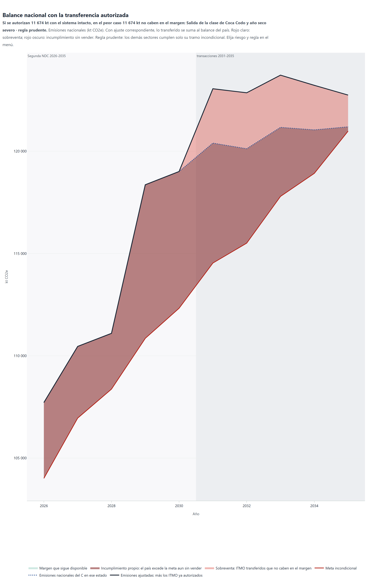
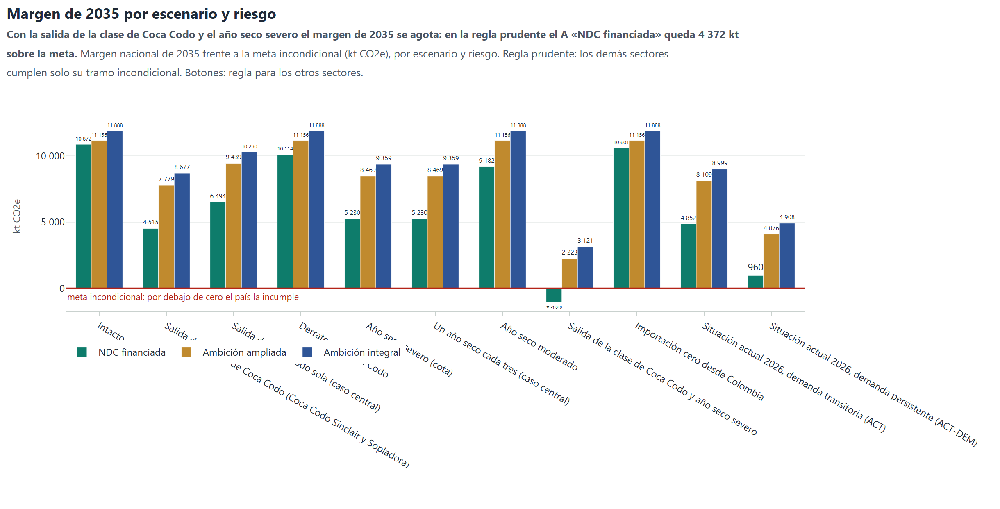
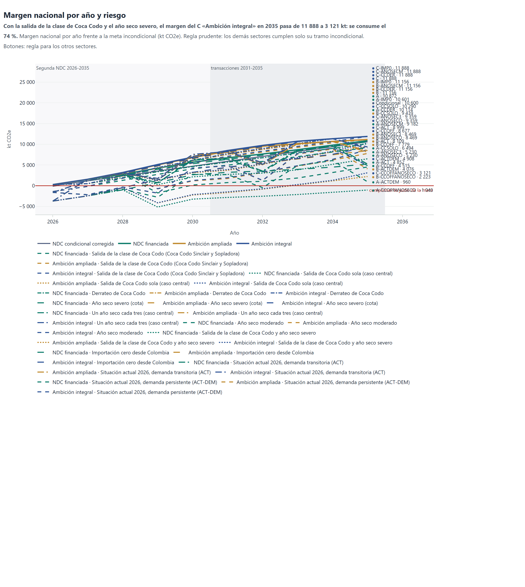
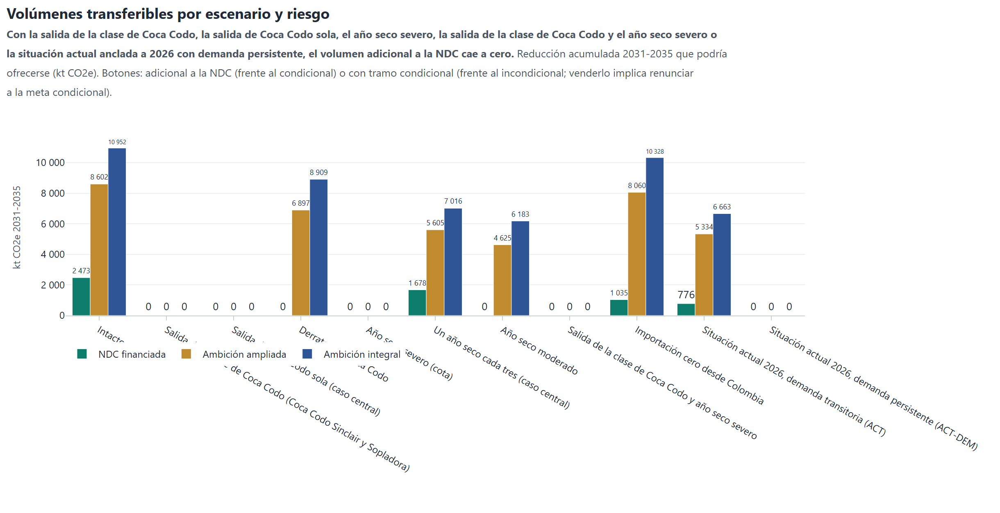

# Pruebas de estrés y sobreventa

Los estados de la corrida se aplican sobre cada escalón de la escalera ([Escenarios](../0_energy/2_scenarios.md)).
Son los siguientes: salida de Coca Codo y Sopladora (clase completa, cota), salida de Coca Codo sola, derrateo de Coca Codo, año seco severo (cota), un año seco cada tres, año seco moderado, salida de Coca Codo y año seco severo, sin importación desde Colombia, situación actual 2026 con choque de demanda transitorio y situación actual 2026 con demanda persistente (ACT-DEM).

La sobreventa se calcula con los dos métodos de ajuste correspondiente (anual y promedio) y los cuatro
subconjuntos de oferta. Cada estado lleva su respaldo de emergencia ([Metodología](../methods.md)).

Balance nacional con la transferencia autorizada

Si se autorizan 11 674 kt con el sistema intacto, en el peor caso 11 674 kt no caben en el margen: Salida de la clase de Coca Codo y año seco severo · regla prudente. Emisiones nacionales (kt CO2e). Con ajuste correspondiente, lo transferido se suma al balance del país. Rojo claro: sobreventa; rojo oscuro: incumplimiento sin vender. Regla prudente: los demás sectores cumplen solo su tramo incondicional. Elija riesgo y regla en el menú.

#### Qué muestra

Emisiones nacionales 2026-2035 (kt CO₂e) frente a la meta incondicional cuando el país autoriza ITMO con el sistema intacto y después ocurre un riesgo.

#### Cómo leerla

Línea roja: meta incondicional. Punteada: emisiones nacionales del C en el estado elegido. Línea negra: esas emisiones más los ITMO ya autorizados, que con ajuste correspondiente se suman al balance del país. Rojo claro: sobreventa, lo transferido que ya no cabe en el margen. Rojo oscuro: exceso sobre la meta aun sin transferir. Verde: margen disponible. El menú elige riesgo y regla.

#### Qué dice el modelo

Con el sistema intacto se autorizan 11 674 kt en 2031-2035 (lo transferible con el sistema intacto en la proyección del Modelo CLG y la regla prudente (los demás sectores cumplen solo su tramo incondicional) (decisión del 2026-10-13), sin las líneas en reserva). Con la salida de la clase de Coca Codo y el año seco severo, en la regla prudente, la sobreventa es de 11 674 kt y el exceso propio, de 16 192 kt; con los otros sectores en su condicional comprometido, la sobreventa es de 8 548 kt.

#### Para la decisión

Autorizar con el sistema intacto expone al país a transferir reducciones que después necesita. Una autorización prudente se limita a resultados verificados ex post, de líneas con adicionalidad firme, y conserva una reserva sin autorizar.

*Tabla. Sobreventa por riesgo, 2031-2035 (kt CO2-eq)*

| estado | sufijo | escenario | regla | autorizado_2031_2035 | sobreventa_2031_2035 | incumplimiento_sin_transferir_2031_2035 | proyeccion |
|---|---|---|---|---|---|---|---|
| Intacto |  | C | condicional | 11674.4 | 0.0 | 0.0 | CLG |
| Intacto |  | C | prudente | 11674.4 | 0.0 | 0.0 | CLG |
| Salida de Coca Codo y Sopladora | -CCOFF | C-CCOFF | condicional | 11674.4 | 735.6 | 0.0 | CLG |
| Salida de Coca Codo y Sopladora | -CCOFF | C-CCOFF | prudente | 11674.4 | 6785.2 | 3053.1 | CLG |
| Salida de Coca Codo sola | -CCSOLO | C-CCSOLO | condicional | 11674.4 | 0.0 | 0.0 | CLG |
| Salida de Coca Codo sola | -CCSOLO | C-CCSOLO | prudente | 11674.4 | 4006.2 | 482.4 | CLG |
| Derrateo de Coca Codo | -CCDER | C-CCDER | condicional | 11674.4 | 0.0 | 0.0 | CLG |
| Derrateo de Coca Codo | -CCDER | C-CCDER | prudente | 11674.4 | 0.0 | 0.0 | CLG |
| Año seco severo | -ANOSECO | C-ANOSECO | condicional | 11674.4 | 0.0 | 0.0 | CLG |
| Año seco severo | -ANOSECO | C-ANOSECO | prudente | 11674.4 | 3651.1 | 0.0 | CLG |
| Un año seco cada tres | -ANOSEC3 | C-ANOSEC3 | condicional | 11674.4 | 0.0 | 0.0 | CLG |
| Un año seco cada tres | -ANOSEC3 | C-ANOSEC3 | prudente | 11674.4 | 1080.0 | 0.0 | CLG |
| Año seco moderado | -ANOSECM | C-ANOSECM | condicional | 11674.4 | 0.0 | 0.0 | CLG |
| Año seco moderado | -ANOSECM | C-ANOSECM | prudente | 11674.4 | 0.0 | 0.0 | CLG |
| Salida de Coca Codo y año seco severo | -CCOFFANOSECO | C-CCOFFANOSECO | condicional | 11674.4 | 8548.0 | 2218.5 | CLG |
| Salida de Coca Codo y año seco severo | -CCOFFANOSECO | C-CCOFFANOSECO | prudente | 11674.4 | 11674.4 | 16191.6 | CLG |
| Sin importación desde Colombia | -IMP0 | C-IMP0 | condicional | 11674.4 | 0.0 | 0.0 | CLG |
| Sin importación desde Colombia | -IMP0 | C-IMP0 | prudente | 11674.4 | 0.0 | 0.0 | CLG |
| Situación actual 2026 con choque de demanda transitorio | -ACT | C-ACT | condicional | 11674.4 | 0.0 | 0.0 | CLG |
| Situación actual 2026 con choque de demanda transitorio | -ACT | C-ACT | prudente | 11674.4 | 1457.8 | 0.0 | CLG |
| Situación actual 2026 con demanda persistente | -ACTDEM | C-ACTDEM | condicional | 11674.4 | 1441.9 | 0.0 | CLG |
| Situación actual 2026 con demanda persistente | -ACTDEM | C-ACTDEM | prudente | 11674.4 | 4950.3 | 2585.6 | CLG |
| Intacto |  | C | condicional | 11674.4 | 0.0 | 0.0 | corregida |
| Intacto |  | C | prudente | 11674.4 | 0.0 | 0.0 | corregida |
| Salida de Coca Codo y Sopladora | -CCOFF | C-CCOFF | condicional | 11674.4 | 0.0 | 0.0 | corregida |
| Salida de Coca Codo y Sopladora | -CCOFF | C-CCOFF | prudente | 11674.4 | 4054.8 | 571.2 | corregida |
| Salida de Coca Codo sola | -CCSOLO | C-CCSOLO | condicional | 11674.4 | 0.0 | 0.0 | corregida |
| Salida de Coca Codo sola | -CCSOLO | C-CCSOLO | prudente | 11674.4 | 1250.8 | 0.0 | corregida |
| Derrateo de Coca Codo | -CCDER | C-CCDER | condicional | 11674.4 | 0.0 | 0.0 | corregida |
| Derrateo de Coca Codo | -CCDER | C-CCDER | prudente | 11674.4 | 0.0 | 0.0 | corregida |
| Año seco severo | -ANOSECO | C-ANOSECO | condicional | 11674.4 | 0.0 | 0.0 | corregida |
| Año seco severo | -ANOSECO | C-ANOSECO | prudente | 11674.4 | 681.8 | 0.0 | corregida |
| Un año seco cada tres | -ANOSEC3 | C-ANOSEC3 | condicional | 11674.4 | 0.0 | 0.0 | corregida |
| Un año seco cada tres | -ANOSEC3 | C-ANOSEC3 | prudente | 11674.4 | 0.0 | 0.0 | corregida |
| Año seco moderado | -ANOSECM | C-ANOSECM | condicional | 11674.4 | 0.0 | 0.0 | corregida |
| Año seco moderado | -ANOSECM | C-ANOSECM | prudente | 11674.4 | 0.0 | 0.0 | corregida |
| Salida de Coca Codo y año seco severo | -CCOFFANOSECO | C-CCOFFANOSECO | condicional | 11674.4 | 4841.1 | 0.0 | corregida |
| Salida de Coca Codo y año seco severo | -CCOFFANOSECO | C-CCOFFANOSECO | prudente | 11674.4 | 10122.9 | 8196.9 | corregida |
| Sin importación desde Colombia | -IMP0 | C-IMP0 | condicional | 11674.4 | 0.0 | 0.0 | corregida |
| Sin importación desde Colombia | -IMP0 | C-IMP0 | prudente | 11674.4 | 0.0 | 0.0 | corregida |
| Situación actual 2026 con choque de demanda transitorio | -ACT | C-ACT | condicional | 11674.4 | 0.0 | 0.0 | corregida |
| Situación actual 2026 con choque de demanda transitorio | -ACT | C-ACT | prudente | 11674.4 | 0.0 | 0.0 | corregida |
| Situación actual 2026 con demanda persistente | -ACTDEM | C-ACTDEM | condicional | 11674.4 | 0.0 | 0.0 | corregida |
| Situación actual 2026 con demanda persistente | -ACTDEM | C-ACTDEM | prudente | 11674.4 | 3060.9 | 656.1 | corregida |

*Tabla. Sobreventa por año y riesgo (kt CO2-eq)*

| proyeccion | regla | estado | sufijo | escenario | anio | margen_kt | autorizado_kt | margen_tras_transferir_kt | sobreventa_kt | incumplimiento_sin_transferir_kt |
|---|---|---|---|---|---|---|---|---|---|---|
| CLG | condicional | Intacto |  | C | 2026 | 274.4 | 0.0 | 274.4 | 0.0 | 0.0 |
| CLG | condicional | Intacto |  | C | 2027 | 1555.9 | 0.0 | 1555.9 | 0.0 | 0.0 |
| CLG | condicional | Intacto |  | C | 2028 | 3191.5 | 0.0 | 3191.5 | 0.0 | 0.0 |
| CLG | condicional | Intacto |  | C | 2029 | 5116.3 | 0.0 | 5116.3 | 0.0 | 0.0 |
| CLG | condicional | Intacto |  | C | 2030 | 6884.3 | 0.0 | 6884.3 | 0.0 | 0.0 |
| CLG | condicional | Intacto |  | C | 2031 | 8491.9 | 2657.7 | 5834.2 | 0.0 | 0.0 |
| CLG | condicional | Intacto |  | C | 2032 | 9730.1 | 2734.0 | 6996.1 | 0.0 | 0.0 |
| CLG | condicional | Intacto |  | C | 2033 | 10726.9 | 2553.1 | 8173.8 | 0.0 | 0.0 |
| CLG | condicional | Intacto |  | C | 2034 | 11337.3 | 2178.1 | 9159.2 | 0.0 | 0.0 |
| CLG | condicional | Intacto |  | C | 2035 | 11888.5 | 1551.6 | 10336.9 | 0.0 | 0.0 |
| CLG | prudente | Intacto |  | C | 2026 | 274.9 | 0.0 | 274.9 | 0.0 | 0.0 |
| CLG | prudente | Intacto |  | C | 2027 | 491.0 | 0.0 | 491.0 | 0.0 | 0.0 |
| CLG | prudente | Intacto |  | C | 2028 | 940.7 | 0.0 | 940.7 | 0.0 | 0.0 |
| CLG | prudente | Intacto |  | C | 2029 | 1728.9 | 0.0 | 1728.9 | 0.0 | 0.0 |
| CLG | prudente | Intacto |  | C | 2030 | 2338.5 | 0.0 | 2338.5 | 0.0 | 0.0 |
| CLG | prudente | Intacto |  | C | 2031 | 4109.3 | 2657.7 | 1451.6 | 0.0 | 0.0 |
| CLG | prudente | Intacto |  | C | 2032 | 5852.4 | 2734.0 | 3118.4 | 0.0 | 0.0 |
| CLG | prudente | Intacto |  | C | 2033 | 7081.8 | 2553.1 | 4528.7 | 0.0 | 0.0 |
| CLG | prudente | Intacto |  | C | 2034 | 7905.4 | 2178.1 | 5727.3 | 0.0 | 0.0 |
| CLG | prudente | Intacto |  | C | 2035 | 8556.8 | 1551.6 | 7005.2 | 0.0 | 0.0 |
| CLG | condicional | Salida de Coca Codo y Sopladora | CCOFF | C-CCOFF | 2026 | 274.4 | 0.0 | 274.4 | 0.0 | 0.0 |
| CLG | condicional | Salida de Coca Codo y Sopladora | CCOFF | C-CCOFF | 2027 | 1555.9 | 0.0 | 1555.9 | 0.0 | 0.0 |
| CLG | condicional | Salida de Coca Codo y Sopladora | CCOFF | C-CCOFF | 2028 | 3191.5 | 0.0 | 3191.5 | 0.0 | 0.0 |
| CLG | condicional | Salida de Coca Codo y Sopladora | CCOFF | C-CCOFF | 2029 | -717.7 | 0.0 | -717.7 | 0.0 | 717.7 |
| CLG | condicional | Salida de Coca Codo y Sopladora | CCOFF | C-CCOFF | 2030 | 1263.9 | 0.0 | 1263.9 | 0.0 | 0.0 |
| CLG | condicional | Salida de Coca Codo y Sopladora | CCOFF | C-CCOFF | 2031 | 1922.1 | 2657.7 | -735.6 | 735.6 | 0.0 |
| CLG | condicional | Salida de Coca Codo y Sopladora | CCOFF | C-CCOFF | 2032 | 3285.1 | 2734.0 | 551.1 | 0.0 | 0.0 |
| CLG | condicional | Salida de Coca Codo y Sopladora | CCOFF | C-CCOFF | 2033 | 4804.7 | 2553.1 | 2251.6 | 0.0 | 0.0 |
| CLG | condicional | Salida de Coca Codo y Sopladora | CCOFF | C-CCOFF | 2034 | 6349.1 | 2178.1 | 4171.0 | 0.0 | 0.0 |
| CLG | condicional | Salida de Coca Codo y Sopladora | CCOFF | C-CCOFF | 2035 | 8676.6 | 1551.6 | 7125.0 | 0.0 | 0.0 |
| CLG | prudente | Salida de Coca Codo y Sopladora | CCOFF | C-CCOFF | 2026 | 274.9 | 0.0 | 274.9 | 0.0 | 0.0 |
| CLG | prudente | Salida de Coca Codo y Sopladora | CCOFF | C-CCOFF | 2027 | 491.0 | 0.0 | 491.0 | 0.0 | 0.0 |
| CLG | prudente | Salida de Coca Codo y Sopladora | CCOFF | C-CCOFF | 2028 | 940.7 | 0.0 | 940.7 | 0.0 | 0.0 |
| CLG | prudente | Salida de Coca Codo y Sopladora | CCOFF | C-CCOFF | 2029 | -4105.1 | 0.0 | -4105.1 | 0.0 | 4105.1 |
| CLG | prudente | Salida de Coca Codo y Sopladora | CCOFF | C-CCOFF | 2030 | -3281.8 | 0.0 | -3281.8 | 0.0 | 3281.8 |
| CLG | prudente | Salida de Coca Codo y Sopladora | CCOFF | C-CCOFF | 2031 | -2460.5 | 2657.7 | -5118.2 | 2657.7 | 2460.5 |
| CLG | prudente | Salida de Coca Codo y Sopladora | CCOFF | C-CCOFF | 2032 | -592.6 | 2734.0 | -3326.6 | 2734.0 | 592.6 |
| CLG | prudente | Salida de Coca Codo y Sopladora | CCOFF | C-CCOFF | 2033 | 1159.6 | 2553.1 | -1393.5 | 1393.5 | 0.0 |
| CLG | prudente | Salida de Coca Codo y Sopladora | CCOFF | C-CCOFF | 2034 | 2917.2 | 2178.1 | 739.1 | 0.0 | 0.0 |
| CLG | prudente | Salida de Coca Codo y Sopladora | CCOFF | C-CCOFF | 2035 | 5344.9 | 1551.6 | 3793.3 | 0.0 | 0.0 |
| CLG | condicional | Salida de Coca Codo sola | CCSOLO | C-CCSOLO | 2026 | 274.4 | 0.0 | 274.4 | 0.0 | 0.0 |
| CLG | condicional | Salida de Coca Codo sola | CCSOLO | C-CCSOLO | 2027 | 1555.9 | 0.0 | 1555.9 | 0.0 | 0.0 |
| CLG | condicional | Salida de Coca Codo sola | CCSOLO | C-CCSOLO | 2028 | 3191.5 | 0.0 | 3191.5 | 0.0 | 0.0 |
| CLG | condicional | Salida de Coca Codo sola | CCSOLO | C-CCSOLO | 2029 | 1260.4 | 0.0 | 1260.4 | 0.0 | 0.0 |
| CLG | condicional | Salida de Coca Codo sola | CCSOLO | C-CCSOLO | 2030 | 3242.0 | 0.0 | 3242.0 | 0.0 | 0.0 |
| CLG | condicional | Salida de Coca Codo sola | CCSOLO | C-CCSOLO | 2031 | 3900.2 | 2657.7 | 1242.5 | 0.0 | 0.0 |
| CLG | condicional | Salida de Coca Codo sola | CCSOLO | C-CCSOLO | 2032 | 5263.2 | 2734.0 | 2529.2 | 0.0 | 0.0 |
| CLG | condicional | Salida de Coca Codo sola | CCSOLO | C-CCSOLO | 2033 | 6782.9 | 2553.1 | 4229.8 | 0.0 | 0.0 |
| CLG | condicional | Salida de Coca Codo sola | CCSOLO | C-CCSOLO | 2034 | 8319.1 | 2178.1 | 6141.0 | 0.0 | 0.0 |
| CLG | condicional | Salida de Coca Codo sola | CCSOLO | C-CCSOLO | 2035 | 10290.2 | 1551.6 | 8738.6 | 0.0 | 0.0 |
| CLG | prudente | Salida de Coca Codo sola | CCSOLO | C-CCSOLO | 2026 | 274.9 | 0.0 | 274.9 | 0.0 | 0.0 |
| CLG | prudente | Salida de Coca Codo sola | CCSOLO | C-CCSOLO | 2027 | 491.0 | 0.0 | 491.0 | 0.0 | 0.0 |
| CLG | prudente | Salida de Coca Codo sola | CCSOLO | C-CCSOLO | 2028 | 940.7 | 0.0 | 940.7 | 0.0 | 0.0 |
| CLG | prudente | Salida de Coca Codo sola | CCSOLO | C-CCSOLO | 2029 | -2127.0 | 0.0 | -2127.0 | 0.0 | 2127.0 |
| CLG | prudente | Salida de Coca Codo sola | CCSOLO | C-CCSOLO | 2030 | -1303.7 | 0.0 | -1303.7 | 0.0 | 1303.7 |
| CLG | prudente | Salida de Coca Codo sola | CCSOLO | C-CCSOLO | 2031 | -482.4 | 2657.7 | -3140.1 | 2657.7 | 482.4 |
| CLG | prudente | Salida de Coca Codo sola | CCSOLO | C-CCSOLO | 2032 | 1385.5 | 2734.0 | -1348.5 | 1348.5 | 0.0 |
| CLG | prudente | Salida de Coca Codo sola | CCSOLO | C-CCSOLO | 2033 | 3137.8 | 2553.1 | 584.7 | 0.0 | 0.0 |
| CLG | prudente | Salida de Coca Codo sola | CCSOLO | C-CCSOLO | 2034 | 4887.2 | 2178.1 | 2709.1 | 0.0 | 0.0 |
| CLG | prudente | Salida de Coca Codo sola | CCSOLO | C-CCSOLO | 2035 | 6958.4 | 1551.6 | 5406.8 | 0.0 | 0.0 |
| CLG | condicional | Derrateo de Coca Codo | CCDER | C-CCDER | 2026 | 274.4 | 0.0 | 274.4 | 0.0 | 0.0 |
| CLG | condicional | Derrateo de Coca Codo | CCDER | C-CCDER | 2027 | 500.2 | 0.0 | 500.2 | 0.0 | 0.0 |
| CLG | condicional | Derrateo de Coca Codo | CCDER | C-CCDER | 2028 | 2433.8 | 0.0 | 2433.8 | 0.0 | 0.0 |
| CLG | condicional | Derrateo de Coca Codo | CCDER | C-CCDER | 2029 | 4362.5 | 0.0 | 4362.5 | 0.0 | 0.0 |
| CLG | condicional | Derrateo de Coca Codo | CCDER | C-CCDER | 2030 | 6130.5 | 0.0 | 6130.5 | 0.0 | 0.0 |
| CLG | condicional | Derrateo de Coca Codo | CCDER | C-CCDER | 2031 | 7734.2 | 2657.7 | 5076.5 | 0.0 | 0.0 |
| CLG | condicional | Derrateo de Coca Codo | CCDER | C-CCDER | 2032 | 8972.3 | 2734.0 | 6238.3 | 0.0 | 0.0 |
| CLG | condicional | Derrateo de Coca Codo | CCDER | C-CCDER | 2033 | 10199.2 | 2553.1 | 7646.1 | 0.0 | 0.0 |
| CLG | condicional | Derrateo de Coca Codo | CCDER | C-CCDER | 2034 | 11337.3 | 2178.1 | 9159.2 | 0.0 | 0.0 |
| CLG | condicional | Derrateo de Coca Codo | CCDER | C-CCDER | 2035 | 11888.5 | 1551.6 | 10336.9 | 0.0 | 0.0 |
| CLG | prudente | Derrateo de Coca Codo | CCDER | C-CCDER | 2026 | 274.9 | 0.0 | 274.9 | 0.0 | 0.0 |
| CLG | prudente | Derrateo de Coca Codo | CCDER | C-CCDER | 2027 | -564.8 | 0.0 | -564.8 | 0.0 | 564.8 |
| CLG | prudente | Derrateo de Coca Codo | CCDER | C-CCDER | 2028 | 183.0 | 0.0 | 183.0 | 0.0 | 0.0 |
| CLG | prudente | Derrateo de Coca Codo | CCDER | C-CCDER | 2029 | 975.1 | 0.0 | 975.1 | 0.0 | 0.0 |
| CLG | prudente | Derrateo de Coca Codo | CCDER | C-CCDER | 2030 | 1584.8 | 0.0 | 1584.8 | 0.0 | 0.0 |
| CLG | prudente | Derrateo de Coca Codo | CCDER | C-CCDER | 2031 | 3351.6 | 2657.7 | 693.9 | 0.0 | 0.0 |
| CLG | prudente | Derrateo de Coca Codo | CCDER | C-CCDER | 2032 | 5094.7 | 2734.0 | 2360.7 | 0.0 | 0.0 |
| CLG | prudente | Derrateo de Coca Codo | CCDER | C-CCDER | 2033 | 6554.1 | 2553.1 | 4001.0 | 0.0 | 0.0 |
| CLG | prudente | Derrateo de Coca Codo | CCDER | C-CCDER | 2034 | 7905.4 | 2178.1 | 5727.3 | 0.0 | 0.0 |
| CLG | prudente | Derrateo de Coca Codo | CCDER | C-CCDER | 2035 | 8556.8 | 1551.6 | 7005.2 | 0.0 | 0.0 |
| CLG | condicional | Año seco severo | ANOSECO | C-ANOSECO | 2026 | -3705.5 | 0.0 | -3705.5 | 0.0 | 3705.5 |
| CLG | condicional | Año seco severo | ANOSECO | C-ANOSECO | 2027 | -2438.9 | 0.0 | -2438.9 | 0.0 | 2438.9 |
| CLG | condicional | Año seco severo | ANOSECO | C-ANOSECO | 2028 | -476.4 | 0.0 | -476.4 | 0.0 | 476.4 |
| CLG | condicional | Año seco severo | ANOSECO | C-ANOSECO | 2029 | 1465.2 | 0.0 | 1465.2 | 0.0 | 0.0 |
| CLG | condicional | Año seco severo | ANOSECO | C-ANOSECO | 2030 | 3222.8 | 0.0 | 3222.8 | 0.0 | 0.0 |
| CLG | condicional | Año seco severo | ANOSECO | C-ANOSECO | 2031 | 4469.2 | 2657.7 | 1811.5 | 0.0 | 0.0 |
| CLG | condicional | Año seco severo | ANOSECO | C-ANOSECO | 2032 | 5531.6 | 2734.0 | 2797.6 | 0.0 | 0.0 |
| CLG | condicional | Año seco severo | ANOSECO | C-ANOSECO | 2033 | 6540.6 | 2553.1 | 3987.5 | 0.0 | 0.0 |
| CLG | condicional | Año seco severo | ANOSECO | C-ANOSECO | 2034 | 7574.3 | 2178.1 | 5396.2 | 0.0 | 0.0 |
| CLG | condicional | Año seco severo | ANOSECO | C-ANOSECO | 2035 | 9359.0 | 1551.6 | 7807.4 | 0.0 | 0.0 |
| CLG | prudente | Año seco severo | ANOSECO | C-ANOSECO | 2026 | -3704.9 | 0.0 | -3704.9 | 0.0 | 3704.9 |
| CLG | prudente | Año seco severo | ANOSECO | C-ANOSECO | 2027 | -3503.9 | 0.0 | -3503.9 | 0.0 | 3503.9 |
| CLG | prudente | Año seco severo | ANOSECO | C-ANOSECO | 2028 | -2727.1 | 0.0 | -2727.1 | 0.0 | 2727.1 |
| CLG | prudente | Año seco severo | ANOSECO | C-ANOSECO | 2029 | -1922.2 | 0.0 | -1922.2 | 0.0 | 1922.2 |
| CLG | prudente | Año seco severo | ANOSECO | C-ANOSECO | 2030 | -1322.9 | 0.0 | -1322.9 | 0.0 | 1322.9 |
| CLG | prudente | Año seco severo | ANOSECO | C-ANOSECO | 2031 | 86.6 | 2657.7 | -2571.1 | 2571.1 | 0.0 |
| CLG | prudente | Año seco severo | ANOSECO | C-ANOSECO | 2032 | 1654.0 | 2734.0 | -1080.0 | 1080.0 | 0.0 |
| CLG | prudente | Año seco severo | ANOSECO | C-ANOSECO | 2033 | 2895.4 | 2553.1 | 342.3 | 0.0 | 0.0 |
| CLG | prudente | Año seco severo | ANOSECO | C-ANOSECO | 2034 | 4142.4 | 2178.1 | 1964.3 | 0.0 | 0.0 |
| CLG | prudente | Año seco severo | ANOSECO | C-ANOSECO | 2035 | 6027.2 | 1551.6 | 4475.6 | 0.0 | 0.0 |
| CLG | condicional | Un año seco cada tres | ANOSEC3 | C-ANOSEC3 | 2026 | -3705.5 | 0.0 | -3705.5 | 0.0 | 3705.5 |
| CLG | condicional | Un año seco cada tres | ANOSEC3 | C-ANOSEC3 | 2027 | 1576.8 | 0.0 | 1576.8 | 0.0 | 0.0 |
| CLG | condicional | Un año seco cada tres | ANOSEC3 | C-ANOSEC3 | 2028 | 3206.5 | 0.0 | 3206.5 | 0.0 | 0.0 |
| CLG | condicional | Un año seco cada tres | ANOSEC3 | C-ANOSEC3 | 2029 | 1465.2 | 0.0 | 1465.2 | 0.0 | 0.0 |
| CLG | condicional | Un año seco cada tres | ANOSEC3 | C-ANOSEC3 | 2030 | 7080.2 | 0.0 | 7080.2 | 0.0 | 0.0 |
| CLG | condicional | Un año seco cada tres | ANOSEC3 | C-ANOSEC3 | 2031 | 8506.9 | 2657.7 | 5849.2 | 0.0 | 0.0 |
| CLG | condicional | Un año seco cada tres | ANOSEC3 | C-ANOSEC3 | 2032 | 5531.6 | 2734.0 | 2797.6 | 0.0 | 0.0 |
| CLG | condicional | Un año seco cada tres | ANOSEC3 | C-ANOSEC3 | 2033 | 10726.9 | 2553.1 | 8173.8 | 0.0 | 0.0 |
| CLG | condicional | Un año seco cada tres | ANOSEC3 | C-ANOSEC3 | 2034 | 11337.3 | 2178.1 | 9159.2 | 0.0 | 0.0 |
| CLG | condicional | Un año seco cada tres | ANOSEC3 | C-ANOSEC3 | 2035 | 9359.0 | 1551.6 | 7807.4 | 0.0 | 0.0 |
| CLG | prudente | Un año seco cada tres | ANOSEC3 | C-ANOSEC3 | 2026 | -3704.9 | 0.0 | -3704.9 | 0.0 | 3704.9 |
| CLG | prudente | Un año seco cada tres | ANOSEC3 | C-ANOSEC3 | 2027 | 511.8 | 0.0 | 511.8 | 0.0 | 0.0 |
| CLG | prudente | Un año seco cada tres | ANOSEC3 | C-ANOSEC3 | 2028 | 955.7 | 0.0 | 955.7 | 0.0 | 0.0 |
| CLG | prudente | Un año seco cada tres | ANOSEC3 | C-ANOSEC3 | 2029 | -1922.2 | 0.0 | -1922.2 | 0.0 | 1922.2 |
| CLG | prudente | Un año seco cada tres | ANOSEC3 | C-ANOSEC3 | 2030 | 2534.4 | 0.0 | 2534.4 | 0.0 | 0.0 |
| CLG | prudente | Un año seco cada tres | ANOSEC3 | C-ANOSEC3 | 2031 | 4124.3 | 2657.7 | 1466.6 | 0.0 | 0.0 |
| CLG | prudente | Un año seco cada tres | ANOSEC3 | C-ANOSEC3 | 2032 | 1654.0 | 2734.0 | -1080.0 | 1080.0 | 0.0 |
| CLG | prudente | Un año seco cada tres | ANOSEC3 | C-ANOSEC3 | 2033 | 7081.8 | 2553.1 | 4528.7 | 0.0 | 0.0 |
| CLG | prudente | Un año seco cada tres | ANOSEC3 | C-ANOSEC3 | 2034 | 7905.4 | 2178.1 | 5727.3 | 0.0 | 0.0 |
| CLG | prudente | Un año seco cada tres | ANOSEC3 | C-ANOSEC3 | 2035 | 6027.2 | 1551.6 | 4475.6 | 0.0 | 0.0 |
| CLG | condicional | Año seco moderado | ANOSECM | C-ANOSECM | 2026 | -1404.0 | 0.0 | -1404.0 | 0.0 | 1404.0 |
| CLG | condicional | Año seco moderado | ANOSECM | C-ANOSECM | 2027 | -144.4 | 0.0 | -144.4 | 0.0 | 144.4 |
| CLG | condicional | Año seco moderado | ANOSECM | C-ANOSECM | 2028 | 1818.9 | 0.0 | 1818.9 | 0.0 | 0.0 |
| CLG | condicional | Año seco moderado | ANOSECM | C-ANOSECM | 2029 | 3760.3 | 0.0 | 3760.3 | 0.0 | 0.0 |
| CLG | condicional | Año seco moderado | ANOSECM | C-ANOSECM | 2030 | 5517.9 | 0.0 | 5517.9 | 0.0 | 0.0 |
| CLG | condicional | Año seco moderado | ANOSECM | C-ANOSECM | 2031 | 7100.1 | 2657.7 | 4442.4 | 0.0 | 0.0 |
| CLG | condicional | Año seco moderado | ANOSECM | C-ANOSECM | 2032 | 8323.1 | 2734.0 | 5589.1 | 0.0 | 0.0 |
| CLG | condicional | Año seco moderado | ANOSECM | C-ANOSECM | 2033 | 9454.2 | 2553.1 | 6901.1 | 0.0 | 0.0 |
| CLG | condicional | Año seco moderado | ANOSECM | C-ANOSECM | 2034 | 10639.2 | 2178.1 | 8461.1 | 0.0 | 0.0 |
| CLG | condicional | Año seco moderado | ANOSECM | C-ANOSECM | 2035 | 11888.5 | 1551.6 | 10336.9 | 0.0 | 0.0 |
| CLG | prudente | Año seco moderado | ANOSECM | C-ANOSECM | 2026 | -1403.5 | 0.0 | -1403.5 | 0.0 | 1403.5 |
| CLG | prudente | Año seco moderado | ANOSECM | C-ANOSECM | 2027 | -1209.4 | 0.0 | -1209.4 | 0.0 | 1209.4 |
| CLG | prudente | Año seco moderado | ANOSECM | C-ANOSECM | 2028 | -431.9 | 0.0 | -431.9 | 0.0 | 431.9 |
| CLG | prudente | Año seco moderado | ANOSECM | C-ANOSECM | 2029 | 372.9 | 0.0 | 372.9 | 0.0 | 0.0 |
| CLG | prudente | Año seco moderado | ANOSECM | C-ANOSECM | 2030 | 972.1 | 0.0 | 972.1 | 0.0 | 0.0 |
| CLG | prudente | Año seco moderado | ANOSECM | C-ANOSECM | 2031 | 2717.5 | 2657.7 | 59.8 | 0.0 | 0.0 |
| CLG | prudente | Año seco moderado | ANOSECM | C-ANOSECM | 2032 | 4445.4 | 2734.0 | 1711.4 | 0.0 | 0.0 |
| CLG | prudente | Año seco moderado | ANOSECM | C-ANOSECM | 2033 | 5809.1 | 2553.1 | 3256.0 | 0.0 | 0.0 |
| CLG | prudente | Año seco moderado | ANOSECM | C-ANOSECM | 2034 | 7207.3 | 2178.1 | 5029.2 | 0.0 | 0.0 |
| CLG | prudente | Año seco moderado | ANOSECM | C-ANOSECM | 2035 | 8556.8 | 1551.6 | 7005.2 | 0.0 | 0.0 |
| CLG | condicional | Salida de Coca Codo y año seco severo | CCOFFANOSECO | C-CCOFFANOSECO | 2026 | -3705.5 | 0.0 | -3705.5 | 0.0 | 3705.5 |
| CLG | condicional | Salida de Coca Codo y año seco severo | CCOFFANOSECO | C-CCOFFANOSECO | 2027 | -2438.9 | 0.0 | -2438.9 | 0.0 | 2438.9 |
| CLG | condicional | Salida de Coca Codo y año seco severo | CCOFFANOSECO | C-CCOFFANOSECO | 2028 | -476.4 | 0.0 | -476.4 | 0.0 | 476.4 |
| CLG | condicional | Salida de Coca Codo y año seco severo | CCOFFANOSECO | C-CCOFFANOSECO | 2029 | -4120.0 | 0.0 | -4120.0 | 0.0 | 4120.0 |
| CLG | condicional | Salida de Coca Codo y año seco severo | CCOFFANOSECO | C-CCOFFANOSECO | 2030 | -2138.4 | 0.0 | -2138.4 | 0.0 | 2138.4 |
| CLG | condicional | Salida de Coca Codo y año seco severo | CCOFFANOSECO | C-CCOFFANOSECO | 2031 | -1480.2 | 2657.7 | -4137.9 | 2657.7 | 1480.2 |
| CLG | condicional | Salida de Coca Codo y año seco severo | CCOFFANOSECO | C-CCOFFANOSECO | 2032 | -738.3 | 2734.0 | -3472.3 | 2734.0 | 738.3 |
| CLG | condicional | Salida de Coca Codo y año seco severo | CCOFFANOSECO | C-CCOFFANOSECO | 2033 | 270.6 | 2553.1 | -2282.5 | 2282.5 | 0.0 |
| CLG | condicional | Salida de Coca Codo y año seco severo | CCOFFANOSECO | C-CCOFFANOSECO | 2034 | 1304.3 | 2178.1 | -873.8 | 873.8 | 0.0 |
| CLG | condicional | Salida de Coca Codo y año seco severo | CCOFFANOSECO | C-CCOFFANOSECO | 2035 | 3121.1 | 1551.6 | 1569.5 | 0.0 | 0.0 |
| CLG | prudente | Salida de Coca Codo y año seco severo | CCOFFANOSECO | C-CCOFFANOSECO | 2026 | -3704.9 | 0.0 | -3704.9 | 0.0 | 3704.9 |
| CLG | prudente | Salida de Coca Codo y año seco severo | CCOFFANOSECO | C-CCOFFANOSECO | 2027 | -3503.9 | 0.0 | -3503.9 | 0.0 | 3503.9 |
| CLG | prudente | Salida de Coca Codo y año seco severo | CCOFFANOSECO | C-CCOFFANOSECO | 2028 | -2727.1 | 0.0 | -2727.1 | 0.0 | 2727.1 |
| CLG | prudente | Salida de Coca Codo y año seco severo | CCOFFANOSECO | C-CCOFFANOSECO | 2029 | -7507.4 | 0.0 | -7507.4 | 0.0 | 7507.4 |
| CLG | prudente | Salida de Coca Codo y año seco severo | CCOFFANOSECO | C-CCOFFANOSECO | 2030 | -6684.1 | 0.0 | -6684.1 | 0.0 | 6684.1 |
| CLG | prudente | Salida de Coca Codo y año seco severo | CCOFFANOSECO | C-CCOFFANOSECO | 2031 | -5862.8 | 2657.7 | -8520.5 | 2657.7 | 5862.8 |
| CLG | prudente | Salida de Coca Codo y año seco severo | CCOFFANOSECO | C-CCOFFANOSECO | 2032 | -4616.0 | 2734.0 | -7350.0 | 2734.0 | 4616.0 |
| CLG | prudente | Salida de Coca Codo y año seco severo | CCOFFANOSECO | C-CCOFFANOSECO | 2033 | -3374.5 | 2553.1 | -5927.6 | 2553.1 | 3374.5 |
| CLG | prudente | Salida de Coca Codo y año seco severo | CCOFFANOSECO | C-CCOFFANOSECO | 2034 | -2127.6 | 2178.1 | -4305.7 | 2178.1 | 2127.6 |
| CLG | prudente | Salida de Coca Codo y año seco severo | CCOFFANOSECO | C-CCOFFANOSECO | 2035 | -210.7 | 1551.6 | -1762.3 | 1551.6 | 210.7 |
| CLG | condicional | Sin importación desde Colombia | IMP0 | C-IMP0 | 2026 | -103.4 | 0.0 | -103.4 | 0.0 | 103.4 |
| CLG | condicional | Sin importación desde Colombia | IMP0 | C-IMP0 | 2027 | 1178.2 | 0.0 | 1178.2 | 0.0 | 0.0 |
| CLG | condicional | Sin importación desde Colombia | IMP0 | C-IMP0 | 2028 | 2920.4 | 0.0 | 2920.4 | 0.0 | 0.0 |
| CLG | condicional | Sin importación desde Colombia | IMP0 | C-IMP0 | 2029 | 4846.6 | 0.0 | 4846.6 | 0.0 | 0.0 |
| CLG | condicional | Sin importación desde Colombia | IMP0 | C-IMP0 | 2030 | 6614.6 | 0.0 | 6614.6 | 0.0 | 0.0 |
| CLG | condicional | Sin importación desde Colombia | IMP0 | C-IMP0 | 2031 | 8220.8 | 2657.7 | 5563.1 | 0.0 | 0.0 |
| CLG | condicional | Sin importación desde Colombia | IMP0 | C-IMP0 | 2032 | 9458.9 | 2734.0 | 6724.9 | 0.0 | 0.0 |
| CLG | condicional | Sin importación desde Colombia | IMP0 | C-IMP0 | 2033 | 10644.9 | 2553.1 | 8091.8 | 0.0 | 0.0 |
| CLG | condicional | Sin importación desde Colombia | IMP0 | C-IMP0 | 2034 | 11337.3 | 2178.1 | 9159.2 | 0.0 | 0.0 |
| CLG | condicional | Sin importación desde Colombia | IMP0 | C-IMP0 | 2035 | 11888.5 | 1551.6 | 10336.9 | 0.0 | 0.0 |
| CLG | prudente | Sin importación desde Colombia | IMP0 | C-IMP0 | 2026 | -102.8 | 0.0 | -102.8 | 0.0 | 102.8 |
| CLG | prudente | Sin importación desde Colombia | IMP0 | C-IMP0 | 2027 | 113.2 | 0.0 | 113.2 | 0.0 | 0.0 |
| CLG | prudente | Sin importación desde Colombia | IMP0 | C-IMP0 | 2028 | 669.6 | 0.0 | 669.6 | 0.0 | 0.0 |
| CLG | prudente | Sin importación desde Colombia | IMP0 | C-IMP0 | 2029 | 1459.2 | 0.0 | 1459.2 | 0.0 | 0.0 |
| CLG | prudente | Sin importación desde Colombia | IMP0 | C-IMP0 | 2030 | 2068.8 | 0.0 | 2068.8 | 0.0 | 0.0 |
| CLG | prudente | Sin importación desde Colombia | IMP0 | C-IMP0 | 2031 | 3838.2 | 2657.7 | 1180.5 | 0.0 | 0.0 |
| CLG | prudente | Sin importación desde Colombia | IMP0 | C-IMP0 | 2032 | 5581.3 | 2734.0 | 2847.3 | 0.0 | 0.0 |
| CLG | prudente | Sin importación desde Colombia | IMP0 | C-IMP0 | 2033 | 6999.7 | 2553.1 | 4446.6 | 0.0 | 0.0 |
| CLG | prudente | Sin importación desde Colombia | IMP0 | C-IMP0 | 2034 | 7905.4 | 2178.1 | 5727.3 | 0.0 | 0.0 |
| CLG | prudente | Sin importación desde Colombia | IMP0 | C-IMP0 | 2035 | 8556.8 | 1551.6 | 7005.2 | 0.0 | 0.0 |
| CLG | condicional | Situación actual 2026 con choque de demanda transitorio | ACT | C-ACT | 2026 | -1615.0 | 0.0 | -1615.0 | 0.0 | 1615.0 |
| CLG | condicional | Situación actual 2026 con choque de demanda transitorio | ACT | C-ACT | 2027 | 1178.2 | 0.0 | 1178.2 | 0.0 | 0.0 |
| CLG | condicional | Situación actual 2026 con choque de demanda transitorio | ACT | C-ACT | 2028 | 2920.4 | 0.0 | 2920.4 | 0.0 | 0.0 |
| CLG | condicional | Situación actual 2026 con choque de demanda transitorio | ACT | C-ACT | 2029 | 1772.3 | 0.0 | 1772.3 | 0.0 | 0.0 |
| CLG | condicional | Situación actual 2026 con choque de demanda transitorio | ACT | C-ACT | 2030 | 7567.7 | 0.0 | 7567.7 | 0.0 | 0.0 |
| CLG | condicional | Situación actual 2026 con choque de demanda transitorio | ACT | C-ACT | 2031 | 8235.8 | 2657.7 | 5578.1 | 0.0 | 0.0 |
| CLG | condicional | Situación actual 2026 con choque de demanda transitorio | ACT | C-ACT | 2032 | 5153.9 | 2734.0 | 2419.9 | 0.0 | 0.0 |
| CLG | condicional | Situación actual 2026 con choque de demanda transitorio | ACT | C-ACT | 2033 | 10645.6 | 2553.1 | 8092.5 | 0.0 | 0.0 |
| CLG | condicional | Situación actual 2026 con choque de demanda transitorio | ACT | C-ACT | 2034 | 11337.3 | 2178.1 | 9159.2 | 0.0 | 0.0 |
| CLG | condicional | Situación actual 2026 con choque de demanda transitorio | ACT | C-ACT | 2035 | 8998.8 | 1551.6 | 7447.2 | 0.0 | 0.0 |
| CLG | prudente | Situación actual 2026 con choque de demanda transitorio | ACT | C-ACT | 2026 | -1614.4 | 0.0 | -1614.4 | 0.0 | 1614.4 |
| CLG | prudente | Situación actual 2026 con choque de demanda transitorio | ACT | C-ACT | 2027 | 113.3 | 0.0 | 113.3 | 0.0 | 0.0 |
| CLG | prudente | Situación actual 2026 con choque de demanda transitorio | ACT | C-ACT | 2028 | 669.6 | 0.0 | 669.6 | 0.0 | 0.0 |
| CLG | prudente | Situación actual 2026 con choque de demanda transitorio | ACT | C-ACT | 2029 | -1615.1 | 0.0 | -1615.1 | 0.0 | 1615.1 |
| CLG | prudente | Situación actual 2026 con choque de demanda transitorio | ACT | C-ACT | 2030 | 3021.9 | 0.0 | 3021.9 | 0.0 | 0.0 |
| CLG | prudente | Situación actual 2026 con choque de demanda transitorio | ACT | C-ACT | 2031 | 3853.2 | 2657.7 | 1195.5 | 0.0 | 0.0 |
| CLG | prudente | Situación actual 2026 con choque de demanda transitorio | ACT | C-ACT | 2032 | 1276.2 | 2734.0 | -1457.8 | 1457.8 | 0.0 |
| CLG | prudente | Situación actual 2026 con choque de demanda transitorio | ACT | C-ACT | 2033 | 7000.4 | 2553.1 | 4447.3 | 0.0 | 0.0 |
| CLG | prudente | Situación actual 2026 con choque de demanda transitorio | ACT | C-ACT | 2034 | 7905.4 | 2178.1 | 5727.3 | 0.0 | 0.0 |
| CLG | prudente | Situación actual 2026 con choque de demanda transitorio | ACT | C-ACT | 2035 | 5667.0 | 1551.6 | 4115.4 | 0.0 | 0.0 |
| CLG | condicional | Situación actual 2026 con demanda persistente | ACTDEM | C-ACTDEM | 2026 | -1615.0 | 0.0 | -1615.0 | 0.0 | 1615.0 |
| CLG | condicional | Situación actual 2026 con demanda persistente | ACTDEM | C-ACTDEM | 2027 | -2174.6 | 0.0 | -2174.6 | 0.0 | 2174.6 |
| CLG | condicional | Situación actual 2026 con demanda persistente | ACTDEM | C-ACTDEM | 2028 | -320.3 | 0.0 | -320.3 | 0.0 | 320.3 |
| CLG | condicional | Situación actual 2026 con demanda persistente | ACTDEM | C-ACTDEM | 2029 | -1783.5 | 0.0 | -1783.5 | 0.0 | 1783.5 |
| CLG | condicional | Situación actual 2026 con demanda persistente | ACTDEM | C-ACTDEM | 2030 | 4260.6 | 0.0 | 4260.6 | 0.0 | 0.0 |
| CLG | condicional | Situación actual 2026 con demanda persistente | ACTDEM | C-ACTDEM | 2031 | 4824.0 | 2657.7 | 2166.3 | 0.0 | 0.0 |
| CLG | condicional | Situación actual 2026 con demanda persistente | ACTDEM | C-ACTDEM | 2032 | 1292.1 | 2734.0 | -1441.9 | 1441.9 | 0.0 |
| CLG | condicional | Situación actual 2026 con demanda persistente | ACTDEM | C-ACTDEM | 2033 | 7732.7 | 2553.1 | 5179.6 | 0.0 | 0.0 |
| CLG | condicional | Situación actual 2026 con demanda persistente | ACTDEM | C-ACTDEM | 2034 | 9086.7 | 2178.1 | 6908.6 | 0.0 | 0.0 |
| CLG | condicional | Situación actual 2026 con demanda persistente | ACTDEM | C-ACTDEM | 2035 | 4907.5 | 1551.6 | 3355.9 | 0.0 | 0.0 |
| CLG | prudente | Situación actual 2026 con demanda persistente | ACTDEM | C-ACTDEM | 2026 | -1614.4 | 0.0 | -1614.4 | 0.0 | 1614.4 |
| CLG | prudente | Situación actual 2026 con demanda persistente | ACTDEM | C-ACTDEM | 2027 | -3239.6 | 0.0 | -3239.6 | 0.0 | 3239.6 |
| CLG | prudente | Situación actual 2026 con demanda persistente | ACTDEM | C-ACTDEM | 2028 | -2571.0 | 0.0 | -2571.0 | 0.0 | 2571.0 |
| CLG | prudente | Situación actual 2026 con demanda persistente | ACTDEM | C-ACTDEM | 2029 | -5170.9 | 0.0 | -5170.9 | 0.0 | 5170.9 |
| CLG | prudente | Situación actual 2026 con demanda persistente | ACTDEM | C-ACTDEM | 2030 | -285.2 | 0.0 | -285.2 | 0.0 | 285.2 |
| CLG | prudente | Situación actual 2026 con demanda persistente | ACTDEM | C-ACTDEM | 2031 | 441.4 | 2657.7 | -2216.3 | 2216.3 | 0.0 |
| CLG | prudente | Situación actual 2026 con demanda persistente | ACTDEM | C-ACTDEM | 2032 | -2585.6 | 2734.0 | -5319.6 | 2734.0 | 2585.6 |
| CLG | prudente | Situación actual 2026 con demanda persistente | ACTDEM | C-ACTDEM | 2033 | 4087.6 | 2553.1 | 1534.5 | 0.0 | 0.0 |
| CLG | prudente | Situación actual 2026 con demanda persistente | ACTDEM | C-ACTDEM | 2034 | 5654.8 | 2178.1 | 3476.7 | 0.0 | 0.0 |
| CLG | prudente | Situación actual 2026 con demanda persistente | ACTDEM | C-ACTDEM | 2035 | 1575.7 | 1551.6 | 24.1 | 0.0 | 0.0 |
| corregida | condicional | Intacto |  | C | 2026 | 2664.7 | 0.0 | 2664.7 | 0.0 | 0.0 |
| corregida | condicional | Intacto |  | C | 2027 | 3485.5 | 0.0 | 3485.5 | 0.0 | 0.0 |
| corregida | condicional | Intacto |  | C | 2028 | 5108.7 | 0.0 | 5108.7 | 0.0 | 0.0 |
| corregida | condicional | Intacto |  | C | 2029 | 6930.5 | 0.0 | 6930.5 | 0.0 | 0.0 |
| corregida | condicional | Intacto |  | C | 2030 | 8736.7 | 0.0 | 8736.7 | 0.0 | 0.0 |
| corregida | condicional | Intacto |  | C | 2031 | 10313.6 | 2657.7 | 7655.9 | 0.0 | 0.0 |
| corregida | condicional | Intacto |  | C | 2032 | 11480.2 | 2734.0 | 8746.2 | 0.0 | 0.0 |
| corregida | condicional | Intacto |  | C | 2033 | 12206.8 | 2553.1 | 9653.7 | 0.0 | 0.0 |
| corregida | condicional | Intacto |  | C | 2034 | 12517.4 | 2178.1 | 10339.3 | 0.0 | 0.0 |
| corregida | condicional | Intacto |  | C | 2035 | 12741.7 | 1551.6 | 11190.1 | 0.0 | 0.0 |
| corregida | prudente | Intacto |  | C | 2026 | 2664.7 | 0.0 | 2664.7 | 0.0 | 0.0 |
| corregida | prudente | Intacto |  | C | 2027 | 2425.9 | 0.0 | 2425.9 | 0.0 | 0.0 |
| corregida | prudente | Intacto |  | C | 2028 | 2891.0 | 0.0 | 2891.0 | 0.0 | 0.0 |
| corregida | prudente | Intacto |  | C | 2029 | 3546.8 | 0.0 | 3546.8 | 0.0 | 0.0 |
| corregida | prudente | Intacto |  | C | 2030 | 4193.9 | 0.0 | 4193.9 | 0.0 | 0.0 |
| corregida | prudente | Intacto |  | C | 2031 | 5998.7 | 2657.7 | 3341.0 | 0.0 | 0.0 |
| corregida | prudente | Intacto |  | C | 2032 | 7781.9 | 2734.0 | 5047.9 | 0.0 | 0.0 |
| corregida | prudente | Intacto |  | C | 2033 | 9044.9 | 2553.1 | 6491.8 | 0.0 | 0.0 |
| corregida | prudente | Intacto |  | C | 2034 | 9907.5 | 2178.1 | 7729.4 | 0.0 | 0.0 |
| corregida | prudente | Intacto |  | C | 2035 | 10589.1 | 1551.6 | 9037.5 | 0.0 | 0.0 |
| corregida | condicional | Salida de Coca Codo y Sopladora | CCOFF | C-CCOFF | 2026 | 2664.7 | 0.0 | 2664.7 | 0.0 | 0.0 |
| corregida | condicional | Salida de Coca Codo y Sopladora | CCOFF | C-CCOFF | 2027 | 3485.5 | 0.0 | 3485.5 | 0.0 | 0.0 |
| corregida | condicional | Salida de Coca Codo y Sopladora | CCOFF | C-CCOFF | 2028 | 5108.7 | 0.0 | 5108.7 | 0.0 | 0.0 |
| corregida | condicional | Salida de Coca Codo y Sopladora | CCOFF | C-CCOFF | 2029 | 1096.5 | 0.0 | 1096.5 | 0.0 | 0.0 |
| corregida | condicional | Salida de Coca Codo y Sopladora | CCOFF | C-CCOFF | 2030 | 3116.3 | 0.0 | 3116.3 | 0.0 | 0.0 |
| corregida | condicional | Salida de Coca Codo y Sopladora | CCOFF | C-CCOFF | 2031 | 3743.7 | 2657.7 | 1086.0 | 0.0 | 0.0 |
| corregida | condicional | Salida de Coca Codo y Sopladora | CCOFF | C-CCOFF | 2032 | 5035.2 | 2734.0 | 2301.2 | 0.0 | 0.0 |
| corregida | condicional | Salida de Coca Codo y Sopladora | CCOFF | C-CCOFF | 2033 | 6284.6 | 2553.1 | 3731.5 | 0.0 | 0.0 |
| corregida | condicional | Salida de Coca Codo y Sopladora | CCOFF | C-CCOFF | 2034 | 7529.3 | 2178.1 | 5351.2 | 0.0 | 0.0 |
| corregida | condicional | Salida de Coca Codo y Sopladora | CCOFF | C-CCOFF | 2035 | 9529.8 | 1551.6 | 7978.2 | 0.0 | 0.0 |
| corregida | prudente | Salida de Coca Codo y Sopladora | CCOFF | C-CCOFF | 2026 | 2664.7 | 0.0 | 2664.7 | 0.0 | 0.0 |
| corregida | prudente | Salida de Coca Codo y Sopladora | CCOFF | C-CCOFF | 2027 | 2425.9 | 0.0 | 2425.9 | 0.0 | 0.0 |
| corregida | prudente | Salida de Coca Codo y Sopladora | CCOFF | C-CCOFF | 2028 | 2891.0 | 0.0 | 2891.0 | 0.0 | 0.0 |
| corregida | prudente | Salida de Coca Codo y Sopladora | CCOFF | C-CCOFF | 2029 | -2287.3 | 0.0 | -2287.3 | 0.0 | 2287.3 |
| corregida | prudente | Salida de Coca Codo y Sopladora | CCOFF | C-CCOFF | 2030 | -1426.5 | 0.0 | -1426.5 | 0.0 | 1426.5 |
| corregida | prudente | Salida de Coca Codo y Sopladora | CCOFF | C-CCOFF | 2031 | -571.2 | 2657.7 | -3228.9 | 2657.7 | 571.2 |
| corregida | prudente | Salida de Coca Codo y Sopladora | CCOFF | C-CCOFF | 2032 | 1336.9 | 2734.0 | -1397.1 | 1397.1 | 0.0 |
| corregida | prudente | Salida de Coca Codo y Sopladora | CCOFF | C-CCOFF | 2033 | 3122.7 | 2553.1 | 569.6 | 0.0 | 0.0 |
| corregida | prudente | Salida de Coca Codo y Sopladora | CCOFF | C-CCOFF | 2034 | 4919.3 | 2178.1 | 2741.2 | 0.0 | 0.0 |
| corregida | prudente | Salida de Coca Codo y Sopladora | CCOFF | C-CCOFF | 2035 | 7377.1 | 1551.6 | 5825.5 | 0.0 | 0.0 |
| corregida | condicional | Salida de Coca Codo sola | CCSOLO | C-CCSOLO | 2026 | 2664.7 | 0.0 | 2664.7 | 0.0 | 0.0 |
| corregida | condicional | Salida de Coca Codo sola | CCSOLO | C-CCSOLO | 2027 | 3485.5 | 0.0 | 3485.5 | 0.0 | 0.0 |
| corregida | condicional | Salida de Coca Codo sola | CCSOLO | C-CCSOLO | 2028 | 5108.7 | 0.0 | 5108.7 | 0.0 | 0.0 |
| corregida | condicional | Salida de Coca Codo sola | CCSOLO | C-CCSOLO | 2029 | 3074.6 | 0.0 | 3074.6 | 0.0 | 0.0 |
| corregida | condicional | Salida de Coca Codo sola | CCSOLO | C-CCSOLO | 2030 | 5094.4 | 0.0 | 5094.4 | 0.0 | 0.0 |
| corregida | condicional | Salida de Coca Codo sola | CCSOLO | C-CCSOLO | 2031 | 5721.8 | 2657.7 | 3064.1 | 0.0 | 0.0 |
| corregida | condicional | Salida de Coca Codo sola | CCSOLO | C-CCSOLO | 2032 | 7013.4 | 2734.0 | 4279.4 | 0.0 | 0.0 |
| corregida | condicional | Salida de Coca Codo sola | CCSOLO | C-CCSOLO | 2033 | 8262.8 | 2553.1 | 5709.7 | 0.0 | 0.0 |
| corregida | condicional | Salida de Coca Codo sola | CCSOLO | C-CCSOLO | 2034 | 9499.2 | 2178.1 | 7321.1 | 0.0 | 0.0 |
| corregida | condicional | Salida de Coca Codo sola | CCSOLO | C-CCSOLO | 2035 | 11143.3 | 1551.6 | 9591.7 | 0.0 | 0.0 |
| corregida | prudente | Salida de Coca Codo sola | CCSOLO | C-CCSOLO | 2026 | 2664.7 | 0.0 | 2664.7 | 0.0 | 0.0 |
| corregida | prudente | Salida de Coca Codo sola | CCSOLO | C-CCSOLO | 2027 | 2425.9 | 0.0 | 2425.9 | 0.0 | 0.0 |
| corregida | prudente | Salida de Coca Codo sola | CCSOLO | C-CCSOLO | 2028 | 2891.0 | 0.0 | 2891.0 | 0.0 | 0.0 |
| corregida | prudente | Salida de Coca Codo sola | CCSOLO | C-CCSOLO | 2029 | -309.2 | 0.0 | -309.2 | 0.0 | 309.2 |
| corregida | prudente | Salida de Coca Codo sola | CCSOLO | C-CCSOLO | 2030 | 551.6 | 0.0 | 551.6 | 0.0 | 0.0 |
| corregida | prudente | Salida de Coca Codo sola | CCSOLO | C-CCSOLO | 2031 | 1406.9 | 2657.7 | -1250.8 | 1250.8 | 0.0 |
| corregida | prudente | Salida de Coca Codo sola | CCSOLO | C-CCSOLO | 2032 | 3315.0 | 2734.0 | 581.0 | 0.0 | 0.0 |
| corregida | prudente | Salida de Coca Codo sola | CCSOLO | C-CCSOLO | 2033 | 5100.9 | 2553.1 | 2547.8 | 0.0 | 0.0 |
| corregida | prudente | Salida de Coca Codo sola | CCSOLO | C-CCSOLO | 2034 | 6889.3 | 2178.1 | 4711.2 | 0.0 | 0.0 |
| corregida | prudente | Salida de Coca Codo sola | CCSOLO | C-CCSOLO | 2035 | 8990.7 | 1551.6 | 7439.1 | 0.0 | 0.0 |
| corregida | condicional | Derrateo de Coca Codo | CCDER | C-CCDER | 2026 | 2664.7 | 0.0 | 2664.7 | 0.0 | 0.0 |
| corregida | condicional | Derrateo de Coca Codo | CCDER | C-CCDER | 2027 | 2429.8 | 0.0 | 2429.8 | 0.0 | 0.0 |
| corregida | condicional | Derrateo de Coca Codo | CCDER | C-CCDER | 2028 | 4350.9 | 0.0 | 4350.9 | 0.0 | 0.0 |
| corregida | condicional | Derrateo de Coca Codo | CCDER | C-CCDER | 2029 | 6176.7 | 0.0 | 6176.7 | 0.0 | 0.0 |
| corregida | condicional | Derrateo de Coca Codo | CCDER | C-CCDER | 2030 | 7982.9 | 0.0 | 7982.9 | 0.0 | 0.0 |
| corregida | condicional | Derrateo de Coca Codo | CCDER | C-CCDER | 2031 | 9555.9 | 2657.7 | 6898.2 | 0.0 | 0.0 |
| corregida | condicional | Derrateo de Coca Codo | CCDER | C-CCDER | 2032 | 10722.5 | 2734.0 | 7988.5 | 0.0 | 0.0 |
| corregida | condicional | Derrateo de Coca Codo | CCDER | C-CCDER | 2033 | 11679.1 | 2553.1 | 9126.0 | 0.0 | 0.0 |
| corregida | condicional | Derrateo de Coca Codo | CCDER | C-CCDER | 2034 | 12517.4 | 2178.1 | 10339.3 | 0.0 | 0.0 |
| corregida | condicional | Derrateo de Coca Codo | CCDER | C-CCDER | 2035 | 12741.7 | 1551.6 | 11190.1 | 0.0 | 0.0 |
| corregida | prudente | Derrateo de Coca Codo | CCDER | C-CCDER | 2026 | 2664.7 | 0.0 | 2664.7 | 0.0 | 0.0 |
| corregida | prudente | Derrateo de Coca Codo | CCDER | C-CCDER | 2027 | 1370.2 | 0.0 | 1370.2 | 0.0 | 0.0 |
| corregida | prudente | Derrateo de Coca Codo | CCDER | C-CCDER | 2028 | 2133.3 | 0.0 | 2133.3 | 0.0 | 0.0 |
| corregida | prudente | Derrateo de Coca Codo | CCDER | C-CCDER | 2029 | 2793.0 | 0.0 | 2793.0 | 0.0 | 0.0 |
| corregida | prudente | Derrateo de Coca Codo | CCDER | C-CCDER | 2030 | 3440.1 | 0.0 | 3440.1 | 0.0 | 0.0 |
| corregida | prudente | Derrateo de Coca Codo | CCDER | C-CCDER | 2031 | 5240.9 | 2657.7 | 2583.2 | 0.0 | 0.0 |
| corregida | prudente | Derrateo de Coca Codo | CCDER | C-CCDER | 2032 | 7024.2 | 2734.0 | 4290.2 | 0.0 | 0.0 |
| corregida | prudente | Derrateo de Coca Codo | CCDER | C-CCDER | 2033 | 8517.2 | 2553.1 | 5964.1 | 0.0 | 0.0 |
| corregida | prudente | Derrateo de Coca Codo | CCDER | C-CCDER | 2034 | 9907.5 | 2178.1 | 7729.4 | 0.0 | 0.0 |
| corregida | prudente | Derrateo de Coca Codo | CCDER | C-CCDER | 2035 | 10589.1 | 1551.6 | 9037.5 | 0.0 | 0.0 |
| corregida | condicional | Año seco severo | ANOSECO | C-ANOSECO | 2026 | -1315.1 | 0.0 | -1315.1 | 0.0 | 1315.1 |
| corregida | condicional | Año seco severo | ANOSECO | C-ANOSECO | 2027 | -509.4 | 0.0 | -509.4 | 0.0 | 509.4 |
| corregida | condicional | Año seco severo | ANOSECO | C-ANOSECO | 2028 | 1440.8 | 0.0 | 1440.8 | 0.0 | 0.0 |
| corregida | condicional | Año seco severo | ANOSECO | C-ANOSECO | 2029 | 3279.4 | 0.0 | 3279.4 | 0.0 | 0.0 |
| corregida | condicional | Año seco severo | ANOSECO | C-ANOSECO | 2030 | 5075.2 | 0.0 | 5075.2 | 0.0 | 0.0 |
| corregida | condicional | Año seco severo | ANOSECO | C-ANOSECO | 2031 | 6290.9 | 2657.7 | 3633.2 | 0.0 | 0.0 |
| corregida | condicional | Año seco severo | ANOSECO | C-ANOSECO | 2032 | 7281.8 | 2734.0 | 4547.8 | 0.0 | 0.0 |
| corregida | condicional | Año seco severo | ANOSECO | C-ANOSECO | 2033 | 8020.4 | 2553.1 | 5467.3 | 0.0 | 0.0 |
| corregida | condicional | Año seco severo | ANOSECO | C-ANOSECO | 2034 | 8754.4 | 2178.1 | 6576.3 | 0.0 | 0.0 |
| corregida | condicional | Año seco severo | ANOSECO | C-ANOSECO | 2035 | 10212.1 | 1551.6 | 8660.5 | 0.0 | 0.0 |
| corregida | prudente | Año seco severo | ANOSECO | C-ANOSECO | 2026 | -1315.1 | 0.0 | -1315.1 | 0.0 | 1315.1 |
| corregida | prudente | Año seco severo | ANOSECO | C-ANOSECO | 2027 | -1569.0 | 0.0 | -1569.0 | 0.0 | 1569.0 |
| corregida | prudente | Año seco severo | ANOSECO | C-ANOSECO | 2028 | -776.9 | 0.0 | -776.9 | 0.0 | 776.9 |
| corregida | prudente | Año seco severo | ANOSECO | C-ANOSECO | 2029 | -104.4 | 0.0 | -104.4 | 0.0 | 104.4 |
| corregida | prudente | Año seco severo | ANOSECO | C-ANOSECO | 2030 | 532.4 | 0.0 | 532.4 | 0.0 | 0.0 |
| corregida | prudente | Año seco severo | ANOSECO | C-ANOSECO | 2031 | 1975.9 | 2657.7 | -681.8 | 681.8 | 0.0 |
| corregida | prudente | Año seco severo | ANOSECO | C-ANOSECO | 2032 | 3583.5 | 2734.0 | 849.5 | 0.0 | 0.0 |
| corregida | prudente | Año seco severo | ANOSECO | C-ANOSECO | 2033 | 4858.5 | 2553.1 | 2305.4 | 0.0 | 0.0 |
| corregida | prudente | Año seco severo | ANOSECO | C-ANOSECO | 2034 | 6144.5 | 2178.1 | 3966.4 | 0.0 | 0.0 |
| corregida | prudente | Año seco severo | ANOSECO | C-ANOSECO | 2035 | 8059.5 | 1551.6 | 6507.9 | 0.0 | 0.0 |
| corregida | condicional | Un año seco cada tres | ANOSEC3 | C-ANOSEC3 | 2026 | -1315.1 | 0.0 | -1315.1 | 0.0 | 1315.1 |
| corregida | condicional | Un año seco cada tres | ANOSEC3 | C-ANOSEC3 | 2027 | 3506.4 | 0.0 | 3506.4 | 0.0 | 0.0 |
| corregida | condicional | Un año seco cada tres | ANOSEC3 | C-ANOSEC3 | 2028 | 5123.6 | 0.0 | 5123.6 | 0.0 | 0.0 |
| corregida | condicional | Un año seco cada tres | ANOSEC3 | C-ANOSEC3 | 2029 | 3279.4 | 0.0 | 3279.4 | 0.0 | 0.0 |
| corregida | condicional | Un año seco cada tres | ANOSEC3 | C-ANOSEC3 | 2030 | 8932.6 | 0.0 | 8932.6 | 0.0 | 0.0 |
| corregida | condicional | Un año seco cada tres | ANOSEC3 | C-ANOSEC3 | 2031 | 10328.6 | 2657.7 | 7670.9 | 0.0 | 0.0 |
| corregida | condicional | Un año seco cada tres | ANOSEC3 | C-ANOSEC3 | 2032 | 7281.8 | 2734.0 | 4547.8 | 0.0 | 0.0 |
| corregida | condicional | Un año seco cada tres | ANOSEC3 | C-ANOSEC3 | 2033 | 12206.8 | 2553.1 | 9653.7 | 0.0 | 0.0 |
| corregida | condicional | Un año seco cada tres | ANOSEC3 | C-ANOSEC3 | 2034 | 12517.4 | 2178.1 | 10339.3 | 0.0 | 0.0 |
| corregida | condicional | Un año seco cada tres | ANOSEC3 | C-ANOSEC3 | 2035 | 10212.1 | 1551.6 | 8660.5 | 0.0 | 0.0 |
| corregida | prudente | Un año seco cada tres | ANOSEC3 | C-ANOSEC3 | 2026 | -1315.1 | 0.0 | -1315.1 | 0.0 | 1315.1 |
| corregida | prudente | Un año seco cada tres | ANOSEC3 | C-ANOSEC3 | 2027 | 2446.8 | 0.0 | 2446.8 | 0.0 | 0.0 |
| corregida | prudente | Un año seco cada tres | ANOSEC3 | C-ANOSEC3 | 2028 | 2906.0 | 0.0 | 2906.0 | 0.0 | 0.0 |
| corregida | prudente | Un año seco cada tres | ANOSEC3 | C-ANOSEC3 | 2029 | -104.4 | 0.0 | -104.4 | 0.0 | 104.4 |
| corregida | prudente | Un año seco cada tres | ANOSEC3 | C-ANOSEC3 | 2030 | 4389.7 | 0.0 | 4389.7 | 0.0 | 0.0 |
| corregida | prudente | Un año seco cada tres | ANOSEC3 | C-ANOSEC3 | 2031 | 6013.6 | 2657.7 | 3355.9 | 0.0 | 0.0 |
| corregida | prudente | Un año seco cada tres | ANOSEC3 | C-ANOSEC3 | 2032 | 3583.5 | 2734.0 | 849.5 | 0.0 | 0.0 |
| corregida | prudente | Un año seco cada tres | ANOSEC3 | C-ANOSEC3 | 2033 | 9044.9 | 2553.1 | 6491.8 | 0.0 | 0.0 |
| corregida | prudente | Un año seco cada tres | ANOSEC3 | C-ANOSEC3 | 2034 | 9907.5 | 2178.1 | 7729.4 | 0.0 | 0.0 |
| corregida | prudente | Un año seco cada tres | ANOSEC3 | C-ANOSEC3 | 2035 | 8059.5 | 1551.6 | 6507.9 | 0.0 | 0.0 |
| corregida | condicional | Año seco moderado | ANOSECM | C-ANOSECM | 2026 | 986.3 | 0.0 | 986.3 | 0.0 | 0.0 |
| corregida | condicional | Año seco moderado | ANOSECM | C-ANOSECM | 2027 | 1785.2 | 0.0 | 1785.2 | 0.0 | 0.0 |
| corregida | condicional | Año seco moderado | ANOSECM | C-ANOSECM | 2028 | 3736.1 | 0.0 | 3736.1 | 0.0 | 0.0 |
| corregida | condicional | Año seco moderado | ANOSECM | C-ANOSECM | 2029 | 5574.5 | 0.0 | 5574.5 | 0.0 | 0.0 |
| corregida | condicional | Año seco moderado | ANOSECM | C-ANOSECM | 2030 | 7370.2 | 0.0 | 7370.2 | 0.0 | 0.0 |
| corregida | condicional | Año seco moderado | ANOSECM | C-ANOSECM | 2031 | 8921.8 | 2657.7 | 6264.1 | 0.0 | 0.0 |
| corregida | condicional | Año seco moderado | ANOSECM | C-ANOSECM | 2032 | 10073.2 | 2734.0 | 7339.2 | 0.0 | 0.0 |
| corregida | condicional | Año seco moderado | ANOSECM | C-ANOSECM | 2033 | 10934.1 | 2553.1 | 8381.0 | 0.0 | 0.0 |
| corregida | condicional | Año seco moderado | ANOSECM | C-ANOSECM | 2034 | 11819.3 | 2178.1 | 9641.2 | 0.0 | 0.0 |
| corregida | condicional | Año seco moderado | ANOSECM | C-ANOSECM | 2035 | 12741.7 | 1551.6 | 11190.1 | 0.0 | 0.0 |
| corregida | prudente | Año seco moderado | ANOSECM | C-ANOSECM | 2026 | 986.3 | 0.0 | 986.3 | 0.0 | 0.0 |
| corregida | prudente | Año seco moderado | ANOSECM | C-ANOSECM | 2027 | 725.6 | 0.0 | 725.6 | 0.0 | 0.0 |
| corregida | prudente | Año seco moderado | ANOSECM | C-ANOSECM | 2028 | 1518.4 | 0.0 | 1518.4 | 0.0 | 0.0 |
| corregida | prudente | Año seco moderado | ANOSECM | C-ANOSECM | 2029 | 2190.7 | 0.0 | 2190.7 | 0.0 | 0.0 |
| corregida | prudente | Año seco moderado | ANOSECM | C-ANOSECM | 2030 | 2827.4 | 0.0 | 2827.4 | 0.0 | 0.0 |
| corregida | prudente | Año seco moderado | ANOSECM | C-ANOSECM | 2031 | 4606.8 | 2657.7 | 1949.1 | 0.0 | 0.0 |
| corregida | prudente | Año seco moderado | ANOSECM | C-ANOSECM | 2032 | 6374.9 | 2734.0 | 3640.9 | 0.0 | 0.0 |
| corregida | prudente | Año seco moderado | ANOSECM | C-ANOSECM | 2033 | 7772.2 | 2553.1 | 5219.1 | 0.0 | 0.0 |
| corregida | prudente | Año seco moderado | ANOSECM | C-ANOSECM | 2034 | 9209.4 | 2178.1 | 7031.3 | 0.0 | 0.0 |
| corregida | prudente | Año seco moderado | ANOSECM | C-ANOSECM | 2035 | 10589.1 | 1551.6 | 9037.5 | 0.0 | 0.0 |
| corregida | condicional | Salida de Coca Codo y año seco severo | CCOFFANOSECO | C-CCOFFANOSECO | 2026 | -1315.1 | 0.0 | -1315.1 | 0.0 | 1315.1 |
| corregida | condicional | Salida de Coca Codo y año seco severo | CCOFFANOSECO | C-CCOFFANOSECO | 2027 | -509.4 | 0.0 | -509.4 | 0.0 | 509.4 |
| corregida | condicional | Salida de Coca Codo y año seco severo | CCOFFANOSECO | C-CCOFFANOSECO | 2028 | 1440.8 | 0.0 | 1440.8 | 0.0 | 0.0 |
| corregida | condicional | Salida de Coca Codo y año seco severo | CCOFFANOSECO | C-CCOFFANOSECO | 2029 | -2305.8 | 0.0 | -2305.8 | 0.0 | 2305.8 |
| corregida | condicional | Salida de Coca Codo y año seco severo | CCOFFANOSECO | C-CCOFFANOSECO | 2030 | -286.0 | 0.0 | -286.0 | 0.0 | 286.0 |
| corregida | condicional | Salida de Coca Codo y año seco severo | CCOFFANOSECO | C-CCOFFANOSECO | 2031 | 341.4 | 2657.7 | -2316.3 | 2316.3 | 0.0 |
| corregida | condicional | Salida de Coca Codo y año seco severo | CCOFFANOSECO | C-CCOFFANOSECO | 2032 | 1011.8 | 2734.0 | -1722.2 | 1722.2 | 0.0 |
| corregida | condicional | Salida de Coca Codo y año seco severo | CCOFFANOSECO | C-CCOFFANOSECO | 2033 | 1750.5 | 2553.1 | -802.6 | 802.6 | 0.0 |
| corregida | condicional | Salida de Coca Codo y año seco severo | CCOFFANOSECO | C-CCOFFANOSECO | 2034 | 2484.4 | 2178.1 | 306.3 | 0.0 | 0.0 |
| corregida | condicional | Salida de Coca Codo y año seco severo | CCOFFANOSECO | C-CCOFFANOSECO | 2035 | 3974.2 | 1551.6 | 2422.6 | 0.0 | 0.0 |
| corregida | prudente | Salida de Coca Codo y año seco severo | CCOFFANOSECO | C-CCOFFANOSECO | 2026 | -1315.1 | 0.0 | -1315.1 | 0.0 | 1315.1 |
| corregida | prudente | Salida de Coca Codo y año seco severo | CCOFFANOSECO | C-CCOFFANOSECO | 2027 | -1569.0 | 0.0 | -1569.0 | 0.0 | 1569.0 |
| corregida | prudente | Salida de Coca Codo y año seco severo | CCOFFANOSECO | C-CCOFFANOSECO | 2028 | -776.9 | 0.0 | -776.9 | 0.0 | 776.9 |
| corregida | prudente | Salida de Coca Codo y año seco severo | CCOFFANOSECO | C-CCOFFANOSECO | 2029 | -5689.6 | 0.0 | -5689.6 | 0.0 | 5689.6 |
| corregida | prudente | Salida de Coca Codo y año seco severo | CCOFFANOSECO | C-CCOFFANOSECO | 2030 | -4828.8 | 0.0 | -4828.8 | 0.0 | 4828.8 |
| corregida | prudente | Salida de Coca Codo y año seco severo | CCOFFANOSECO | C-CCOFFANOSECO | 2031 | -3973.5 | 2657.7 | -6631.2 | 2657.7 | 3973.5 |
| corregida | prudente | Salida de Coca Codo y año seco severo | CCOFFANOSECO | C-CCOFFANOSECO | 2032 | -2686.5 | 2734.0 | -5420.5 | 2734.0 | 2686.5 |
| corregida | prudente | Salida de Coca Codo y año seco severo | CCOFFANOSECO | C-CCOFFANOSECO | 2033 | -1411.4 | 2553.1 | -3964.5 | 2553.1 | 1411.4 |
| corregida | prudente | Salida de Coca Codo y año seco severo | CCOFFANOSECO | C-CCOFFANOSECO | 2034 | -125.5 | 2178.1 | -2303.6 | 2178.1 | 125.5 |
| corregida | prudente | Salida de Coca Codo y año seco severo | CCOFFANOSECO | C-CCOFFANOSECO | 2035 | 1821.6 | 1551.6 | 270.0 | 0.0 | 0.0 |
| corregida | condicional | Sin importación desde Colombia | IMP0 | C-IMP0 | 2026 | 2287.0 | 0.0 | 2287.0 | 0.0 | 0.0 |
| corregida | condicional | Sin importación desde Colombia | IMP0 | C-IMP0 | 2027 | 3107.8 | 0.0 | 3107.8 | 0.0 | 0.0 |
| corregida | condicional | Sin importación desde Colombia | IMP0 | C-IMP0 | 2028 | 4837.5 | 0.0 | 4837.5 | 0.0 | 0.0 |
| corregida | condicional | Sin importación desde Colombia | IMP0 | C-IMP0 | 2029 | 6660.8 | 0.0 | 6660.8 | 0.0 | 0.0 |
| corregida | condicional | Sin importación desde Colombia | IMP0 | C-IMP0 | 2030 | 8467.0 | 0.0 | 8467.0 | 0.0 | 0.0 |
| corregida | condicional | Sin importación desde Colombia | IMP0 | C-IMP0 | 2031 | 10042.5 | 2657.7 | 7384.8 | 0.0 | 0.0 |
| corregida | condicional | Sin importación desde Colombia | IMP0 | C-IMP0 | 2032 | 11209.1 | 2734.0 | 8475.1 | 0.0 | 0.0 |
| corregida | condicional | Sin importación desde Colombia | IMP0 | C-IMP0 | 2033 | 12124.7 | 2553.1 | 9571.6 | 0.0 | 0.0 |
| corregida | condicional | Sin importación desde Colombia | IMP0 | C-IMP0 | 2034 | 12517.4 | 2178.1 | 10339.3 | 0.0 | 0.0 |
| corregida | condicional | Sin importación desde Colombia | IMP0 | C-IMP0 | 2035 | 12741.7 | 1551.6 | 11190.1 | 0.0 | 0.0 |
| corregida | prudente | Sin importación desde Colombia | IMP0 | C-IMP0 | 2026 | 2287.0 | 0.0 | 2287.0 | 0.0 | 0.0 |
| corregida | prudente | Sin importación desde Colombia | IMP0 | C-IMP0 | 2027 | 2048.2 | 0.0 | 2048.2 | 0.0 | 0.0 |
| corregida | prudente | Sin importación desde Colombia | IMP0 | C-IMP0 | 2028 | 2619.9 | 0.0 | 2619.9 | 0.0 | 0.0 |
| corregida | prudente | Sin importación desde Colombia | IMP0 | C-IMP0 | 2029 | 3277.1 | 0.0 | 3277.1 | 0.0 | 0.0 |
| corregida | prudente | Sin importación desde Colombia | IMP0 | C-IMP0 | 2030 | 3924.2 | 0.0 | 3924.2 | 0.0 | 0.0 |
| corregida | prudente | Sin importación desde Colombia | IMP0 | C-IMP0 | 2031 | 5727.6 | 2657.7 | 3069.9 | 0.0 | 0.0 |
| corregida | prudente | Sin importación desde Colombia | IMP0 | C-IMP0 | 2032 | 7510.8 | 2734.0 | 4776.8 | 0.0 | 0.0 |
| corregida | prudente | Sin importación desde Colombia | IMP0 | C-IMP0 | 2033 | 8962.8 | 2553.1 | 6409.7 | 0.0 | 0.0 |
| corregida | prudente | Sin importación desde Colombia | IMP0 | C-IMP0 | 2034 | 9907.5 | 2178.1 | 7729.4 | 0.0 | 0.0 |
| corregida | prudente | Sin importación desde Colombia | IMP0 | C-IMP0 | 2035 | 10589.1 | 1551.6 | 9037.5 | 0.0 | 0.0 |
| corregida | condicional | Situación actual 2026 con choque de demanda transitorio | ACT | C-ACT | 2026 | 775.4 | 0.0 | 775.4 | 0.0 | 0.0 |
| corregida | condicional | Situación actual 2026 con choque de demanda transitorio | ACT | C-ACT | 2027 | 3107.8 | 0.0 | 3107.8 | 0.0 | 0.0 |
| corregida | condicional | Situación actual 2026 con choque de demanda transitorio | ACT | C-ACT | 2028 | 4837.5 | 0.0 | 4837.5 | 0.0 | 0.0 |
| corregida | condicional | Situación actual 2026 con choque de demanda transitorio | ACT | C-ACT | 2029 | 3586.5 | 0.0 | 3586.5 | 0.0 | 0.0 |
| corregida | condicional | Situación actual 2026 con choque de demanda transitorio | ACT | C-ACT | 2030 | 9420.0 | 0.0 | 9420.0 | 0.0 | 0.0 |
| corregida | condicional | Situación actual 2026 con choque de demanda transitorio | ACT | C-ACT | 2031 | 10057.5 | 2657.7 | 7399.8 | 0.0 | 0.0 |
| corregida | condicional | Situación actual 2026 con choque de demanda transitorio | ACT | C-ACT | 2032 | 6904.0 | 2734.0 | 4170.0 | 0.0 | 0.0 |
| corregida | condicional | Situación actual 2026 con choque de demanda transitorio | ACT | C-ACT | 2033 | 12125.5 | 2553.1 | 9572.4 | 0.0 | 0.0 |
| corregida | condicional | Situación actual 2026 con choque de demanda transitorio | ACT | C-ACT | 2034 | 12517.4 | 2178.1 | 10339.3 | 0.0 | 0.0 |
| corregida | condicional | Situación actual 2026 con choque de demanda transitorio | ACT | C-ACT | 2035 | 9851.9 | 1551.6 | 8300.3 | 0.0 | 0.0 |
| corregida | prudente | Situación actual 2026 con choque de demanda transitorio | ACT | C-ACT | 2026 | 775.4 | 0.0 | 775.4 | 0.0 | 0.0 |
| corregida | prudente | Situación actual 2026 con choque de demanda transitorio | ACT | C-ACT | 2027 | 2048.2 | 0.0 | 2048.2 | 0.0 | 0.0 |
| corregida | prudente | Situación actual 2026 con choque de demanda transitorio | ACT | C-ACT | 2028 | 2619.9 | 0.0 | 2619.9 | 0.0 | 0.0 |
| corregida | prudente | Situación actual 2026 con choque de demanda transitorio | ACT | C-ACT | 2029 | 202.7 | 0.0 | 202.7 | 0.0 | 0.0 |
| corregida | prudente | Situación actual 2026 con choque de demanda transitorio | ACT | C-ACT | 2030 | 4877.2 | 0.0 | 4877.2 | 0.0 | 0.0 |
| corregida | prudente | Situación actual 2026 con choque de demanda transitorio | ACT | C-ACT | 2031 | 5742.5 | 2657.7 | 3084.8 | 0.0 | 0.0 |
| corregida | prudente | Situación actual 2026 con choque de demanda transitorio | ACT | C-ACT | 2032 | 3205.7 | 2734.0 | 471.7 | 0.0 | 0.0 |
| corregida | prudente | Situación actual 2026 con choque de demanda transitorio | ACT | C-ACT | 2033 | 8963.5 | 2553.1 | 6410.4 | 0.0 | 0.0 |
| corregida | prudente | Situación actual 2026 con choque de demanda transitorio | ACT | C-ACT | 2034 | 9907.5 | 2178.1 | 7729.4 | 0.0 | 0.0 |
| corregida | prudente | Situación actual 2026 con choque de demanda transitorio | ACT | C-ACT | 2035 | 7699.3 | 1551.6 | 6147.7 | 0.0 | 0.0 |
| corregida | condicional | Situación actual 2026 con demanda persistente | ACTDEM | C-ACTDEM | 2026 | 775.4 | 0.0 | 775.4 | 0.0 | 0.0 |
| corregida | condicional | Situación actual 2026 con demanda persistente | ACTDEM | C-ACTDEM | 2027 | -245.1 | 0.0 | -245.1 | 0.0 | 245.1 |
| corregida | condicional | Situación actual 2026 con demanda persistente | ACTDEM | C-ACTDEM | 2028 | 1596.9 | 0.0 | 1596.9 | 0.0 | 0.0 |
| corregida | condicional | Situación actual 2026 con demanda persistente | ACTDEM | C-ACTDEM | 2029 | 30.7 | 0.0 | 30.7 | 0.0 | 0.0 |
| corregida | condicional | Situación actual 2026 con demanda persistente | ACTDEM | C-ACTDEM | 2030 | 6112.9 | 0.0 | 6112.9 | 0.0 | 0.0 |
| corregida | condicional | Situación actual 2026 con demanda persistente | ACTDEM | C-ACTDEM | 2031 | 6645.7 | 2657.7 | 3988.0 | 0.0 | 0.0 |
| corregida | condicional | Situación actual 2026 con demanda persistente | ACTDEM | C-ACTDEM | 2032 | 3042.2 | 2734.0 | 308.2 | 0.0 | 0.0 |
| corregida | condicional | Situación actual 2026 con demanda persistente | ACTDEM | C-ACTDEM | 2033 | 9212.6 | 2553.1 | 6659.5 | 0.0 | 0.0 |
| corregida | condicional | Situación actual 2026 con demanda persistente | ACTDEM | C-ACTDEM | 2034 | 10266.8 | 2178.1 | 8088.7 | 0.0 | 0.0 |
| corregida | condicional | Situación actual 2026 con demanda persistente | ACTDEM | C-ACTDEM | 2035 | 5760.6 | 1551.6 | 4209.0 | 0.0 | 0.0 |
| corregida | prudente | Situación actual 2026 con demanda persistente | ACTDEM | C-ACTDEM | 2026 | 775.4 | 0.0 | 775.4 | 0.0 | 0.0 |
| corregida | prudente | Situación actual 2026 con demanda persistente | ACTDEM | C-ACTDEM | 2027 | -1304.7 | 0.0 | -1304.7 | 0.0 | 1304.7 |
| corregida | prudente | Situación actual 2026 con demanda persistente | ACTDEM | C-ACTDEM | 2028 | -620.8 | 0.0 | -620.8 | 0.0 | 620.8 |
| corregida | prudente | Situación actual 2026 con demanda persistente | ACTDEM | C-ACTDEM | 2029 | -3353.1 | 0.0 | -3353.1 | 0.0 | 3353.1 |
| corregida | prudente | Situación actual 2026 con demanda persistente | ACTDEM | C-ACTDEM | 2030 | 1570.1 | 0.0 | 1570.1 | 0.0 | 0.0 |
| corregida | prudente | Situación actual 2026 con demanda persistente | ACTDEM | C-ACTDEM | 2031 | 2330.8 | 2657.7 | -326.9 | 326.9 | 0.0 |
| corregida | prudente | Situación actual 2026 con demanda persistente | ACTDEM | C-ACTDEM | 2032 | -656.1 | 2734.0 | -3390.1 | 2734.0 | 656.1 |
| corregida | prudente | Situación actual 2026 con demanda persistente | ACTDEM | C-ACTDEM | 2033 | 6050.7 | 2553.1 | 3497.6 | 0.0 | 0.0 |
| corregida | prudente | Situación actual 2026 con demanda persistente | ACTDEM | C-ACTDEM | 2034 | 7656.9 | 2178.1 | 5478.8 | 0.0 | 0.0 |
| corregida | prudente | Situación actual 2026 con demanda persistente | ACTDEM | C-ACTDEM | 2035 | 3608.0 | 1551.6 | 2056.4 | 0.0 | 0.0 |

*Tabla. Sobreventa por método, subconjunto de oferta, proyección y regla (kt CO2-eq)*

| subconjunto | subconjunto_nombre | metodo | proyeccion | regla | lectura_de_autorizacion | estado | sufijo | escenario | estado_de_referencia | oferta_2031_2035 | autorizado_2031_2035 | ajuste_2035 | margen_2035 | margen_2035_tras_ajuste | sobreventa_kt | sobreventa_pct_autorizado | incumplimiento_propio_kt | anios_evaluados | primer_anio_margen_negativo | primer_anio_negativo_tras_transferir | sobreventa_2031 | sobreventa_2032 | sobreventa_2033 | sobreventa_2034 | sobreventa_2035 |
|---|---|---|---|---|---|---|---|---|---|---|---|---|---|---|---|---|---|---|---|---|---|---|---|---|---|
| toda_con_EN32 | Potencial: toda la oferta, con EN32 | anual | CLG | prudente | True | Intacto |  | C | False | 12599.4 | 12599.4 | 1736.6 | 8556.8 | 6820.2 | 0.0 | 0.0 | 0.0 | 2031-2035 |  |  | 0.0 | 0.0 | 0.0 | 0.0 | 0.0 |
| toda_con_EN32 | Potencial: toda la oferta, con EN32 | promedio | CLG | prudente | True | Intacto |  | C | False | 12599.4 | 12599.4 | 1259.9 | 8556.8 | 7296.9 | 0.0 | 0.0 | 0.0 | 2035 |  |  |  |  |  |  | 0.0 |
| toda_con_EN32 | Potencial: toda la oferta, con EN32 | anual | CLG | condicional | False | Intacto |  | C | False | 12599.4 | 12599.4 | 1736.6 | 11888.5 | 10151.9 | 0.0 | 0.0 | 0.0 | 2031-2035 |  |  | 0.0 | 0.0 | 0.0 | 0.0 | 0.0 |
| toda_con_EN32 | Potencial: toda la oferta, con EN32 | promedio | CLG | condicional | False | Intacto |  | C | False | 12599.4 | 12599.4 | 1259.9 | 11888.5 | 10628.6 | 0.0 | 0.0 | 0.0 | 2035 |  |  |  |  |  |  | 0.0 |
| toda_con_EN32 | Potencial: toda la oferta, con EN32 | anual | corregida | condicional | False | Intacto |  | C | False | 12599.4 | 12599.4 | 1736.6 | 12741.7 | 11005.1 | 0.0 | 0.0 | 0.0 | 2031-2035 |  |  | 0.0 | 0.0 | 0.0 | 0.0 | 0.0 |
| toda_con_EN32 | Potencial: toda la oferta, con EN32 | promedio | corregida | condicional | False | Intacto |  | C | False | 12599.4 | 12599.4 | 1259.9 | 12741.7 | 11481.8 | 0.0 | 0.0 | 0.0 | 2035 |  |  |  |  |  |  | 0.0 |
| toda_con_EN32 | Potencial: toda la oferta, con EN32 | anual | corregida | prudente | False | Intacto |  | C | False | 12599.4 | 12599.4 | 1736.6 | 10589.1 | 8852.5 | 0.0 | 0.0 | 0.0 | 2031-2035 |  |  | 0.0 | 0.0 | 0.0 | 0.0 | 0.0 |
| toda_con_EN32 | Potencial: toda la oferta, con EN32 | promedio | corregida | prudente | False | Intacto |  | C | False | 12599.4 | 12599.4 | 1259.9 | 10589.1 | 9329.2 | 0.0 | 0.0 | 0.0 | 2035 |  |  |  |  |  |  | 0.0 |
| toda_con_EN32 | Potencial: toda la oferta, con EN32 | anual | CLG | prudente | True | Salida de Coca Codo y Sopladora | CCOFF | C-CCOFF | False | 12599.4 | 12599.4 | 1736.6 | 5344.9 | 3608.3 | 7340.2 | 58.3 | 3053.1 | 2031-2035 | 2029 | 2031 | 2842.7 | 2919.0 | 1578.5 | 0.0 | 0.0 |
| toda_con_EN32 | Potencial: toda la oferta, con EN32 | promedio | CLG | prudente | True | Salida de Coca Codo y Sopladora | CCOFF | C-CCOFF | False | 12599.4 | 12599.4 | 1259.9 | 5344.9 | 4085.0 | 0.0 | 0.0 | 0.0 | 2035 | 2029 |  |  |  |  |  | 0.0 |
| toda_con_EN32 | Potencial: toda la oferta, con EN32 | anual | CLG | condicional | False | Salida de Coca Codo y Sopladora | CCOFF | C-CCOFF | False | 12599.4 | 12599.4 | 1736.6 | 8676.6 | 6940.0 | 920.6 | 7.3 | 0.0 | 2031-2035 | 2029 | 2031 | 920.6 | 0.0 | 0.0 | 0.0 | 0.0 |
| toda_con_EN32 | Potencial: toda la oferta, con EN32 | promedio | CLG | condicional | False | Salida de Coca Codo y Sopladora | CCOFF | C-CCOFF | False | 12599.4 | 12599.4 | 1259.9 | 8676.6 | 7416.7 | 0.0 | 0.0 | 0.0 | 2035 | 2029 |  |  |  |  |  | 0.0 |
| toda_con_EN32 | Potencial: toda la oferta, con EN32 | anual | corregida | condicional | False | Salida de Coca Codo y Sopladora | CCOFF | C-CCOFF | False | 12599.4 | 12599.4 | 1736.6 | 9529.8 | 7793.2 | 0.0 | 0.0 | 0.0 | 2031-2035 |  |  | 0.0 | 0.0 | 0.0 | 0.0 | 0.0 |
| toda_con_EN32 | Potencial: toda la oferta, con EN32 | promedio | corregida | condicional | False | Salida de Coca Codo y Sopladora | CCOFF | C-CCOFF | False | 12599.4 | 12599.4 | 1259.9 | 9529.8 | 8269.9 | 0.0 | 0.0 | 0.0 | 2035 |  |  |  |  |  |  | 0.0 |
| toda_con_EN32 | Potencial: toda la oferta, con EN32 | anual | corregida | prudente | False | Salida de Coca Codo y Sopladora | CCOFF | C-CCOFF | False | 12599.4 | 12599.4 | 1736.6 | 7377.1 | 5640.5 | 4424.8 | 35.1 | 571.2 | 2031-2035 | 2029 | 2031 | 2842.7 | 1582.1 | 0.0 | 0.0 | 0.0 |
| toda_con_EN32 | Potencial: toda la oferta, con EN32 | promedio | corregida | prudente | False | Salida de Coca Codo y Sopladora | CCOFF | C-CCOFF | False | 12599.4 | 12599.4 | 1259.9 | 7377.1 | 6117.2 | 0.0 | 0.0 | 0.0 | 2035 | 2029 |  |  |  |  |  | 0.0 |
| toda_con_EN32 | Potencial: toda la oferta, con EN32 | anual | CLG | prudente | True | Salida de Coca Codo sola | CCSOLO | C-CCSOLO | True | 12599.4 | 12599.4 | 1736.6 | 6958.4 | 5221.8 | 4376.2 | 34.7 | 482.4 | 2031-2035 | 2029 | 2031 | 2842.7 | 1533.5 | 0.0 | 0.0 | 0.0 |
| toda_con_EN32 | Potencial: toda la oferta, con EN32 | promedio | CLG | prudente | True | Salida de Coca Codo sola | CCSOLO | C-CCSOLO | True | 12599.4 | 12599.4 | 1259.9 | 6958.4 | 5698.5 | 0.0 | 0.0 | 0.0 | 2035 | 2029 |  |  |  |  |  | 0.0 |
| toda_con_EN32 | Potencial: toda la oferta, con EN32 | anual | CLG | condicional | False | Salida de Coca Codo sola | CCSOLO | C-CCSOLO | True | 12599.4 | 12599.4 | 1736.6 | 10290.2 | 8553.6 | 0.0 | 0.0 | 0.0 | 2031-2035 |  |  | 0.0 | 0.0 | 0.0 | 0.0 | 0.0 |
| toda_con_EN32 | Potencial: toda la oferta, con EN32 | promedio | CLG | condicional | False | Salida de Coca Codo sola | CCSOLO | C-CCSOLO | True | 12599.4 | 12599.4 | 1259.9 | 10290.2 | 9030.3 | 0.0 | 0.0 | 0.0 | 2035 |  |  |  |  |  |  | 0.0 |
| toda_con_EN32 | Potencial: toda la oferta, con EN32 | anual | corregida | condicional | False | Salida de Coca Codo sola | CCSOLO | C-CCSOLO | True | 12599.4 | 12599.4 | 1736.6 | 11143.3 | 9406.7 | 0.0 | 0.0 | 0.0 | 2031-2035 |  |  | 0.0 | 0.0 | 0.0 | 0.0 | 0.0 |
| toda_con_EN32 | Potencial: toda la oferta, con EN32 | promedio | corregida | condicional | False | Salida de Coca Codo sola | CCSOLO | C-CCSOLO | True | 12599.4 | 12599.4 | 1259.9 | 11143.3 | 9883.4 | 0.0 | 0.0 | 0.0 | 2035 |  |  |  |  |  |  | 0.0 |
| toda_con_EN32 | Potencial: toda la oferta, con EN32 | anual | corregida | prudente | False | Salida de Coca Codo sola | CCSOLO | C-CCSOLO | True | 12599.4 | 12599.4 | 1736.6 | 8990.7 | 7254.1 | 1435.8 | 11.4 | 0.0 | 2031-2035 | 2029 | 2031 | 1435.8 | 0.0 | 0.0 | 0.0 | 0.0 |
| toda_con_EN32 | Potencial: toda la oferta, con EN32 | promedio | corregida | prudente | False | Salida de Coca Codo sola | CCSOLO | C-CCSOLO | True | 12599.4 | 12599.4 | 1259.9 | 8990.7 | 7730.8 | 0.0 | 0.0 | 0.0 | 2035 | 2029 |  |  |  |  |  | 0.0 |
| toda_con_EN32 | Potencial: toda la oferta, con EN32 | anual | CLG | prudente | True | Derrateo de Coca Codo | CCDER | C-CCDER | False | 12599.4 | 12599.4 | 1736.6 | 8556.8 | 6820.2 | 0.0 | 0.0 | 0.0 | 2031-2035 | 2027 |  | 0.0 | 0.0 | 0.0 | 0.0 | 0.0 |
| toda_con_EN32 | Potencial: toda la oferta, con EN32 | promedio | CLG | prudente | True | Derrateo de Coca Codo | CCDER | C-CCDER | False | 12599.4 | 12599.4 | 1259.9 | 8556.8 | 7296.9 | 0.0 | 0.0 | 0.0 | 2035 | 2027 |  |  |  |  |  | 0.0 |
| toda_con_EN32 | Potencial: toda la oferta, con EN32 | anual | CLG | condicional | False | Derrateo de Coca Codo | CCDER | C-CCDER | False | 12599.4 | 12599.4 | 1736.6 | 11888.5 | 10151.9 | 0.0 | 0.0 | 0.0 | 2031-2035 |  |  | 0.0 | 0.0 | 0.0 | 0.0 | 0.0 |
| toda_con_EN32 | Potencial: toda la oferta, con EN32 | promedio | CLG | condicional | False | Derrateo de Coca Codo | CCDER | C-CCDER | False | 12599.4 | 12599.4 | 1259.9 | 11888.5 | 10628.6 | 0.0 | 0.0 | 0.0 | 2035 |  |  |  |  |  |  | 0.0 |
| toda_con_EN32 | Potencial: toda la oferta, con EN32 | anual | corregida | condicional | False | Derrateo de Coca Codo | CCDER | C-CCDER | False | 12599.4 | 12599.4 | 1736.6 | 12741.7 | 11005.1 | 0.0 | 0.0 | 0.0 | 2031-2035 |  |  | 0.0 | 0.0 | 0.0 | 0.0 | 0.0 |
| toda_con_EN32 | Potencial: toda la oferta, con EN32 | promedio | corregida | condicional | False | Derrateo de Coca Codo | CCDER | C-CCDER | False | 12599.4 | 12599.4 | 1259.9 | 12741.7 | 11481.8 | 0.0 | 0.0 | 0.0 | 2035 |  |  |  |  |  |  | 0.0 |
| toda_con_EN32 | Potencial: toda la oferta, con EN32 | anual | corregida | prudente | False | Derrateo de Coca Codo | CCDER | C-CCDER | False | 12599.4 | 12599.4 | 1736.6 | 10589.1 | 8852.5 | 0.0 | 0.0 | 0.0 | 2031-2035 |  |  | 0.0 | 0.0 | 0.0 | 0.0 | 0.0 |
| toda_con_EN32 | Potencial: toda la oferta, con EN32 | promedio | corregida | prudente | False | Derrateo de Coca Codo | CCDER | C-CCDER | False | 12599.4 | 12599.4 | 1259.9 | 10589.1 | 9329.2 | 0.0 | 0.0 | 0.0 | 2035 |  |  |  |  |  |  | 0.0 |
| toda_con_EN32 | Potencial: toda la oferta, con EN32 | anual | CLG | prudente | True | Año seco severo | ANOSECO | C-ANOSECO | False | 12599.4 | 12599.4 | 1736.6 | 6027.2 | 4290.6 | 4021.1 | 31.9 | 0.0 | 2031-2035 | 2026 | 2031 | 2756.1 | 1265.0 | 0.0 | 0.0 | 0.0 |
| toda_con_EN32 | Potencial: toda la oferta, con EN32 | promedio | CLG | prudente | True | Año seco severo | ANOSECO | C-ANOSECO | False | 12599.4 | 12599.4 | 1259.9 | 6027.2 | 4767.3 | 0.0 | 0.0 | 0.0 | 2035 | 2026 |  |  |  |  |  | 0.0 |
| toda_con_EN32 | Potencial: toda la oferta, con EN32 | anual | CLG | condicional | False | Año seco severo | ANOSECO | C-ANOSECO | False | 12599.4 | 12599.4 | 1736.6 | 9359.0 | 7622.4 | 0.0 | 0.0 | 0.0 | 2031-2035 | 2026 |  | 0.0 | 0.0 | 0.0 | 0.0 | 0.0 |
| toda_con_EN32 | Potencial: toda la oferta, con EN32 | promedio | CLG | condicional | False | Año seco severo | ANOSECO | C-ANOSECO | False | 12599.4 | 12599.4 | 1259.9 | 9359.0 | 8099.1 | 0.0 | 0.0 | 0.0 | 2035 | 2026 |  |  |  |  |  | 0.0 |
| toda_con_EN32 | Potencial: toda la oferta, con EN32 | anual | corregida | condicional | False | Año seco severo | ANOSECO | C-ANOSECO | False | 12599.4 | 12599.4 | 1736.6 | 10212.1 | 8475.5 | 0.0 | 0.0 | 0.0 | 2031-2035 | 2026 |  | 0.0 | 0.0 | 0.0 | 0.0 | 0.0 |
| toda_con_EN32 | Potencial: toda la oferta, con EN32 | promedio | corregida | condicional | False | Año seco severo | ANOSECO | C-ANOSECO | False | 12599.4 | 12599.4 | 1259.9 | 10212.1 | 8952.2 | 0.0 | 0.0 | 0.0 | 2035 | 2026 |  |  |  |  |  | 0.0 |
| toda_con_EN32 | Potencial: toda la oferta, con EN32 | anual | corregida | prudente | False | Año seco severo | ANOSECO | C-ANOSECO | False | 12599.4 | 12599.4 | 1736.6 | 8059.5 | 6322.9 | 866.8 | 6.9 | 0.0 | 2031-2035 | 2026 | 2031 | 866.8 | 0.0 | 0.0 | 0.0 | 0.0 |
| toda_con_EN32 | Potencial: toda la oferta, con EN32 | promedio | corregida | prudente | False | Año seco severo | ANOSECO | C-ANOSECO | False | 12599.4 | 12599.4 | 1259.9 | 8059.5 | 6799.6 | 0.0 | 0.0 | 0.0 | 2035 | 2026 |  |  |  |  |  | 0.0 |
| toda_con_EN32 | Potencial: toda la oferta, con EN32 | anual | CLG | prudente | True | Un año seco cada tres | ANOSEC3 | C-ANOSEC3 | False | 12599.4 | 12599.4 | 1736.6 | 6027.2 | 4290.6 | 1265.0 | 10.0 | 0.0 | 2031-2035 | 2026 | 2032 | 0.0 | 1265.0 | 0.0 | 0.0 | 0.0 |
| toda_con_EN32 | Potencial: toda la oferta, con EN32 | promedio | CLG | prudente | True | Un año seco cada tres | ANOSEC3 | C-ANOSEC3 | False | 12599.4 | 12599.4 | 1259.9 | 6027.2 | 4767.3 | 0.0 | 0.0 | 0.0 | 2035 | 2026 |  |  |  |  |  | 0.0 |
| toda_con_EN32 | Potencial: toda la oferta, con EN32 | anual | CLG | condicional | False | Un año seco cada tres | ANOSEC3 | C-ANOSEC3 | False | 12599.4 | 12599.4 | 1736.6 | 9359.0 | 7622.4 | 0.0 | 0.0 | 0.0 | 2031-2035 | 2026 |  | 0.0 | 0.0 | 0.0 | 0.0 | 0.0 |
| toda_con_EN32 | Potencial: toda la oferta, con EN32 | promedio | CLG | condicional | False | Un año seco cada tres | ANOSEC3 | C-ANOSEC3 | False | 12599.4 | 12599.4 | 1259.9 | 9359.0 | 8099.1 | 0.0 | 0.0 | 0.0 | 2035 | 2026 |  |  |  |  |  | 0.0 |
| toda_con_EN32 | Potencial: toda la oferta, con EN32 | anual | corregida | condicional | False | Un año seco cada tres | ANOSEC3 | C-ANOSEC3 | False | 12599.4 | 12599.4 | 1736.6 | 10212.1 | 8475.5 | 0.0 | 0.0 | 0.0 | 2031-2035 | 2026 |  | 0.0 | 0.0 | 0.0 | 0.0 | 0.0 |
| toda_con_EN32 | Potencial: toda la oferta, con EN32 | promedio | corregida | condicional | False | Un año seco cada tres | ANOSEC3 | C-ANOSEC3 | False | 12599.4 | 12599.4 | 1259.9 | 10212.1 | 8952.2 | 0.0 | 0.0 | 0.0 | 2035 | 2026 |  |  |  |  |  | 0.0 |
| toda_con_EN32 | Potencial: toda la oferta, con EN32 | anual | corregida | prudente | False | Un año seco cada tres | ANOSEC3 | C-ANOSEC3 | False | 12599.4 | 12599.4 | 1736.6 | 8059.5 | 6322.9 | 0.0 | 0.0 | 0.0 | 2031-2035 | 2026 |  | 0.0 | 0.0 | 0.0 | 0.0 | 0.0 |
| toda_con_EN32 | Potencial: toda la oferta, con EN32 | promedio | corregida | prudente | False | Un año seco cada tres | ANOSEC3 | C-ANOSEC3 | False | 12599.4 | 12599.4 | 1259.9 | 8059.5 | 6799.6 | 0.0 | 0.0 | 0.0 | 2035 | 2026 |  |  |  |  |  | 0.0 |
| toda_con_EN32 | Potencial: toda la oferta, con EN32 | anual | CLG | prudente | True | Año seco moderado | ANOSECM | C-ANOSECM | False | 12599.4 | 12599.4 | 1736.6 | 8556.8 | 6820.2 | 125.2 | 1.0 | 0.0 | 2031-2035 | 2026 | 2031 | 125.2 | 0.0 | 0.0 | 0.0 | 0.0 |
| toda_con_EN32 | Potencial: toda la oferta, con EN32 | promedio | CLG | prudente | True | Año seco moderado | ANOSECM | C-ANOSECM | False | 12599.4 | 12599.4 | 1259.9 | 8556.8 | 7296.9 | 0.0 | 0.0 | 0.0 | 2035 | 2026 |  |  |  |  |  | 0.0 |
| toda_con_EN32 | Potencial: toda la oferta, con EN32 | anual | CLG | condicional | False | Año seco moderado | ANOSECM | C-ANOSECM | False | 12599.4 | 12599.4 | 1736.6 | 11888.5 | 10151.9 | 0.0 | 0.0 | 0.0 | 2031-2035 | 2026 |  | 0.0 | 0.0 | 0.0 | 0.0 | 0.0 |
| toda_con_EN32 | Potencial: toda la oferta, con EN32 | promedio | CLG | condicional | False | Año seco moderado | ANOSECM | C-ANOSECM | False | 12599.4 | 12599.4 | 1259.9 | 11888.5 | 10628.6 | 0.0 | 0.0 | 0.0 | 2035 | 2026 |  |  |  |  |  | 0.0 |
| toda_con_EN32 | Potencial: toda la oferta, con EN32 | anual | corregida | condicional | False | Año seco moderado | ANOSECM | C-ANOSECM | False | 12599.4 | 12599.4 | 1736.6 | 12741.7 | 11005.1 | 0.0 | 0.0 | 0.0 | 2031-2035 |  |  | 0.0 | 0.0 | 0.0 | 0.0 | 0.0 |
| toda_con_EN32 | Potencial: toda la oferta, con EN32 | promedio | corregida | condicional | False | Año seco moderado | ANOSECM | C-ANOSECM | False | 12599.4 | 12599.4 | 1259.9 | 12741.7 | 11481.8 | 0.0 | 0.0 | 0.0 | 2035 |  |  |  |  |  |  | 0.0 |
| toda_con_EN32 | Potencial: toda la oferta, con EN32 | anual | corregida | prudente | False | Año seco moderado | ANOSECM | C-ANOSECM | False | 12599.4 | 12599.4 | 1736.6 | 10589.1 | 8852.5 | 0.0 | 0.0 | 0.0 | 2031-2035 |  |  | 0.0 | 0.0 | 0.0 | 0.0 | 0.0 |
| toda_con_EN32 | Potencial: toda la oferta, con EN32 | promedio | corregida | prudente | False | Año seco moderado | ANOSECM | C-ANOSECM | False | 12599.4 | 12599.4 | 1259.9 | 10589.1 | 9329.2 | 0.0 | 0.0 | 0.0 | 2035 |  |  |  |  |  |  | 0.0 |
| toda_con_EN32 | Potencial: toda la oferta, con EN32 | anual | CLG | prudente | True | Salida de Coca Codo y año seco severo | CCOFFANOSECO | C-CCOFFANOSECO | False | 12599.4 | 12599.4 | 1736.6 | -210.7 | -1947.3 | 12599.4 | 100.0 | 16191.6 | 2031-2035 | 2026 | 2031 | 2842.7 | 2919.0 | 2738.1 | 2363.1 | 1736.6 |
| toda_con_EN32 | Potencial: toda la oferta, con EN32 | promedio | CLG | prudente | True | Salida de Coca Codo y año seco severo | CCOFFANOSECO | C-CCOFFANOSECO | False | 12599.4 | 12599.4 | 1259.9 | -210.7 | -1470.6 | 1259.9 | 10.0 | 210.7 | 2035 | 2026 | 2035 |  |  |  |  | 1259.9 |
| toda_con_EN32 | Potencial: toda la oferta, con EN32 | anual | CLG | condicional | False | Salida de Coca Codo y año seco severo | CCOFFANOSECO | C-CCOFFANOSECO | False | 12599.4 | 12599.4 | 1736.6 | 3121.1 | 1384.5 | 9288.0 | 73.7 | 2218.5 | 2031-2035 | 2026 | 2031 | 2842.7 | 2919.0 | 2467.5 | 1058.8 | 0.0 |
| toda_con_EN32 | Potencial: toda la oferta, con EN32 | promedio | CLG | condicional | False | Salida de Coca Codo y año seco severo | CCOFFANOSECO | C-CCOFFANOSECO | False | 12599.4 | 12599.4 | 1259.9 | 3121.1 | 1861.2 | 0.0 | 0.0 | 0.0 | 2035 | 2026 |  |  |  |  |  | 0.0 |
| toda_con_EN32 | Potencial: toda la oferta, con EN32 | anual | corregida | condicional | False | Salida de Coca Codo y año seco severo | CCOFFANOSECO | C-CCOFFANOSECO | False | 12599.4 | 12599.4 | 1736.6 | 3974.2 | 2237.6 | 5396.1 | 42.8 | 0.0 | 2031-2035 | 2026 | 2031 | 2501.3 | 1907.2 | 987.6 | 0.0 | 0.0 |
| toda_con_EN32 | Potencial: toda la oferta, con EN32 | promedio | corregida | condicional | False | Salida de Coca Codo y año seco severo | CCOFFANOSECO | C-CCOFFANOSECO | False | 12599.4 | 12599.4 | 1259.9 | 3974.2 | 2714.3 | 0.0 | 0.0 | 0.0 | 2035 | 2026 |  |  |  |  |  | 0.0 |
| toda_con_EN32 | Potencial: toda la oferta, con EN32 | anual | corregida | prudente | False | Salida de Coca Codo y año seco severo | CCOFFANOSECO | C-CCOFFANOSECO | False | 12599.4 | 12599.4 | 1736.6 | 1821.6 | 85.0 | 10862.9 | 86.2 | 8196.9 | 2031-2035 | 2026 | 2031 | 2842.7 | 2919.0 | 2738.1 | 2363.1 | 0.0 |
| toda_con_EN32 | Potencial: toda la oferta, con EN32 | promedio | corregida | prudente | False | Salida de Coca Codo y año seco severo | CCOFFANOSECO | C-CCOFFANOSECO | False | 12599.4 | 12599.4 | 1259.9 | 1821.6 | 561.7 | 0.0 | 0.0 | 0.0 | 2035 | 2026 |  |  |  |  |  | 0.0 |
| toda_con_EN32 | Potencial: toda la oferta, con EN32 | anual | CLG | prudente | True | Sin importación desde Colombia | IMP0 | C-IMP0 | False | 12599.4 | 12599.4 | 1736.6 | 8556.8 | 6820.2 | 0.0 | 0.0 | 0.0 | 2031-2035 | 2026 |  | 0.0 | 0.0 | 0.0 | 0.0 | 0.0 |
| toda_con_EN32 | Potencial: toda la oferta, con EN32 | promedio | CLG | prudente | True | Sin importación desde Colombia | IMP0 | C-IMP0 | False | 12599.4 | 12599.4 | 1259.9 | 8556.8 | 7296.9 | 0.0 | 0.0 | 0.0 | 2035 | 2026 |  |  |  |  |  | 0.0 |
| toda_con_EN32 | Potencial: toda la oferta, con EN32 | anual | CLG | condicional | False | Sin importación desde Colombia | IMP0 | C-IMP0 | False | 12599.4 | 12599.4 | 1736.6 | 11888.5 | 10151.9 | 0.0 | 0.0 | 0.0 | 2031-2035 | 2026 |  | 0.0 | 0.0 | 0.0 | 0.0 | 0.0 |
| toda_con_EN32 | Potencial: toda la oferta, con EN32 | promedio | CLG | condicional | False | Sin importación desde Colombia | IMP0 | C-IMP0 | False | 12599.4 | 12599.4 | 1259.9 | 11888.5 | 10628.6 | 0.0 | 0.0 | 0.0 | 2035 | 2026 |  |  |  |  |  | 0.0 |
| toda_con_EN32 | Potencial: toda la oferta, con EN32 | anual | corregida | condicional | False | Sin importación desde Colombia | IMP0 | C-IMP0 | False | 12599.4 | 12599.4 | 1736.6 | 12741.7 | 11005.1 | 0.0 | 0.0 | 0.0 | 2031-2035 |  |  | 0.0 | 0.0 | 0.0 | 0.0 | 0.0 |
| toda_con_EN32 | Potencial: toda la oferta, con EN32 | promedio | corregida | condicional | False | Sin importación desde Colombia | IMP0 | C-IMP0 | False | 12599.4 | 12599.4 | 1259.9 | 12741.7 | 11481.8 | 0.0 | 0.0 | 0.0 | 2035 |  |  |  |  |  |  | 0.0 |
| toda_con_EN32 | Potencial: toda la oferta, con EN32 | anual | corregida | prudente | False | Sin importación desde Colombia | IMP0 | C-IMP0 | False | 12599.4 | 12599.4 | 1736.6 | 10589.1 | 8852.5 | 0.0 | 0.0 | 0.0 | 2031-2035 |  |  | 0.0 | 0.0 | 0.0 | 0.0 | 0.0 |
| toda_con_EN32 | Potencial: toda la oferta, con EN32 | promedio | corregida | prudente | False | Sin importación desde Colombia | IMP0 | C-IMP0 | False | 12599.4 | 12599.4 | 1259.9 | 10589.1 | 9329.2 | 0.0 | 0.0 | 0.0 | 2035 |  |  |  |  |  |  | 0.0 |
| toda_con_EN32 | Potencial: toda la oferta, con EN32 | anual | CLG | prudente | True | Situación actual 2026 con choque de demanda transitorio | ACT | C-ACT | True | 12599.4 | 12599.4 | 1736.6 | 5667.0 | 3930.4 | 1642.8 | 13.0 | 0.0 | 2031-2035 | 2026 | 2032 | 0.0 | 1642.8 | 0.0 | 0.0 | 0.0 |
| toda_con_EN32 | Potencial: toda la oferta, con EN32 | promedio | CLG | prudente | True | Situación actual 2026 con choque de demanda transitorio | ACT | C-ACT | True | 12599.4 | 12599.4 | 1259.9 | 5667.0 | 4407.1 | 0.0 | 0.0 | 0.0 | 2035 | 2026 |  |  |  |  |  | 0.0 |
| toda_con_EN32 | Potencial: toda la oferta, con EN32 | anual | CLG | condicional | False | Situación actual 2026 con choque de demanda transitorio | ACT | C-ACT | True | 12599.4 | 12599.4 | 1736.6 | 8998.8 | 7262.2 | 0.0 | 0.0 | 0.0 | 2031-2035 | 2026 |  | 0.0 | 0.0 | 0.0 | 0.0 | 0.0 |
| toda_con_EN32 | Potencial: toda la oferta, con EN32 | promedio | CLG | condicional | False | Situación actual 2026 con choque de demanda transitorio | ACT | C-ACT | True | 12599.4 | 12599.4 | 1259.9 | 8998.8 | 7738.9 | 0.0 | 0.0 | 0.0 | 2035 | 2026 |  |  |  |  |  | 0.0 |
| toda_con_EN32 | Potencial: toda la oferta, con EN32 | anual | corregida | condicional | False | Situación actual 2026 con choque de demanda transitorio | ACT | C-ACT | True | 12599.4 | 12599.4 | 1736.6 | 9851.9 | 8115.3 | 0.0 | 0.0 | 0.0 | 2031-2035 |  |  | 0.0 | 0.0 | 0.0 | 0.0 | 0.0 |
| toda_con_EN32 | Potencial: toda la oferta, con EN32 | promedio | corregida | condicional | False | Situación actual 2026 con choque de demanda transitorio | ACT | C-ACT | True | 12599.4 | 12599.4 | 1259.9 | 9851.9 | 8592.0 | 0.0 | 0.0 | 0.0 | 2035 |  |  |  |  |  |  | 0.0 |
| toda_con_EN32 | Potencial: toda la oferta, con EN32 | anual | corregida | prudente | False | Situación actual 2026 con choque de demanda transitorio | ACT | C-ACT | True | 12599.4 | 12599.4 | 1736.6 | 7699.3 | 5962.7 | 0.0 | 0.0 | 0.0 | 2031-2035 |  |  | 0.0 | 0.0 | 0.0 | 0.0 | 0.0 |
| toda_con_EN32 | Potencial: toda la oferta, con EN32 | promedio | corregida | prudente | False | Situación actual 2026 con choque de demanda transitorio | ACT | C-ACT | True | 12599.4 | 12599.4 | 1259.9 | 7699.3 | 6439.4 | 0.0 | 0.0 | 0.0 | 2035 |  |  |  |  |  |  | 0.0 |
| toda_con_EN32 | Potencial: toda la oferta, con EN32 | anual | CLG | prudente | True | Situación actual 2026 con demanda persistente | ACTDEM | C-ACTDEM | True | 12599.4 | 12599.4 | 1736.6 | 1575.7 | -160.9 | 5481.2 | 43.5 | 2585.6 | 2031-2035 | 2026 | 2031 | 2401.3 | 2919.0 | 0.0 | 0.0 | 160.9 |
| toda_con_EN32 | Potencial: toda la oferta, con EN32 | promedio | CLG | prudente | True | Situación actual 2026 con demanda persistente | ACTDEM | C-ACTDEM | True | 12599.4 | 12599.4 | 1259.9 | 1575.7 | 315.8 | 0.0 | 0.0 | 0.0 | 2035 | 2026 |  |  |  |  |  | 0.0 |
| toda_con_EN32 | Potencial: toda la oferta, con EN32 | anual | CLG | condicional | False | Situación actual 2026 con demanda persistente | ACTDEM | C-ACTDEM | True | 12599.4 | 12599.4 | 1736.6 | 4907.5 | 3170.9 | 1626.9 | 12.9 | 0.0 | 2031-2035 | 2026 | 2032 | 0.0 | 1626.9 | 0.0 | 0.0 | 0.0 |
| toda_con_EN32 | Potencial: toda la oferta, con EN32 | promedio | CLG | condicional | False | Situación actual 2026 con demanda persistente | ACTDEM | C-ACTDEM | True | 12599.4 | 12599.4 | 1259.9 | 4907.5 | 3647.6 | 0.0 | 0.0 | 0.0 | 2035 | 2026 |  |  |  |  |  | 0.0 |
| toda_con_EN32 | Potencial: toda la oferta, con EN32 | anual | corregida | condicional | False | Situación actual 2026 con demanda persistente | ACTDEM | C-ACTDEM | True | 12599.4 | 12599.4 | 1736.6 | 5760.6 | 4024.0 | 0.0 | 0.0 | 0.0 | 2031-2035 | 2027 |  | 0.0 | 0.0 | 0.0 | 0.0 | 0.0 |
| toda_con_EN32 | Potencial: toda la oferta, con EN32 | promedio | corregida | condicional | False | Situación actual 2026 con demanda persistente | ACTDEM | C-ACTDEM | True | 12599.4 | 12599.4 | 1259.9 | 5760.6 | 4500.7 | 0.0 | 0.0 | 0.0 | 2035 | 2027 |  |  |  |  |  | 0.0 |
| toda_con_EN32 | Potencial: toda la oferta, con EN32 | anual | corregida | prudente | False | Situación actual 2026 con demanda persistente | ACTDEM | C-ACTDEM | True | 12599.4 | 12599.4 | 1736.6 | 3608.0 | 1871.4 | 3430.9 | 27.2 | 656.1 | 2031-2035 | 2027 | 2031 | 511.9 | 2919.0 | 0.0 | 0.0 | 0.0 |
| toda_con_EN32 | Potencial: toda la oferta, con EN32 | promedio | corregida | prudente | False | Situación actual 2026 con demanda persistente | ACTDEM | C-ACTDEM | True | 12599.4 | 12599.4 | 1259.9 | 3608.0 | 2348.1 | 0.0 | 0.0 | 0.0 | 2035 | 2027 |  |  |  |  |  | 0.0 |
| sin_EN32 | Caso central: toda la oferta, sin EN32 | anual | CLG | prudente | True | Intacto |  | C | False | 11674.4 | 11674.4 | 1551.6 | 8556.8 | 7005.2 | 0.0 | 0.0 | 0.0 | 2031-2035 |  |  | 0.0 | 0.0 | 0.0 | 0.0 | 0.0 |
| sin_EN32 | Caso central: toda la oferta, sin EN32 | promedio | CLG | prudente | True | Intacto |  | C | False | 11674.4 | 11674.4 | 1167.4 | 8556.8 | 7389.4 | 0.0 | 0.0 | 0.0 | 2035 |  |  |  |  |  |  | 0.0 |
| sin_EN32 | Caso central: toda la oferta, sin EN32 | anual | CLG | condicional | False | Intacto |  | C | False | 11674.4 | 11674.4 | 1551.6 | 11888.5 | 10336.9 | 0.0 | 0.0 | 0.0 | 2031-2035 |  |  | 0.0 | 0.0 | 0.0 | 0.0 | 0.0 |
| sin_EN32 | Caso central: toda la oferta, sin EN32 | promedio | CLG | condicional | False | Intacto |  | C | False | 11674.4 | 11674.4 | 1167.4 | 11888.5 | 10721.1 | 0.0 | 0.0 | 0.0 | 2035 |  |  |  |  |  |  | 0.0 |
| sin_EN32 | Caso central: toda la oferta, sin EN32 | anual | corregida | condicional | False | Intacto |  | C | False | 11674.4 | 11674.4 | 1551.6 | 12741.7 | 11190.1 | 0.0 | 0.0 | 0.0 | 2031-2035 |  |  | 0.0 | 0.0 | 0.0 | 0.0 | 0.0 |
| sin_EN32 | Caso central: toda la oferta, sin EN32 | promedio | corregida | condicional | False | Intacto |  | C | False | 11674.4 | 11674.4 | 1167.4 | 12741.7 | 11574.3 | 0.0 | 0.0 | 0.0 | 2035 |  |  |  |  |  |  | 0.0 |
| sin_EN32 | Caso central: toda la oferta, sin EN32 | anual | corregida | prudente | False | Intacto |  | C | False | 11674.4 | 11674.4 | 1551.6 | 10589.1 | 9037.5 | 0.0 | 0.0 | 0.0 | 2031-2035 |  |  | 0.0 | 0.0 | 0.0 | 0.0 | 0.0 |
| sin_EN32 | Caso central: toda la oferta, sin EN32 | promedio | corregida | prudente | False | Intacto |  | C | False | 11674.4 | 11674.4 | 1167.4 | 10589.1 | 9421.7 | 0.0 | 0.0 | 0.0 | 2035 |  |  |  |  |  |  | 0.0 |
| sin_EN32 | Caso central: toda la oferta, sin EN32 | anual | CLG | prudente | True | Salida de Coca Codo y Sopladora | CCOFF | C-CCOFF | False | 11674.4 | 11674.4 | 1551.6 | 5344.9 | 3793.3 | 6785.2 | 58.1 | 3053.1 | 2031-2035 | 2029 | 2031 | 2657.7 | 2734.0 | 1393.5 | 0.0 | 0.0 |
| sin_EN32 | Caso central: toda la oferta, sin EN32 | promedio | CLG | prudente | True | Salida de Coca Codo y Sopladora | CCOFF | C-CCOFF | False | 11674.4 | 11674.4 | 1167.4 | 5344.9 | 4177.5 | 0.0 | 0.0 | 0.0 | 2035 | 2029 |  |  |  |  |  | 0.0 |
| sin_EN32 | Caso central: toda la oferta, sin EN32 | anual | CLG | condicional | False | Salida de Coca Codo y Sopladora | CCOFF | C-CCOFF | False | 11674.4 | 11674.4 | 1551.6 | 8676.6 | 7125.0 | 735.6 | 6.3 | 0.0 | 2031-2035 | 2029 | 2031 | 735.6 | 0.0 | 0.0 | 0.0 | 0.0 |
| sin_EN32 | Caso central: toda la oferta, sin EN32 | promedio | CLG | condicional | False | Salida de Coca Codo y Sopladora | CCOFF | C-CCOFF | False | 11674.4 | 11674.4 | 1167.4 | 8676.6 | 7509.2 | 0.0 | 0.0 | 0.0 | 2035 | 2029 |  |  |  |  |  | 0.0 |
| sin_EN32 | Caso central: toda la oferta, sin EN32 | anual | corregida | condicional | False | Salida de Coca Codo y Sopladora | CCOFF | C-CCOFF | False | 11674.4 | 11674.4 | 1551.6 | 9529.8 | 7978.2 | 0.0 | 0.0 | 0.0 | 2031-2035 |  |  | 0.0 | 0.0 | 0.0 | 0.0 | 0.0 |
| sin_EN32 | Caso central: toda la oferta, sin EN32 | promedio | corregida | condicional | False | Salida de Coca Codo y Sopladora | CCOFF | C-CCOFF | False | 11674.4 | 11674.4 | 1167.4 | 9529.8 | 8362.4 | 0.0 | 0.0 | 0.0 | 2035 |  |  |  |  |  |  | 0.0 |
| sin_EN32 | Caso central: toda la oferta, sin EN32 | anual | corregida | prudente | False | Salida de Coca Codo y Sopladora | CCOFF | C-CCOFF | False | 11674.4 | 11674.4 | 1551.6 | 7377.1 | 5825.5 | 4054.8 | 34.7 | 571.2 | 2031-2035 | 2029 | 2031 | 2657.7 | 1397.1 | 0.0 | 0.0 | 0.0 |
| sin_EN32 | Caso central: toda la oferta, sin EN32 | promedio | corregida | prudente | False | Salida de Coca Codo y Sopladora | CCOFF | C-CCOFF | False | 11674.4 | 11674.4 | 1167.4 | 7377.1 | 6209.7 | 0.0 | 0.0 | 0.0 | 2035 | 2029 |  |  |  |  |  | 0.0 |
| sin_EN32 | Caso central: toda la oferta, sin EN32 | anual | CLG | prudente | True | Salida de Coca Codo sola | CCSOLO | C-CCSOLO | True | 11674.4 | 11674.4 | 1551.6 | 6958.4 | 5406.8 | 4006.2 | 34.3 | 482.4 | 2031-2035 | 2029 | 2031 | 2657.7 | 1348.5 | 0.0 | 0.0 | 0.0 |
| sin_EN32 | Caso central: toda la oferta, sin EN32 | promedio | CLG | prudente | True | Salida de Coca Codo sola | CCSOLO | C-CCSOLO | True | 11674.4 | 11674.4 | 1167.4 | 6958.4 | 5791.0 | 0.0 | 0.0 | 0.0 | 2035 | 2029 |  |  |  |  |  | 0.0 |
| sin_EN32 | Caso central: toda la oferta, sin EN32 | anual | CLG | condicional | False | Salida de Coca Codo sola | CCSOLO | C-CCSOLO | True | 11674.4 | 11674.4 | 1551.6 | 10290.2 | 8738.6 | 0.0 | 0.0 | 0.0 | 2031-2035 |  |  | 0.0 | 0.0 | 0.0 | 0.0 | 0.0 |
| sin_EN32 | Caso central: toda la oferta, sin EN32 | promedio | CLG | condicional | False | Salida de Coca Codo sola | CCSOLO | C-CCSOLO | True | 11674.4 | 11674.4 | 1167.4 | 10290.2 | 9122.8 | 0.0 | 0.0 | 0.0 | 2035 |  |  |  |  |  |  | 0.0 |
| sin_EN32 | Caso central: toda la oferta, sin EN32 | anual | corregida | condicional | False | Salida de Coca Codo sola | CCSOLO | C-CCSOLO | True | 11674.4 | 11674.4 | 1551.6 | 11143.3 | 9591.7 | 0.0 | 0.0 | 0.0 | 2031-2035 |  |  | 0.0 | 0.0 | 0.0 | 0.0 | 0.0 |
| sin_EN32 | Caso central: toda la oferta, sin EN32 | promedio | corregida | condicional | False | Salida de Coca Codo sola | CCSOLO | C-CCSOLO | True | 11674.4 | 11674.4 | 1167.4 | 11143.3 | 9975.9 | 0.0 | 0.0 | 0.0 | 2035 |  |  |  |  |  |  | 0.0 |
| sin_EN32 | Caso central: toda la oferta, sin EN32 | anual | corregida | prudente | False | Salida de Coca Codo sola | CCSOLO | C-CCSOLO | True | 11674.4 | 11674.4 | 1551.6 | 8990.7 | 7439.1 | 1250.8 | 10.7 | 0.0 | 2031-2035 | 2029 | 2031 | 1250.8 | 0.0 | 0.0 | 0.0 | 0.0 |
| sin_EN32 | Caso central: toda la oferta, sin EN32 | promedio | corregida | prudente | False | Salida de Coca Codo sola | CCSOLO | C-CCSOLO | True | 11674.4 | 11674.4 | 1167.4 | 8990.7 | 7823.3 | 0.0 | 0.0 | 0.0 | 2035 | 2029 |  |  |  |  |  | 0.0 |
| sin_EN32 | Caso central: toda la oferta, sin EN32 | anual | CLG | prudente | True | Derrateo de Coca Codo | CCDER | C-CCDER | False | 11674.4 | 11674.4 | 1551.6 | 8556.8 | 7005.2 | 0.0 | 0.0 | 0.0 | 2031-2035 | 2027 |  | 0.0 | 0.0 | 0.0 | 0.0 | 0.0 |
| sin_EN32 | Caso central: toda la oferta, sin EN32 | promedio | CLG | prudente | True | Derrateo de Coca Codo | CCDER | C-CCDER | False | 11674.4 | 11674.4 | 1167.4 | 8556.8 | 7389.4 | 0.0 | 0.0 | 0.0 | 2035 | 2027 |  |  |  |  |  | 0.0 |
| sin_EN32 | Caso central: toda la oferta, sin EN32 | anual | CLG | condicional | False | Derrateo de Coca Codo | CCDER | C-CCDER | False | 11674.4 | 11674.4 | 1551.6 | 11888.5 | 10336.9 | 0.0 | 0.0 | 0.0 | 2031-2035 |  |  | 0.0 | 0.0 | 0.0 | 0.0 | 0.0 |
| sin_EN32 | Caso central: toda la oferta, sin EN32 | promedio | CLG | condicional | False | Derrateo de Coca Codo | CCDER | C-CCDER | False | 11674.4 | 11674.4 | 1167.4 | 11888.5 | 10721.1 | 0.0 | 0.0 | 0.0 | 2035 |  |  |  |  |  |  | 0.0 |
| sin_EN32 | Caso central: toda la oferta, sin EN32 | anual | corregida | condicional | False | Derrateo de Coca Codo | CCDER | C-CCDER | False | 11674.4 | 11674.4 | 1551.6 | 12741.7 | 11190.1 | 0.0 | 0.0 | 0.0 | 2031-2035 |  |  | 0.0 | 0.0 | 0.0 | 0.0 | 0.0 |
| sin_EN32 | Caso central: toda la oferta, sin EN32 | promedio | corregida | condicional | False | Derrateo de Coca Codo | CCDER | C-CCDER | False | 11674.4 | 11674.4 | 1167.4 | 12741.7 | 11574.3 | 0.0 | 0.0 | 0.0 | 2035 |  |  |  |  |  |  | 0.0 |
| sin_EN32 | Caso central: toda la oferta, sin EN32 | anual | corregida | prudente | False | Derrateo de Coca Codo | CCDER | C-CCDER | False | 11674.4 | 11674.4 | 1551.6 | 10589.1 | 9037.5 | 0.0 | 0.0 | 0.0 | 2031-2035 |  |  | 0.0 | 0.0 | 0.0 | 0.0 | 0.0 |
| sin_EN32 | Caso central: toda la oferta, sin EN32 | promedio | corregida | prudente | False | Derrateo de Coca Codo | CCDER | C-CCDER | False | 11674.4 | 11674.4 | 1167.4 | 10589.1 | 9421.7 | 0.0 | 0.0 | 0.0 | 2035 |  |  |  |  |  |  | 0.0 |
| sin_EN32 | Caso central: toda la oferta, sin EN32 | anual | CLG | prudente | True | Año seco severo | ANOSECO | C-ANOSECO | False | 11674.4 | 11674.4 | 1551.6 | 6027.2 | 4475.6 | 3651.1 | 31.3 | 0.0 | 2031-2035 | 2026 | 2031 | 2571.1 | 1080.0 | 0.0 | 0.0 | 0.0 |
| sin_EN32 | Caso central: toda la oferta, sin EN32 | promedio | CLG | prudente | True | Año seco severo | ANOSECO | C-ANOSECO | False | 11674.4 | 11674.4 | 1167.4 | 6027.2 | 4859.8 | 0.0 | 0.0 | 0.0 | 2035 | 2026 |  |  |  |  |  | 0.0 |
| sin_EN32 | Caso central: toda la oferta, sin EN32 | anual | CLG | condicional | False | Año seco severo | ANOSECO | C-ANOSECO | False | 11674.4 | 11674.4 | 1551.6 | 9359.0 | 7807.4 | 0.0 | 0.0 | 0.0 | 2031-2035 | 2026 |  | 0.0 | 0.0 | 0.0 | 0.0 | 0.0 |
| sin_EN32 | Caso central: toda la oferta, sin EN32 | promedio | CLG | condicional | False | Año seco severo | ANOSECO | C-ANOSECO | False | 11674.4 | 11674.4 | 1167.4 | 9359.0 | 8191.6 | 0.0 | 0.0 | 0.0 | 2035 | 2026 |  |  |  |  |  | 0.0 |
| sin_EN32 | Caso central: toda la oferta, sin EN32 | anual | corregida | condicional | False | Año seco severo | ANOSECO | C-ANOSECO | False | 11674.4 | 11674.4 | 1551.6 | 10212.1 | 8660.5 | 0.0 | 0.0 | 0.0 | 2031-2035 | 2026 |  | 0.0 | 0.0 | 0.0 | 0.0 | 0.0 |
| sin_EN32 | Caso central: toda la oferta, sin EN32 | promedio | corregida | condicional | False | Año seco severo | ANOSECO | C-ANOSECO | False | 11674.4 | 11674.4 | 1167.4 | 10212.1 | 9044.7 | 0.0 | 0.0 | 0.0 | 2035 | 2026 |  |  |  |  |  | 0.0 |
| sin_EN32 | Caso central: toda la oferta, sin EN32 | anual | corregida | prudente | False | Año seco severo | ANOSECO | C-ANOSECO | False | 11674.4 | 11674.4 | 1551.6 | 8059.5 | 6507.9 | 681.8 | 5.8 | 0.0 | 2031-2035 | 2026 | 2031 | 681.8 | 0.0 | 0.0 | 0.0 | 0.0 |
| sin_EN32 | Caso central: toda la oferta, sin EN32 | promedio | corregida | prudente | False | Año seco severo | ANOSECO | C-ANOSECO | False | 11674.4 | 11674.4 | 1167.4 | 8059.5 | 6892.1 | 0.0 | 0.0 | 0.0 | 2035 | 2026 |  |  |  |  |  | 0.0 |
| sin_EN32 | Caso central: toda la oferta, sin EN32 | anual | CLG | prudente | True | Un año seco cada tres | ANOSEC3 | C-ANOSEC3 | False | 11674.4 | 11674.4 | 1551.6 | 6027.2 | 4475.6 | 1080.0 | 9.3 | 0.0 | 2031-2035 | 2026 | 2032 | 0.0 | 1080.0 | 0.0 | 0.0 | 0.0 |
| sin_EN32 | Caso central: toda la oferta, sin EN32 | promedio | CLG | prudente | True | Un año seco cada tres | ANOSEC3 | C-ANOSEC3 | False | 11674.4 | 11674.4 | 1167.4 | 6027.2 | 4859.8 | 0.0 | 0.0 | 0.0 | 2035 | 2026 |  |  |  |  |  | 0.0 |
| sin_EN32 | Caso central: toda la oferta, sin EN32 | anual | CLG | condicional | False | Un año seco cada tres | ANOSEC3 | C-ANOSEC3 | False | 11674.4 | 11674.4 | 1551.6 | 9359.0 | 7807.4 | 0.0 | 0.0 | 0.0 | 2031-2035 | 2026 |  | 0.0 | 0.0 | 0.0 | 0.0 | 0.0 |
| sin_EN32 | Caso central: toda la oferta, sin EN32 | promedio | CLG | condicional | False | Un año seco cada tres | ANOSEC3 | C-ANOSEC3 | False | 11674.4 | 11674.4 | 1167.4 | 9359.0 | 8191.6 | 0.0 | 0.0 | 0.0 | 2035 | 2026 |  |  |  |  |  | 0.0 |
| sin_EN32 | Caso central: toda la oferta, sin EN32 | anual | corregida | condicional | False | Un año seco cada tres | ANOSEC3 | C-ANOSEC3 | False | 11674.4 | 11674.4 | 1551.6 | 10212.1 | 8660.5 | 0.0 | 0.0 | 0.0 | 2031-2035 | 2026 |  | 0.0 | 0.0 | 0.0 | 0.0 | 0.0 |
| sin_EN32 | Caso central: toda la oferta, sin EN32 | promedio | corregida | condicional | False | Un año seco cada tres | ANOSEC3 | C-ANOSEC3 | False | 11674.4 | 11674.4 | 1167.4 | 10212.1 | 9044.7 | 0.0 | 0.0 | 0.0 | 2035 | 2026 |  |  |  |  |  | 0.0 |
| sin_EN32 | Caso central: toda la oferta, sin EN32 | anual | corregida | prudente | False | Un año seco cada tres | ANOSEC3 | C-ANOSEC3 | False | 11674.4 | 11674.4 | 1551.6 | 8059.5 | 6507.9 | 0.0 | 0.0 | 0.0 | 2031-2035 | 2026 |  | 0.0 | 0.0 | 0.0 | 0.0 | 0.0 |
| sin_EN32 | Caso central: toda la oferta, sin EN32 | promedio | corregida | prudente | False | Un año seco cada tres | ANOSEC3 | C-ANOSEC3 | False | 11674.4 | 11674.4 | 1167.4 | 8059.5 | 6892.1 | 0.0 | 0.0 | 0.0 | 2035 | 2026 |  |  |  |  |  | 0.0 |
| sin_EN32 | Caso central: toda la oferta, sin EN32 | anual | CLG | prudente | True | Año seco moderado | ANOSECM | C-ANOSECM | False | 11674.4 | 11674.4 | 1551.6 | 8556.8 | 7005.2 | 0.0 | 0.0 | 0.0 | 2031-2035 | 2026 |  | 0.0 | 0.0 | 0.0 | 0.0 | 0.0 |
| sin_EN32 | Caso central: toda la oferta, sin EN32 | promedio | CLG | prudente | True | Año seco moderado | ANOSECM | C-ANOSECM | False | 11674.4 | 11674.4 | 1167.4 | 8556.8 | 7389.4 | 0.0 | 0.0 | 0.0 | 2035 | 2026 |  |  |  |  |  | 0.0 |
| sin_EN32 | Caso central: toda la oferta, sin EN32 | anual | CLG | condicional | False | Año seco moderado | ANOSECM | C-ANOSECM | False | 11674.4 | 11674.4 | 1551.6 | 11888.5 | 10336.9 | 0.0 | 0.0 | 0.0 | 2031-2035 | 2026 |  | 0.0 | 0.0 | 0.0 | 0.0 | 0.0 |
| sin_EN32 | Caso central: toda la oferta, sin EN32 | promedio | CLG | condicional | False | Año seco moderado | ANOSECM | C-ANOSECM | False | 11674.4 | 11674.4 | 1167.4 | 11888.5 | 10721.1 | 0.0 | 0.0 | 0.0 | 2035 | 2026 |  |  |  |  |  | 0.0 |
| sin_EN32 | Caso central: toda la oferta, sin EN32 | anual | corregida | condicional | False | Año seco moderado | ANOSECM | C-ANOSECM | False | 11674.4 | 11674.4 | 1551.6 | 12741.7 | 11190.1 | 0.0 | 0.0 | 0.0 | 2031-2035 |  |  | 0.0 | 0.0 | 0.0 | 0.0 | 0.0 |
| sin_EN32 | Caso central: toda la oferta, sin EN32 | promedio | corregida | condicional | False | Año seco moderado | ANOSECM | C-ANOSECM | False | 11674.4 | 11674.4 | 1167.4 | 12741.7 | 11574.3 | 0.0 | 0.0 | 0.0 | 2035 |  |  |  |  |  |  | 0.0 |
| sin_EN32 | Caso central: toda la oferta, sin EN32 | anual | corregida | prudente | False | Año seco moderado | ANOSECM | C-ANOSECM | False | 11674.4 | 11674.4 | 1551.6 | 10589.1 | 9037.5 | 0.0 | 0.0 | 0.0 | 2031-2035 |  |  | 0.0 | 0.0 | 0.0 | 0.0 | 0.0 |
| sin_EN32 | Caso central: toda la oferta, sin EN32 | promedio | corregida | prudente | False | Año seco moderado | ANOSECM | C-ANOSECM | False | 11674.4 | 11674.4 | 1167.4 | 10589.1 | 9421.7 | 0.0 | 0.0 | 0.0 | 2035 |  |  |  |  |  |  | 0.0 |
| sin_EN32 | Caso central: toda la oferta, sin EN32 | anual | CLG | prudente | True | Salida de Coca Codo y año seco severo | CCOFFANOSECO | C-CCOFFANOSECO | False | 11674.4 | 11674.4 | 1551.6 | -210.7 | -1762.3 | 11674.4 | 100.0 | 16191.6 | 2031-2035 | 2026 | 2031 | 2657.7 | 2734.0 | 2553.1 | 2178.1 | 1551.6 |
| sin_EN32 | Caso central: toda la oferta, sin EN32 | promedio | CLG | prudente | True | Salida de Coca Codo y año seco severo | CCOFFANOSECO | C-CCOFFANOSECO | False | 11674.4 | 11674.4 | 1167.4 | -210.7 | -1378.1 | 1167.4 | 10.0 | 210.7 | 2035 | 2026 | 2035 |  |  |  |  | 1167.4 |
| sin_EN32 | Caso central: toda la oferta, sin EN32 | anual | CLG | condicional | False | Salida de Coca Codo y año seco severo | CCOFFANOSECO | C-CCOFFANOSECO | False | 11674.4 | 11674.4 | 1551.6 | 3121.1 | 1569.5 | 8548.0 | 73.2 | 2218.5 | 2031-2035 | 2026 | 2031 | 2657.7 | 2734.0 | 2282.5 | 873.8 | 0.0 |
| sin_EN32 | Caso central: toda la oferta, sin EN32 | promedio | CLG | condicional | False | Salida de Coca Codo y año seco severo | CCOFFANOSECO | C-CCOFFANOSECO | False | 11674.4 | 11674.4 | 1167.4 | 3121.1 | 1953.7 | 0.0 | 0.0 | 0.0 | 2035 | 2026 |  |  |  |  |  | 0.0 |
| sin_EN32 | Caso central: toda la oferta, sin EN32 | anual | corregida | condicional | False | Salida de Coca Codo y año seco severo | CCOFFANOSECO | C-CCOFFANOSECO | False | 11674.4 | 11674.4 | 1551.6 | 3974.2 | 2422.6 | 4841.1 | 41.5 | 0.0 | 2031-2035 | 2026 | 2031 | 2316.3 | 1722.2 | 802.6 | 0.0 | 0.0 |
| sin_EN32 | Caso central: toda la oferta, sin EN32 | promedio | corregida | condicional | False | Salida de Coca Codo y año seco severo | CCOFFANOSECO | C-CCOFFANOSECO | False | 11674.4 | 11674.4 | 1167.4 | 3974.2 | 2806.8 | 0.0 | 0.0 | 0.0 | 2035 | 2026 |  |  |  |  |  | 0.0 |
| sin_EN32 | Caso central: toda la oferta, sin EN32 | anual | corregida | prudente | False | Salida de Coca Codo y año seco severo | CCOFFANOSECO | C-CCOFFANOSECO | False | 11674.4 | 11674.4 | 1551.6 | 1821.6 | 270.0 | 10122.9 | 86.7 | 8196.9 | 2031-2035 | 2026 | 2031 | 2657.7 | 2734.0 | 2553.1 | 2178.1 | 0.0 |
| sin_EN32 | Caso central: toda la oferta, sin EN32 | promedio | corregida | prudente | False | Salida de Coca Codo y año seco severo | CCOFFANOSECO | C-CCOFFANOSECO | False | 11674.4 | 11674.4 | 1167.4 | 1821.6 | 654.2 | 0.0 | 0.0 | 0.0 | 2035 | 2026 |  |  |  |  |  | 0.0 |
| sin_EN32 | Caso central: toda la oferta, sin EN32 | anual | CLG | prudente | True | Sin importación desde Colombia | IMP0 | C-IMP0 | False | 11674.4 | 11674.4 | 1551.6 | 8556.8 | 7005.2 | 0.0 | 0.0 | 0.0 | 2031-2035 | 2026 |  | 0.0 | 0.0 | 0.0 | 0.0 | 0.0 |
| sin_EN32 | Caso central: toda la oferta, sin EN32 | promedio | CLG | prudente | True | Sin importación desde Colombia | IMP0 | C-IMP0 | False | 11674.4 | 11674.4 | 1167.4 | 8556.8 | 7389.4 | 0.0 | 0.0 | 0.0 | 2035 | 2026 |  |  |  |  |  | 0.0 |
| sin_EN32 | Caso central: toda la oferta, sin EN32 | anual | CLG | condicional | False | Sin importación desde Colombia | IMP0 | C-IMP0 | False | 11674.4 | 11674.4 | 1551.6 | 11888.5 | 10336.9 | 0.0 | 0.0 | 0.0 | 2031-2035 | 2026 |  | 0.0 | 0.0 | 0.0 | 0.0 | 0.0 |
| sin_EN32 | Caso central: toda la oferta, sin EN32 | promedio | CLG | condicional | False | Sin importación desde Colombia | IMP0 | C-IMP0 | False | 11674.4 | 11674.4 | 1167.4 | 11888.5 | 10721.1 | 0.0 | 0.0 | 0.0 | 2035 | 2026 |  |  |  |  |  | 0.0 |
| sin_EN32 | Caso central: toda la oferta, sin EN32 | anual | corregida | condicional | False | Sin importación desde Colombia | IMP0 | C-IMP0 | False | 11674.4 | 11674.4 | 1551.6 | 12741.7 | 11190.1 | 0.0 | 0.0 | 0.0 | 2031-2035 |  |  | 0.0 | 0.0 | 0.0 | 0.0 | 0.0 |
| sin_EN32 | Caso central: toda la oferta, sin EN32 | promedio | corregida | condicional | False | Sin importación desde Colombia | IMP0 | C-IMP0 | False | 11674.4 | 11674.4 | 1167.4 | 12741.7 | 11574.3 | 0.0 | 0.0 | 0.0 | 2035 |  |  |  |  |  |  | 0.0 |
| sin_EN32 | Caso central: toda la oferta, sin EN32 | anual | corregida | prudente | False | Sin importación desde Colombia | IMP0 | C-IMP0 | False | 11674.4 | 11674.4 | 1551.6 | 10589.1 | 9037.5 | 0.0 | 0.0 | 0.0 | 2031-2035 |  |  | 0.0 | 0.0 | 0.0 | 0.0 | 0.0 |
| sin_EN32 | Caso central: toda la oferta, sin EN32 | promedio | corregida | prudente | False | Sin importación desde Colombia | IMP0 | C-IMP0 | False | 11674.4 | 11674.4 | 1167.4 | 10589.1 | 9421.7 | 0.0 | 0.0 | 0.0 | 2035 |  |  |  |  |  |  | 0.0 |
| sin_EN32 | Caso central: toda la oferta, sin EN32 | anual | CLG | prudente | True | Situación actual 2026 con choque de demanda transitorio | ACT | C-ACT | True | 11674.4 | 11674.4 | 1551.6 | 5667.0 | 4115.4 | 1457.8 | 12.5 | 0.0 | 2031-2035 | 2026 | 2032 | 0.0 | 1457.8 | 0.0 | 0.0 | 0.0 |
| sin_EN32 | Caso central: toda la oferta, sin EN32 | promedio | CLG | prudente | True | Situación actual 2026 con choque de demanda transitorio | ACT | C-ACT | True | 11674.4 | 11674.4 | 1167.4 | 5667.0 | 4499.6 | 0.0 | 0.0 | 0.0 | 2035 | 2026 |  |  |  |  |  | 0.0 |
| sin_EN32 | Caso central: toda la oferta, sin EN32 | anual | CLG | condicional | False | Situación actual 2026 con choque de demanda transitorio | ACT | C-ACT | True | 11674.4 | 11674.4 | 1551.6 | 8998.8 | 7447.2 | 0.0 | 0.0 | 0.0 | 2031-2035 | 2026 |  | 0.0 | 0.0 | 0.0 | 0.0 | 0.0 |
| sin_EN32 | Caso central: toda la oferta, sin EN32 | promedio | CLG | condicional | False | Situación actual 2026 con choque de demanda transitorio | ACT | C-ACT | True | 11674.4 | 11674.4 | 1167.4 | 8998.8 | 7831.4 | 0.0 | 0.0 | 0.0 | 2035 | 2026 |  |  |  |  |  | 0.0 |
| sin_EN32 | Caso central: toda la oferta, sin EN32 | anual | corregida | condicional | False | Situación actual 2026 con choque de demanda transitorio | ACT | C-ACT | True | 11674.4 | 11674.4 | 1551.6 | 9851.9 | 8300.3 | 0.0 | 0.0 | 0.0 | 2031-2035 |  |  | 0.0 | 0.0 | 0.0 | 0.0 | 0.0 |
| sin_EN32 | Caso central: toda la oferta, sin EN32 | promedio | corregida | condicional | False | Situación actual 2026 con choque de demanda transitorio | ACT | C-ACT | True | 11674.4 | 11674.4 | 1167.4 | 9851.9 | 8684.5 | 0.0 | 0.0 | 0.0 | 2035 |  |  |  |  |  |  | 0.0 |
| sin_EN32 | Caso central: toda la oferta, sin EN32 | anual | corregida | prudente | False | Situación actual 2026 con choque de demanda transitorio | ACT | C-ACT | True | 11674.4 | 11674.4 | 1551.6 | 7699.3 | 6147.7 | 0.0 | 0.0 | 0.0 | 2031-2035 |  |  | 0.0 | 0.0 | 0.0 | 0.0 | 0.0 |
| sin_EN32 | Caso central: toda la oferta, sin EN32 | promedio | corregida | prudente | False | Situación actual 2026 con choque de demanda transitorio | ACT | C-ACT | True | 11674.4 | 11674.4 | 1167.4 | 7699.3 | 6531.9 | 0.0 | 0.0 | 0.0 | 2035 |  |  |  |  |  |  | 0.0 |
| sin_EN32 | Caso central: toda la oferta, sin EN32 | anual | CLG | prudente | True | Situación actual 2026 con demanda persistente | ACTDEM | C-ACTDEM | True | 11674.4 | 11674.4 | 1551.6 | 1575.7 | 24.1 | 4950.3 | 42.4 | 2585.6 | 2031-2035 | 2026 | 2031 | 2216.3 | 2734.0 | 0.0 | 0.0 | 0.0 |
| sin_EN32 | Caso central: toda la oferta, sin EN32 | promedio | CLG | prudente | True | Situación actual 2026 con demanda persistente | ACTDEM | C-ACTDEM | True | 11674.4 | 11674.4 | 1167.4 | 1575.7 | 408.3 | 0.0 | 0.0 | 0.0 | 2035 | 2026 |  |  |  |  |  | 0.0 |
| sin_EN32 | Caso central: toda la oferta, sin EN32 | anual | CLG | condicional | False | Situación actual 2026 con demanda persistente | ACTDEM | C-ACTDEM | True | 11674.4 | 11674.4 | 1551.6 | 4907.5 | 3355.9 | 1441.9 | 12.4 | 0.0 | 2031-2035 | 2026 | 2032 | 0.0 | 1441.9 | 0.0 | 0.0 | 0.0 |
| sin_EN32 | Caso central: toda la oferta, sin EN32 | promedio | CLG | condicional | False | Situación actual 2026 con demanda persistente | ACTDEM | C-ACTDEM | True | 11674.4 | 11674.4 | 1167.4 | 4907.5 | 3740.1 | 0.0 | 0.0 | 0.0 | 2035 | 2026 |  |  |  |  |  | 0.0 |
| sin_EN32 | Caso central: toda la oferta, sin EN32 | anual | corregida | condicional | False | Situación actual 2026 con demanda persistente | ACTDEM | C-ACTDEM | True | 11674.4 | 11674.4 | 1551.6 | 5760.6 | 4209.0 | 0.0 | 0.0 | 0.0 | 2031-2035 | 2027 |  | 0.0 | 0.0 | 0.0 | 0.0 | 0.0 |
| sin_EN32 | Caso central: toda la oferta, sin EN32 | promedio | corregida | condicional | False | Situación actual 2026 con demanda persistente | ACTDEM | C-ACTDEM | True | 11674.4 | 11674.4 | 1167.4 | 5760.6 | 4593.2 | 0.0 | 0.0 | 0.0 | 2035 | 2027 |  |  |  |  |  | 0.0 |
| sin_EN32 | Caso central: toda la oferta, sin EN32 | anual | corregida | prudente | False | Situación actual 2026 con demanda persistente | ACTDEM | C-ACTDEM | True | 11674.4 | 11674.4 | 1551.6 | 3608.0 | 2056.4 | 3060.9 | 26.2 | 656.1 | 2031-2035 | 2027 | 2031 | 326.9 | 2734.0 | 0.0 | 0.0 | 0.0 |
| sin_EN32 | Caso central: toda la oferta, sin EN32 | promedio | corregida | prudente | False | Situación actual 2026 con demanda persistente | ACTDEM | C-ACTDEM | True | 11674.4 | 11674.4 | 1167.4 | 3608.0 | 2440.6 | 0.0 | 0.0 | 0.0 | 2035 | 2027 |  |  |  |  |  | 0.0 |
| lista_blanca | Lista blanca del Capítulo 5: firme, condicionadas declaradas sin EN32 y capa del C | anual | CLG | prudente | True | Intacto |  | C | False | 3072.3 | 3072.3 | 995.2 | 8556.8 | 7561.6 | 0.0 | 0.0 | 0.0 | 2031-2035 |  |  | 0.0 | 0.0 | 0.0 | 0.0 | 0.0 |
| lista_blanca | Lista blanca del Capítulo 5: firme, condicionadas declaradas sin EN32 y capa del C | promedio | CLG | prudente | True | Intacto |  | C | False | 3072.3 | 3072.3 | 307.2 | 8556.8 | 8249.6 | 0.0 | 0.0 | 0.0 | 2035 |  |  |  |  |  |  | 0.0 |
| lista_blanca | Lista blanca del Capítulo 5: firme, condicionadas declaradas sin EN32 y capa del C | anual | CLG | condicional | False | Intacto |  | C | False | 3072.3 | 3072.3 | 995.2 | 11888.5 | 10893.3 | 0.0 | 0.0 | 0.0 | 2031-2035 |  |  | 0.0 | 0.0 | 0.0 | 0.0 | 0.0 |
| lista_blanca | Lista blanca del Capítulo 5: firme, condicionadas declaradas sin EN32 y capa del C | promedio | CLG | condicional | False | Intacto |  | C | False | 3072.3 | 3072.3 | 307.2 | 11888.5 | 11581.3 | 0.0 | 0.0 | 0.0 | 2035 |  |  |  |  |  |  | 0.0 |
| lista_blanca | Lista blanca del Capítulo 5: firme, condicionadas declaradas sin EN32 y capa del C | anual | corregida | condicional | False | Intacto |  | C | False | 3072.3 | 3072.3 | 995.2 | 12741.7 | 11746.5 | 0.0 | 0.0 | 0.0 | 2031-2035 |  |  | 0.0 | 0.0 | 0.0 | 0.0 | 0.0 |
| lista_blanca | Lista blanca del Capítulo 5: firme, condicionadas declaradas sin EN32 y capa del C | promedio | corregida | condicional | False | Intacto |  | C | False | 3072.3 | 3072.3 | 307.2 | 12741.7 | 12434.5 | 0.0 | 0.0 | 0.0 | 2035 |  |  |  |  |  |  | 0.0 |
| lista_blanca | Lista blanca del Capítulo 5: firme, condicionadas declaradas sin EN32 y capa del C | anual | corregida | prudente | False | Intacto |  | C | False | 3072.3 | 3072.3 | 995.2 | 10589.1 | 9593.9 | 0.0 | 0.0 | 0.0 | 2031-2035 |  |  | 0.0 | 0.0 | 0.0 | 0.0 | 0.0 |
| lista_blanca | Lista blanca del Capítulo 5: firme, condicionadas declaradas sin EN32 y capa del C | promedio | corregida | prudente | False | Intacto |  | C | False | 3072.3 | 3072.3 | 307.2 | 10589.1 | 10281.9 | 0.0 | 0.0 | 0.0 | 2035 |  |  |  |  |  |  | 0.0 |
| lista_blanca | Lista blanca del Capítulo 5: firme, condicionadas declaradas sin EN32 y capa del C | anual | CLG | prudente | True | Salida de Coca Codo y Sopladora | CCOFF | C-CCOFF | False | 3072.3 | 3072.3 | 995.2 | 5344.9 | 4349.7 | 504.7 | 16.4 | 3053.1 | 2031-2035 | 2029 | 2031 | 226.2 | 278.5 | 0.0 | 0.0 | 0.0 |
| lista_blanca | Lista blanca del Capítulo 5: firme, condicionadas declaradas sin EN32 y capa del C | promedio | CLG | prudente | True | Salida de Coca Codo y Sopladora | CCOFF | C-CCOFF | False | 3072.3 | 3072.3 | 307.2 | 5344.9 | 5037.7 | 0.0 | 0.0 | 0.0 | 2035 | 2029 |  |  |  |  |  | 0.0 |
| lista_blanca | Lista blanca del Capítulo 5: firme, condicionadas declaradas sin EN32 y capa del C | anual | CLG | condicional | False | Salida de Coca Codo y Sopladora | CCOFF | C-CCOFF | False | 3072.3 | 3072.3 | 995.2 | 8676.6 | 7681.4 | 0.0 | 0.0 | 0.0 | 2031-2035 | 2029 |  | 0.0 | 0.0 | 0.0 | 0.0 | 0.0 |
| lista_blanca | Lista blanca del Capítulo 5: firme, condicionadas declaradas sin EN32 y capa del C | promedio | CLG | condicional | False | Salida de Coca Codo y Sopladora | CCOFF | C-CCOFF | False | 3072.3 | 3072.3 | 307.2 | 8676.6 | 8369.4 | 0.0 | 0.0 | 0.0 | 2035 | 2029 |  |  |  |  |  | 0.0 |
| lista_blanca | Lista blanca del Capítulo 5: firme, condicionadas declaradas sin EN32 y capa del C | anual | corregida | condicional | False | Salida de Coca Codo y Sopladora | CCOFF | C-CCOFF | False | 3072.3 | 3072.3 | 995.2 | 9529.8 | 8534.6 | 0.0 | 0.0 | 0.0 | 2031-2035 |  |  | 0.0 | 0.0 | 0.0 | 0.0 | 0.0 |
| lista_blanca | Lista blanca del Capítulo 5: firme, condicionadas declaradas sin EN32 y capa del C | promedio | corregida | condicional | False | Salida de Coca Codo y Sopladora | CCOFF | C-CCOFF | False | 3072.3 | 3072.3 | 307.2 | 9529.8 | 9222.6 | 0.0 | 0.0 | 0.0 | 2035 |  |  |  |  |  |  | 0.0 |
| lista_blanca | Lista blanca del Capítulo 5: firme, condicionadas declaradas sin EN32 y capa del C | anual | corregida | prudente | False | Salida de Coca Codo y Sopladora | CCOFF | C-CCOFF | False | 3072.3 | 3072.3 | 995.2 | 7377.1 | 6381.9 | 226.2 | 7.4 | 571.2 | 2031-2035 | 2029 | 2031 | 226.2 | 0.0 | 0.0 | 0.0 | 0.0 |
| lista_blanca | Lista blanca del Capítulo 5: firme, condicionadas declaradas sin EN32 y capa del C | promedio | corregida | prudente | False | Salida de Coca Codo y Sopladora | CCOFF | C-CCOFF | False | 3072.3 | 3072.3 | 307.2 | 7377.1 | 7069.9 | 0.0 | 0.0 | 0.0 | 2035 | 2029 |  |  |  |  |  | 0.0 |
| lista_blanca | Lista blanca del Capítulo 5: firme, condicionadas declaradas sin EN32 y capa del C | anual | CLG | prudente | True | Salida de Coca Codo sola | CCSOLO | C-CCSOLO | True | 3072.3 | 3072.3 | 995.2 | 6958.4 | 5963.2 | 226.2 | 7.4 | 482.4 | 2031-2035 | 2029 | 2031 | 226.2 | 0.0 | 0.0 | 0.0 | 0.0 |
| lista_blanca | Lista blanca del Capítulo 5: firme, condicionadas declaradas sin EN32 y capa del C | promedio | CLG | prudente | True | Salida de Coca Codo sola | CCSOLO | C-CCSOLO | True | 3072.3 | 3072.3 | 307.2 | 6958.4 | 6651.2 | 0.0 | 0.0 | 0.0 | 2035 | 2029 |  |  |  |  |  | 0.0 |
| lista_blanca | Lista blanca del Capítulo 5: firme, condicionadas declaradas sin EN32 y capa del C | anual | CLG | condicional | False | Salida de Coca Codo sola | CCSOLO | C-CCSOLO | True | 3072.3 | 3072.3 | 995.2 | 10290.2 | 9295.0 | 0.0 | 0.0 | 0.0 | 2031-2035 |  |  | 0.0 | 0.0 | 0.0 | 0.0 | 0.0 |
| lista_blanca | Lista blanca del Capítulo 5: firme, condicionadas declaradas sin EN32 y capa del C | promedio | CLG | condicional | False | Salida de Coca Codo sola | CCSOLO | C-CCSOLO | True | 3072.3 | 3072.3 | 307.2 | 10290.2 | 9983.0 | 0.0 | 0.0 | 0.0 | 2035 |  |  |  |  |  |  | 0.0 |
| lista_blanca | Lista blanca del Capítulo 5: firme, condicionadas declaradas sin EN32 y capa del C | anual | corregida | condicional | False | Salida de Coca Codo sola | CCSOLO | C-CCSOLO | True | 3072.3 | 3072.3 | 995.2 | 11143.3 | 10148.1 | 0.0 | 0.0 | 0.0 | 2031-2035 |  |  | 0.0 | 0.0 | 0.0 | 0.0 | 0.0 |
| lista_blanca | Lista blanca del Capítulo 5: firme, condicionadas declaradas sin EN32 y capa del C | promedio | corregida | condicional | False | Salida de Coca Codo sola | CCSOLO | C-CCSOLO | True | 3072.3 | 3072.3 | 307.2 | 11143.3 | 10836.1 | 0.0 | 0.0 | 0.0 | 2035 |  |  |  |  |  |  | 0.0 |
| lista_blanca | Lista blanca del Capítulo 5: firme, condicionadas declaradas sin EN32 y capa del C | anual | corregida | prudente | False | Salida de Coca Codo sola | CCSOLO | C-CCSOLO | True | 3072.3 | 3072.3 | 995.2 | 8990.7 | 7995.5 | 0.0 | 0.0 | 0.0 | 2031-2035 | 2029 |  | 0.0 | 0.0 | 0.0 | 0.0 | 0.0 |
| lista_blanca | Lista blanca del Capítulo 5: firme, condicionadas declaradas sin EN32 y capa del C | promedio | corregida | prudente | False | Salida de Coca Codo sola | CCSOLO | C-CCSOLO | True | 3072.3 | 3072.3 | 307.2 | 8990.7 | 8683.5 | 0.0 | 0.0 | 0.0 | 2035 | 2029 |  |  |  |  |  | 0.0 |
| lista_blanca | Lista blanca del Capítulo 5: firme, condicionadas declaradas sin EN32 y capa del C | anual | CLG | prudente | True | Derrateo de Coca Codo | CCDER | C-CCDER | False | 3072.3 | 3072.3 | 995.2 | 8556.8 | 7561.6 | 0.0 | 0.0 | 0.0 | 2031-2035 | 2027 |  | 0.0 | 0.0 | 0.0 | 0.0 | 0.0 |
| lista_blanca | Lista blanca del Capítulo 5: firme, condicionadas declaradas sin EN32 y capa del C | promedio | CLG | prudente | True | Derrateo de Coca Codo | CCDER | C-CCDER | False | 3072.3 | 3072.3 | 307.2 | 8556.8 | 8249.6 | 0.0 | 0.0 | 0.0 | 2035 | 2027 |  |  |  |  |  | 0.0 |
| lista_blanca | Lista blanca del Capítulo 5: firme, condicionadas declaradas sin EN32 y capa del C | anual | CLG | condicional | False | Derrateo de Coca Codo | CCDER | C-CCDER | False | 3072.3 | 3072.3 | 995.2 | 11888.5 | 10893.3 | 0.0 | 0.0 | 0.0 | 2031-2035 |  |  | 0.0 | 0.0 | 0.0 | 0.0 | 0.0 |
| lista_blanca | Lista blanca del Capítulo 5: firme, condicionadas declaradas sin EN32 y capa del C | promedio | CLG | condicional | False | Derrateo de Coca Codo | CCDER | C-CCDER | False | 3072.3 | 3072.3 | 307.2 | 11888.5 | 11581.3 | 0.0 | 0.0 | 0.0 | 2035 |  |  |  |  |  |  | 0.0 |
| lista_blanca | Lista blanca del Capítulo 5: firme, condicionadas declaradas sin EN32 y capa del C | anual | corregida | condicional | False | Derrateo de Coca Codo | CCDER | C-CCDER | False | 3072.3 | 3072.3 | 995.2 | 12741.7 | 11746.5 | 0.0 | 0.0 | 0.0 | 2031-2035 |  |  | 0.0 | 0.0 | 0.0 | 0.0 | 0.0 |
| lista_blanca | Lista blanca del Capítulo 5: firme, condicionadas declaradas sin EN32 y capa del C | promedio | corregida | condicional | False | Derrateo de Coca Codo | CCDER | C-CCDER | False | 3072.3 | 3072.3 | 307.2 | 12741.7 | 12434.5 | 0.0 | 0.0 | 0.0 | 2035 |  |  |  |  |  |  | 0.0 |
| lista_blanca | Lista blanca del Capítulo 5: firme, condicionadas declaradas sin EN32 y capa del C | anual | corregida | prudente | False | Derrateo de Coca Codo | CCDER | C-CCDER | False | 3072.3 | 3072.3 | 995.2 | 10589.1 | 9593.9 | 0.0 | 0.0 | 0.0 | 2031-2035 |  |  | 0.0 | 0.0 | 0.0 | 0.0 | 0.0 |
| lista_blanca | Lista blanca del Capítulo 5: firme, condicionadas declaradas sin EN32 y capa del C | promedio | corregida | prudente | False | Derrateo de Coca Codo | CCDER | C-CCDER | False | 3072.3 | 3072.3 | 307.2 | 10589.1 | 10281.9 | 0.0 | 0.0 | 0.0 | 2035 |  |  |  |  |  |  | 0.0 |
| lista_blanca | Lista blanca del Capítulo 5: firme, condicionadas declaradas sin EN32 y capa del C | anual | CLG | prudente | True | Año seco severo | ANOSECO | C-ANOSECO | False | 3072.3 | 3072.3 | 995.2 | 6027.2 | 5032.0 | 139.6 | 4.5 | 0.0 | 2031-2035 | 2026 | 2031 | 139.6 | 0.0 | 0.0 | 0.0 | 0.0 |
| lista_blanca | Lista blanca del Capítulo 5: firme, condicionadas declaradas sin EN32 y capa del C | promedio | CLG | prudente | True | Año seco severo | ANOSECO | C-ANOSECO | False | 3072.3 | 3072.3 | 307.2 | 6027.2 | 5720.0 | 0.0 | 0.0 | 0.0 | 2035 | 2026 |  |  |  |  |  | 0.0 |
| lista_blanca | Lista blanca del Capítulo 5: firme, condicionadas declaradas sin EN32 y capa del C | anual | CLG | condicional | False | Año seco severo | ANOSECO | C-ANOSECO | False | 3072.3 | 3072.3 | 995.2 | 9359.0 | 8363.8 | 0.0 | 0.0 | 0.0 | 2031-2035 | 2026 |  | 0.0 | 0.0 | 0.0 | 0.0 | 0.0 |
| lista_blanca | Lista blanca del Capítulo 5: firme, condicionadas declaradas sin EN32 y capa del C | promedio | CLG | condicional | False | Año seco severo | ANOSECO | C-ANOSECO | False | 3072.3 | 3072.3 | 307.2 | 9359.0 | 9051.8 | 0.0 | 0.0 | 0.0 | 2035 | 2026 |  |  |  |  |  | 0.0 |
| lista_blanca | Lista blanca del Capítulo 5: firme, condicionadas declaradas sin EN32 y capa del C | anual | corregida | condicional | False | Año seco severo | ANOSECO | C-ANOSECO | False | 3072.3 | 3072.3 | 995.2 | 10212.1 | 9216.9 | 0.0 | 0.0 | 0.0 | 2031-2035 | 2026 |  | 0.0 | 0.0 | 0.0 | 0.0 | 0.0 |
| lista_blanca | Lista blanca del Capítulo 5: firme, condicionadas declaradas sin EN32 y capa del C | promedio | corregida | condicional | False | Año seco severo | ANOSECO | C-ANOSECO | False | 3072.3 | 3072.3 | 307.2 | 10212.1 | 9904.9 | 0.0 | 0.0 | 0.0 | 2035 | 2026 |  |  |  |  |  | 0.0 |
| lista_blanca | Lista blanca del Capítulo 5: firme, condicionadas declaradas sin EN32 y capa del C | anual | corregida | prudente | False | Año seco severo | ANOSECO | C-ANOSECO | False | 3072.3 | 3072.3 | 995.2 | 8059.5 | 7064.3 | 0.0 | 0.0 | 0.0 | 2031-2035 | 2026 |  | 0.0 | 0.0 | 0.0 | 0.0 | 0.0 |
| lista_blanca | Lista blanca del Capítulo 5: firme, condicionadas declaradas sin EN32 y capa del C | promedio | corregida | prudente | False | Año seco severo | ANOSECO | C-ANOSECO | False | 3072.3 | 3072.3 | 307.2 | 8059.5 | 7752.3 | 0.0 | 0.0 | 0.0 | 2035 | 2026 |  |  |  |  |  | 0.0 |
| lista_blanca | Lista blanca del Capítulo 5: firme, condicionadas declaradas sin EN32 y capa del C | anual | CLG | prudente | True | Un año seco cada tres | ANOSEC3 | C-ANOSEC3 | False | 3072.3 | 3072.3 | 995.2 | 6027.2 | 5032.0 | 0.0 | 0.0 | 0.0 | 2031-2035 | 2026 |  | 0.0 | 0.0 | 0.0 | 0.0 | 0.0 |
| lista_blanca | Lista blanca del Capítulo 5: firme, condicionadas declaradas sin EN32 y capa del C | promedio | CLG | prudente | True | Un año seco cada tres | ANOSEC3 | C-ANOSEC3 | False | 3072.3 | 3072.3 | 307.2 | 6027.2 | 5720.0 | 0.0 | 0.0 | 0.0 | 2035 | 2026 |  |  |  |  |  | 0.0 |
| lista_blanca | Lista blanca del Capítulo 5: firme, condicionadas declaradas sin EN32 y capa del C | anual | CLG | condicional | False | Un año seco cada tres | ANOSEC3 | C-ANOSEC3 | False | 3072.3 | 3072.3 | 995.2 | 9359.0 | 8363.8 | 0.0 | 0.0 | 0.0 | 2031-2035 | 2026 |  | 0.0 | 0.0 | 0.0 | 0.0 | 0.0 |
| lista_blanca | Lista blanca del Capítulo 5: firme, condicionadas declaradas sin EN32 y capa del C | promedio | CLG | condicional | False | Un año seco cada tres | ANOSEC3 | C-ANOSEC3 | False | 3072.3 | 3072.3 | 307.2 | 9359.0 | 9051.8 | 0.0 | 0.0 | 0.0 | 2035 | 2026 |  |  |  |  |  | 0.0 |
| lista_blanca | Lista blanca del Capítulo 5: firme, condicionadas declaradas sin EN32 y capa del C | anual | corregida | condicional | False | Un año seco cada tres | ANOSEC3 | C-ANOSEC3 | False | 3072.3 | 3072.3 | 995.2 | 10212.1 | 9216.9 | 0.0 | 0.0 | 0.0 | 2031-2035 | 2026 |  | 0.0 | 0.0 | 0.0 | 0.0 | 0.0 |
| lista_blanca | Lista blanca del Capítulo 5: firme, condicionadas declaradas sin EN32 y capa del C | promedio | corregida | condicional | False | Un año seco cada tres | ANOSEC3 | C-ANOSEC3 | False | 3072.3 | 3072.3 | 307.2 | 10212.1 | 9904.9 | 0.0 | 0.0 | 0.0 | 2035 | 2026 |  |  |  |  |  | 0.0 |
| lista_blanca | Lista blanca del Capítulo 5: firme, condicionadas declaradas sin EN32 y capa del C | anual | corregida | prudente | False | Un año seco cada tres | ANOSEC3 | C-ANOSEC3 | False | 3072.3 | 3072.3 | 995.2 | 8059.5 | 7064.3 | 0.0 | 0.0 | 0.0 | 2031-2035 | 2026 |  | 0.0 | 0.0 | 0.0 | 0.0 | 0.0 |
| lista_blanca | Lista blanca del Capítulo 5: firme, condicionadas declaradas sin EN32 y capa del C | promedio | corregida | prudente | False | Un año seco cada tres | ANOSEC3 | C-ANOSEC3 | False | 3072.3 | 3072.3 | 307.2 | 8059.5 | 7752.3 | 0.0 | 0.0 | 0.0 | 2035 | 2026 |  |  |  |  |  | 0.0 |
| lista_blanca | Lista blanca del Capítulo 5: firme, condicionadas declaradas sin EN32 y capa del C | anual | CLG | prudente | True | Año seco moderado | ANOSECM | C-ANOSECM | False | 3072.3 | 3072.3 | 995.2 | 8556.8 | 7561.6 | 0.0 | 0.0 | 0.0 | 2031-2035 | 2026 |  | 0.0 | 0.0 | 0.0 | 0.0 | 0.0 |
| lista_blanca | Lista blanca del Capítulo 5: firme, condicionadas declaradas sin EN32 y capa del C | promedio | CLG | prudente | True | Año seco moderado | ANOSECM | C-ANOSECM | False | 3072.3 | 3072.3 | 307.2 | 8556.8 | 8249.6 | 0.0 | 0.0 | 0.0 | 2035 | 2026 |  |  |  |  |  | 0.0 |
| lista_blanca | Lista blanca del Capítulo 5: firme, condicionadas declaradas sin EN32 y capa del C | anual | CLG | condicional | False | Año seco moderado | ANOSECM | C-ANOSECM | False | 3072.3 | 3072.3 | 995.2 | 11888.5 | 10893.3 | 0.0 | 0.0 | 0.0 | 2031-2035 | 2026 |  | 0.0 | 0.0 | 0.0 | 0.0 | 0.0 |
| lista_blanca | Lista blanca del Capítulo 5: firme, condicionadas declaradas sin EN32 y capa del C | promedio | CLG | condicional | False | Año seco moderado | ANOSECM | C-ANOSECM | False | 3072.3 | 3072.3 | 307.2 | 11888.5 | 11581.3 | 0.0 | 0.0 | 0.0 | 2035 | 2026 |  |  |  |  |  | 0.0 |
| lista_blanca | Lista blanca del Capítulo 5: firme, condicionadas declaradas sin EN32 y capa del C | anual | corregida | condicional | False | Año seco moderado | ANOSECM | C-ANOSECM | False | 3072.3 | 3072.3 | 995.2 | 12741.7 | 11746.5 | 0.0 | 0.0 | 0.0 | 2031-2035 |  |  | 0.0 | 0.0 | 0.0 | 0.0 | 0.0 |
| lista_blanca | Lista blanca del Capítulo 5: firme, condicionadas declaradas sin EN32 y capa del C | promedio | corregida | condicional | False | Año seco moderado | ANOSECM | C-ANOSECM | False | 3072.3 | 3072.3 | 307.2 | 12741.7 | 12434.5 | 0.0 | 0.0 | 0.0 | 2035 |  |  |  |  |  |  | 0.0 |
| lista_blanca | Lista blanca del Capítulo 5: firme, condicionadas declaradas sin EN32 y capa del C | anual | corregida | prudente | False | Año seco moderado | ANOSECM | C-ANOSECM | False | 3072.3 | 3072.3 | 995.2 | 10589.1 | 9593.9 | 0.0 | 0.0 | 0.0 | 2031-2035 |  |  | 0.0 | 0.0 | 0.0 | 0.0 | 0.0 |
| lista_blanca | Lista blanca del Capítulo 5: firme, condicionadas declaradas sin EN32 y capa del C | promedio | corregida | prudente | False | Año seco moderado | ANOSECM | C-ANOSECM | False | 3072.3 | 3072.3 | 307.2 | 10589.1 | 10281.9 | 0.0 | 0.0 | 0.0 | 2035 |  |  |  |  |  |  | 0.0 |
| lista_blanca | Lista blanca del Capítulo 5: firme, condicionadas declaradas sin EN32 y capa del C | anual | CLG | prudente | True | Salida de Coca Codo y año seco severo | CCOFFANOSECO | C-CCOFFANOSECO | False | 3072.3 | 3072.3 | 995.2 | -210.7 | -1205.9 | 3072.3 | 100.0 | 16191.6 | 2031-2035 | 2026 | 2031 | 226.2 | 278.5 | 652.1 | 920.2 | 995.2 |
| lista_blanca | Lista blanca del Capítulo 5: firme, condicionadas declaradas sin EN32 y capa del C | promedio | CLG | prudente | True | Salida de Coca Codo y año seco severo | CCOFFANOSECO | C-CCOFFANOSECO | False | 3072.3 | 3072.3 | 307.2 | -210.7 | -517.9 | 307.2 | 10.0 | 210.7 | 2035 | 2026 | 2035 |  |  |  |  | 307.2 |
| lista_blanca | Lista blanca del Capítulo 5: firme, condicionadas declaradas sin EN32 y capa del C | anual | CLG | condicional | False | Salida de Coca Codo y año seco severo | CCOFFANOSECO | C-CCOFFANOSECO | False | 3072.3 | 3072.3 | 995.2 | 3121.1 | 2125.9 | 886.2 | 28.8 | 2218.5 | 2031-2035 | 2026 | 2031 | 226.2 | 278.5 | 381.5 | 0.0 | 0.0 |
| lista_blanca | Lista blanca del Capítulo 5: firme, condicionadas declaradas sin EN32 y capa del C | promedio | CLG | condicional | False | Salida de Coca Codo y año seco severo | CCOFFANOSECO | C-CCOFFANOSECO | False | 3072.3 | 3072.3 | 307.2 | 3121.1 | 2813.9 | 0.0 | 0.0 | 0.0 | 2035 | 2026 |  |  |  |  |  | 0.0 |
| lista_blanca | Lista blanca del Capítulo 5: firme, condicionadas declaradas sin EN32 y capa del C | anual | corregida | condicional | False | Salida de Coca Codo y año seco severo | CCOFFANOSECO | C-CCOFFANOSECO | False | 3072.3 | 3072.3 | 995.2 | 3974.2 | 2979.0 | 0.0 | 0.0 | 0.0 | 2031-2035 | 2026 |  | 0.0 | 0.0 | 0.0 | 0.0 | 0.0 |
| lista_blanca | Lista blanca del Capítulo 5: firme, condicionadas declaradas sin EN32 y capa del C | promedio | corregida | condicional | False | Salida de Coca Codo y año seco severo | CCOFFANOSECO | C-CCOFFANOSECO | False | 3072.3 | 3072.3 | 307.2 | 3974.2 | 3667.0 | 0.0 | 0.0 | 0.0 | 2035 | 2026 |  |  |  |  |  | 0.0 |
| lista_blanca | Lista blanca del Capítulo 5: firme, condicionadas declaradas sin EN32 y capa del C | anual | corregida | prudente | False | Salida de Coca Codo y año seco severo | CCOFFANOSECO | C-CCOFFANOSECO | False | 3072.3 | 3072.3 | 995.2 | 1821.6 | 826.4 | 2077.0 | 67.6 | 8196.9 | 2031-2035 | 2026 | 2031 | 226.2 | 278.5 | 652.1 | 920.2 | 0.0 |
| lista_blanca | Lista blanca del Capítulo 5: firme, condicionadas declaradas sin EN32 y capa del C | promedio | corregida | prudente | False | Salida de Coca Codo y año seco severo | CCOFFANOSECO | C-CCOFFANOSECO | False | 3072.3 | 3072.3 | 307.2 | 1821.6 | 1514.4 | 0.0 | 0.0 | 0.0 | 2035 | 2026 |  |  |  |  |  | 0.0 |
| lista_blanca | Lista blanca del Capítulo 5: firme, condicionadas declaradas sin EN32 y capa del C | anual | CLG | prudente | True | Sin importación desde Colombia | IMP0 | C-IMP0 | False | 3072.3 | 3072.3 | 995.2 | 8556.8 | 7561.6 | 0.0 | 0.0 | 0.0 | 2031-2035 | 2026 |  | 0.0 | 0.0 | 0.0 | 0.0 | 0.0 |
| lista_blanca | Lista blanca del Capítulo 5: firme, condicionadas declaradas sin EN32 y capa del C | promedio | CLG | prudente | True | Sin importación desde Colombia | IMP0 | C-IMP0 | False | 3072.3 | 3072.3 | 307.2 | 8556.8 | 8249.6 | 0.0 | 0.0 | 0.0 | 2035 | 2026 |  |  |  |  |  | 0.0 |
| lista_blanca | Lista blanca del Capítulo 5: firme, condicionadas declaradas sin EN32 y capa del C | anual | CLG | condicional | False | Sin importación desde Colombia | IMP0 | C-IMP0 | False | 3072.3 | 3072.3 | 995.2 | 11888.5 | 10893.3 | 0.0 | 0.0 | 0.0 | 2031-2035 | 2026 |  | 0.0 | 0.0 | 0.0 | 0.0 | 0.0 |
| lista_blanca | Lista blanca del Capítulo 5: firme, condicionadas declaradas sin EN32 y capa del C | promedio | CLG | condicional | False | Sin importación desde Colombia | IMP0 | C-IMP0 | False | 3072.3 | 3072.3 | 307.2 | 11888.5 | 11581.3 | 0.0 | 0.0 | 0.0 | 2035 | 2026 |  |  |  |  |  | 0.0 |
| lista_blanca | Lista blanca del Capítulo 5: firme, condicionadas declaradas sin EN32 y capa del C | anual | corregida | condicional | False | Sin importación desde Colombia | IMP0 | C-IMP0 | False | 3072.3 | 3072.3 | 995.2 | 12741.7 | 11746.5 | 0.0 | 0.0 | 0.0 | 2031-2035 |  |  | 0.0 | 0.0 | 0.0 | 0.0 | 0.0 |
| lista_blanca | Lista blanca del Capítulo 5: firme, condicionadas declaradas sin EN32 y capa del C | promedio | corregida | condicional | False | Sin importación desde Colombia | IMP0 | C-IMP0 | False | 3072.3 | 3072.3 | 307.2 | 12741.7 | 12434.5 | 0.0 | 0.0 | 0.0 | 2035 |  |  |  |  |  |  | 0.0 |
| lista_blanca | Lista blanca del Capítulo 5: firme, condicionadas declaradas sin EN32 y capa del C | anual | corregida | prudente | False | Sin importación desde Colombia | IMP0 | C-IMP0 | False | 3072.3 | 3072.3 | 995.2 | 10589.1 | 9593.9 | 0.0 | 0.0 | 0.0 | 2031-2035 |  |  | 0.0 | 0.0 | 0.0 | 0.0 | 0.0 |
| lista_blanca | Lista blanca del Capítulo 5: firme, condicionadas declaradas sin EN32 y capa del C | promedio | corregida | prudente | False | Sin importación desde Colombia | IMP0 | C-IMP0 | False | 3072.3 | 3072.3 | 307.2 | 10589.1 | 10281.9 | 0.0 | 0.0 | 0.0 | 2035 |  |  |  |  |  |  | 0.0 |
| lista_blanca | Lista blanca del Capítulo 5: firme, condicionadas declaradas sin EN32 y capa del C | anual | CLG | prudente | True | Situación actual 2026 con choque de demanda transitorio | ACT | C-ACT | True | 3072.3 | 3072.3 | 995.2 | 5667.0 | 4671.8 | 0.0 | 0.0 | 0.0 | 2031-2035 | 2026 |  | 0.0 | 0.0 | 0.0 | 0.0 | 0.0 |
| lista_blanca | Lista blanca del Capítulo 5: firme, condicionadas declaradas sin EN32 y capa del C | promedio | CLG | prudente | True | Situación actual 2026 con choque de demanda transitorio | ACT | C-ACT | True | 3072.3 | 3072.3 | 307.2 | 5667.0 | 5359.8 | 0.0 | 0.0 | 0.0 | 2035 | 2026 |  |  |  |  |  | 0.0 |
| lista_blanca | Lista blanca del Capítulo 5: firme, condicionadas declaradas sin EN32 y capa del C | anual | CLG | condicional | False | Situación actual 2026 con choque de demanda transitorio | ACT | C-ACT | True | 3072.3 | 3072.3 | 995.2 | 8998.8 | 8003.6 | 0.0 | 0.0 | 0.0 | 2031-2035 | 2026 |  | 0.0 | 0.0 | 0.0 | 0.0 | 0.0 |
| lista_blanca | Lista blanca del Capítulo 5: firme, condicionadas declaradas sin EN32 y capa del C | promedio | CLG | condicional | False | Situación actual 2026 con choque de demanda transitorio | ACT | C-ACT | True | 3072.3 | 3072.3 | 307.2 | 8998.8 | 8691.6 | 0.0 | 0.0 | 0.0 | 2035 | 2026 |  |  |  |  |  | 0.0 |
| lista_blanca | Lista blanca del Capítulo 5: firme, condicionadas declaradas sin EN32 y capa del C | anual | corregida | condicional | False | Situación actual 2026 con choque de demanda transitorio | ACT | C-ACT | True | 3072.3 | 3072.3 | 995.2 | 9851.9 | 8856.7 | 0.0 | 0.0 | 0.0 | 2031-2035 |  |  | 0.0 | 0.0 | 0.0 | 0.0 | 0.0 |
| lista_blanca | Lista blanca del Capítulo 5: firme, condicionadas declaradas sin EN32 y capa del C | promedio | corregida | condicional | False | Situación actual 2026 con choque de demanda transitorio | ACT | C-ACT | True | 3072.3 | 3072.3 | 307.2 | 9851.9 | 9544.7 | 0.0 | 0.0 | 0.0 | 2035 |  |  |  |  |  |  | 0.0 |
| lista_blanca | Lista blanca del Capítulo 5: firme, condicionadas declaradas sin EN32 y capa del C | anual | corregida | prudente | False | Situación actual 2026 con choque de demanda transitorio | ACT | C-ACT | True | 3072.3 | 3072.3 | 995.2 | 7699.3 | 6704.1 | 0.0 | 0.0 | 0.0 | 2031-2035 |  |  | 0.0 | 0.0 | 0.0 | 0.0 | 0.0 |
| lista_blanca | Lista blanca del Capítulo 5: firme, condicionadas declaradas sin EN32 y capa del C | promedio | corregida | prudente | False | Situación actual 2026 con choque de demanda transitorio | ACT | C-ACT | True | 3072.3 | 3072.3 | 307.2 | 7699.3 | 7392.1 | 0.0 | 0.0 | 0.0 | 2035 |  |  |  |  |  |  | 0.0 |
| lista_blanca | Lista blanca del Capítulo 5: firme, condicionadas declaradas sin EN32 y capa del C | anual | CLG | prudente | True | Situación actual 2026 con demanda persistente | ACTDEM | C-ACTDEM | True | 3072.3 | 3072.3 | 995.2 | 1575.7 | 580.5 | 278.5 | 9.1 | 2585.6 | 2031-2035 | 2026 | 2032 | 0.0 | 278.5 | 0.0 | 0.0 | 0.0 |
| lista_blanca | Lista blanca del Capítulo 5: firme, condicionadas declaradas sin EN32 y capa del C | promedio | CLG | prudente | True | Situación actual 2026 con demanda persistente | ACTDEM | C-ACTDEM | True | 3072.3 | 3072.3 | 307.2 | 1575.7 | 1268.5 | 0.0 | 0.0 | 0.0 | 2035 | 2026 |  |  |  |  |  | 0.0 |
| lista_blanca | Lista blanca del Capítulo 5: firme, condicionadas declaradas sin EN32 y capa del C | anual | CLG | condicional | False | Situación actual 2026 con demanda persistente | ACTDEM | C-ACTDEM | True | 3072.3 | 3072.3 | 995.2 | 4907.5 | 3912.3 | 0.0 | 0.0 | 0.0 | 2031-2035 | 2026 |  | 0.0 | 0.0 | 0.0 | 0.0 | 0.0 |
| lista_blanca | Lista blanca del Capítulo 5: firme, condicionadas declaradas sin EN32 y capa del C | promedio | CLG | condicional | False | Situación actual 2026 con demanda persistente | ACTDEM | C-ACTDEM | True | 3072.3 | 3072.3 | 307.2 | 4907.5 | 4600.3 | 0.0 | 0.0 | 0.0 | 2035 | 2026 |  |  |  |  |  | 0.0 |
| lista_blanca | Lista blanca del Capítulo 5: firme, condicionadas declaradas sin EN32 y capa del C | anual | corregida | condicional | False | Situación actual 2026 con demanda persistente | ACTDEM | C-ACTDEM | True | 3072.3 | 3072.3 | 995.2 | 5760.6 | 4765.4 | 0.0 | 0.0 | 0.0 | 2031-2035 | 2027 |  | 0.0 | 0.0 | 0.0 | 0.0 | 0.0 |
| lista_blanca | Lista blanca del Capítulo 5: firme, condicionadas declaradas sin EN32 y capa del C | promedio | corregida | condicional | False | Situación actual 2026 con demanda persistente | ACTDEM | C-ACTDEM | True | 3072.3 | 3072.3 | 307.2 | 5760.6 | 5453.4 | 0.0 | 0.0 | 0.0 | 2035 | 2027 |  |  |  |  |  | 0.0 |
| lista_blanca | Lista blanca del Capítulo 5: firme, condicionadas declaradas sin EN32 y capa del C | anual | corregida | prudente | False | Situación actual 2026 con demanda persistente | ACTDEM | C-ACTDEM | True | 3072.3 | 3072.3 | 995.2 | 3608.0 | 2612.8 | 278.5 | 9.1 | 656.1 | 2031-2035 | 2027 | 2032 | 0.0 | 278.5 | 0.0 | 0.0 | 0.0 |
| lista_blanca | Lista blanca del Capítulo 5: firme, condicionadas declaradas sin EN32 y capa del C | promedio | corregida | prudente | False | Situación actual 2026 con demanda persistente | ACTDEM | C-ACTDEM | True | 3072.3 | 3072.3 | 307.2 | 3608.0 | 3300.8 | 0.0 | 0.0 | 0.0 | 2035 | 2027 |  |  |  |  |  | 0.0 |
| solo_firme | Solo firme | anual | CLG | prudente | True | Intacto |  | C | False | 384.8 | 384.8 | 192.4 | 8556.8 | 8364.4 | 0.0 | 0.0 | 0.0 | 2031-2035 |  |  | 0.0 | 0.0 | 0.0 | 0.0 | 0.0 |
| solo_firme | Solo firme | promedio | CLG | prudente | True | Intacto |  | C | False | 384.8 | 384.8 | 38.5 | 8556.8 | 8518.3 | 0.0 | 0.0 | 0.0 | 2035 |  |  |  |  |  |  | 0.0 |
| solo_firme | Solo firme | anual | CLG | condicional | False | Intacto |  | C | False | 384.8 | 384.8 | 192.4 | 11888.5 | 11696.1 | 0.0 | 0.0 | 0.0 | 2031-2035 |  |  | 0.0 | 0.0 | 0.0 | 0.0 | 0.0 |
| solo_firme | Solo firme | promedio | CLG | condicional | False | Intacto |  | C | False | 384.8 | 384.8 | 38.5 | 11888.5 | 11850.0 | 0.0 | 0.0 | 0.0 | 2035 |  |  |  |  |  |  | 0.0 |
| solo_firme | Solo firme | anual | corregida | condicional | False | Intacto |  | C | False | 384.8 | 384.8 | 192.4 | 12741.7 | 12549.3 | 0.0 | 0.0 | 0.0 | 2031-2035 |  |  | 0.0 | 0.0 | 0.0 | 0.0 | 0.0 |
| solo_firme | Solo firme | promedio | corregida | condicional | False | Intacto |  | C | False | 384.8 | 384.8 | 38.5 | 12741.7 | 12703.2 | 0.0 | 0.0 | 0.0 | 2035 |  |  |  |  |  |  | 0.0 |
| solo_firme | Solo firme | anual | corregida | prudente | False | Intacto |  | C | False | 384.8 | 384.8 | 192.4 | 10589.1 | 10396.7 | 0.0 | 0.0 | 0.0 | 2031-2035 |  |  | 0.0 | 0.0 | 0.0 | 0.0 | 0.0 |
| solo_firme | Solo firme | promedio | corregida | prudente | False | Intacto |  | C | False | 384.8 | 384.8 | 38.5 | 10589.1 | 10550.6 | 0.0 | 0.0 | 0.0 | 2035 |  |  |  |  |  |  | 0.0 |
| solo_firme | Solo firme | anual | CLG | prudente | True | Salida de Coca Codo y Sopladora | CCOFF | C-CCOFF | False | 384.8 | 384.8 | 192.4 | 5344.9 | 5152.5 | 0.0 | 0.0 | 3053.1 | 2031-2035 | 2029 | 2031 | 0.0 | 0.0 | 0.0 | 0.0 | 0.0 |
| solo_firme | Solo firme | promedio | CLG | prudente | True | Salida de Coca Codo y Sopladora | CCOFF | C-CCOFF | False | 384.8 | 384.8 | 38.5 | 5344.9 | 5306.4 | 0.0 | 0.0 | 0.0 | 2035 | 2029 |  |  |  |  |  | 0.0 |
| solo_firme | Solo firme | anual | CLG | condicional | False | Salida de Coca Codo y Sopladora | CCOFF | C-CCOFF | False | 384.8 | 384.8 | 192.4 | 8676.6 | 8484.2 | 0.0 | 0.0 | 0.0 | 2031-2035 | 2029 |  | 0.0 | 0.0 | 0.0 | 0.0 | 0.0 |
| solo_firme | Solo firme | promedio | CLG | condicional | False | Salida de Coca Codo y Sopladora | CCOFF | C-CCOFF | False | 384.8 | 384.8 | 38.5 | 8676.6 | 8638.1 | 0.0 | 0.0 | 0.0 | 2035 | 2029 |  |  |  |  |  | 0.0 |
| solo_firme | Solo firme | anual | corregida | condicional | False | Salida de Coca Codo y Sopladora | CCOFF | C-CCOFF | False | 384.8 | 384.8 | 192.4 | 9529.8 | 9337.4 | 0.0 | 0.0 | 0.0 | 2031-2035 |  |  | 0.0 | 0.0 | 0.0 | 0.0 | 0.0 |
| solo_firme | Solo firme | promedio | corregida | condicional | False | Salida de Coca Codo y Sopladora | CCOFF | C-CCOFF | False | 384.8 | 384.8 | 38.5 | 9529.8 | 9491.3 | 0.0 | 0.0 | 0.0 | 2035 |  |  |  |  |  |  | 0.0 |
| solo_firme | Solo firme | anual | corregida | prudente | False | Salida de Coca Codo y Sopladora | CCOFF | C-CCOFF | False | 384.8 | 384.8 | 192.4 | 7377.1 | 7184.7 | 0.0 | 0.0 | 571.2 | 2031-2035 | 2029 | 2031 | 0.0 | 0.0 | 0.0 | 0.0 | 0.0 |
| solo_firme | Solo firme | promedio | corregida | prudente | False | Salida de Coca Codo y Sopladora | CCOFF | C-CCOFF | False | 384.8 | 384.8 | 38.5 | 7377.1 | 7338.6 | 0.0 | 0.0 | 0.0 | 2035 | 2029 |  |  |  |  |  | 0.0 |
| solo_firme | Solo firme | anual | CLG | prudente | True | Salida de Coca Codo sola | CCSOLO | C-CCSOLO | True | 384.8 | 384.8 | 192.4 | 6958.4 | 6766.0 | 0.0 | 0.0 | 482.4 | 2031-2035 | 2029 | 2031 | 0.0 | 0.0 | 0.0 | 0.0 | 0.0 |
| solo_firme | Solo firme | promedio | CLG | prudente | True | Salida de Coca Codo sola | CCSOLO | C-CCSOLO | True | 384.8 | 384.8 | 38.5 | 6958.4 | 6919.9 | 0.0 | 0.0 | 0.0 | 2035 | 2029 |  |  |  |  |  | 0.0 |
| solo_firme | Solo firme | anual | CLG | condicional | False | Salida de Coca Codo sola | CCSOLO | C-CCSOLO | True | 384.8 | 384.8 | 192.4 | 10290.2 | 10097.8 | 0.0 | 0.0 | 0.0 | 2031-2035 |  |  | 0.0 | 0.0 | 0.0 | 0.0 | 0.0 |
| solo_firme | Solo firme | promedio | CLG | condicional | False | Salida de Coca Codo sola | CCSOLO | C-CCSOLO | True | 384.8 | 384.8 | 38.5 | 10290.2 | 10251.7 | 0.0 | 0.0 | 0.0 | 2035 |  |  |  |  |  |  | 0.0 |
| solo_firme | Solo firme | anual | corregida | condicional | False | Salida de Coca Codo sola | CCSOLO | C-CCSOLO | True | 384.8 | 384.8 | 192.4 | 11143.3 | 10950.9 | 0.0 | 0.0 | 0.0 | 2031-2035 |  |  | 0.0 | 0.0 | 0.0 | 0.0 | 0.0 |
| solo_firme | Solo firme | promedio | corregida | condicional | False | Salida de Coca Codo sola | CCSOLO | C-CCSOLO | True | 384.8 | 384.8 | 38.5 | 11143.3 | 11104.8 | 0.0 | 0.0 | 0.0 | 2035 |  |  |  |  |  |  | 0.0 |
| solo_firme | Solo firme | anual | corregida | prudente | False | Salida de Coca Codo sola | CCSOLO | C-CCSOLO | True | 384.8 | 384.8 | 192.4 | 8990.7 | 8798.3 | 0.0 | 0.0 | 0.0 | 2031-2035 | 2029 |  | 0.0 | 0.0 | 0.0 | 0.0 | 0.0 |
| solo_firme | Solo firme | promedio | corregida | prudente | False | Salida de Coca Codo sola | CCSOLO | C-CCSOLO | True | 384.8 | 384.8 | 38.5 | 8990.7 | 8952.2 | 0.0 | 0.0 | 0.0 | 2035 | 2029 |  |  |  |  |  | 0.0 |
| solo_firme | Solo firme | anual | CLG | prudente | True | Derrateo de Coca Codo | CCDER | C-CCDER | False | 384.8 | 384.8 | 192.4 | 8556.8 | 8364.4 | 0.0 | 0.0 | 0.0 | 2031-2035 | 2027 |  | 0.0 | 0.0 | 0.0 | 0.0 | 0.0 |
| solo_firme | Solo firme | promedio | CLG | prudente | True | Derrateo de Coca Codo | CCDER | C-CCDER | False | 384.8 | 384.8 | 38.5 | 8556.8 | 8518.3 | 0.0 | 0.0 | 0.0 | 2035 | 2027 |  |  |  |  |  | 0.0 |
| solo_firme | Solo firme | anual | CLG | condicional | False | Derrateo de Coca Codo | CCDER | C-CCDER | False | 384.8 | 384.8 | 192.4 | 11888.5 | 11696.1 | 0.0 | 0.0 | 0.0 | 2031-2035 |  |  | 0.0 | 0.0 | 0.0 | 0.0 | 0.0 |
| solo_firme | Solo firme | promedio | CLG | condicional | False | Derrateo de Coca Codo | CCDER | C-CCDER | False | 384.8 | 384.8 | 38.5 | 11888.5 | 11850.0 | 0.0 | 0.0 | 0.0 | 2035 |  |  |  |  |  |  | 0.0 |
| solo_firme | Solo firme | anual | corregida | condicional | False | Derrateo de Coca Codo | CCDER | C-CCDER | False | 384.8 | 384.8 | 192.4 | 12741.7 | 12549.3 | 0.0 | 0.0 | 0.0 | 2031-2035 |  |  | 0.0 | 0.0 | 0.0 | 0.0 | 0.0 |
| solo_firme | Solo firme | promedio | corregida | condicional | False | Derrateo de Coca Codo | CCDER | C-CCDER | False | 384.8 | 384.8 | 38.5 | 12741.7 | 12703.2 | 0.0 | 0.0 | 0.0 | 2035 |  |  |  |  |  |  | 0.0 |
| solo_firme | Solo firme | anual | corregida | prudente | False | Derrateo de Coca Codo | CCDER | C-CCDER | False | 384.8 | 384.8 | 192.4 | 10589.1 | 10396.7 | 0.0 | 0.0 | 0.0 | 2031-2035 |  |  | 0.0 | 0.0 | 0.0 | 0.0 | 0.0 |
| solo_firme | Solo firme | promedio | corregida | prudente | False | Derrateo de Coca Codo | CCDER | C-CCDER | False | 384.8 | 384.8 | 38.5 | 10589.1 | 10550.6 | 0.0 | 0.0 | 0.0 | 2035 |  |  |  |  |  |  | 0.0 |
| solo_firme | Solo firme | anual | CLG | prudente | True | Año seco severo | ANOSECO | C-ANOSECO | False | 384.8 | 384.8 | 192.4 | 6027.2 | 5834.8 | 0.0 | 0.0 | 0.0 | 2031-2035 | 2026 |  | 0.0 | 0.0 | 0.0 | 0.0 | 0.0 |
| solo_firme | Solo firme | promedio | CLG | prudente | True | Año seco severo | ANOSECO | C-ANOSECO | False | 384.8 | 384.8 | 38.5 | 6027.2 | 5988.7 | 0.0 | 0.0 | 0.0 | 2035 | 2026 |  |  |  |  |  | 0.0 |
| solo_firme | Solo firme | anual | CLG | condicional | False | Año seco severo | ANOSECO | C-ANOSECO | False | 384.8 | 384.8 | 192.4 | 9359.0 | 9166.6 | 0.0 | 0.0 | 0.0 | 2031-2035 | 2026 |  | 0.0 | 0.0 | 0.0 | 0.0 | 0.0 |
| solo_firme | Solo firme | promedio | CLG | condicional | False | Año seco severo | ANOSECO | C-ANOSECO | False | 384.8 | 384.8 | 38.5 | 9359.0 | 9320.5 | 0.0 | 0.0 | 0.0 | 2035 | 2026 |  |  |  |  |  | 0.0 |
| solo_firme | Solo firme | anual | corregida | condicional | False | Año seco severo | ANOSECO | C-ANOSECO | False | 384.8 | 384.8 | 192.4 | 10212.1 | 10019.7 | 0.0 | 0.0 | 0.0 | 2031-2035 | 2026 |  | 0.0 | 0.0 | 0.0 | 0.0 | 0.0 |
| solo_firme | Solo firme | promedio | corregida | condicional | False | Año seco severo | ANOSECO | C-ANOSECO | False | 384.8 | 384.8 | 38.5 | 10212.1 | 10173.6 | 0.0 | 0.0 | 0.0 | 2035 | 2026 |  |  |  |  |  | 0.0 |
| solo_firme | Solo firme | anual | corregida | prudente | False | Año seco severo | ANOSECO | C-ANOSECO | False | 384.8 | 384.8 | 192.4 | 8059.5 | 7867.1 | 0.0 | 0.0 | 0.0 | 2031-2035 | 2026 |  | 0.0 | 0.0 | 0.0 | 0.0 | 0.0 |
| solo_firme | Solo firme | promedio | corregida | prudente | False | Año seco severo | ANOSECO | C-ANOSECO | False | 384.8 | 384.8 | 38.5 | 8059.5 | 8021.0 | 0.0 | 0.0 | 0.0 | 2035 | 2026 |  |  |  |  |  | 0.0 |
| solo_firme | Solo firme | anual | CLG | prudente | True | Un año seco cada tres | ANOSEC3 | C-ANOSEC3 | False | 384.8 | 384.8 | 192.4 | 6027.2 | 5834.8 | 0.0 | 0.0 | 0.0 | 2031-2035 | 2026 |  | 0.0 | 0.0 | 0.0 | 0.0 | 0.0 |
| solo_firme | Solo firme | promedio | CLG | prudente | True | Un año seco cada tres | ANOSEC3 | C-ANOSEC3 | False | 384.8 | 384.8 | 38.5 | 6027.2 | 5988.7 | 0.0 | 0.0 | 0.0 | 2035 | 2026 |  |  |  |  |  | 0.0 |
| solo_firme | Solo firme | anual | CLG | condicional | False | Un año seco cada tres | ANOSEC3 | C-ANOSEC3 | False | 384.8 | 384.8 | 192.4 | 9359.0 | 9166.6 | 0.0 | 0.0 | 0.0 | 2031-2035 | 2026 |  | 0.0 | 0.0 | 0.0 | 0.0 | 0.0 |
| solo_firme | Solo firme | promedio | CLG | condicional | False | Un año seco cada tres | ANOSEC3 | C-ANOSEC3 | False | 384.8 | 384.8 | 38.5 | 9359.0 | 9320.5 | 0.0 | 0.0 | 0.0 | 2035 | 2026 |  |  |  |  |  | 0.0 |
| solo_firme | Solo firme | anual | corregida | condicional | False | Un año seco cada tres | ANOSEC3 | C-ANOSEC3 | False | 384.8 | 384.8 | 192.4 | 10212.1 | 10019.7 | 0.0 | 0.0 | 0.0 | 2031-2035 | 2026 |  | 0.0 | 0.0 | 0.0 | 0.0 | 0.0 |
| solo_firme | Solo firme | promedio | corregida | condicional | False | Un año seco cada tres | ANOSEC3 | C-ANOSEC3 | False | 384.8 | 384.8 | 38.5 | 10212.1 | 10173.6 | 0.0 | 0.0 | 0.0 | 2035 | 2026 |  |  |  |  |  | 0.0 |
| solo_firme | Solo firme | anual | corregida | prudente | False | Un año seco cada tres | ANOSEC3 | C-ANOSEC3 | False | 384.8 | 384.8 | 192.4 | 8059.5 | 7867.1 | 0.0 | 0.0 | 0.0 | 2031-2035 | 2026 |  | 0.0 | 0.0 | 0.0 | 0.0 | 0.0 |
| solo_firme | Solo firme | promedio | corregida | prudente | False | Un año seco cada tres | ANOSEC3 | C-ANOSEC3 | False | 384.8 | 384.8 | 38.5 | 8059.5 | 8021.0 | 0.0 | 0.0 | 0.0 | 2035 | 2026 |  |  |  |  |  | 0.0 |
| solo_firme | Solo firme | anual | CLG | prudente | True | Año seco moderado | ANOSECM | C-ANOSECM | False | 384.8 | 384.8 | 192.4 | 8556.8 | 8364.4 | 0.0 | 0.0 | 0.0 | 2031-2035 | 2026 |  | 0.0 | 0.0 | 0.0 | 0.0 | 0.0 |
| solo_firme | Solo firme | promedio | CLG | prudente | True | Año seco moderado | ANOSECM | C-ANOSECM | False | 384.8 | 384.8 | 38.5 | 8556.8 | 8518.3 | 0.0 | 0.0 | 0.0 | 2035 | 2026 |  |  |  |  |  | 0.0 |
| solo_firme | Solo firme | anual | CLG | condicional | False | Año seco moderado | ANOSECM | C-ANOSECM | False | 384.8 | 384.8 | 192.4 | 11888.5 | 11696.1 | 0.0 | 0.0 | 0.0 | 2031-2035 | 2026 |  | 0.0 | 0.0 | 0.0 | 0.0 | 0.0 |
| solo_firme | Solo firme | promedio | CLG | condicional | False | Año seco moderado | ANOSECM | C-ANOSECM | False | 384.8 | 384.8 | 38.5 | 11888.5 | 11850.0 | 0.0 | 0.0 | 0.0 | 2035 | 2026 |  |  |  |  |  | 0.0 |
| solo_firme | Solo firme | anual | corregida | condicional | False | Año seco moderado | ANOSECM | C-ANOSECM | False | 384.8 | 384.8 | 192.4 | 12741.7 | 12549.3 | 0.0 | 0.0 | 0.0 | 2031-2035 |  |  | 0.0 | 0.0 | 0.0 | 0.0 | 0.0 |
| solo_firme | Solo firme | promedio | corregida | condicional | False | Año seco moderado | ANOSECM | C-ANOSECM | False | 384.8 | 384.8 | 38.5 | 12741.7 | 12703.2 | 0.0 | 0.0 | 0.0 | 2035 |  |  |  |  |  |  | 0.0 |
| solo_firme | Solo firme | anual | corregida | prudente | False | Año seco moderado | ANOSECM | C-ANOSECM | False | 384.8 | 384.8 | 192.4 | 10589.1 | 10396.7 | 0.0 | 0.0 | 0.0 | 2031-2035 |  |  | 0.0 | 0.0 | 0.0 | 0.0 | 0.0 |
| solo_firme | Solo firme | promedio | corregida | prudente | False | Año seco moderado | ANOSECM | C-ANOSECM | False | 384.8 | 384.8 | 38.5 | 10589.1 | 10550.6 | 0.0 | 0.0 | 0.0 | 2035 |  |  |  |  |  |  | 0.0 |
| solo_firme | Solo firme | anual | CLG | prudente | True | Salida de Coca Codo y año seco severo | CCOFFANOSECO | C-CCOFFANOSECO | False | 384.8 | 384.8 | 192.4 | -210.7 | -403.1 | 384.8 | 100.0 | 16191.6 | 2031-2035 | 2026 | 2031 | 0.0 | 0.0 | 0.0 | 192.4 | 192.4 |
| solo_firme | Solo firme | promedio | CLG | prudente | True | Salida de Coca Codo y año seco severo | CCOFFANOSECO | C-CCOFFANOSECO | False | 384.8 | 384.8 | 38.5 | -210.7 | -249.2 | 38.5 | 10.0 | 210.7 | 2035 | 2026 | 2035 |  |  |  |  | 38.5 |
| solo_firme | Solo firme | anual | CLG | condicional | False | Salida de Coca Codo y año seco severo | CCOFFANOSECO | C-CCOFFANOSECO | False | 384.8 | 384.8 | 192.4 | 3121.1 | 2928.7 | 0.0 | 0.0 | 2218.5 | 2031-2035 | 2026 | 2031 | 0.0 | 0.0 | 0.0 | 0.0 | 0.0 |
| solo_firme | Solo firme | promedio | CLG | condicional | False | Salida de Coca Codo y año seco severo | CCOFFANOSECO | C-CCOFFANOSECO | False | 384.8 | 384.8 | 38.5 | 3121.1 | 3082.6 | 0.0 | 0.0 | 0.0 | 2035 | 2026 |  |  |  |  |  | 0.0 |
| solo_firme | Solo firme | anual | corregida | condicional | False | Salida de Coca Codo y año seco severo | CCOFFANOSECO | C-CCOFFANOSECO | False | 384.8 | 384.8 | 192.4 | 3974.2 | 3781.8 | 0.0 | 0.0 | 0.0 | 2031-2035 | 2026 |  | 0.0 | 0.0 | 0.0 | 0.0 | 0.0 |
| solo_firme | Solo firme | promedio | corregida | condicional | False | Salida de Coca Codo y año seco severo | CCOFFANOSECO | C-CCOFFANOSECO | False | 384.8 | 384.8 | 38.5 | 3974.2 | 3935.7 | 0.0 | 0.0 | 0.0 | 2035 | 2026 |  |  |  |  |  | 0.0 |
| solo_firme | Solo firme | anual | corregida | prudente | False | Salida de Coca Codo y año seco severo | CCOFFANOSECO | C-CCOFFANOSECO | False | 384.8 | 384.8 | 192.4 | 1821.6 | 1629.2 | 192.4 | 50.0 | 8196.9 | 2031-2035 | 2026 | 2031 | 0.0 | 0.0 | 0.0 | 192.4 | 0.0 |
| solo_firme | Solo firme | promedio | corregida | prudente | False | Salida de Coca Codo y año seco severo | CCOFFANOSECO | C-CCOFFANOSECO | False | 384.8 | 384.8 | 38.5 | 1821.6 | 1783.1 | 0.0 | 0.0 | 0.0 | 2035 | 2026 |  |  |  |  |  | 0.0 |
| solo_firme | Solo firme | anual | CLG | prudente | True | Sin importación desde Colombia | IMP0 | C-IMP0 | False | 384.8 | 384.8 | 192.4 | 8556.8 | 8364.4 | 0.0 | 0.0 | 0.0 | 2031-2035 | 2026 |  | 0.0 | 0.0 | 0.0 | 0.0 | 0.0 |
| solo_firme | Solo firme | promedio | CLG | prudente | True | Sin importación desde Colombia | IMP0 | C-IMP0 | False | 384.8 | 384.8 | 38.5 | 8556.8 | 8518.3 | 0.0 | 0.0 | 0.0 | 2035 | 2026 |  |  |  |  |  | 0.0 |
| solo_firme | Solo firme | anual | CLG | condicional | False | Sin importación desde Colombia | IMP0 | C-IMP0 | False | 384.8 | 384.8 | 192.4 | 11888.5 | 11696.1 | 0.0 | 0.0 | 0.0 | 2031-2035 | 2026 |  | 0.0 | 0.0 | 0.0 | 0.0 | 0.0 |
| solo_firme | Solo firme | promedio | CLG | condicional | False | Sin importación desde Colombia | IMP0 | C-IMP0 | False | 384.8 | 384.8 | 38.5 | 11888.5 | 11850.0 | 0.0 | 0.0 | 0.0 | 2035 | 2026 |  |  |  |  |  | 0.0 |
| solo_firme | Solo firme | anual | corregida | condicional | False | Sin importación desde Colombia | IMP0 | C-IMP0 | False | 384.8 | 384.8 | 192.4 | 12741.7 | 12549.3 | 0.0 | 0.0 | 0.0 | 2031-2035 |  |  | 0.0 | 0.0 | 0.0 | 0.0 | 0.0 |
| solo_firme | Solo firme | promedio | corregida | condicional | False | Sin importación desde Colombia | IMP0 | C-IMP0 | False | 384.8 | 384.8 | 38.5 | 12741.7 | 12703.2 | 0.0 | 0.0 | 0.0 | 2035 |  |  |  |  |  |  | 0.0 |
| solo_firme | Solo firme | anual | corregida | prudente | False | Sin importación desde Colombia | IMP0 | C-IMP0 | False | 384.8 | 384.8 | 192.4 | 10589.1 | 10396.7 | 0.0 | 0.0 | 0.0 | 2031-2035 |  |  | 0.0 | 0.0 | 0.0 | 0.0 | 0.0 |
| solo_firme | Solo firme | promedio | corregida | prudente | False | Sin importación desde Colombia | IMP0 | C-IMP0 | False | 384.8 | 384.8 | 38.5 | 10589.1 | 10550.6 | 0.0 | 0.0 | 0.0 | 2035 |  |  |  |  |  |  | 0.0 |
| solo_firme | Solo firme | anual | CLG | prudente | True | Situación actual 2026 con choque de demanda transitorio | ACT | C-ACT | True | 384.8 | 384.8 | 192.4 | 5667.0 | 5474.6 | 0.0 | 0.0 | 0.0 | 2031-2035 | 2026 |  | 0.0 | 0.0 | 0.0 | 0.0 | 0.0 |
| solo_firme | Solo firme | promedio | CLG | prudente | True | Situación actual 2026 con choque de demanda transitorio | ACT | C-ACT | True | 384.8 | 384.8 | 38.5 | 5667.0 | 5628.5 | 0.0 | 0.0 | 0.0 | 2035 | 2026 |  |  |  |  |  | 0.0 |
| solo_firme | Solo firme | anual | CLG | condicional | False | Situación actual 2026 con choque de demanda transitorio | ACT | C-ACT | True | 384.8 | 384.8 | 192.4 | 8998.8 | 8806.4 | 0.0 | 0.0 | 0.0 | 2031-2035 | 2026 |  | 0.0 | 0.0 | 0.0 | 0.0 | 0.0 |
| solo_firme | Solo firme | promedio | CLG | condicional | False | Situación actual 2026 con choque de demanda transitorio | ACT | C-ACT | True | 384.8 | 384.8 | 38.5 | 8998.8 | 8960.3 | 0.0 | 0.0 | 0.0 | 2035 | 2026 |  |  |  |  |  | 0.0 |
| solo_firme | Solo firme | anual | corregida | condicional | False | Situación actual 2026 con choque de demanda transitorio | ACT | C-ACT | True | 384.8 | 384.8 | 192.4 | 9851.9 | 9659.5 | 0.0 | 0.0 | 0.0 | 2031-2035 |  |  | 0.0 | 0.0 | 0.0 | 0.0 | 0.0 |
| solo_firme | Solo firme | promedio | corregida | condicional | False | Situación actual 2026 con choque de demanda transitorio | ACT | C-ACT | True | 384.8 | 384.8 | 38.5 | 9851.9 | 9813.4 | 0.0 | 0.0 | 0.0 | 2035 |  |  |  |  |  |  | 0.0 |
| solo_firme | Solo firme | anual | corregida | prudente | False | Situación actual 2026 con choque de demanda transitorio | ACT | C-ACT | True | 384.8 | 384.8 | 192.4 | 7699.3 | 7506.9 | 0.0 | 0.0 | 0.0 | 2031-2035 |  |  | 0.0 | 0.0 | 0.0 | 0.0 | 0.0 |
| solo_firme | Solo firme | promedio | corregida | prudente | False | Situación actual 2026 con choque de demanda transitorio | ACT | C-ACT | True | 384.8 | 384.8 | 38.5 | 7699.3 | 7660.8 | 0.0 | 0.0 | 0.0 | 2035 |  |  |  |  |  |  | 0.0 |
| solo_firme | Solo firme | anual | CLG | prudente | True | Situación actual 2026 con demanda persistente | ACTDEM | C-ACTDEM | True | 384.8 | 384.8 | 192.4 | 1575.7 | 1383.3 | 0.0 | 0.0 | 2585.6 | 2031-2035 | 2026 | 2032 | 0.0 | 0.0 | 0.0 | 0.0 | 0.0 |
| solo_firme | Solo firme | promedio | CLG | prudente | True | Situación actual 2026 con demanda persistente | ACTDEM | C-ACTDEM | True | 384.8 | 384.8 | 38.5 | 1575.7 | 1537.2 | 0.0 | 0.0 | 0.0 | 2035 | 2026 |  |  |  |  |  | 0.0 |
| solo_firme | Solo firme | anual | CLG | condicional | False | Situación actual 2026 con demanda persistente | ACTDEM | C-ACTDEM | True | 384.8 | 384.8 | 192.4 | 4907.5 | 4715.1 | 0.0 | 0.0 | 0.0 | 2031-2035 | 2026 |  | 0.0 | 0.0 | 0.0 | 0.0 | 0.0 |
| solo_firme | Solo firme | promedio | CLG | condicional | False | Situación actual 2026 con demanda persistente | ACTDEM | C-ACTDEM | True | 384.8 | 384.8 | 38.5 | 4907.5 | 4869.0 | 0.0 | 0.0 | 0.0 | 2035 | 2026 |  |  |  |  |  | 0.0 |
| solo_firme | Solo firme | anual | corregida | condicional | False | Situación actual 2026 con demanda persistente | ACTDEM | C-ACTDEM | True | 384.8 | 384.8 | 192.4 | 5760.6 | 5568.2 | 0.0 | 0.0 | 0.0 | 2031-2035 | 2027 |  | 0.0 | 0.0 | 0.0 | 0.0 | 0.0 |
| solo_firme | Solo firme | promedio | corregida | condicional | False | Situación actual 2026 con demanda persistente | ACTDEM | C-ACTDEM | True | 384.8 | 384.8 | 38.5 | 5760.6 | 5722.1 | 0.0 | 0.0 | 0.0 | 2035 | 2027 |  |  |  |  |  | 0.0 |
| solo_firme | Solo firme | anual | corregida | prudente | False | Situación actual 2026 con demanda persistente | ACTDEM | C-ACTDEM | True | 384.8 | 384.8 | 192.4 | 3608.0 | 3415.6 | 0.0 | 0.0 | 656.1 | 2031-2035 | 2027 | 2032 | 0.0 | 0.0 | 0.0 | 0.0 | 0.0 |
| solo_firme | Solo firme | promedio | corregida | prudente | False | Situación actual 2026 con demanda persistente | ACTDEM | C-ACTDEM | True | 384.8 | 384.8 | 38.5 | 3608.0 | 3569.5 | 0.0 | 0.0 | 0.0 | 2035 | 2027 |  |  |  |  |  | 0.0 |

*Tabla. Primer año con margen negativo, antes y después de transferir*

| proyeccion | regla | estado | sufijo | escenario | primer_anio_margen_negativo | primer_anio_margen_negativo_tras_transferir | autorizado_2031_2035 | sobreventa_2031_2035 | incumplimiento_sin_transferir_2031_2035 | margen_2035 |
|---|---|---|---|---|---|---|---|---|---|---|
| CLG | condicional | Intacto |  | C |  |  | 11674.4 | 0.0 | 0.0 | 11888.5 |
| CLG | prudente | Intacto |  | C |  |  | 11674.4 | 0.0 | 0.0 | 8556.8 |
| CLG | condicional | Salida de Coca Codo y Sopladora | CCOFF | C-CCOFF | 2029 | 2031 | 11674.4 | 735.6 | 0.0 | 8676.6 |
| CLG | prudente | Salida de Coca Codo y Sopladora | CCOFF | C-CCOFF | 2029 | 2031 | 11674.4 | 6785.2 | 3053.1 | 5344.9 |
| CLG | condicional | Salida de Coca Codo sola | CCSOLO | C-CCSOLO |  |  | 11674.4 | 0.0 | 0.0 | 10290.2 |
| CLG | prudente | Salida de Coca Codo sola | CCSOLO | C-CCSOLO | 2029 | 2031 | 11674.4 | 4006.2 | 482.4 | 6958.4 |
| CLG | condicional | Derrateo de Coca Codo | CCDER | C-CCDER |  |  | 11674.4 | 0.0 | 0.0 | 11888.5 |
| CLG | prudente | Derrateo de Coca Codo | CCDER | C-CCDER | 2027 |  | 11674.4 | 0.0 | 0.0 | 8556.8 |
| CLG | condicional | Año seco severo | ANOSECO | C-ANOSECO | 2026 |  | 11674.4 | 0.0 | 0.0 | 9359.0 |
| CLG | prudente | Año seco severo | ANOSECO | C-ANOSECO | 2026 | 2031 | 11674.4 | 3651.1 | 0.0 | 6027.2 |
| CLG | condicional | Un año seco cada tres | ANOSEC3 | C-ANOSEC3 | 2026 |  | 11674.4 | 0.0 | 0.0 | 9359.0 |
| CLG | prudente | Un año seco cada tres | ANOSEC3 | C-ANOSEC3 | 2026 | 2032 | 11674.4 | 1080.0 | 0.0 | 6027.2 |
| CLG | condicional | Año seco moderado | ANOSECM | C-ANOSECM | 2026 |  | 11674.4 | 0.0 | 0.0 | 11888.5 |
| CLG | prudente | Año seco moderado | ANOSECM | C-ANOSECM | 2026 |  | 11674.4 | 0.0 | 0.0 | 8556.8 |
| CLG | condicional | Salida de Coca Codo y año seco severo | CCOFFANOSECO | C-CCOFFANOSECO | 2026 | 2031 | 11674.4 | 8548.0 | 2218.5 | 3121.1 |
| CLG | prudente | Salida de Coca Codo y año seco severo | CCOFFANOSECO | C-CCOFFANOSECO | 2026 | 2031 | 11674.4 | 11674.4 | 16191.6 | -210.7 |
| CLG | condicional | Sin importación desde Colombia | IMP0 | C-IMP0 | 2026 |  | 11674.4 | 0.0 | 0.0 | 11888.5 |
| CLG | prudente | Sin importación desde Colombia | IMP0 | C-IMP0 | 2026 |  | 11674.4 | 0.0 | 0.0 | 8556.8 |
| CLG | condicional | Situación actual 2026 con choque de demanda transitorio | ACT | C-ACT | 2026 |  | 11674.4 | 0.0 | 0.0 | 8998.8 |
| CLG | prudente | Situación actual 2026 con choque de demanda transitorio | ACT | C-ACT | 2026 | 2032 | 11674.4 | 1457.8 | 0.0 | 5667.0 |
| CLG | condicional | Situación actual 2026 con demanda persistente | ACTDEM | C-ACTDEM | 2026 | 2032 | 11674.4 | 1441.9 | 0.0 | 4907.5 |
| CLG | prudente | Situación actual 2026 con demanda persistente | ACTDEM | C-ACTDEM | 2026 | 2031 | 11674.4 | 4950.3 | 2585.6 | 1575.7 |
| corregida | condicional | Intacto |  | C |  |  | 11674.4 | 0.0 | 0.0 | 12741.7 |
| corregida | prudente | Intacto |  | C |  |  | 11674.4 | 0.0 | 0.0 | 10589.1 |
| corregida | condicional | Salida de Coca Codo y Sopladora | CCOFF | C-CCOFF |  |  | 11674.4 | 0.0 | 0.0 | 9529.8 |
| corregida | prudente | Salida de Coca Codo y Sopladora | CCOFF | C-CCOFF | 2029 | 2031 | 11674.4 | 4054.8 | 571.2 | 7377.1 |
| corregida | condicional | Salida de Coca Codo sola | CCSOLO | C-CCSOLO |  |  | 11674.4 | 0.0 | 0.0 | 11143.3 |
| corregida | prudente | Salida de Coca Codo sola | CCSOLO | C-CCSOLO | 2029 | 2031 | 11674.4 | 1250.8 | 0.0 | 8990.7 |
| corregida | condicional | Derrateo de Coca Codo | CCDER | C-CCDER |  |  | 11674.4 | 0.0 | 0.0 | 12741.7 |
| corregida | prudente | Derrateo de Coca Codo | CCDER | C-CCDER |  |  | 11674.4 | 0.0 | 0.0 | 10589.1 |
| corregida | condicional | Año seco severo | ANOSECO | C-ANOSECO | 2026 |  | 11674.4 | 0.0 | 0.0 | 10212.1 |
| corregida | prudente | Año seco severo | ANOSECO | C-ANOSECO | 2026 | 2031 | 11674.4 | 681.8 | 0.0 | 8059.5 |
| corregida | condicional | Un año seco cada tres | ANOSEC3 | C-ANOSEC3 | 2026 |  | 11674.4 | 0.0 | 0.0 | 10212.1 |
| corregida | prudente | Un año seco cada tres | ANOSEC3 | C-ANOSEC3 | 2026 |  | 11674.4 | 0.0 | 0.0 | 8059.5 |
| corregida | condicional | Año seco moderado | ANOSECM | C-ANOSECM |  |  | 11674.4 | 0.0 | 0.0 | 12741.7 |
| corregida | prudente | Año seco moderado | ANOSECM | C-ANOSECM |  |  | 11674.4 | 0.0 | 0.0 | 10589.1 |
| corregida | condicional | Salida de Coca Codo y año seco severo | CCOFFANOSECO | C-CCOFFANOSECO | 2026 | 2031 | 11674.4 | 4841.1 | 0.0 | 3974.2 |
| corregida | prudente | Salida de Coca Codo y año seco severo | CCOFFANOSECO | C-CCOFFANOSECO | 2026 | 2031 | 11674.4 | 10122.9 | 8196.9 | 1821.6 |
| corregida | condicional | Sin importación desde Colombia | IMP0 | C-IMP0 |  |  | 11674.4 | 0.0 | 0.0 | 12741.7 |
| corregida | prudente | Sin importación desde Colombia | IMP0 | C-IMP0 |  |  | 11674.4 | 0.0 | 0.0 | 10589.1 |
| corregida | condicional | Situación actual 2026 con choque de demanda transitorio | ACT | C-ACT |  |  | 11674.4 | 0.0 | 0.0 | 9851.9 |
| corregida | prudente | Situación actual 2026 con choque de demanda transitorio | ACT | C-ACT |  |  | 11674.4 | 0.0 | 0.0 | 7699.3 |
| corregida | condicional | Situación actual 2026 con demanda persistente | ACTDEM | C-ACTDEM | 2027 |  | 11674.4 | 0.0 | 0.0 | 5760.6 |
| corregida | prudente | Situación actual 2026 con demanda persistente | ACTDEM | C-ACTDEM | 2027 | 2031 | 11674.4 | 3060.9 | 656.1 | 3608.0 |

Margen de 2035 por escenario y riesgo

Con la salida de la clase de Coca Codo y el año seco severo el margen de 2035 se agota: en la regla prudente el A «NDC financiada» queda 4 372 kt sobre la meta. Margen nacional de 2035 frente a la meta incondicional (kt CO2e), por escenario y riesgo. Regla prudente: los demás sectores cumplen solo su tramo incondicional. Botones: regla para los otros sectores.

#### Qué muestra

Margen nacional de 2035 (kt CO₂e) de A, B y C, con el sistema intacto y bajo cada riesgo.

#### Cómo leerla

Una barra sobre cero es margen frente a la meta incondicional; bajo cero, el país excede su meta aun sin transferir. Los botones cambian la regla para los otros cuatro sectores.

#### Qué dice el modelo

Con los otros sectores en su condicional comprometido, el margen del A pasa de 10 872 kt intacto a −1 040 kt con la salida de la clase de Coca Codo y el año seco severo; en la regla prudente (los demás sectores cumplen solo su tramo incondicional), a −4 372 kt.

#### Para la decisión

Con la salida de la clase de Coca Codo y el año seco severo, el A queda por encima de su meta incondicional con las dos reglas: ninguna transferencia sería compatible con ella.

Margen nacional por año y riesgo

Con la salida de la clase de Coca Codo y el año seco severo, el margen del C «Ambición integral» en 2035 pasa de 11 888 a 3 121 kt: se consume el 74 %. Margen nacional por año frente a la meta incondicional (kt CO2e). Regla prudente: los demás sectores cumplen solo su tramo incondicional. Botones: regla para los otros sectores.

#### Qué muestra

Margen nacional año por año, 2026-2035 (kt CO₂e), del condicional, A, B y C y sus riesgos.

#### Cómo leerla

Sobre la línea roja hay margen; debajo, incumplimiento. Los botones cambian la regla para los otros sectores.

#### Qué dice el modelo

En 2035 el margen del C es de 11 888 kt intacto; 8 677 kt con la salida de la clase de Coca Codo, 10 290 kt con la salida de Coca Codo sola, 11 888 kt con el derrateo de Coca Codo, 9 359 kt con el año seco severo, 9 359 kt con un año seco cada tres, 11 888 kt con el año seco moderado, 3 121 kt con la salida de la clase de Coca Codo y el año seco severo, 11 888 kt con la importación cero desde Colombia, 8 999 kt con la situación actual anclada a 2026 con choque de demanda transitorio y 4 908 kt con la situación actual anclada a 2026 con demanda persistente, con los otros sectores en su condicional comprometido.

#### Para la decisión

Del margen del C en 2035, la salida de la clase de Coca Codo se lleva el 27 %; la salida de Coca Codo sola, el 13 %; el derrateo de Coca Codo, el 0 %; el año seco severo, el 21 %; un año seco cada tres, el 21 %; el año seco moderado, el 0 %; la salida de la clase de Coca Codo y el año seco severo, el 74 %; la importación cero desde Colombia, el 0 %; la situación actual anclada a 2026 con choque de demanda transitorio, el 24 % y la situación actual anclada a 2026 con demanda persistente, el 59 %.

*Tabla. Margen nacional por año (kt CO2-eq)*

| escenario | regla | 2026 | 2027 | 2028 | 2029 | 2030 | 2031 | 2032 | 2033 | 2034 | 2035 | nacional_2035 |
|---|---|---|---|---|---|---|---|---|---|---|---|---|
| NDCINC | condicional | -2390.3 | -870.0 | 300.5 | 1569.5 | 2690.4 | 2493.3 | 1948.2 | 1682.0 | 1429.8 | 1299.5 | 119683.2 |
| NDCINC | prudente | -2389.8 | -1934.9 | -1950.3 | -1817.9 | -1855.3 | -1889.3 | -1929.5 | -1963.1 | -2002.1 | -2032.3 | 123014.9 |
| NDCCON | condicional | -2390.3 | -751.8 | 438.4 | 1719.1 | 2858.7 | 4067.2 | 5316.5 | 6764.6 | 8242.1 | 9746.9 | 111235.8 |
| NDCCON | prudente | -2389.8 | -1816.8 | -1812.4 | -1668.2 | -1687.0 | -315.4 | 1438.8 | 3119.4 | 4810.2 | 6415.1 | 114567.6 |
| INCA6 | condicional | -0.5 | 1064.9 | 2250.8 | 3387.4 | 4545.8 | 4382.6 | 3877.7 | 3645.1 | 3431.9 | 3331.8 | 117650.9 |
| INCA6 | prudente | 0.0 | 0.0 | 0.0 | 0.0 | 0.0 | 0.0 | 0.0 | 0.0 | 0.0 | 0.0 | 120982.6 |
| CONA6 | condicional | 0.0 | 1177.8 | 2355.6 | 3533.3 | 4711.1 | 5888.9 | 7066.7 | 8244.4 | 9422.2 | 10600.0 | 110382.6 |
| CONA6 | prudente | 0.5 | 112.8 | 104.8 | 145.9 | 165.3 | 1506.3 | 3189.0 | 4599.3 | 5990.3 | 7268.2 | 113714.4 |
| CONA6G | condicional | -118.0 | 909.2 | 1515.9 | 3270.8 | 4603.0 | 5193.1 | 6189.1 | 7585.6 | 9016.3 | 10463.1 | 110519.6 |
| CONA6G | prudente | -117.5 | -155.8 | -734.8 | -116.6 | 57.2 | 810.5 | 2311.5 | 3940.4 | 5584.4 | 7131.3 | 113851.4 |
| CONA6P | condicional | 0.0 | 1177.8 | 2439.2 | 3533.3 | 4711.1 | 5888.9 | 7091.6 | 8467.6 | 9750.1 | 10927.9 | 110054.8 |
| CONA6P | prudente | 0.5 | 112.8 | 188.5 | 145.9 | 165.3 | 1506.3 | 3213.9 | 4822.5 | 6318.2 | 7596.1 | 113386.6 |
| CONA6I | condicional | -377.8 | 800.0 | 2061.5 | 3155.6 | 4333.4 | 5511.1 | 6706.5 | 7973.3 | 9151.1 | 10328.9 | 110653.8 |
| CONA6I | prudente | -377.2 | -264.9 | -189.3 | -231.8 | -212.4 | 1128.5 | 2828.8 | 4328.2 | 5719.2 | 6997.1 | 113985.6 |
| A | condicional | 268.0 | 1541.2 | 2757.3 | 4240.5 | 5674.5 | 6726.5 | 7646.1 | 8682.4 | 9768.3 | 10872.0 | 110110.6 |
| A | prudente | 268.6 | 476.3 | 506.5 | 853.1 | 1128.7 | 2343.9 | 3768.4 | 5037.3 | 6336.4 | 7540.2 | 113442.4 |
| A-CCOFF | condicional | 268.0 | 1541.2 | 2757.3 | -1743.6 | 164.8 | 755.0 | 1066.6 | 1862.2 | 3164.9 | 4515.4 | 116467.3 |
| A-CCOFF | prudente | 268.6 | 476.3 | 506.5 | -5131.0 | -4380.9 | -3627.6 | -2811.1 | -1782.9 | -267.0 | 1183.6 | 119799.0 |
| A-CCSOLO | condicional | 268.0 | 1541.2 | 2757.3 | 234.6 | 2143.0 | 2733.2 | 3044.8 | 3840.4 | 5143.1 | 6493.6 | 114489.1 |
| A-CCSOLO | prudente | 268.6 | 476.3 | 506.5 | -3152.8 | -2402.7 | -1649.4 | -832.9 | 195.3 | 1711.2 | 3161.8 | 117820.9 |
| A-CCDER | condicional | 268.0 | 485.5 | 1943.2 | 3379.7 | 4627.1 | 5701.6 | 6749.6 | 7924.7 | 9010.6 | 10114.3 | 110868.4 |
| A-CCDER | prudente | 268.6 | -579.5 | -307.5 | -7.7 | 81.3 | 1319.0 | 2872.0 | 4279.6 | 5578.7 | 6782.5 | 114200.1 |
| A-ANOSECO | condicional | -3711.9 | -2453.6 | -997.1 | 734.2 | 2642.6 | 3232.8 | 3544.4 | 3952.6 | 4487.3 | 5229.8 | 115752.9 |
| A-ANOSECO | prudente | -3711.3 | -3518.6 | -3247.9 | -2653.2 | -1903.1 | -1149.8 | -333.3 | 307.5 | 1055.4 | 1898.0 | 119084.6 |
| A-ANOSEC3 | condicional | -3711.9 | 1562.1 | 2772.3 | 734.2 | 6135.2 | 6753.3 | 3544.4 | 8697.4 | 9783.3 | 5229.8 | 115752.9 |
| A-ANOSEC3 | prudente | -3711.3 | 497.1 | 521.5 | -2653.2 | 1589.5 | 2370.8 | -333.3 | 5052.3 | 6351.4 | 1898.0 | 119084.6 |
| A-ANOSECM | condicional | -1410.4 | -159.1 | 1298.2 | 2734.4 | 4070.5 | 4936.5 | 5860.5 | 7008.3 | 8148.1 | 9182.0 | 111800.6 |
| A-ANOSECM | prudente | -1409.9 | -1224.1 | -952.6 | -653.0 | -475.3 | 553.9 | 1982.9 | 3363.2 | 4716.2 | 5850.2 | 115132.4 |
| A-CCOFFANOSECO | condicional | -3711.9 | -2453.6 | -997.1 | -5145.8 | -3237.4 | -2824.5 | -2532.6 | -2124.4 | -1589.7 | -1040.2 | 122022.9 |
| A-CCOFFANOSECO | prudente | -3711.3 | -3518.6 | -3247.9 | -8533.2 | -7783.1 | -7207.1 | -6410.3 | -5769.5 | -5021.6 | -4372.0 | 125354.6 |
| A-FOI | condicional | 268.0 | 1541.2 | 2999.0 | 4435.4 | 5682.8 | 6757.3 | 7806.8 | 9010.3 | 10096.2 | 11199.9 | 109782.8 |
| A-FOI | prudente | 268.6 | 476.3 | 748.2 | 1048.1 | 1137.0 | 2374.8 | 3929.1 | 5365.2 | 6664.3 | 7868.1 | 113114.6 |
| A-IMP0 | condicional | -109.7 | 1163.5 | 2486.2 | 3969.3 | 5305.1 | 6373.3 | 7374.9 | 8411.3 | 9497.2 | 10600.9 | 110381.7 |
| A-IMP0 | prudente | -109.2 | 98.5 | 235.4 | 582.0 | 759.3 | 1990.7 | 3497.3 | 4766.2 | 6065.3 | 7269.1 | 113713.5 |
| A-ACT | condicional | -1613.9 | 1163.5 | 2486.2 | 746.5 | 6349.0 | 6393.2 | 3359.7 | 8426.3 | 9512.2 | 4852.0 | 116130.7 |
| A-ACT | prudente | -1613.4 | 98.6 | 235.4 | -2640.9 | 1803.2 | 2010.6 | -518.0 | 4781.1 | 6080.3 | 1520.2 | 119462.4 |
| A-ACTDEM | condicional | -1613.9 | -2174.6 | -819.3 | -2780.5 | 2759.9 | 2675.5 | -454.0 | 4854.1 | 6070.7 | 959.9 | 120022.8 |
| A-ACTDEM | prudente | -1613.4 | -3239.6 | -3070.0 | -6167.9 | -1785.8 | -1707.1 | -4331.7 | 1209.0 | 2638.8 | -2371.9 | 123354.5 |
| A-GAS | condicional | 150.0 | 1272.6 | 2075.7 | 3512.1 | 4759.5 | 5834.0 | 6891.5 | 8175.0 | 9477.6 | 10804.6 | 110178.1 |
| A-GAS | prudente | 150.6 | 207.7 | -175.1 | 124.7 | 213.7 | 1451.4 | 3013.9 | 4529.8 | 6045.7 | 7472.8 | 113509.9 |
| A-SIN | condicional | -3.7 | 1070.9 | 2204.8 | 3220.0 | 4294.6 | 5369.1 | 6361.2 | 7550.6 | 8631.1 | 9734.8 | 111247.8 |
| A-SIN | prudente | -3.1 | 6.0 | -46.0 | -167.4 | -251.2 | 986.5 | 2483.6 | 3905.5 | 5199.2 | 6403.1 | 114579.6 |
| B | condicional | 268.0 | 1541.2 | 3112.2 | 5022.7 | 6772.3 | 8320.4 | 9522.2 | 10145.4 | 10680.1 | 11156.3 | 109826.3 |
| B | prudente | 268.6 | 476.3 | 861.4 | 1635.3 | 2226.5 | 3937.8 | 5644.6 | 6500.2 | 7248.1 | 7824.6 | 113158.1 |
| B-CCOFF | condicional | 268.0 | 1541.2 | 3112.2 | -754.7 | 1153.7 | 1738.7 | 3195.0 | 4694.2 | 6212.7 | 7779.0 | 113203.7 |
| B-CCOFF | prudente | 268.6 | 476.3 | 861.4 | -4142.1 | -3392.0 | -2643.9 | -682.7 | 1049.1 | 2780.8 | 4447.2 | 116535.5 |
| B-CCSOLO | condicional | 268.0 | 1541.2 | 3112.2 | 1223.5 | 3131.9 | 3716.9 | 5173.1 | 6672.4 | 8158.4 | 9439.2 | 111543.4 |
| B-CCSOLO | prudente | 268.6 | 476.3 | 861.4 | -2163.9 | -1413.8 | -665.7 | 1295.4 | 3027.2 | 4726.5 | 6107.4 | 114875.2 |
| B-CCDER | condicional | 268.0 | 485.5 | 2354.4 | 4268.9 | 6018.5 | 7562.6 | 8764.5 | 9955.8 | 10680.1 | 11156.3 | 109826.3 |
| B-CCDER | prudente | 268.6 | -579.5 | 103.6 | 881.6 | 1472.7 | 3180.1 | 4886.8 | 6310.6 | 7248.1 | 7824.6 | 113158.1 |
| B-ANOSECO | condicional | -3711.9 | -2453.6 | -502.6 | 1428.3 | 3170.0 | 4400.3 | 5441.5 | 6430.1 | 7437.8 | 8469.0 | 112513.7 |
| B-ANOSECO | prudente | -3711.3 | -3518.6 | -2753.4 | -1959.1 | -1375.7 | 17.7 | 1563.9 | 2784.9 | 4005.9 | 5137.2 | 115845.5 |
| B-ANOSEC3 | condicional | -3711.9 | 1562.1 | 3127.1 | 1428.3 | 6940.9 | 8335.3 | 5441.5 | 10145.4 | 10680.1 | 8469.0 | 112513.7 |
| B-ANOSEC3 | prudente | -3711.3 | 497.1 | 876.4 | -1959.1 | 2395.1 | 3952.8 | 1563.9 | 6500.2 | 7248.1 | 5137.2 | 115845.5 |
| B-ANOSECM | condicional | -1410.4 | -159.1 | 1792.6 | 3723.3 | 5465.1 | 7009.2 | 8115.2 | 9210.8 | 10355.8 | 11156.3 | 109826.3 |
| B-ANOSECM | prudente | -1409.9 | -1224.1 | -458.1 | 335.9 | 919.4 | 2626.6 | 4237.6 | 5565.6 | 6923.9 | 7824.6 | 113158.1 |
| B-CCOFFANOSECO | condicional | -3711.9 | -2453.6 | -502.6 | -4156.9 | -2248.5 | -1663.5 | -828.4 | 160.0 | 1167.8 | 2223.4 | 118759.3 |
| B-CCOFFANOSECO | prudente | -3711.3 | -3518.6 | -2753.4 | -7544.3 | -6794.2 | -6046.1 | -4706.1 | -3485.1 | -2264.1 | -1108.4 | 122091.0 |
| B-FOI | condicional | 268.0 | 1541.2 | 3418.7 | 5333.4 | 7082.9 | 8648.2 | 9850.1 | 11041.4 | 12155.3 | 12631.6 | 108351.1 |
| B-FOI | prudente | 268.6 | 476.3 | 1168.0 | 1946.0 | 2537.2 | 4265.6 | 5972.4 | 7396.2 | 8723.4 | 9299.8 | 111682.9 |
| B-IMP0 | condicional | -109.7 | 1163.5 | 2841.0 | 4753.0 | 6502.6 | 8049.3 | 9251.1 | 10145.4 | 10680.1 | 11156.3 | 109826.3 |
| B-IMP0 | prudente | -109.2 | 98.5 | 590.3 | 1365.6 | 1956.8 | 3666.7 | 5373.4 | 6500.2 | 7248.1 | 7824.6 | 113158.1 |
| B-ACT | condicional | -1613.9 | 1163.5 | 2841.1 | 1735.3 | 7428.4 | 8064.2 | 5063.8 | 10145.4 | 10680.1 | 8108.8 | 112873.9 |
| B-ACT | prudente | -1613.4 | 98.6 | 590.3 | -1652.1 | 2882.6 | 3681.6 | 1186.1 | 6500.2 | 7248.1 | 4777.0 | 116205.7 |
| B-ACTDEM | condicional | -1613.9 | -2174.6 | -324.8 | -1791.6 | 4243.2 | 4797.1 | 1250.2 | 7652.2 | 8846.4 | 4075.9 | 116906.8 |
| B-ACTDEM | prudente | -1613.4 | -3239.6 | -2575.5 | -5179.0 | -302.5 | 414.5 | -2627.5 | 4007.1 | 5414.5 | 744.1 | 120238.5 |
| B-GAS | condicional | 150.0 | 1272.6 | 2570.1 | 4501.0 | 6242.8 | 7955.7 | 9479.3 | 10145.4 | 10680.1 | 11156.3 | 109826.3 |
| B-GAS | prudente | 150.6 | 207.7 | 319.4 | 1113.6 | 1697.0 | 3573.1 | 5601.6 | 6500.2 | 7248.1 | 7824.6 | 113158.1 |
| C | condicional | 274.4 | 1555.9 | 3191.5 | 5116.3 | 6884.3 | 8491.9 | 9730.1 | 10726.9 | 11337.3 | 11888.5 | 109094.1 |
| C | prudente | 274.9 | 491.0 | 940.7 | 1728.9 | 2338.5 | 4109.3 | 5852.4 | 7081.8 | 7905.4 | 8556.8 | 112425.9 |
| C-CCOFF | condicional | 274.4 | 1555.9 | 3191.5 | -717.7 | 1263.9 | 1922.1 | 3285.1 | 4804.7 | 6349.1 | 8676.6 | 112306.0 |
| C-CCOFF | prudente | 274.9 | 491.0 | 940.7 | -4105.1 | -3281.8 | -2460.5 | -592.6 | 1159.6 | 2917.2 | 5344.9 | 115637.8 |
| C-CCSOLO | condicional | 274.4 | 1555.9 | 3191.5 | 1260.4 | 3242.0 | 3900.2 | 5263.2 | 6782.9 | 8319.1 | 10290.2 | 110692.5 |
| C-CCSOLO | prudente | 274.9 | 491.0 | 940.7 | -2127.0 | -1303.7 | -482.4 | 1385.5 | 3137.8 | 4887.2 | 6958.4 | 114024.3 |
| C-CCDER | condicional | 274.4 | 500.2 | 2433.8 | 4362.5 | 6130.5 | 7734.2 | 8972.3 | 10199.2 | 11337.3 | 11888.5 | 109094.1 |
| C-CCDER | prudente | 274.9 | -564.8 | 183.0 | 975.1 | 1584.8 | 3351.6 | 5094.7 | 6554.1 | 7905.4 | 8556.8 | 112425.9 |
| C-ANOSECO | condicional | -3705.5 | -2438.9 | -476.4 | 1465.2 | 3222.8 | 4469.2 | 5531.6 | 6540.6 | 7574.3 | 9359.0 | 111623.7 |
| C-ANOSECO | prudente | -3704.9 | -3503.9 | -2727.1 | -1922.2 | -1322.9 | 86.6 | 1654.0 | 2895.4 | 4142.4 | 6027.2 | 114955.5 |
| C-ANOSEC3 | condicional | -3705.5 | 1576.8 | 3206.5 | 1465.2 | 7080.2 | 8506.9 | 5531.6 | 10726.9 | 11337.3 | 9359.0 | 111623.7 |
| C-ANOSEC3 | prudente | -3704.9 | 511.8 | 955.7 | -1922.2 | 2534.4 | 4124.3 | 1654.0 | 7081.8 | 7905.4 | 6027.2 | 114955.5 |
| C-ANOSECM | condicional | -1404.0 | -144.4 | 1818.9 | 3760.3 | 5517.9 | 7100.1 | 8323.1 | 9454.2 | 10639.2 | 11888.5 | 109094.1 |
| C-ANOSECM | prudente | -1403.5 | -1209.4 | -431.9 | 372.9 | 972.1 | 2717.5 | 4445.4 | 5809.1 | 7207.3 | 8556.8 | 112425.9 |
| C-CCOFFANOSECO | condicional | -3705.5 | -2438.9 | -476.4 | -4120.0 | -2138.4 | -1480.2 | -738.3 | 270.6 | 1304.3 | 3121.1 | 117861.6 |
| C-CCOFFANOSECO | prudente | -3704.9 | -3503.9 | -2727.1 | -7507.4 | -6684.1 | -5862.8 | -4616.0 | -3374.5 | -2127.6 | -210.7 | 121193.3 |
| C-IMP0 | condicional | -103.4 | 1178.2 | 2920.4 | 4846.6 | 6614.6 | 8220.8 | 9458.9 | 10644.9 | 11337.3 | 11888.5 | 109094.1 |
| C-IMP0 | prudente | -102.8 | 113.2 | 669.6 | 1459.2 | 2068.8 | 3838.2 | 5581.3 | 6999.7 | 7905.4 | 8556.8 | 112425.9 |
| C-ACT | condicional | -1615.0 | 1178.2 | 2920.4 | 1772.3 | 7567.7 | 8235.8 | 5153.9 | 10645.6 | 11337.3 | 8998.8 | 111983.9 |
| C-ACT | prudente | -1614.4 | 113.3 | 669.6 | -1615.1 | 3021.9 | 3853.2 | 1276.2 | 7000.4 | 7905.4 | 5667.0 | 115315.7 |
| C-ACTDEM | condicional | -1615.0 | -2174.6 | -320.3 | -1783.5 | 4260.6 | 4824.0 | 1292.1 | 7732.7 | 9086.7 | 4907.5 | 116075.2 |
| C-ACTDEM | prudente | -1614.4 | -3239.6 | -2571.0 | -5170.9 | -285.2 | 441.4 | -2585.6 | 4087.6 | 5654.8 | 1575.7 | 119406.9 |
| C-GAS | condicional | 156.4 | 1287.3 | 2596.4 | 4537.9 | 6295.5 | 8024.5 | 9588.7 | 10726.9 | 11337.3 | 11888.5 | 109094.1 |
| C-GAS | prudente | 156.9 | 222.4 | 345.6 | 1150.6 | 1749.8 | 3642.0 | 5711.1 | 7081.8 | 7905.4 | 8556.8 | 112425.9 |
| A-V7 | condicional | 127.3 | 1394.2 | 2644.9 | 4123.9 | 5514.8 | 6573.2 | 7523.8 | 8558.6 | 9642.8 | 10779.6 | 110203.0 |
| A-V7 | prudente | 127.8 | 329.2 | 394.1 | 736.6 | 969.0 | 2190.7 | 3646.2 | 4913.5 | 6210.9 | 7447.9 | 113534.8 |
| B-V7 | condicional | 127.3 | 1394.2 | 2988.4 | 4879.0 | 6608.0 | 8124.2 | 9313.1 | 10145.4 | 10680.1 | 11156.3 | 109826.3 |
| B-V7 | prudente | 127.8 | 329.2 | 737.6 | 1491.6 | 2062.2 | 3741.7 | 5435.4 | 6500.2 | 7248.1 | 7824.6 | 113158.1 |
| C-V7 | condicional | 133.7 | 1408.9 | 3067.7 | 4972.6 | 6723.6 | 8295.8 | 9520.9 | 10654.2 | 11337.3 | 11888.5 | 109094.1 |
| C-V7 | prudente | 134.2 | 343.9 | 817.0 | 1585.2 | 2177.8 | 3913.2 | 5643.2 | 7009.1 | 7905.4 | 8556.8 | 112425.9 |

Volúmenes transferibles por escenario y riesgo

Con la salida de la clase de Coca Codo, la salida de Coca Codo sola, el año seco severo, la salida de la clase de Coca Codo y el año seco severo o la situación actual anclada a 2026 con demanda persistente, el volumen adicional a la NDC cae a cero. Reducción acumulada 2031-2035 que podría ofrecerse (kt CO2e). Botones: adicional a la NDC (frente al condicional) o con tramo condicional (frente al incondicional; venderlo implica renunciar a la meta condicional).

#### Qué muestra

Reducción acumulada 2031-2035 (kt CO₂e) de A, B y C, con el sistema intacto y bajo cada riesgo, según dos reglas de contabilidad.

#### Cómo leerla

Adicional a la NDC: reducción frente al condicional; transferirla no toca ninguna meta. Con tramo condicional: reducción frente al incondicional; transferirla obliga a renunciar a la meta condicional en la misma cuantía. Los botones cambian de regla.

#### Qué dice el modelo

Adicional a la NDC, con el sistema intacto: A 2 473 kt, B 8 602 kt y C 10 952 kt. Bajo riesgo, el C queda entre 0 y 10 328 kt. Con tramo condicional, intacto: A 25 026 kt, B 31 155 kt y C 33 506 kt.

#### Para la decisión

La regla de contabilidad multiplica por 10 el volumen del A.

*Tabla. Volumen de cada escalón intacto y bajo cada prueba (kt CO2-eq)*

| escenario | riesgo | adicional_a_la_NDC_intacto | adicional_a_la_NDC_bajo_riesgo | adicional_a_la_NDC_sobreventa | con_tramo_condicional_intacto | con_tramo_condicional_bajo_riesgo | con_tramo_condicional_sobreventa | headroom_2035_condicional_intacto | headroom_2035_condicional_bajo_riesgo | headroom_2035_prudente_intacto | headroom_2035_prudente_bajo_riesgo | aumento_emisiones_2035 |
|---|---|---|---|---|---|---|---|---|---|---|---|---|
| A | CCOFF | 2473.1 | 0.0 | 2473.1 | 25026.3 | 1183.6 | 23842.7 | 10872.0 | 4515.4 | 7540.2 | 1183.6 | 6356.6 |
| A | CCSOLO | 2473.1 | 0.0 | 2473.1 | 25026.3 | 5068.3 | 19958.0 | 10872.0 | 6493.6 | 7540.2 | 3161.8 | 4378.5 |
| A | CCDER | 2473.1 | 0.0 | 2473.1 | 25026.3 | 20831.7 | 4194.6 | 10872.0 | 10114.3 | 7540.2 | 6782.5 | 757.7 |
| A | ANOSECO | 2473.1 | 0.0 | 2473.1 | 25026.3 | 3260.9 | 21765.4 | 10872.0 | 5229.8 | 7540.2 | 1898.0 | 5642.2 |
| A | ANOSEC3 | 2473.1 | 1678.5 | 794.6 | 25026.3 | 15672.4 | 9353.9 | 10872.0 | 5229.8 | 7540.2 | 1898.0 | 5642.2 |
| A | ANOSECM | 2473.1 | 0.0 | 2473.1 | 25026.3 | 16466.4 | 8559.9 | 10872.0 | 9182.0 | 7540.2 | 5850.2 | 1690.0 |
| A | CCOFFANOSECO | 2473.1 | 0.0 | 2473.1 | 25026.3 | 0.0 | 25026.3 | 10872.0 | -1040.2 | 7540.2 | -4372.0 | 11912.2 |
| A | IMP0 | 2473.1 | 1035.4 | 1437.7 | 25026.3 | 23588.6 | 1437.7 | 10872.0 | 10600.9 | 7540.2 | 7269.1 | 271.1 |
| A | ACT | 2473.1 | 776.1 | 1697.0 | 25026.3 | 14392.2 | 10634.1 | 10872.0 | 4852.0 | 7540.2 | 1520.2 | 6020.0 |
| A | ACTDEM | 2473.1 | 0.0 | 2473.1 | 25026.3 | 3847.8 | 21178.5 | 10872.0 | 959.9 | 7540.2 | -2371.9 | 9912.1 |
| B | CCOFF | 8602.2 | 0.0 | 8602.2 | 31155.3 | 8277.1 | 22878.2 | 11156.3 | 7779.0 | 7824.6 | 4447.2 | 3377.4 |
| B | CCSOLO | 8602.2 | 0.0 | 8602.2 | 31155.3 | 15156.6 | 15998.7 | 11156.3 | 9439.2 | 7824.6 | 6107.4 | 1717.1 |
| B | CCDER | 8602.2 | 6897.1 | 1705.1 | 31155.3 | 29450.2 | 1705.1 | 11156.3 | 11156.3 | 7824.6 | 7824.6 | 0.0 |
| B | ANOSECO | 8602.2 | 0.0 | 8602.2 | 31155.3 | 13509.6 | 17645.7 | 11156.3 | 8469.0 | 7824.6 | 5137.2 | 2687.4 |
| B | ANOSEC3 | 8602.2 | 5605.2 | 2997.0 | 31155.3 | 24402.2 | 6753.1 | 11156.3 | 8469.0 | 7824.6 | 5137.2 | 2687.4 |
| B | ANOSECM | 8602.2 | 4625.1 | 3977.1 | 31155.3 | 27178.2 | 3977.1 | 11156.3 | 11156.3 | 7824.6 | 7824.6 | 0.0 |
| B | CCOFFANOSECO | 8602.2 | 0.0 | 8602.2 | 31155.3 | 0.0 | 31155.3 | 11156.3 | 2223.4 | 7824.6 | -1108.4 | 8932.9 |
| B | IMP0 | 8602.2 | 8059.9 | 542.3 | 31155.3 | 30613.1 | 542.2 | 11156.3 | 11156.3 | 7824.6 | 7824.6 | 0.0 |
| B | ACT | 8602.2 | 5334.1 | 3268.1 | 31155.3 | 23393.2 | 7762.1 | 11156.3 | 8108.8 | 7824.6 | 4777.0 | 3047.6 |
| B | ACTDEM | 8602.2 | 0.0 | 8602.2 | 31155.3 | 10580.2 | 20575.1 | 11156.3 | 4075.9 | 7824.6 | 744.1 | 7080.5 |
| C | CCOFF | 10952.4 | 0.0 | 10952.4 | 33505.6 | 9421.7 | 24083.9 | 11888.5 | 8676.6 | 8556.8 | 5344.9 | 3211.9 |
| C | CCSOLO | 10952.4 | 0.0 | 10952.4 | 33505.6 | 16368.8 | 17136.8 | 11888.5 | 10290.2 | 8556.8 | 6958.4 | 1598.4 |
| C | CCDER | 10952.4 | 8909.3 | 2043.1 | 33505.6 | 31462.5 | 2043.1 | 11888.5 | 11888.5 | 8556.8 | 8556.8 | 0.0 |
| C | ANOSECO | 10952.4 | 0.0 | 10952.4 | 33505.6 | 14805.5 | 18700.1 | 11888.5 | 9359.0 | 8556.8 | 6027.2 | 2529.6 |
| C | ANOSEC3 | 10952.4 | 7015.5 | 3936.9 | 33505.6 | 26792.6 | 6713.0 | 11888.5 | 9359.0 | 8556.8 | 6027.2 | 2529.6 |
| C | ANOSECM | 10952.4 | 6182.9 | 4769.5 | 33505.6 | 28736.1 | 4769.5 | 11888.5 | 11888.5 | 8556.8 | 8556.8 | 0.0 |
| C | CCOFFANOSECO | 10952.4 | 0.0 | 10952.4 | 33505.6 | 0.0 | 33505.6 | 11888.5 | 3121.1 | 8556.8 | -210.7 | 8767.5 |
| C | IMP0 | 10952.4 | 10328.2 | 624.2 | 33505.6 | 32881.3 | 624.3 | 11888.5 | 11888.5 | 8556.8 | 8556.8 | 0.0 |
| C | ACT | 10952.4 | 6663.1 | 4289.3 | 33505.6 | 25702.2 | 7803.4 | 11888.5 | 8998.8 | 8556.8 | 5667.0 | 2889.8 |
| C | ACTDEM | 10952.4 | 0.0 | 10952.4 | 33505.6 | 11759.5 | 21746.1 | 11888.5 | 4907.5 | 8556.8 | 1575.7 | 6981.1 |

## Reserva por año de reducción y autorizable ex post

*Tabla. Reserva por año de reducción frente a los estados de referencia (kt CO2-eq)*

| subconjunto | estado | sufijo | escenario | estado_de_referencia | anio | oferta_kt | margen_kt | autorizable_kt | reserva_kt | reserva_pct |
|---|---|---|---|---|---|---|---|---|---|---|
| toda_con_EN32 | Intacto |  | C | False | 2031 | 2842.7 | 4109.3 | 2842.7 | 0.0 | 0.0 |
| toda_con_EN32 | Intacto |  | C | False | 2032 | 2919.0 | 5852.4 | 2919.0 | 0.0 | 0.0 |
| toda_con_EN32 | Intacto |  | C | False | 2033 | 2738.1 | 7081.8 | 2738.1 | 0.0 | 0.0 |
| toda_con_EN32 | Intacto |  | C | False | 2034 | 2363.1 | 7905.4 | 2363.1 | 0.0 | 0.0 |
| toda_con_EN32 | Intacto |  | C | False | 2035 | 1736.6 | 8556.8 | 1736.6 | 0.0 | 0.0 |
| toda_con_EN32 | Intacto |  | C | False | 2031-2035 | 12599.4 | 33505.7 | 12599.4 | 0.0 | 0.0 |
| toda_con_EN32 | Salida de Coca Codo y Sopladora | CCOFF | C-CCOFF | False | 2031 | 2842.7 | -2460.5 | 0.0 | 2842.7 | 100.0 |
| toda_con_EN32 | Salida de Coca Codo y Sopladora | CCOFF | C-CCOFF | False | 2032 | 2919.0 | -592.6 | 0.0 | 2919.0 | 100.0 |
| toda_con_EN32 | Salida de Coca Codo y Sopladora | CCOFF | C-CCOFF | False | 2033 | 2738.1 | 1159.6 | 1159.6 | 1578.5 | 57.6 |
| toda_con_EN32 | Salida de Coca Codo y Sopladora | CCOFF | C-CCOFF | False | 2034 | 2363.1 | 2917.2 | 2363.1 | 0.0 | 0.0 |
| toda_con_EN32 | Salida de Coca Codo y Sopladora | CCOFF | C-CCOFF | False | 2035 | 1736.6 | 5344.9 | 1736.6 | 0.0 | 0.0 |
| toda_con_EN32 | Salida de Coca Codo y Sopladora | CCOFF | C-CCOFF | False | 2031-2035 | 12599.4 | 6368.6 | 5259.2 | 7340.2 | 58.3 |
| toda_con_EN32 | Salida de Coca Codo sola | CCSOLO | C-CCSOLO | True | 2031 | 2842.7 | -482.4 | 0.0 | 2842.7 | 100.0 |
| toda_con_EN32 | Salida de Coca Codo sola | CCSOLO | C-CCSOLO | True | 2032 | 2919.0 | 1385.5 | 1385.5 | 1533.5 | 52.5 |
| toda_con_EN32 | Salida de Coca Codo sola | CCSOLO | C-CCSOLO | True | 2033 | 2738.1 | 3137.8 | 2738.1 | 0.0 | 0.0 |
| toda_con_EN32 | Salida de Coca Codo sola | CCSOLO | C-CCSOLO | True | 2034 | 2363.1 | 4887.2 | 2363.1 | 0.0 | 0.0 |
| toda_con_EN32 | Salida de Coca Codo sola | CCSOLO | C-CCSOLO | True | 2035 | 1736.6 | 6958.4 | 1736.6 | 0.0 | 0.0 |
| toda_con_EN32 | Salida de Coca Codo sola | CCSOLO | C-CCSOLO | True | 2031-2035 | 12599.4 | 15886.5 | 8223.2 | 4376.2 | 34.7 |
| toda_con_EN32 | Derrateo de Coca Codo | CCDER | C-CCDER | False | 2031 | 2842.7 | 3351.6 | 2842.7 | 0.0 | 0.0 |
| toda_con_EN32 | Derrateo de Coca Codo | CCDER | C-CCDER | False | 2032 | 2919.0 | 5094.7 | 2919.0 | 0.0 | 0.0 |
| toda_con_EN32 | Derrateo de Coca Codo | CCDER | C-CCDER | False | 2033 | 2738.1 | 6554.1 | 2738.1 | 0.0 | 0.0 |
| toda_con_EN32 | Derrateo de Coca Codo | CCDER | C-CCDER | False | 2034 | 2363.1 | 7905.4 | 2363.1 | 0.0 | 0.0 |
| toda_con_EN32 | Derrateo de Coca Codo | CCDER | C-CCDER | False | 2035 | 1736.6 | 8556.8 | 1736.6 | 0.0 | 0.0 |
| toda_con_EN32 | Derrateo de Coca Codo | CCDER | C-CCDER | False | 2031-2035 | 12599.4 | 31462.6 | 12599.4 | 0.0 | 0.0 |
| toda_con_EN32 | Año seco severo | ANOSECO | C-ANOSECO | False | 2031 | 2842.7 | 86.6 | 86.6 | 2756.1 | 97.0 |
| toda_con_EN32 | Año seco severo | ANOSECO | C-ANOSECO | False | 2032 | 2919.0 | 1654.0 | 1654.0 | 1265.0 | 43.3 |
| toda_con_EN32 | Año seco severo | ANOSECO | C-ANOSECO | False | 2033 | 2738.1 | 2895.4 | 2738.1 | 0.0 | 0.0 |
| toda_con_EN32 | Año seco severo | ANOSECO | C-ANOSECO | False | 2034 | 2363.1 | 4142.4 | 2363.1 | 0.0 | 0.0 |
| toda_con_EN32 | Año seco severo | ANOSECO | C-ANOSECO | False | 2035 | 1736.6 | 6027.2 | 1736.6 | 0.0 | 0.0 |
| toda_con_EN32 | Año seco severo | ANOSECO | C-ANOSECO | False | 2031-2035 | 12599.4 | 14805.6 | 8578.3 | 4021.1 | 31.9 |
| toda_con_EN32 | Un año seco cada tres | ANOSEC3 | C-ANOSEC3 | False | 2031 | 2842.7 | 4124.3 | 2842.7 | 0.0 | 0.0 |
| toda_con_EN32 | Un año seco cada tres | ANOSEC3 | C-ANOSEC3 | False | 2032 | 2919.0 | 1654.0 | 1654.0 | 1265.0 | 43.3 |
| toda_con_EN32 | Un año seco cada tres | ANOSEC3 | C-ANOSEC3 | False | 2033 | 2738.1 | 7081.8 | 2738.1 | 0.0 | 0.0 |
| toda_con_EN32 | Un año seco cada tres | ANOSEC3 | C-ANOSEC3 | False | 2034 | 2363.1 | 7905.4 | 2363.1 | 0.0 | 0.0 |
| toda_con_EN32 | Un año seco cada tres | ANOSEC3 | C-ANOSEC3 | False | 2035 | 1736.6 | 6027.2 | 1736.6 | 0.0 | 0.0 |
| toda_con_EN32 | Un año seco cada tres | ANOSEC3 | C-ANOSEC3 | False | 2031-2035 | 12599.4 | 26792.7 | 11334.4 | 1265.0 | 10.0 |
| toda_con_EN32 | Año seco moderado | ANOSECM | C-ANOSECM | False | 2031 | 2842.7 | 2717.5 | 2717.5 | 125.2 | 4.4 |
| toda_con_EN32 | Año seco moderado | ANOSECM | C-ANOSECM | False | 2032 | 2919.0 | 4445.4 | 2919.0 | 0.0 | 0.0 |
| toda_con_EN32 | Año seco moderado | ANOSECM | C-ANOSECM | False | 2033 | 2738.1 | 5809.1 | 2738.1 | 0.0 | 0.0 |
| toda_con_EN32 | Año seco moderado | ANOSECM | C-ANOSECM | False | 2034 | 2363.1 | 7207.3 | 2363.1 | 0.0 | 0.0 |
| toda_con_EN32 | Año seco moderado | ANOSECM | C-ANOSECM | False | 2035 | 1736.6 | 8556.8 | 1736.6 | 0.0 | 0.0 |
| toda_con_EN32 | Año seco moderado | ANOSECM | C-ANOSECM | False | 2031-2035 | 12599.4 | 28736.1 | 12474.2 | 125.2 | 1.0 |
| toda_con_EN32 | Salida de Coca Codo y año seco severo | CCOFFANOSECO | C-CCOFFANOSECO | False | 2031 | 2842.7 | -5862.8 | 0.0 | 2842.7 | 100.0 |
| toda_con_EN32 | Salida de Coca Codo y año seco severo | CCOFFANOSECO | C-CCOFFANOSECO | False | 2032 | 2919.0 | -4616.0 | 0.0 | 2919.0 | 100.0 |
| toda_con_EN32 | Salida de Coca Codo y año seco severo | CCOFFANOSECO | C-CCOFFANOSECO | False | 2033 | 2738.1 | -3374.5 | 0.0 | 2738.1 | 100.0 |
| toda_con_EN32 | Salida de Coca Codo y año seco severo | CCOFFANOSECO | C-CCOFFANOSECO | False | 2034 | 2363.1 | -2127.6 | 0.0 | 2363.1 | 100.0 |
| toda_con_EN32 | Salida de Coca Codo y año seco severo | CCOFFANOSECO | C-CCOFFANOSECO | False | 2035 | 1736.6 | -210.7 | 0.0 | 1736.6 | 100.0 |
| toda_con_EN32 | Salida de Coca Codo y año seco severo | CCOFFANOSECO | C-CCOFFANOSECO | False | 2031-2035 | 12599.4 | -16191.6 | 0.0 | 12599.4 | 100.0 |
| toda_con_EN32 | Sin importación desde Colombia | IMP0 | C-IMP0 | False | 2031 | 2842.7 | 3838.2 | 2842.7 | 0.0 | 0.0 |
| toda_con_EN32 | Sin importación desde Colombia | IMP0 | C-IMP0 | False | 2032 | 2919.0 | 5581.3 | 2919.0 | 0.0 | 0.0 |
| toda_con_EN32 | Sin importación desde Colombia | IMP0 | C-IMP0 | False | 2033 | 2738.1 | 6999.7 | 2738.1 | 0.0 | 0.0 |
| toda_con_EN32 | Sin importación desde Colombia | IMP0 | C-IMP0 | False | 2034 | 2363.1 | 7905.4 | 2363.1 | 0.0 | 0.0 |
| toda_con_EN32 | Sin importación desde Colombia | IMP0 | C-IMP0 | False | 2035 | 1736.6 | 8556.8 | 1736.6 | 0.0 | 0.0 |
| toda_con_EN32 | Sin importación desde Colombia | IMP0 | C-IMP0 | False | 2031-2035 | 12599.4 | 32881.4 | 12599.4 | 0.0 | 0.0 |
| toda_con_EN32 | Situación actual 2026 con choque de demanda transitorio | ACT | C-ACT | True | 2031 | 2842.7 | 3853.2 | 2842.7 | 0.0 | 0.0 |
| toda_con_EN32 | Situación actual 2026 con choque de demanda transitorio | ACT | C-ACT | True | 2032 | 2919.0 | 1276.2 | 1276.2 | 1642.8 | 56.3 |
| toda_con_EN32 | Situación actual 2026 con choque de demanda transitorio | ACT | C-ACT | True | 2033 | 2738.1 | 7000.4 | 2738.1 | 0.0 | 0.0 |
| toda_con_EN32 | Situación actual 2026 con choque de demanda transitorio | ACT | C-ACT | True | 2034 | 2363.1 | 7905.4 | 2363.1 | 0.0 | 0.0 |
| toda_con_EN32 | Situación actual 2026 con choque de demanda transitorio | ACT | C-ACT | True | 2035 | 1736.6 | 5667.0 | 1736.6 | 0.0 | 0.0 |
| toda_con_EN32 | Situación actual 2026 con choque de demanda transitorio | ACT | C-ACT | True | 2031-2035 | 12599.4 | 25702.2 | 10956.6 | 1642.8 | 13.0 |
| toda_con_EN32 | Situación actual 2026 con demanda persistente | ACTDEM | C-ACTDEM | True | 2031 | 2842.7 | 441.4 | 441.4 | 2401.3 | 84.5 |
| toda_con_EN32 | Situación actual 2026 con demanda persistente | ACTDEM | C-ACTDEM | True | 2032 | 2919.0 | -2585.6 | 0.0 | 2919.0 | 100.0 |
| toda_con_EN32 | Situación actual 2026 con demanda persistente | ACTDEM | C-ACTDEM | True | 2033 | 2738.1 | 4087.6 | 2738.1 | 0.0 | 0.0 |
| toda_con_EN32 | Situación actual 2026 con demanda persistente | ACTDEM | C-ACTDEM | True | 2034 | 2363.1 | 5654.8 | 2363.1 | 0.0 | 0.0 |
| toda_con_EN32 | Situación actual 2026 con demanda persistente | ACTDEM | C-ACTDEM | True | 2035 | 1736.6 | 1575.7 | 1575.7 | 160.9 | 9.3 |
| toda_con_EN32 | Situación actual 2026 con demanda persistente | ACTDEM | C-ACTDEM | True | 2031-2035 | 12599.4 | 9173.9 | 7118.2 | 5481.2 | 43.5 |
| sin_EN32 | Intacto |  | C | False | 2031 | 2657.7 | 4109.3 | 2657.7 | 0.0 | 0.0 |
| sin_EN32 | Intacto |  | C | False | 2032 | 2734.0 | 5852.4 | 2734.0 | 0.0 | 0.0 |
| sin_EN32 | Intacto |  | C | False | 2033 | 2553.1 | 7081.8 | 2553.1 | 0.0 | 0.0 |
| sin_EN32 | Intacto |  | C | False | 2034 | 2178.1 | 7905.4 | 2178.1 | 0.0 | 0.0 |
| sin_EN32 | Intacto |  | C | False | 2035 | 1551.6 | 8556.8 | 1551.6 | 0.0 | 0.0 |
| sin_EN32 | Intacto |  | C | False | 2031-2035 | 11674.4 | 33505.7 | 11674.4 | 0.0 | 0.0 |
| sin_EN32 | Salida de Coca Codo y Sopladora | CCOFF | C-CCOFF | False | 2031 | 2657.7 | -2460.5 | 0.0 | 2657.7 | 100.0 |
| sin_EN32 | Salida de Coca Codo y Sopladora | CCOFF | C-CCOFF | False | 2032 | 2734.0 | -592.6 | 0.0 | 2734.0 | 100.0 |
| sin_EN32 | Salida de Coca Codo y Sopladora | CCOFF | C-CCOFF | False | 2033 | 2553.1 | 1159.6 | 1159.6 | 1393.5 | 54.6 |
| sin_EN32 | Salida de Coca Codo y Sopladora | CCOFF | C-CCOFF | False | 2034 | 2178.1 | 2917.2 | 2178.1 | 0.0 | 0.0 |
| sin_EN32 | Salida de Coca Codo y Sopladora | CCOFF | C-CCOFF | False | 2035 | 1551.6 | 5344.9 | 1551.6 | 0.0 | 0.0 |
| sin_EN32 | Salida de Coca Codo y Sopladora | CCOFF | C-CCOFF | False | 2031-2035 | 11674.4 | 6368.6 | 4889.2 | 6785.2 | 58.1 |
| sin_EN32 | Salida de Coca Codo sola | CCSOLO | C-CCSOLO | True | 2031 | 2657.7 | -482.4 | 0.0 | 2657.7 | 100.0 |
| sin_EN32 | Salida de Coca Codo sola | CCSOLO | C-CCSOLO | True | 2032 | 2734.0 | 1385.5 | 1385.5 | 1348.5 | 49.3 |
| sin_EN32 | Salida de Coca Codo sola | CCSOLO | C-CCSOLO | True | 2033 | 2553.1 | 3137.8 | 2553.1 | 0.0 | 0.0 |
| sin_EN32 | Salida de Coca Codo sola | CCSOLO | C-CCSOLO | True | 2034 | 2178.1 | 4887.2 | 2178.1 | 0.0 | 0.0 |
| sin_EN32 | Salida de Coca Codo sola | CCSOLO | C-CCSOLO | True | 2035 | 1551.6 | 6958.4 | 1551.6 | 0.0 | 0.0 |
| sin_EN32 | Salida de Coca Codo sola | CCSOLO | C-CCSOLO | True | 2031-2035 | 11674.4 | 15886.5 | 7668.2 | 4006.2 | 34.3 |
| sin_EN32 | Derrateo de Coca Codo | CCDER | C-CCDER | False | 2031 | 2657.7 | 3351.6 | 2657.7 | 0.0 | 0.0 |
| sin_EN32 | Derrateo de Coca Codo | CCDER | C-CCDER | False | 2032 | 2734.0 | 5094.7 | 2734.0 | 0.0 | 0.0 |
| sin_EN32 | Derrateo de Coca Codo | CCDER | C-CCDER | False | 2033 | 2553.1 | 6554.1 | 2553.1 | 0.0 | 0.0 |
| sin_EN32 | Derrateo de Coca Codo | CCDER | C-CCDER | False | 2034 | 2178.1 | 7905.4 | 2178.1 | 0.0 | 0.0 |
| sin_EN32 | Derrateo de Coca Codo | CCDER | C-CCDER | False | 2035 | 1551.6 | 8556.8 | 1551.6 | 0.0 | 0.0 |
| sin_EN32 | Derrateo de Coca Codo | CCDER | C-CCDER | False | 2031-2035 | 11674.4 | 31462.6 | 11674.4 | 0.0 | 0.0 |
| sin_EN32 | Año seco severo | ANOSECO | C-ANOSECO | False | 2031 | 2657.7 | 86.6 | 86.6 | 2571.1 | 96.7 |
| sin_EN32 | Año seco severo | ANOSECO | C-ANOSECO | False | 2032 | 2734.0 | 1654.0 | 1654.0 | 1080.0 | 39.5 |
| sin_EN32 | Año seco severo | ANOSECO | C-ANOSECO | False | 2033 | 2553.1 | 2895.4 | 2553.1 | 0.0 | 0.0 |
| sin_EN32 | Año seco severo | ANOSECO | C-ANOSECO | False | 2034 | 2178.1 | 4142.4 | 2178.1 | 0.0 | 0.0 |
| sin_EN32 | Año seco severo | ANOSECO | C-ANOSECO | False | 2035 | 1551.6 | 6027.2 | 1551.6 | 0.0 | 0.0 |
| sin_EN32 | Año seco severo | ANOSECO | C-ANOSECO | False | 2031-2035 | 11674.4 | 14805.6 | 8023.3 | 3651.1 | 31.3 |
| sin_EN32 | Un año seco cada tres | ANOSEC3 | C-ANOSEC3 | False | 2031 | 2657.7 | 4124.3 | 2657.7 | 0.0 | 0.0 |
| sin_EN32 | Un año seco cada tres | ANOSEC3 | C-ANOSEC3 | False | 2032 | 2734.0 | 1654.0 | 1654.0 | 1080.0 | 39.5 |
| sin_EN32 | Un año seco cada tres | ANOSEC3 | C-ANOSEC3 | False | 2033 | 2553.1 | 7081.8 | 2553.1 | 0.0 | 0.0 |
| sin_EN32 | Un año seco cada tres | ANOSEC3 | C-ANOSEC3 | False | 2034 | 2178.1 | 7905.4 | 2178.1 | 0.0 | 0.0 |
| sin_EN32 | Un año seco cada tres | ANOSEC3 | C-ANOSEC3 | False | 2035 | 1551.6 | 6027.2 | 1551.6 | 0.0 | 0.0 |
| sin_EN32 | Un año seco cada tres | ANOSEC3 | C-ANOSEC3 | False | 2031-2035 | 11674.4 | 26792.7 | 10594.4 | 1080.0 | 9.3 |
| sin_EN32 | Año seco moderado | ANOSECM | C-ANOSECM | False | 2031 | 2657.7 | 2717.5 | 2657.7 | 0.0 | 0.0 |
| sin_EN32 | Año seco moderado | ANOSECM | C-ANOSECM | False | 2032 | 2734.0 | 4445.4 | 2734.0 | 0.0 | 0.0 |
| sin_EN32 | Año seco moderado | ANOSECM | C-ANOSECM | False | 2033 | 2553.1 | 5809.1 | 2553.1 | 0.0 | 0.0 |
| sin_EN32 | Año seco moderado | ANOSECM | C-ANOSECM | False | 2034 | 2178.1 | 7207.3 | 2178.1 | 0.0 | 0.0 |
| sin_EN32 | Año seco moderado | ANOSECM | C-ANOSECM | False | 2035 | 1551.6 | 8556.8 | 1551.6 | 0.0 | 0.0 |
| sin_EN32 | Año seco moderado | ANOSECM | C-ANOSECM | False | 2031-2035 | 11674.4 | 28736.1 | 11674.4 | 0.0 | 0.0 |
| sin_EN32 | Salida de Coca Codo y año seco severo | CCOFFANOSECO | C-CCOFFANOSECO | False | 2031 | 2657.7 | -5862.8 | 0.0 | 2657.7 | 100.0 |
| sin_EN32 | Salida de Coca Codo y año seco severo | CCOFFANOSECO | C-CCOFFANOSECO | False | 2032 | 2734.0 | -4616.0 | 0.0 | 2734.0 | 100.0 |
| sin_EN32 | Salida de Coca Codo y año seco severo | CCOFFANOSECO | C-CCOFFANOSECO | False | 2033 | 2553.1 | -3374.5 | 0.0 | 2553.1 | 100.0 |
| sin_EN32 | Salida de Coca Codo y año seco severo | CCOFFANOSECO | C-CCOFFANOSECO | False | 2034 | 2178.1 | -2127.6 | 0.0 | 2178.1 | 100.0 |
| sin_EN32 | Salida de Coca Codo y año seco severo | CCOFFANOSECO | C-CCOFFANOSECO | False | 2035 | 1551.6 | -210.7 | 0.0 | 1551.6 | 100.0 |
| sin_EN32 | Salida de Coca Codo y año seco severo | CCOFFANOSECO | C-CCOFFANOSECO | False | 2031-2035 | 11674.4 | -16191.6 | 0.0 | 11674.4 | 100.0 |
| sin_EN32 | Sin importación desde Colombia | IMP0 | C-IMP0 | False | 2031 | 2657.7 | 3838.2 | 2657.7 | 0.0 | 0.0 |
| sin_EN32 | Sin importación desde Colombia | IMP0 | C-IMP0 | False | 2032 | 2734.0 | 5581.3 | 2734.0 | 0.0 | 0.0 |
| sin_EN32 | Sin importación desde Colombia | IMP0 | C-IMP0 | False | 2033 | 2553.1 | 6999.7 | 2553.1 | 0.0 | 0.0 |
| sin_EN32 | Sin importación desde Colombia | IMP0 | C-IMP0 | False | 2034 | 2178.1 | 7905.4 | 2178.1 | 0.0 | 0.0 |
| sin_EN32 | Sin importación desde Colombia | IMP0 | C-IMP0 | False | 2035 | 1551.6 | 8556.8 | 1551.6 | 0.0 | 0.0 |
| sin_EN32 | Sin importación desde Colombia | IMP0 | C-IMP0 | False | 2031-2035 | 11674.4 | 32881.4 | 11674.4 | 0.0 | 0.0 |
| sin_EN32 | Situación actual 2026 con choque de demanda transitorio | ACT | C-ACT | True | 2031 | 2657.7 | 3853.2 | 2657.7 | 0.0 | 0.0 |
| sin_EN32 | Situación actual 2026 con choque de demanda transitorio | ACT | C-ACT | True | 2032 | 2734.0 | 1276.2 | 1276.2 | 1457.8 | 53.3 |
| sin_EN32 | Situación actual 2026 con choque de demanda transitorio | ACT | C-ACT | True | 2033 | 2553.1 | 7000.4 | 2553.1 | 0.0 | 0.0 |
| sin_EN32 | Situación actual 2026 con choque de demanda transitorio | ACT | C-ACT | True | 2034 | 2178.1 | 7905.4 | 2178.1 | 0.0 | 0.0 |
| sin_EN32 | Situación actual 2026 con choque de demanda transitorio | ACT | C-ACT | True | 2035 | 1551.6 | 5667.0 | 1551.6 | 0.0 | 0.0 |
| sin_EN32 | Situación actual 2026 con choque de demanda transitorio | ACT | C-ACT | True | 2031-2035 | 11674.4 | 25702.2 | 10216.6 | 1457.8 | 12.5 |
| sin_EN32 | Situación actual 2026 con demanda persistente | ACTDEM | C-ACTDEM | True | 2031 | 2657.7 | 441.4 | 441.4 | 2216.3 | 83.4 |
| sin_EN32 | Situación actual 2026 con demanda persistente | ACTDEM | C-ACTDEM | True | 2032 | 2734.0 | -2585.6 | 0.0 | 2734.0 | 100.0 |
| sin_EN32 | Situación actual 2026 con demanda persistente | ACTDEM | C-ACTDEM | True | 2033 | 2553.1 | 4087.6 | 2553.1 | 0.0 | 0.0 |
| sin_EN32 | Situación actual 2026 con demanda persistente | ACTDEM | C-ACTDEM | True | 2034 | 2178.1 | 5654.8 | 2178.1 | 0.0 | 0.0 |
| sin_EN32 | Situación actual 2026 con demanda persistente | ACTDEM | C-ACTDEM | True | 2035 | 1551.6 | 1575.7 | 1551.6 | 0.0 | 0.0 |
| sin_EN32 | Situación actual 2026 con demanda persistente | ACTDEM | C-ACTDEM | True | 2031-2035 | 11674.4 | 9173.9 | 6724.1 | 4950.3 | 42.4 |
| lista_blanca | Intacto |  | C | False | 2031 | 226.2 | 4109.3 | 226.2 | 0.0 | 0.0 |
| lista_blanca | Intacto |  | C | False | 2032 | 278.5 | 5852.4 | 278.5 | 0.0 | 0.0 |
| lista_blanca | Intacto |  | C | False | 2033 | 652.1 | 7081.8 | 652.1 | 0.0 | 0.0 |
| lista_blanca | Intacto |  | C | False | 2034 | 920.2 | 7905.4 | 920.2 | 0.0 | 0.0 |
| lista_blanca | Intacto |  | C | False | 2035 | 995.2 | 8556.8 | 995.2 | 0.0 | 0.0 |
| lista_blanca | Intacto |  | C | False | 2031-2035 | 3072.3 | 33505.7 | 3072.3 | 0.0 | 0.0 |
| lista_blanca | Salida de Coca Codo y Sopladora | CCOFF | C-CCOFF | False | 2031 | 226.2 | -2460.5 | 0.0 | 226.2 | 100.0 |
| lista_blanca | Salida de Coca Codo y Sopladora | CCOFF | C-CCOFF | False | 2032 | 278.5 | -592.6 | 0.0 | 278.5 | 100.0 |
| lista_blanca | Salida de Coca Codo y Sopladora | CCOFF | C-CCOFF | False | 2033 | 652.1 | 1159.6 | 652.1 | 0.0 | 0.0 |
| lista_blanca | Salida de Coca Codo y Sopladora | CCOFF | C-CCOFF | False | 2034 | 920.2 | 2917.2 | 920.2 | 0.0 | 0.0 |
| lista_blanca | Salida de Coca Codo y Sopladora | CCOFF | C-CCOFF | False | 2035 | 995.2 | 5344.9 | 995.2 | 0.0 | 0.0 |
| lista_blanca | Salida de Coca Codo y Sopladora | CCOFF | C-CCOFF | False | 2031-2035 | 3072.3 | 6368.6 | 2567.6 | 504.7 | 16.4 |
| lista_blanca | Salida de Coca Codo sola | CCSOLO | C-CCSOLO | True | 2031 | 226.2 | -482.4 | 0.0 | 226.2 | 100.0 |
| lista_blanca | Salida de Coca Codo sola | CCSOLO | C-CCSOLO | True | 2032 | 278.5 | 1385.5 | 278.5 | 0.0 | 0.0 |
| lista_blanca | Salida de Coca Codo sola | CCSOLO | C-CCSOLO | True | 2033 | 652.1 | 3137.8 | 652.1 | 0.0 | 0.0 |
| lista_blanca | Salida de Coca Codo sola | CCSOLO | C-CCSOLO | True | 2034 | 920.2 | 4887.2 | 920.2 | 0.0 | 0.0 |
| lista_blanca | Salida de Coca Codo sola | CCSOLO | C-CCSOLO | True | 2035 | 995.2 | 6958.4 | 995.2 | 0.0 | 0.0 |
| lista_blanca | Salida de Coca Codo sola | CCSOLO | C-CCSOLO | True | 2031-2035 | 3072.3 | 15886.5 | 2846.1 | 226.2 | 7.4 |
| lista_blanca | Derrateo de Coca Codo | CCDER | C-CCDER | False | 2031 | 226.2 | 3351.6 | 226.2 | 0.0 | 0.0 |
| lista_blanca | Derrateo de Coca Codo | CCDER | C-CCDER | False | 2032 | 278.5 | 5094.7 | 278.5 | 0.0 | 0.0 |
| lista_blanca | Derrateo de Coca Codo | CCDER | C-CCDER | False | 2033 | 652.1 | 6554.1 | 652.1 | 0.0 | 0.0 |
| lista_blanca | Derrateo de Coca Codo | CCDER | C-CCDER | False | 2034 | 920.2 | 7905.4 | 920.2 | 0.0 | 0.0 |
| lista_blanca | Derrateo de Coca Codo | CCDER | C-CCDER | False | 2035 | 995.2 | 8556.8 | 995.2 | 0.0 | 0.0 |
| lista_blanca | Derrateo de Coca Codo | CCDER | C-CCDER | False | 2031-2035 | 3072.3 | 31462.6 | 3072.3 | 0.0 | 0.0 |
| lista_blanca | Año seco severo | ANOSECO | C-ANOSECO | False | 2031 | 226.2 | 86.6 | 86.6 | 139.6 | 61.7 |
| lista_blanca | Año seco severo | ANOSECO | C-ANOSECO | False | 2032 | 278.5 | 1654.0 | 278.5 | 0.0 | 0.0 |
| lista_blanca | Año seco severo | ANOSECO | C-ANOSECO | False | 2033 | 652.1 | 2895.4 | 652.1 | 0.0 | 0.0 |
| lista_blanca | Año seco severo | ANOSECO | C-ANOSECO | False | 2034 | 920.2 | 4142.4 | 920.2 | 0.0 | 0.0 |
| lista_blanca | Año seco severo | ANOSECO | C-ANOSECO | False | 2035 | 995.2 | 6027.2 | 995.2 | 0.0 | 0.0 |
| lista_blanca | Año seco severo | ANOSECO | C-ANOSECO | False | 2031-2035 | 3072.3 | 14805.6 | 2932.7 | 139.6 | 4.5 |
| lista_blanca | Un año seco cada tres | ANOSEC3 | C-ANOSEC3 | False | 2031 | 226.2 | 4124.3 | 226.2 | 0.0 | 0.0 |
| lista_blanca | Un año seco cada tres | ANOSEC3 | C-ANOSEC3 | False | 2032 | 278.5 | 1654.0 | 278.5 | 0.0 | 0.0 |
| lista_blanca | Un año seco cada tres | ANOSEC3 | C-ANOSEC3 | False | 2033 | 652.1 | 7081.8 | 652.1 | 0.0 | 0.0 |
| lista_blanca | Un año seco cada tres | ANOSEC3 | C-ANOSEC3 | False | 2034 | 920.2 | 7905.4 | 920.2 | 0.0 | 0.0 |
| lista_blanca | Un año seco cada tres | ANOSEC3 | C-ANOSEC3 | False | 2035 | 995.2 | 6027.2 | 995.2 | 0.0 | 0.0 |
| lista_blanca | Un año seco cada tres | ANOSEC3 | C-ANOSEC3 | False | 2031-2035 | 3072.3 | 26792.7 | 3072.3 | 0.0 | 0.0 |
| lista_blanca | Año seco moderado | ANOSECM | C-ANOSECM | False | 2031 | 226.2 | 2717.5 | 226.2 | 0.0 | 0.0 |
| lista_blanca | Año seco moderado | ANOSECM | C-ANOSECM | False | 2032 | 278.5 | 4445.4 | 278.5 | 0.0 | 0.0 |
| lista_blanca | Año seco moderado | ANOSECM | C-ANOSECM | False | 2033 | 652.1 | 5809.1 | 652.1 | 0.0 | 0.0 |
| lista_blanca | Año seco moderado | ANOSECM | C-ANOSECM | False | 2034 | 920.2 | 7207.3 | 920.2 | 0.0 | 0.0 |
| lista_blanca | Año seco moderado | ANOSECM | C-ANOSECM | False | 2035 | 995.2 | 8556.8 | 995.2 | 0.0 | 0.0 |
| lista_blanca | Año seco moderado | ANOSECM | C-ANOSECM | False | 2031-2035 | 3072.3 | 28736.1 | 3072.3 | 0.0 | 0.0 |
| lista_blanca | Salida de Coca Codo y año seco severo | CCOFFANOSECO | C-CCOFFANOSECO | False | 2031 | 226.2 | -5862.8 | 0.0 | 226.2 | 100.0 |
| lista_blanca | Salida de Coca Codo y año seco severo | CCOFFANOSECO | C-CCOFFANOSECO | False | 2032 | 278.5 | -4616.0 | 0.0 | 278.5 | 100.0 |
| lista_blanca | Salida de Coca Codo y año seco severo | CCOFFANOSECO | C-CCOFFANOSECO | False | 2033 | 652.1 | -3374.5 | 0.0 | 652.1 | 100.0 |
| lista_blanca | Salida de Coca Codo y año seco severo | CCOFFANOSECO | C-CCOFFANOSECO | False | 2034 | 920.2 | -2127.6 | 0.0 | 920.2 | 100.0 |
| lista_blanca | Salida de Coca Codo y año seco severo | CCOFFANOSECO | C-CCOFFANOSECO | False | 2035 | 995.2 | -210.7 | 0.0 | 995.2 | 100.0 |
| lista_blanca | Salida de Coca Codo y año seco severo | CCOFFANOSECO | C-CCOFFANOSECO | False | 2031-2035 | 3072.3 | -16191.6 | 0.0 | 3072.3 | 100.0 |
| lista_blanca | Sin importación desde Colombia | IMP0 | C-IMP0 | False | 2031 | 226.2 | 3838.2 | 226.2 | 0.0 | 0.0 |
| lista_blanca | Sin importación desde Colombia | IMP0 | C-IMP0 | False | 2032 | 278.5 | 5581.3 | 278.5 | 0.0 | 0.0 |
| lista_blanca | Sin importación desde Colombia | IMP0 | C-IMP0 | False | 2033 | 652.1 | 6999.7 | 652.1 | 0.0 | 0.0 |
| lista_blanca | Sin importación desde Colombia | IMP0 | C-IMP0 | False | 2034 | 920.2 | 7905.4 | 920.2 | 0.0 | 0.0 |
| lista_blanca | Sin importación desde Colombia | IMP0 | C-IMP0 | False | 2035 | 995.2 | 8556.8 | 995.2 | 0.0 | 0.0 |
| lista_blanca | Sin importación desde Colombia | IMP0 | C-IMP0 | False | 2031-2035 | 3072.3 | 32881.4 | 3072.3 | 0.0 | 0.0 |
| lista_blanca | Situación actual 2026 con choque de demanda transitorio | ACT | C-ACT | True | 2031 | 226.2 | 3853.2 | 226.2 | 0.0 | 0.0 |
| lista_blanca | Situación actual 2026 con choque de demanda transitorio | ACT | C-ACT | True | 2032 | 278.5 | 1276.2 | 278.5 | 0.0 | 0.0 |
| lista_blanca | Situación actual 2026 con choque de demanda transitorio | ACT | C-ACT | True | 2033 | 652.1 | 7000.4 | 652.1 | 0.0 | 0.0 |
| lista_blanca | Situación actual 2026 con choque de demanda transitorio | ACT | C-ACT | True | 2034 | 920.2 | 7905.4 | 920.2 | 0.0 | 0.0 |
| lista_blanca | Situación actual 2026 con choque de demanda transitorio | ACT | C-ACT | True | 2035 | 995.2 | 5667.0 | 995.2 | 0.0 | 0.0 |
| lista_blanca | Situación actual 2026 con choque de demanda transitorio | ACT | C-ACT | True | 2031-2035 | 3072.3 | 25702.2 | 3072.3 | 0.0 | 0.0 |
| lista_blanca | Situación actual 2026 con demanda persistente | ACTDEM | C-ACTDEM | True | 2031 | 226.2 | 441.4 | 226.2 | 0.0 | 0.0 |
| lista_blanca | Situación actual 2026 con demanda persistente | ACTDEM | C-ACTDEM | True | 2032 | 278.5 | -2585.6 | 0.0 | 278.5 | 100.0 |
| lista_blanca | Situación actual 2026 con demanda persistente | ACTDEM | C-ACTDEM | True | 2033 | 652.1 | 4087.6 | 652.1 | 0.0 | 0.0 |
| lista_blanca | Situación actual 2026 con demanda persistente | ACTDEM | C-ACTDEM | True | 2034 | 920.2 | 5654.8 | 920.2 | 0.0 | 0.0 |
| lista_blanca | Situación actual 2026 con demanda persistente | ACTDEM | C-ACTDEM | True | 2035 | 995.2 | 1575.7 | 995.2 | 0.0 | 0.0 |
| lista_blanca | Situación actual 2026 con demanda persistente | ACTDEM | C-ACTDEM | True | 2031-2035 | 3072.3 | 9173.9 | 2793.8 | 278.5 | 9.1 |
| solo_firme | Intacto |  | C | False | 2031 | 0.0 | 4109.3 | 0.0 | 0.0 |  |
| solo_firme | Intacto |  | C | False | 2032 | 0.0 | 5852.4 | 0.0 | 0.0 |  |
| solo_firme | Intacto |  | C | False | 2033 | 0.0 | 7081.8 | 0.0 | 0.0 |  |
| solo_firme | Intacto |  | C | False | 2034 | 192.4 | 7905.4 | 192.4 | 0.0 | 0.0 |
| solo_firme | Intacto |  | C | False | 2035 | 192.4 | 8556.8 | 192.4 | 0.0 | 0.0 |
| solo_firme | Intacto |  | C | False | 2031-2035 | 384.8 | 33505.7 | 384.8 | 0.0 | 0.0 |
| solo_firme | Salida de Coca Codo y Sopladora | CCOFF | C-CCOFF | False | 2031 | 0.0 | -2460.5 | 0.0 | 0.0 |  |
| solo_firme | Salida de Coca Codo y Sopladora | CCOFF | C-CCOFF | False | 2032 | 0.0 | -592.6 | 0.0 | 0.0 |  |
| solo_firme | Salida de Coca Codo y Sopladora | CCOFF | C-CCOFF | False | 2033 | 0.0 | 1159.6 | 0.0 | 0.0 |  |
| solo_firme | Salida de Coca Codo y Sopladora | CCOFF | C-CCOFF | False | 2034 | 192.4 | 2917.2 | 192.4 | 0.0 | 0.0 |
| solo_firme | Salida de Coca Codo y Sopladora | CCOFF | C-CCOFF | False | 2035 | 192.4 | 5344.9 | 192.4 | 0.0 | 0.0 |
| solo_firme | Salida de Coca Codo y Sopladora | CCOFF | C-CCOFF | False | 2031-2035 | 384.8 | 6368.6 | 384.8 | 0.0 | 0.0 |
| solo_firme | Salida de Coca Codo sola | CCSOLO | C-CCSOLO | True | 2031 | 0.0 | -482.4 | 0.0 | 0.0 |  |
| solo_firme | Salida de Coca Codo sola | CCSOLO | C-CCSOLO | True | 2032 | 0.0 | 1385.5 | 0.0 | 0.0 |  |
| solo_firme | Salida de Coca Codo sola | CCSOLO | C-CCSOLO | True | 2033 | 0.0 | 3137.8 | 0.0 | 0.0 |  |
| solo_firme | Salida de Coca Codo sola | CCSOLO | C-CCSOLO | True | 2034 | 192.4 | 4887.2 | 192.4 | 0.0 | 0.0 |
| solo_firme | Salida de Coca Codo sola | CCSOLO | C-CCSOLO | True | 2035 | 192.4 | 6958.4 | 192.4 | 0.0 | 0.0 |
| solo_firme | Salida de Coca Codo sola | CCSOLO | C-CCSOLO | True | 2031-2035 | 384.8 | 15886.5 | 384.8 | 0.0 | 0.0 |
| solo_firme | Derrateo de Coca Codo | CCDER | C-CCDER | False | 2031 | 0.0 | 3351.6 | 0.0 | 0.0 |  |
| solo_firme | Derrateo de Coca Codo | CCDER | C-CCDER | False | 2032 | 0.0 | 5094.7 | 0.0 | 0.0 |  |
| solo_firme | Derrateo de Coca Codo | CCDER | C-CCDER | False | 2033 | 0.0 | 6554.1 | 0.0 | 0.0 |  |
| solo_firme | Derrateo de Coca Codo | CCDER | C-CCDER | False | 2034 | 192.4 | 7905.4 | 192.4 | 0.0 | 0.0 |
| solo_firme | Derrateo de Coca Codo | CCDER | C-CCDER | False | 2035 | 192.4 | 8556.8 | 192.4 | 0.0 | 0.0 |
| solo_firme | Derrateo de Coca Codo | CCDER | C-CCDER | False | 2031-2035 | 384.8 | 31462.6 | 384.8 | 0.0 | 0.0 |
| solo_firme | Año seco severo | ANOSECO | C-ANOSECO | False | 2031 | 0.0 | 86.6 | 0.0 | 0.0 |  |
| solo_firme | Año seco severo | ANOSECO | C-ANOSECO | False | 2032 | 0.0 | 1654.0 | 0.0 | 0.0 |  |
| solo_firme | Año seco severo | ANOSECO | C-ANOSECO | False | 2033 | 0.0 | 2895.4 | 0.0 | 0.0 |  |
| solo_firme | Año seco severo | ANOSECO | C-ANOSECO | False | 2034 | 192.4 | 4142.4 | 192.4 | 0.0 | 0.0 |
| solo_firme | Año seco severo | ANOSECO | C-ANOSECO | False | 2035 | 192.4 | 6027.2 | 192.4 | 0.0 | 0.0 |
| solo_firme | Año seco severo | ANOSECO | C-ANOSECO | False | 2031-2035 | 384.8 | 14805.6 | 384.8 | 0.0 | 0.0 |
| solo_firme | Un año seco cada tres | ANOSEC3 | C-ANOSEC3 | False | 2031 | 0.0 | 4124.3 | 0.0 | 0.0 |  |
| solo_firme | Un año seco cada tres | ANOSEC3 | C-ANOSEC3 | False | 2032 | 0.0 | 1654.0 | 0.0 | 0.0 |  |
| solo_firme | Un año seco cada tres | ANOSEC3 | C-ANOSEC3 | False | 2033 | 0.0 | 7081.8 | 0.0 | 0.0 |  |
| solo_firme | Un año seco cada tres | ANOSEC3 | C-ANOSEC3 | False | 2034 | 192.4 | 7905.4 | 192.4 | 0.0 | 0.0 |
| solo_firme | Un año seco cada tres | ANOSEC3 | C-ANOSEC3 | False | 2035 | 192.4 | 6027.2 | 192.4 | 0.0 | 0.0 |
| solo_firme | Un año seco cada tres | ANOSEC3 | C-ANOSEC3 | False | 2031-2035 | 384.8 | 26792.7 | 384.8 | 0.0 | 0.0 |
| solo_firme | Año seco moderado | ANOSECM | C-ANOSECM | False | 2031 | 0.0 | 2717.5 | 0.0 | 0.0 |  |
| solo_firme | Año seco moderado | ANOSECM | C-ANOSECM | False | 2032 | 0.0 | 4445.4 | 0.0 | 0.0 |  |
| solo_firme | Año seco moderado | ANOSECM | C-ANOSECM | False | 2033 | 0.0 | 5809.1 | 0.0 | 0.0 |  |
| solo_firme | Año seco moderado | ANOSECM | C-ANOSECM | False | 2034 | 192.4 | 7207.3 | 192.4 | 0.0 | 0.0 |
| solo_firme | Año seco moderado | ANOSECM | C-ANOSECM | False | 2035 | 192.4 | 8556.8 | 192.4 | 0.0 | 0.0 |
| solo_firme | Año seco moderado | ANOSECM | C-ANOSECM | False | 2031-2035 | 384.8 | 28736.1 | 384.8 | 0.0 | 0.0 |
| solo_firme | Salida de Coca Codo y año seco severo | CCOFFANOSECO | C-CCOFFANOSECO | False | 2031 | 0.0 | -5862.8 | 0.0 | 0.0 |  |
| solo_firme | Salida de Coca Codo y año seco severo | CCOFFANOSECO | C-CCOFFANOSECO | False | 2032 | 0.0 | -4616.0 | 0.0 | 0.0 |  |
| solo_firme | Salida de Coca Codo y año seco severo | CCOFFANOSECO | C-CCOFFANOSECO | False | 2033 | 0.0 | -3374.5 | 0.0 | 0.0 |  |
| solo_firme | Salida de Coca Codo y año seco severo | CCOFFANOSECO | C-CCOFFANOSECO | False | 2034 | 192.4 | -2127.6 | 0.0 | 192.4 | 100.0 |
| solo_firme | Salida de Coca Codo y año seco severo | CCOFFANOSECO | C-CCOFFANOSECO | False | 2035 | 192.4 | -210.7 | 0.0 | 192.4 | 100.0 |
| solo_firme | Salida de Coca Codo y año seco severo | CCOFFANOSECO | C-CCOFFANOSECO | False | 2031-2035 | 384.8 | -16191.6 | 0.0 | 384.8 | 100.0 |
| solo_firme | Sin importación desde Colombia | IMP0 | C-IMP0 | False | 2031 | 0.0 | 3838.2 | 0.0 | 0.0 |  |
| solo_firme | Sin importación desde Colombia | IMP0 | C-IMP0 | False | 2032 | 0.0 | 5581.3 | 0.0 | 0.0 |  |
| solo_firme | Sin importación desde Colombia | IMP0 | C-IMP0 | False | 2033 | 0.0 | 6999.7 | 0.0 | 0.0 |  |
| solo_firme | Sin importación desde Colombia | IMP0 | C-IMP0 | False | 2034 | 192.4 | 7905.4 | 192.4 | 0.0 | 0.0 |
| solo_firme | Sin importación desde Colombia | IMP0 | C-IMP0 | False | 2035 | 192.4 | 8556.8 | 192.4 | 0.0 | 0.0 |
| solo_firme | Sin importación desde Colombia | IMP0 | C-IMP0 | False | 2031-2035 | 384.8 | 32881.4 | 384.8 | 0.0 | 0.0 |
| solo_firme | Situación actual 2026 con choque de demanda transitorio | ACT | C-ACT | True | 2031 | 0.0 | 3853.2 | 0.0 | 0.0 |  |
| solo_firme | Situación actual 2026 con choque de demanda transitorio | ACT | C-ACT | True | 2032 | 0.0 | 1276.2 | 0.0 | 0.0 |  |
| solo_firme | Situación actual 2026 con choque de demanda transitorio | ACT | C-ACT | True | 2033 | 0.0 | 7000.4 | 0.0 | 0.0 |  |
| solo_firme | Situación actual 2026 con choque de demanda transitorio | ACT | C-ACT | True | 2034 | 192.4 | 7905.4 | 192.4 | 0.0 | 0.0 |
| solo_firme | Situación actual 2026 con choque de demanda transitorio | ACT | C-ACT | True | 2035 | 192.4 | 5667.0 | 192.4 | 0.0 | 0.0 |
| solo_firme | Situación actual 2026 con choque de demanda transitorio | ACT | C-ACT | True | 2031-2035 | 384.8 | 25702.2 | 384.8 | 0.0 | 0.0 |
| solo_firme | Situación actual 2026 con demanda persistente | ACTDEM | C-ACTDEM | True | 2031 | 0.0 | 441.4 | 0.0 | 0.0 |  |
| solo_firme | Situación actual 2026 con demanda persistente | ACTDEM | C-ACTDEM | True | 2032 | 0.0 | -2585.6 | 0.0 | 0.0 |  |
| solo_firme | Situación actual 2026 con demanda persistente | ACTDEM | C-ACTDEM | True | 2033 | 0.0 | 4087.6 | 0.0 | 0.0 |  |
| solo_firme | Situación actual 2026 con demanda persistente | ACTDEM | C-ACTDEM | True | 2034 | 192.4 | 5654.8 | 192.4 | 0.0 | 0.0 |
| solo_firme | Situación actual 2026 con demanda persistente | ACTDEM | C-ACTDEM | True | 2035 | 192.4 | 1575.7 | 192.4 | 0.0 | 0.0 |
| solo_firme | Situación actual 2026 con demanda persistente | ACTDEM | C-ACTDEM | True | 2031-2035 | 384.8 | 9173.9 | 384.8 | 0.0 | 0.0 |

*Tabla. Autorizable ex post por año de reducción (kt CO2-eq)*

| subconjunto | proyeccion | regla | lectura_de_autorizacion | estado | sufijo | escenario | estado_de_referencia | anio | firme_kt | capa_A_kt | condicionadas_kt | capa_B_kt | capa_C_kt | fuente_capa_A | reduccion_estado_kt | margen_kt | oferta_aniada_kt | autorizable_ex_post_kt | autorizado_ex_ante_kt | diferencia_ex_post_menos_ex_ante_kt | autorizable_ex_post_sin_tope_kt |
|---|---|---|---|---|---|---|---|---|---|---|---|---|---|---|---|---|---|---|---|---|---|
| sin_EN32 | CLG | prudente | True | Intacto |  | C | False | 2031 | 0.0 | 837.6 | 54.6 | 1593.9 | 171.6 | CONA6 menos A | 2657.7 | 4109.3 | 2657.7 | 2657.7 | 2657.7 | 0.0 | 2657.7 |
| sin_EN32 | CLG | prudente | True | Intacto |  | C | False | 2032 | 0.0 | 579.4 | 70.6 | 1876.2 | 207.8 | CONA6 menos A | 2734.0 | 5852.4 | 2734.0 | 2734.0 | 2734.0 | 0.0 | 2734.0 |
| sin_EN32 | CLG | prudente | True | Intacto |  | C | False | 2033 | 0.0 | 438.0 | 70.6 | 1462.9 | 581.5 | CONA6 menos A | 2553.1 | 7081.8 | 2553.1 | 2553.1 | 2553.1 | 0.0 | 2553.1 |
| sin_EN32 | CLG | prudente | True | Intacto |  | C | False | 2034 | 192.4 | 346.1 | 70.6 | 911.7 | 657.2 | CONA6 menos A | 2178.1 | 7905.4 | 2178.1 | 2178.1 | 2178.1 | 0.0 | 2178.1 |
| sin_EN32 | CLG | prudente | True | Intacto |  | C | False | 2035 | 192.4 | 272.0 | 70.6 | 284.3 | 732.2 | CONA6 menos A | 1551.6 | 8556.8 | 1551.6 | 1551.6 | 1551.6 | 0.0 | 1551.6 |
| sin_EN32 | CLG | condicional | False | Intacto |  | C | False | 2031 | 0.0 | 837.6 | 54.6 | 1593.9 | 171.6 | CONA6 menos A | 2657.7 | 8491.9 | 2657.7 | 2657.7 | 2657.7 | 0.0 | 2657.7 |
| sin_EN32 | CLG | condicional | False | Intacto |  | C | False | 2032 | 0.0 | 579.4 | 70.6 | 1876.2 | 207.8 | CONA6 menos A | 2734.0 | 9730.1 | 2734.0 | 2734.0 | 2734.0 | 0.0 | 2734.0 |
| sin_EN32 | CLG | condicional | False | Intacto |  | C | False | 2033 | 0.0 | 438.0 | 70.6 | 1462.9 | 581.5 | CONA6 menos A | 2553.1 | 10726.9 | 2553.1 | 2553.1 | 2553.1 | 0.0 | 2553.1 |
| sin_EN32 | CLG | condicional | False | Intacto |  | C | False | 2034 | 192.4 | 346.1 | 70.6 | 911.7 | 657.2 | CONA6 menos A | 2178.1 | 11337.3 | 2178.1 | 2178.1 | 2178.1 | 0.0 | 2178.1 |
| sin_EN32 | CLG | condicional | False | Intacto |  | C | False | 2035 | 192.4 | 272.0 | 70.6 | 284.3 | 732.2 | CONA6 menos A | 1551.6 | 11888.5 | 1551.6 | 1551.6 | 1551.6 | 0.0 | 1551.6 |
| sin_EN32 | corregida | condicional | False | Intacto |  | C | False | 2031 | 0.0 | 837.6 | 54.6 | 1593.9 | 171.6 | CONA6 menos A | 2657.7 | 10313.6 | 2657.7 | 2657.7 | 2657.7 | 0.0 | 2657.7 |
| sin_EN32 | corregida | condicional | False | Intacto |  | C | False | 2032 | 0.0 | 579.4 | 70.6 | 1876.2 | 207.8 | CONA6 menos A | 2734.0 | 11480.2 | 2734.0 | 2734.0 | 2734.0 | 0.0 | 2734.0 |
| sin_EN32 | corregida | condicional | False | Intacto |  | C | False | 2033 | 0.0 | 438.0 | 70.6 | 1462.9 | 581.5 | CONA6 menos A | 2553.1 | 12206.8 | 2553.1 | 2553.1 | 2553.1 | 0.0 | 2553.1 |
| sin_EN32 | corregida | condicional | False | Intacto |  | C | False | 2034 | 192.4 | 346.1 | 70.6 | 911.7 | 657.2 | CONA6 menos A | 2178.1 | 12517.4 | 2178.1 | 2178.1 | 2178.1 | 0.0 | 2178.1 |
| sin_EN32 | corregida | condicional | False | Intacto |  | C | False | 2035 | 192.4 | 272.0 | 70.6 | 284.3 | 732.2 | CONA6 menos A | 1551.6 | 12741.7 | 1551.6 | 1551.6 | 1551.6 | 0.0 | 1551.6 |
| sin_EN32 | corregida | prudente | False | Intacto |  | C | False | 2031 | 0.0 | 837.6 | 54.6 | 1593.9 | 171.6 | CONA6 menos A | 2657.7 | 5998.7 | 2657.7 | 2657.7 | 2657.7 | 0.0 | 2657.7 |
| sin_EN32 | corregida | prudente | False | Intacto |  | C | False | 2032 | 0.0 | 579.4 | 70.6 | 1876.2 | 207.8 | CONA6 menos A | 2734.0 | 7781.9 | 2734.0 | 2734.0 | 2734.0 | 0.0 | 2734.0 |
| sin_EN32 | corregida | prudente | False | Intacto |  | C | False | 2033 | 0.0 | 438.0 | 70.6 | 1462.9 | 581.5 | CONA6 menos A | 2553.1 | 9044.9 | 2553.1 | 2553.1 | 2553.1 | 0.0 | 2553.1 |
| sin_EN32 | corregida | prudente | False | Intacto |  | C | False | 2034 | 192.4 | 346.1 | 70.6 | 911.7 | 657.2 | CONA6 menos A | 2178.1 | 9907.5 | 2178.1 | 2178.1 | 2178.1 | 0.0 | 2178.1 |
| sin_EN32 | corregida | prudente | False | Intacto |  | C | False | 2035 | 192.4 | 272.0 | 70.6 | 284.3 | 732.2 | CONA6 menos A | 1551.6 | 10589.1 | 1551.6 | 1551.6 | 1551.6 | 0.0 | 1551.6 |
| sin_EN32 | CLG | prudente | True | Salida de Coca Codo y Sopladora | CCOFF | C-CCOFF | False | 2031 | 0.0 | 837.6 | 54.6 | 983.7 | 183.4 | capa intacta, CONA6 menos A: el estado no tiene referencia CONA6 propia [supuesto] | 2059.3 | -2460.5 | 2657.7 | 0.0 | 2657.7 | -2657.7 | 0.0 |
| sin_EN32 | CLG | prudente | True | Salida de Coca Codo y Sopladora | CCOFF | C-CCOFF | False | 2032 | 0.0 | 579.4 | 70.6 | 2128.4 | 90.1 | capa intacta, CONA6 menos A: el estado no tiene referencia CONA6 propia [supuesto] | 2868.5 | -592.6 | 2734.0 | 0.0 | 2734.0 | -2734.0 | 0.0 |
| sin_EN32 | CLG | prudente | True | Salida de Coca Codo y Sopladora | CCOFF | C-CCOFF | False | 2033 | 0.0 | 438.0 | 70.6 | 2832.0 | 110.5 | capa intacta, CONA6 menos A: el estado no tiene referencia CONA6 propia [supuesto] | 3451.1 | 1159.6 | 2553.1 | 1159.6 | 2553.1 | -1393.5 | 1159.6 |
| sin_EN32 | CLG | prudente | True | Salida de Coca Codo y Sopladora | CCOFF | C-CCOFF | False | 2034 | 192.4 | 346.1 | 70.6 | 3047.8 | 136.4 | capa intacta, CONA6 menos A: el estado no tiene referencia CONA6 propia [supuesto] | 3793.4 | 2917.2 | 2178.1 | 2178.1 | 2178.1 | 0.0 | 2917.2 |
| sin_EN32 | CLG | prudente | True | Salida de Coca Codo y Sopladora | CCOFF | C-CCOFF | False | 2035 | 192.4 | 272.0 | 70.6 | 3263.6 | 897.7 | capa intacta, CONA6 menos A: el estado no tiene referencia CONA6 propia [supuesto] | 4696.3 | 5344.9 | 1551.6 | 1551.6 | 1551.6 | 0.0 | 4696.3 |
| sin_EN32 | CLG | condicional | False | Salida de Coca Codo y Sopladora | CCOFF | C-CCOFF | False | 2031 | 0.0 | 837.6 | 54.6 | 983.7 | 183.4 | capa intacta, CONA6 menos A: el estado no tiene referencia CONA6 propia [supuesto] | 2059.3 | 1922.1 | 2657.7 | 1922.1 | 2657.7 | -735.6 | 1922.1 |
| sin_EN32 | CLG | condicional | False | Salida de Coca Codo y Sopladora | CCOFF | C-CCOFF | False | 2032 | 0.0 | 579.4 | 70.6 | 2128.4 | 90.1 | capa intacta, CONA6 menos A: el estado no tiene referencia CONA6 propia [supuesto] | 2868.5 | 3285.1 | 2734.0 | 2734.0 | 2734.0 | 0.0 | 2868.5 |
| sin_EN32 | CLG | condicional | False | Salida de Coca Codo y Sopladora | CCOFF | C-CCOFF | False | 2033 | 0.0 | 438.0 | 70.6 | 2832.0 | 110.5 | capa intacta, CONA6 menos A: el estado no tiene referencia CONA6 propia [supuesto] | 3451.1 | 4804.7 | 2553.1 | 2553.1 | 2553.1 | 0.0 | 3451.1 |
| sin_EN32 | CLG | condicional | False | Salida de Coca Codo y Sopladora | CCOFF | C-CCOFF | False | 2034 | 192.4 | 346.1 | 70.6 | 3047.8 | 136.4 | capa intacta, CONA6 menos A: el estado no tiene referencia CONA6 propia [supuesto] | 3793.4 | 6349.1 | 2178.1 | 2178.1 | 2178.1 | 0.0 | 3793.4 |
| sin_EN32 | CLG | condicional | False | Salida de Coca Codo y Sopladora | CCOFF | C-CCOFF | False | 2035 | 192.4 | 272.0 | 70.6 | 3263.6 | 897.7 | capa intacta, CONA6 menos A: el estado no tiene referencia CONA6 propia [supuesto] | 4696.3 | 8676.6 | 1551.6 | 1551.6 | 1551.6 | 0.0 | 4696.3 |
| sin_EN32 | corregida | condicional | False | Salida de Coca Codo y Sopladora | CCOFF | C-CCOFF | False | 2031 | 0.0 | 837.6 | 54.6 | 983.7 | 183.4 | capa intacta, CONA6 menos A: el estado no tiene referencia CONA6 propia [supuesto] | 2059.3 | 3743.7 | 2657.7 | 2059.3 | 2657.7 | -598.4 | 2059.3 |
| sin_EN32 | corregida | condicional | False | Salida de Coca Codo y Sopladora | CCOFF | C-CCOFF | False | 2032 | 0.0 | 579.4 | 70.6 | 2128.4 | 90.1 | capa intacta, CONA6 menos A: el estado no tiene referencia CONA6 propia [supuesto] | 2868.5 | 5035.2 | 2734.0 | 2734.0 | 2734.0 | 0.0 | 2868.5 |
| sin_EN32 | corregida | condicional | False | Salida de Coca Codo y Sopladora | CCOFF | C-CCOFF | False | 2033 | 0.0 | 438.0 | 70.6 | 2832.0 | 110.5 | capa intacta, CONA6 menos A: el estado no tiene referencia CONA6 propia [supuesto] | 3451.1 | 6284.6 | 2553.1 | 2553.1 | 2553.1 | 0.0 | 3451.1 |
| sin_EN32 | corregida | condicional | False | Salida de Coca Codo y Sopladora | CCOFF | C-CCOFF | False | 2034 | 192.4 | 346.1 | 70.6 | 3047.8 | 136.4 | capa intacta, CONA6 menos A: el estado no tiene referencia CONA6 propia [supuesto] | 3793.4 | 7529.3 | 2178.1 | 2178.1 | 2178.1 | 0.0 | 3793.4 |
| sin_EN32 | corregida | condicional | False | Salida de Coca Codo y Sopladora | CCOFF | C-CCOFF | False | 2035 | 192.4 | 272.0 | 70.6 | 3263.6 | 897.7 | capa intacta, CONA6 menos A: el estado no tiene referencia CONA6 propia [supuesto] | 4696.3 | 9529.8 | 1551.6 | 1551.6 | 1551.6 | 0.0 | 4696.3 |
| sin_EN32 | corregida | prudente | False | Salida de Coca Codo y Sopladora | CCOFF | C-CCOFF | False | 2031 | 0.0 | 837.6 | 54.6 | 983.7 | 183.4 | capa intacta, CONA6 menos A: el estado no tiene referencia CONA6 propia [supuesto] | 2059.3 | -571.2 | 2657.7 | 0.0 | 2657.7 | -2657.7 | 0.0 |
| sin_EN32 | corregida | prudente | False | Salida de Coca Codo y Sopladora | CCOFF | C-CCOFF | False | 2032 | 0.0 | 579.4 | 70.6 | 2128.4 | 90.1 | capa intacta, CONA6 menos A: el estado no tiene referencia CONA6 propia [supuesto] | 2868.5 | 1336.9 | 2734.0 | 1336.9 | 2734.0 | -1397.1 | 1336.9 |
| sin_EN32 | corregida | prudente | False | Salida de Coca Codo y Sopladora | CCOFF | C-CCOFF | False | 2033 | 0.0 | 438.0 | 70.6 | 2832.0 | 110.5 | capa intacta, CONA6 menos A: el estado no tiene referencia CONA6 propia [supuesto] | 3451.1 | 3122.7 | 2553.1 | 2553.1 | 2553.1 | 0.0 | 3122.7 |
| sin_EN32 | corregida | prudente | False | Salida de Coca Codo y Sopladora | CCOFF | C-CCOFF | False | 2034 | 192.4 | 346.1 | 70.6 | 3047.8 | 136.4 | capa intacta, CONA6 menos A: el estado no tiene referencia CONA6 propia [supuesto] | 3793.4 | 4919.3 | 2178.1 | 2178.1 | 2178.1 | 0.0 | 3793.4 |
| sin_EN32 | corregida | prudente | False | Salida de Coca Codo y Sopladora | CCOFF | C-CCOFF | False | 2035 | 192.4 | 272.0 | 70.6 | 3263.6 | 897.7 | capa intacta, CONA6 menos A: el estado no tiene referencia CONA6 propia [supuesto] | 4696.3 | 7377.1 | 1551.6 | 1551.6 | 1551.6 | 0.0 | 4696.3 |
| sin_EN32 | CLG | prudente | True | Salida de Coca Codo sola | CCSOLO | C-CCSOLO | True | 2031 | 0.0 | 837.6 | 54.6 | 983.7 | 183.3 | capa intacta, CONA6 menos A: el estado no tiene referencia CONA6 propia [supuesto] | 2059.2 | -482.4 | 2657.7 | 0.0 | 2657.7 | -2657.7 | 0.0 |
| sin_EN32 | CLG | prudente | True | Salida de Coca Codo sola | CCSOLO | C-CCSOLO | True | 2032 | 0.0 | 579.4 | 70.6 | 2128.3 | 90.1 | capa intacta, CONA6 menos A: el estado no tiene referencia CONA6 propia [supuesto] | 2868.5 | 1385.5 | 2734.0 | 1385.5 | 2734.0 | -1348.5 | 1385.5 |
| sin_EN32 | CLG | prudente | True | Salida de Coca Codo sola | CCSOLO | C-CCSOLO | True | 2033 | 0.0 | 438.0 | 70.6 | 2831.9 | 110.5 | capa intacta, CONA6 menos A: el estado no tiene referencia CONA6 propia [supuesto] | 3451.1 | 3137.8 | 2553.1 | 2553.1 | 2553.1 | 0.0 | 3137.8 |
| sin_EN32 | CLG | prudente | True | Salida de Coca Codo sola | CCSOLO | C-CCSOLO | True | 2034 | 192.4 | 346.1 | 70.6 | 3015.3 | 160.6 | capa intacta, CONA6 menos A: el estado no tiene referencia CONA6 propia [supuesto] | 3785.1 | 4887.2 | 2178.1 | 2178.1 | 2178.1 | 0.0 | 3785.1 |
| sin_EN32 | CLG | prudente | True | Salida de Coca Codo sola | CCSOLO | C-CCSOLO | True | 2035 | 192.4 | 272.0 | 70.6 | 2945.6 | 851.0 | capa intacta, CONA6 menos A: el estado no tiene referencia CONA6 propia [supuesto] | 4331.7 | 6958.4 | 1551.6 | 1551.6 | 1551.6 | 0.0 | 4331.7 |
| sin_EN32 | CLG | condicional | False | Salida de Coca Codo sola | CCSOLO | C-CCSOLO | True | 2031 | 0.0 | 837.6 | 54.6 | 983.7 | 183.3 | capa intacta, CONA6 menos A: el estado no tiene referencia CONA6 propia [supuesto] | 2059.2 | 3900.2 | 2657.7 | 2059.2 | 2657.7 | -598.5 | 2059.2 |
| sin_EN32 | CLG | condicional | False | Salida de Coca Codo sola | CCSOLO | C-CCSOLO | True | 2032 | 0.0 | 579.4 | 70.6 | 2128.3 | 90.1 | capa intacta, CONA6 menos A: el estado no tiene referencia CONA6 propia [supuesto] | 2868.5 | 5263.2 | 2734.0 | 2734.0 | 2734.0 | 0.0 | 2868.5 |
| sin_EN32 | CLG | condicional | False | Salida de Coca Codo sola | CCSOLO | C-CCSOLO | True | 2033 | 0.0 | 438.0 | 70.6 | 2831.9 | 110.5 | capa intacta, CONA6 menos A: el estado no tiene referencia CONA6 propia [supuesto] | 3451.1 | 6782.9 | 2553.1 | 2553.1 | 2553.1 | 0.0 | 3451.1 |
| sin_EN32 | CLG | condicional | False | Salida de Coca Codo sola | CCSOLO | C-CCSOLO | True | 2034 | 192.4 | 346.1 | 70.6 | 3015.3 | 160.6 | capa intacta, CONA6 menos A: el estado no tiene referencia CONA6 propia [supuesto] | 3785.1 | 8319.1 | 2178.1 | 2178.1 | 2178.1 | 0.0 | 3785.1 |
| sin_EN32 | CLG | condicional | False | Salida de Coca Codo sola | CCSOLO | C-CCSOLO | True | 2035 | 192.4 | 272.0 | 70.6 | 2945.6 | 851.0 | capa intacta, CONA6 menos A: el estado no tiene referencia CONA6 propia [supuesto] | 4331.7 | 10290.2 | 1551.6 | 1551.6 | 1551.6 | 0.0 | 4331.7 |
| sin_EN32 | corregida | condicional | False | Salida de Coca Codo sola | CCSOLO | C-CCSOLO | True | 2031 | 0.0 | 837.6 | 54.6 | 983.7 | 183.3 | capa intacta, CONA6 menos A: el estado no tiene referencia CONA6 propia [supuesto] | 2059.2 | 5721.8 | 2657.7 | 2059.2 | 2657.7 | -598.5 | 2059.2 |
| sin_EN32 | corregida | condicional | False | Salida de Coca Codo sola | CCSOLO | C-CCSOLO | True | 2032 | 0.0 | 579.4 | 70.6 | 2128.3 | 90.1 | capa intacta, CONA6 menos A: el estado no tiene referencia CONA6 propia [supuesto] | 2868.5 | 7013.4 | 2734.0 | 2734.0 | 2734.0 | 0.0 | 2868.5 |
| sin_EN32 | corregida | condicional | False | Salida de Coca Codo sola | CCSOLO | C-CCSOLO | True | 2033 | 0.0 | 438.0 | 70.6 | 2831.9 | 110.5 | capa intacta, CONA6 menos A: el estado no tiene referencia CONA6 propia [supuesto] | 3451.1 | 8262.8 | 2553.1 | 2553.1 | 2553.1 | 0.0 | 3451.1 |
| sin_EN32 | corregida | condicional | False | Salida de Coca Codo sola | CCSOLO | C-CCSOLO | True | 2034 | 192.4 | 346.1 | 70.6 | 3015.3 | 160.6 | capa intacta, CONA6 menos A: el estado no tiene referencia CONA6 propia [supuesto] | 3785.1 | 9499.2 | 2178.1 | 2178.1 | 2178.1 | 0.0 | 3785.1 |
| sin_EN32 | corregida | condicional | False | Salida de Coca Codo sola | CCSOLO | C-CCSOLO | True | 2035 | 192.4 | 272.0 | 70.6 | 2945.6 | 851.0 | capa intacta, CONA6 menos A: el estado no tiene referencia CONA6 propia [supuesto] | 4331.7 | 11143.3 | 1551.6 | 1551.6 | 1551.6 | 0.0 | 4331.7 |
| sin_EN32 | corregida | prudente | False | Salida de Coca Codo sola | CCSOLO | C-CCSOLO | True | 2031 | 0.0 | 837.6 | 54.6 | 983.7 | 183.3 | capa intacta, CONA6 menos A: el estado no tiene referencia CONA6 propia [supuesto] | 2059.2 | 1406.9 | 2657.7 | 1406.9 | 2657.7 | -1250.8 | 1406.9 |
| sin_EN32 | corregida | prudente | False | Salida de Coca Codo sola | CCSOLO | C-CCSOLO | True | 2032 | 0.0 | 579.4 | 70.6 | 2128.3 | 90.1 | capa intacta, CONA6 menos A: el estado no tiene referencia CONA6 propia [supuesto] | 2868.5 | 3315.0 | 2734.0 | 2734.0 | 2734.0 | 0.0 | 2868.5 |
| sin_EN32 | corregida | prudente | False | Salida de Coca Codo sola | CCSOLO | C-CCSOLO | True | 2033 | 0.0 | 438.0 | 70.6 | 2831.9 | 110.5 | capa intacta, CONA6 menos A: el estado no tiene referencia CONA6 propia [supuesto] | 3451.1 | 5100.9 | 2553.1 | 2553.1 | 2553.1 | 0.0 | 3451.1 |
| sin_EN32 | corregida | prudente | False | Salida de Coca Codo sola | CCSOLO | C-CCSOLO | True | 2034 | 192.4 | 346.1 | 70.6 | 3015.3 | 160.6 | capa intacta, CONA6 menos A: el estado no tiene referencia CONA6 propia [supuesto] | 3785.1 | 6889.3 | 2178.1 | 2178.1 | 2178.1 | 0.0 | 3785.1 |
| sin_EN32 | corregida | prudente | False | Salida de Coca Codo sola | CCSOLO | C-CCSOLO | True | 2035 | 192.4 | 272.0 | 70.6 | 2945.6 | 851.0 | capa intacta, CONA6 menos A: el estado no tiene referencia CONA6 propia [supuesto] | 4331.7 | 8990.7 | 1551.6 | 1551.6 | 1551.6 | 0.0 | 4331.7 |
| sin_EN32 | CLG | prudente | True | Derrateo de Coca Codo | CCDER | C-CCDER | False | 2031 | 0.0 | 837.6 | 54.6 | 1861.0 | 171.6 | capa intacta, CONA6 menos A: el estado no tiene referencia CONA6 propia [supuesto] | 2924.8 | 3351.6 | 2657.7 | 2657.7 | 2657.7 | 0.0 | 2924.8 |
| sin_EN32 | CLG | prudente | True | Derrateo de Coca Codo | CCDER | C-CCDER | False | 2032 | 0.0 | 579.4 | 70.6 | 2014.9 | 207.8 | capa intacta, CONA6 menos A: el estado no tiene referencia CONA6 propia [supuesto] | 2872.7 | 5094.7 | 2734.0 | 2734.0 | 2734.0 | 0.0 | 2872.7 |
| sin_EN32 | CLG | prudente | True | Derrateo de Coca Codo | CCDER | C-CCDER | False | 2033 | 0.0 | 438.0 | 70.6 | 2031.1 | 243.5 | capa intacta, CONA6 menos A: el estado no tiene referencia CONA6 propia [supuesto] | 2783.2 | 6554.1 | 2553.1 | 2553.1 | 2553.1 | 0.0 | 2783.2 |
| sin_EN32 | CLG | prudente | True | Derrateo de Coca Codo | CCDER | C-CCDER | False | 2034 | 192.4 | 346.1 | 70.6 | 1669.4 | 657.2 | capa intacta, CONA6 menos A: el estado no tiene referencia CONA6 propia [supuesto] | 2935.8 | 7905.4 | 2178.1 | 2178.1 | 2178.1 | 0.0 | 2935.8 |
| sin_EN32 | CLG | prudente | True | Derrateo de Coca Codo | CCDER | C-CCDER | False | 2035 | 192.4 | 272.0 | 70.6 | 1042.1 | 732.2 | capa intacta, CONA6 menos A: el estado no tiene referencia CONA6 propia [supuesto] | 2309.3 | 8556.8 | 1551.6 | 1551.6 | 1551.6 | 0.0 | 2309.3 |
| sin_EN32 | CLG | condicional | False | Derrateo de Coca Codo | CCDER | C-CCDER | False | 2031 | 0.0 | 837.6 | 54.6 | 1861.0 | 171.6 | capa intacta, CONA6 menos A: el estado no tiene referencia CONA6 propia [supuesto] | 2924.8 | 7734.2 | 2657.7 | 2657.7 | 2657.7 | 0.0 | 2924.8 |
| sin_EN32 | CLG | condicional | False | Derrateo de Coca Codo | CCDER | C-CCDER | False | 2032 | 0.0 | 579.4 | 70.6 | 2014.9 | 207.8 | capa intacta, CONA6 menos A: el estado no tiene referencia CONA6 propia [supuesto] | 2872.7 | 8972.3 | 2734.0 | 2734.0 | 2734.0 | 0.0 | 2872.7 |
| sin_EN32 | CLG | condicional | False | Derrateo de Coca Codo | CCDER | C-CCDER | False | 2033 | 0.0 | 438.0 | 70.6 | 2031.1 | 243.5 | capa intacta, CONA6 menos A: el estado no tiene referencia CONA6 propia [supuesto] | 2783.2 | 10199.2 | 2553.1 | 2553.1 | 2553.1 | 0.0 | 2783.2 |
| sin_EN32 | CLG | condicional | False | Derrateo de Coca Codo | CCDER | C-CCDER | False | 2034 | 192.4 | 346.1 | 70.6 | 1669.4 | 657.2 | capa intacta, CONA6 menos A: el estado no tiene referencia CONA6 propia [supuesto] | 2935.8 | 11337.3 | 2178.1 | 2178.1 | 2178.1 | 0.0 | 2935.8 |
| sin_EN32 | CLG | condicional | False | Derrateo de Coca Codo | CCDER | C-CCDER | False | 2035 | 192.4 | 272.0 | 70.6 | 1042.1 | 732.2 | capa intacta, CONA6 menos A: el estado no tiene referencia CONA6 propia [supuesto] | 2309.3 | 11888.5 | 1551.6 | 1551.6 | 1551.6 | 0.0 | 2309.3 |
| sin_EN32 | corregida | condicional | False | Derrateo de Coca Codo | CCDER | C-CCDER | False | 2031 | 0.0 | 837.6 | 54.6 | 1861.0 | 171.6 | capa intacta, CONA6 menos A: el estado no tiene referencia CONA6 propia [supuesto] | 2924.8 | 9555.9 | 2657.7 | 2657.7 | 2657.7 | 0.0 | 2924.8 |
| sin_EN32 | corregida | condicional | False | Derrateo de Coca Codo | CCDER | C-CCDER | False | 2032 | 0.0 | 579.4 | 70.6 | 2014.9 | 207.8 | capa intacta, CONA6 menos A: el estado no tiene referencia CONA6 propia [supuesto] | 2872.7 | 10722.5 | 2734.0 | 2734.0 | 2734.0 | 0.0 | 2872.7 |
| sin_EN32 | corregida | condicional | False | Derrateo de Coca Codo | CCDER | C-CCDER | False | 2033 | 0.0 | 438.0 | 70.6 | 2031.1 | 243.5 | capa intacta, CONA6 menos A: el estado no tiene referencia CONA6 propia [supuesto] | 2783.2 | 11679.1 | 2553.1 | 2553.1 | 2553.1 | 0.0 | 2783.2 |
| sin_EN32 | corregida | condicional | False | Derrateo de Coca Codo | CCDER | C-CCDER | False | 2034 | 192.4 | 346.1 | 70.6 | 1669.4 | 657.2 | capa intacta, CONA6 menos A: el estado no tiene referencia CONA6 propia [supuesto] | 2935.8 | 12517.4 | 2178.1 | 2178.1 | 2178.1 | 0.0 | 2935.8 |
| sin_EN32 | corregida | condicional | False | Derrateo de Coca Codo | CCDER | C-CCDER | False | 2035 | 192.4 | 272.0 | 70.6 | 1042.1 | 732.2 | capa intacta, CONA6 menos A: el estado no tiene referencia CONA6 propia [supuesto] | 2309.3 | 12741.7 | 1551.6 | 1551.6 | 1551.6 | 0.0 | 2309.3 |
| sin_EN32 | corregida | prudente | False | Derrateo de Coca Codo | CCDER | C-CCDER | False | 2031 | 0.0 | 837.6 | 54.6 | 1861.0 | 171.6 | capa intacta, CONA6 menos A: el estado no tiene referencia CONA6 propia [supuesto] | 2924.8 | 5240.9 | 2657.7 | 2657.7 | 2657.7 | 0.0 | 2924.8 |
| sin_EN32 | corregida | prudente | False | Derrateo de Coca Codo | CCDER | C-CCDER | False | 2032 | 0.0 | 579.4 | 70.6 | 2014.9 | 207.8 | capa intacta, CONA6 menos A: el estado no tiene referencia CONA6 propia [supuesto] | 2872.7 | 7024.2 | 2734.0 | 2734.0 | 2734.0 | 0.0 | 2872.7 |
| sin_EN32 | corregida | prudente | False | Derrateo de Coca Codo | CCDER | C-CCDER | False | 2033 | 0.0 | 438.0 | 70.6 | 2031.1 | 243.5 | capa intacta, CONA6 menos A: el estado no tiene referencia CONA6 propia [supuesto] | 2783.2 | 8517.2 | 2553.1 | 2553.1 | 2553.1 | 0.0 | 2783.2 |
| sin_EN32 | corregida | prudente | False | Derrateo de Coca Codo | CCDER | C-CCDER | False | 2034 | 192.4 | 346.1 | 70.6 | 1669.4 | 657.2 | capa intacta, CONA6 menos A: el estado no tiene referencia CONA6 propia [supuesto] | 2935.8 | 9907.5 | 2178.1 | 2178.1 | 2178.1 | 0.0 | 2935.8 |
| sin_EN32 | corregida | prudente | False | Derrateo de Coca Codo | CCDER | C-CCDER | False | 2035 | 192.4 | 272.0 | 70.6 | 1042.1 | 732.2 | capa intacta, CONA6 menos A: el estado no tiene referencia CONA6 propia [supuesto] | 2309.3 | 10589.1 | 1551.6 | 1551.6 | 1551.6 | 0.0 | 2309.3 |
| sin_EN32 | CLG | prudente | True | Año seco severo | ANOSECO | C-ANOSECO | False | 2031 | 0.0 | 837.6 | 54.6 | 1167.5 | 68.9 | capa intacta, CONA6 menos A: el estado no tiene referencia CONA6 propia [supuesto] | 2128.6 | 86.6 | 2657.7 | 86.6 | 2657.7 | -2571.1 | 86.6 |
| sin_EN32 | CLG | prudente | True | Año seco severo | ANOSECO | C-ANOSECO | False | 2032 | 0.0 | 579.4 | 70.6 | 1897.2 | 90.1 | capa intacta, CONA6 menos A: el estado no tiene referencia CONA6 propia [supuesto] | 2637.3 | 1654.0 | 2734.0 | 1654.0 | 2734.0 | -1080.0 | 1654.0 |
| sin_EN32 | CLG | prudente | True | Año seco severo | ANOSECO | C-ANOSECO | False | 2033 | 0.0 | 438.0 | 70.6 | 2477.4 | 110.5 | capa intacta, CONA6 menos A: el estado no tiene referencia CONA6 propia [supuesto] | 3096.6 | 2895.4 | 2553.1 | 2553.1 | 2553.1 | 0.0 | 2895.4 |
| sin_EN32 | CLG | prudente | True | Año seco severo | ANOSECO | C-ANOSECO | False | 2034 | 192.4 | 346.1 | 70.6 | 2950.5 | 136.4 | capa intacta, CONA6 menos A: el estado no tiene referencia CONA6 propia [supuesto] | 3696.1 | 4142.4 | 2178.1 | 2178.1 | 2178.1 | 0.0 | 3696.1 |
| sin_EN32 | CLG | prudente | True | Año seco severo | ANOSECO | C-ANOSECO | False | 2035 | 192.4 | 272.0 | 70.6 | 3239.2 | 890.0 | capa intacta, CONA6 menos A: el estado no tiene referencia CONA6 propia [supuesto] | 4664.2 | 6027.2 | 1551.6 | 1551.6 | 1551.6 | 0.0 | 4664.2 |
| sin_EN32 | CLG | condicional | False | Año seco severo | ANOSECO | C-ANOSECO | False | 2031 | 0.0 | 837.6 | 54.6 | 1167.5 | 68.9 | capa intacta, CONA6 menos A: el estado no tiene referencia CONA6 propia [supuesto] | 2128.6 | 4469.2 | 2657.7 | 2128.6 | 2657.7 | -529.1 | 2128.6 |
| sin_EN32 | CLG | condicional | False | Año seco severo | ANOSECO | C-ANOSECO | False | 2032 | 0.0 | 579.4 | 70.6 | 1897.2 | 90.1 | capa intacta, CONA6 menos A: el estado no tiene referencia CONA6 propia [supuesto] | 2637.3 | 5531.6 | 2734.0 | 2637.3 | 2734.0 | -96.7 | 2637.3 |
| sin_EN32 | CLG | condicional | False | Año seco severo | ANOSECO | C-ANOSECO | False | 2033 | 0.0 | 438.0 | 70.6 | 2477.4 | 110.5 | capa intacta, CONA6 menos A: el estado no tiene referencia CONA6 propia [supuesto] | 3096.6 | 6540.6 | 2553.1 | 2553.1 | 2553.1 | 0.0 | 3096.6 |
| sin_EN32 | CLG | condicional | False | Año seco severo | ANOSECO | C-ANOSECO | False | 2034 | 192.4 | 346.1 | 70.6 | 2950.5 | 136.4 | capa intacta, CONA6 menos A: el estado no tiene referencia CONA6 propia [supuesto] | 3696.1 | 7574.3 | 2178.1 | 2178.1 | 2178.1 | 0.0 | 3696.1 |
| sin_EN32 | CLG | condicional | False | Año seco severo | ANOSECO | C-ANOSECO | False | 2035 | 192.4 | 272.0 | 70.6 | 3239.2 | 890.0 | capa intacta, CONA6 menos A: el estado no tiene referencia CONA6 propia [supuesto] | 4664.2 | 9359.0 | 1551.6 | 1551.6 | 1551.6 | 0.0 | 4664.2 |
| sin_EN32 | corregida | condicional | False | Año seco severo | ANOSECO | C-ANOSECO | False | 2031 | 0.0 | 837.6 | 54.6 | 1167.5 | 68.9 | capa intacta, CONA6 menos A: el estado no tiene referencia CONA6 propia [supuesto] | 2128.6 | 6290.9 | 2657.7 | 2128.6 | 2657.7 | -529.1 | 2128.6 |
| sin_EN32 | corregida | condicional | False | Año seco severo | ANOSECO | C-ANOSECO | False | 2032 | 0.0 | 579.4 | 70.6 | 1897.2 | 90.1 | capa intacta, CONA6 menos A: el estado no tiene referencia CONA6 propia [supuesto] | 2637.3 | 7281.8 | 2734.0 | 2637.3 | 2734.0 | -96.7 | 2637.3 |
| sin_EN32 | corregida | condicional | False | Año seco severo | ANOSECO | C-ANOSECO | False | 2033 | 0.0 | 438.0 | 70.6 | 2477.4 | 110.5 | capa intacta, CONA6 menos A: el estado no tiene referencia CONA6 propia [supuesto] | 3096.6 | 8020.4 | 2553.1 | 2553.1 | 2553.1 | 0.0 | 3096.6 |
| sin_EN32 | corregida | condicional | False | Año seco severo | ANOSECO | C-ANOSECO | False | 2034 | 192.4 | 346.1 | 70.6 | 2950.5 | 136.4 | capa intacta, CONA6 menos A: el estado no tiene referencia CONA6 propia [supuesto] | 3696.1 | 8754.4 | 2178.1 | 2178.1 | 2178.1 | 0.0 | 3696.1 |
| sin_EN32 | corregida | condicional | False | Año seco severo | ANOSECO | C-ANOSECO | False | 2035 | 192.4 | 272.0 | 70.6 | 3239.2 | 890.0 | capa intacta, CONA6 menos A: el estado no tiene referencia CONA6 propia [supuesto] | 4664.2 | 10212.1 | 1551.6 | 1551.6 | 1551.6 | 0.0 | 4664.2 |
| sin_EN32 | corregida | prudente | False | Año seco severo | ANOSECO | C-ANOSECO | False | 2031 | 0.0 | 837.6 | 54.6 | 1167.5 | 68.9 | capa intacta, CONA6 menos A: el estado no tiene referencia CONA6 propia [supuesto] | 2128.6 | 1975.9 | 2657.7 | 1975.9 | 2657.7 | -681.8 | 1975.9 |
| sin_EN32 | corregida | prudente | False | Año seco severo | ANOSECO | C-ANOSECO | False | 2032 | 0.0 | 579.4 | 70.6 | 1897.2 | 90.1 | capa intacta, CONA6 menos A: el estado no tiene referencia CONA6 propia [supuesto] | 2637.3 | 3583.5 | 2734.0 | 2637.3 | 2734.0 | -96.7 | 2637.3 |
| sin_EN32 | corregida | prudente | False | Año seco severo | ANOSECO | C-ANOSECO | False | 2033 | 0.0 | 438.0 | 70.6 | 2477.4 | 110.5 | capa intacta, CONA6 menos A: el estado no tiene referencia CONA6 propia [supuesto] | 3096.6 | 4858.5 | 2553.1 | 2553.1 | 2553.1 | 0.0 | 3096.6 |
| sin_EN32 | corregida | prudente | False | Año seco severo | ANOSECO | C-ANOSECO | False | 2034 | 192.4 | 346.1 | 70.6 | 2950.5 | 136.4 | capa intacta, CONA6 menos A: el estado no tiene referencia CONA6 propia [supuesto] | 3696.1 | 6144.5 | 2178.1 | 2178.1 | 2178.1 | 0.0 | 3696.1 |
| sin_EN32 | corregida | prudente | False | Año seco severo | ANOSECO | C-ANOSECO | False | 2035 | 192.4 | 272.0 | 70.6 | 3239.2 | 890.0 | capa intacta, CONA6 menos A: el estado no tiene referencia CONA6 propia [supuesto] | 4664.2 | 8059.5 | 1551.6 | 1551.6 | 1551.6 | 0.0 | 4664.2 |
| sin_EN32 | CLG | prudente | True | Un año seco cada tres | ANOSEC3 | C-ANOSEC3 | False | 2031 | 0.0 | 837.6 | 54.6 | 1582.0 | 171.6 | capa intacta, CONA6 menos A: el estado no tiene referencia CONA6 propia [supuesto] | 2645.8 | 4124.3 | 2657.7 | 2645.8 | 2657.7 | -11.9 | 2645.8 |
| sin_EN32 | CLG | prudente | True | Un año seco cada tres | ANOSEC3 | C-ANOSEC3 | False | 2032 | 0.0 | 579.4 | 70.6 | 1897.2 | 90.1 | capa intacta, CONA6 menos A: el estado no tiene referencia CONA6 propia [supuesto] | 2637.3 | 1654.0 | 2734.0 | 1654.0 | 2734.0 | -1080.0 | 1654.0 |
| sin_EN32 | CLG | prudente | True | Un año seco cada tres | ANOSEC3 | C-ANOSEC3 | False | 2033 | 0.0 | 438.0 | 70.6 | 1448.0 | 581.5 | capa intacta, CONA6 menos A: el estado no tiene referencia CONA6 propia [supuesto] | 2538.1 | 7081.8 | 2553.1 | 2538.1 | 2553.1 | -15.0 | 2538.1 |
| sin_EN32 | CLG | prudente | True | Un año seco cada tres | ANOSEC3 | C-ANOSEC3 | False | 2034 | 192.4 | 346.1 | 70.6 | 896.7 | 657.2 | capa intacta, CONA6 menos A: el estado no tiene referencia CONA6 propia [supuesto] | 2163.1 | 7905.4 | 2178.1 | 2163.1 | 2178.1 | -15.0 | 2163.1 |
| sin_EN32 | CLG | prudente | True | Un año seco cada tres | ANOSEC3 | C-ANOSEC3 | False | 2035 | 192.4 | 272.0 | 70.6 | 3239.2 | 890.0 | capa intacta, CONA6 menos A: el estado no tiene referencia CONA6 propia [supuesto] | 4664.2 | 6027.2 | 1551.6 | 1551.6 | 1551.6 | 0.0 | 4664.2 |
| sin_EN32 | CLG | condicional | False | Un año seco cada tres | ANOSEC3 | C-ANOSEC3 | False | 2031 | 0.0 | 837.6 | 54.6 | 1582.0 | 171.6 | capa intacta, CONA6 menos A: el estado no tiene referencia CONA6 propia [supuesto] | 2645.8 | 8506.9 | 2657.7 | 2645.8 | 2657.7 | -11.9 | 2645.8 |
| sin_EN32 | CLG | condicional | False | Un año seco cada tres | ANOSEC3 | C-ANOSEC3 | False | 2032 | 0.0 | 579.4 | 70.6 | 1897.2 | 90.1 | capa intacta, CONA6 menos A: el estado no tiene referencia CONA6 propia [supuesto] | 2637.3 | 5531.6 | 2734.0 | 2637.3 | 2734.0 | -96.7 | 2637.3 |
| sin_EN32 | CLG | condicional | False | Un año seco cada tres | ANOSEC3 | C-ANOSEC3 | False | 2033 | 0.0 | 438.0 | 70.6 | 1448.0 | 581.5 | capa intacta, CONA6 menos A: el estado no tiene referencia CONA6 propia [supuesto] | 2538.1 | 10726.9 | 2553.1 | 2538.1 | 2553.1 | -15.0 | 2538.1 |
| sin_EN32 | CLG | condicional | False | Un año seco cada tres | ANOSEC3 | C-ANOSEC3 | False | 2034 | 192.4 | 346.1 | 70.6 | 896.7 | 657.2 | capa intacta, CONA6 menos A: el estado no tiene referencia CONA6 propia [supuesto] | 2163.1 | 11337.3 | 2178.1 | 2163.1 | 2178.1 | -15.0 | 2163.1 |
| sin_EN32 | CLG | condicional | False | Un año seco cada tres | ANOSEC3 | C-ANOSEC3 | False | 2035 | 192.4 | 272.0 | 70.6 | 3239.2 | 890.0 | capa intacta, CONA6 menos A: el estado no tiene referencia CONA6 propia [supuesto] | 4664.2 | 9359.0 | 1551.6 | 1551.6 | 1551.6 | 0.0 | 4664.2 |
| sin_EN32 | corregida | condicional | False | Un año seco cada tres | ANOSEC3 | C-ANOSEC3 | False | 2031 | 0.0 | 837.6 | 54.6 | 1582.0 | 171.6 | capa intacta, CONA6 menos A: el estado no tiene referencia CONA6 propia [supuesto] | 2645.8 | 10328.6 | 2657.7 | 2645.8 | 2657.7 | -11.9 | 2645.8 |
| sin_EN32 | corregida | condicional | False | Un año seco cada tres | ANOSEC3 | C-ANOSEC3 | False | 2032 | 0.0 | 579.4 | 70.6 | 1897.2 | 90.1 | capa intacta, CONA6 menos A: el estado no tiene referencia CONA6 propia [supuesto] | 2637.3 | 7281.8 | 2734.0 | 2637.3 | 2734.0 | -96.7 | 2637.3 |
| sin_EN32 | corregida | condicional | False | Un año seco cada tres | ANOSEC3 | C-ANOSEC3 | False | 2033 | 0.0 | 438.0 | 70.6 | 1448.0 | 581.5 | capa intacta, CONA6 menos A: el estado no tiene referencia CONA6 propia [supuesto] | 2538.1 | 12206.8 | 2553.1 | 2538.1 | 2553.1 | -15.0 | 2538.1 |
| sin_EN32 | corregida | condicional | False | Un año seco cada tres | ANOSEC3 | C-ANOSEC3 | False | 2034 | 192.4 | 346.1 | 70.6 | 896.7 | 657.2 | capa intacta, CONA6 menos A: el estado no tiene referencia CONA6 propia [supuesto] | 2163.1 | 12517.4 | 2178.1 | 2163.1 | 2178.1 | -15.0 | 2163.1 |
| sin_EN32 | corregida | condicional | False | Un año seco cada tres | ANOSEC3 | C-ANOSEC3 | False | 2035 | 192.4 | 272.0 | 70.6 | 3239.2 | 890.0 | capa intacta, CONA6 menos A: el estado no tiene referencia CONA6 propia [supuesto] | 4664.2 | 10212.1 | 1551.6 | 1551.6 | 1551.6 | 0.0 | 4664.2 |
| sin_EN32 | corregida | prudente | False | Un año seco cada tres | ANOSEC3 | C-ANOSEC3 | False | 2031 | 0.0 | 837.6 | 54.6 | 1582.0 | 171.6 | capa intacta, CONA6 menos A: el estado no tiene referencia CONA6 propia [supuesto] | 2645.8 | 6013.6 | 2657.7 | 2645.8 | 2657.7 | -11.9 | 2645.8 |
| sin_EN32 | corregida | prudente | False | Un año seco cada tres | ANOSEC3 | C-ANOSEC3 | False | 2032 | 0.0 | 579.4 | 70.6 | 1897.2 | 90.1 | capa intacta, CONA6 menos A: el estado no tiene referencia CONA6 propia [supuesto] | 2637.3 | 3583.5 | 2734.0 | 2637.3 | 2734.0 | -96.7 | 2637.3 |
| sin_EN32 | corregida | prudente | False | Un año seco cada tres | ANOSEC3 | C-ANOSEC3 | False | 2033 | 0.0 | 438.0 | 70.6 | 1448.0 | 581.5 | capa intacta, CONA6 menos A: el estado no tiene referencia CONA6 propia [supuesto] | 2538.1 | 9044.9 | 2553.1 | 2538.1 | 2553.1 | -15.0 | 2538.1 |
| sin_EN32 | corregida | prudente | False | Un año seco cada tres | ANOSEC3 | C-ANOSEC3 | False | 2034 | 192.4 | 346.1 | 70.6 | 896.7 | 657.2 | capa intacta, CONA6 menos A: el estado no tiene referencia CONA6 propia [supuesto] | 2163.1 | 9907.5 | 2178.1 | 2163.1 | 2178.1 | -15.0 | 2163.1 |
| sin_EN32 | corregida | prudente | False | Un año seco cada tres | ANOSEC3 | C-ANOSEC3 | False | 2035 | 192.4 | 272.0 | 70.6 | 3239.2 | 890.0 | capa intacta, CONA6 menos A: el estado no tiene referencia CONA6 propia [supuesto] | 4664.2 | 8059.5 | 1551.6 | 1551.6 | 1551.6 | 0.0 | 4664.2 |
| sin_EN32 | CLG | prudente | True | Año seco moderado | ANOSECM | C-ANOSECM | False | 2031 | 0.0 | 837.6 | 54.6 | 2072.7 | 90.9 | capa intacta, CONA6 menos A: el estado no tiene referencia CONA6 propia [supuesto] | 3055.8 | 2717.5 | 2657.7 | 2657.7 | 2657.7 | 0.0 | 2717.5 |
| sin_EN32 | CLG | prudente | True | Año seco moderado | ANOSECM | C-ANOSECM | False | 2032 | 0.0 | 579.4 | 70.6 | 2254.7 | 207.8 | capa intacta, CONA6 menos A: el estado no tiene referencia CONA6 propia [supuesto] | 3112.6 | 4445.4 | 2734.0 | 2734.0 | 2734.0 | 0.0 | 3112.6 |
| sin_EN32 | CLG | prudente | True | Año seco moderado | ANOSECM | C-ANOSECM | False | 2033 | 0.0 | 438.0 | 70.6 | 2202.4 | 243.5 | capa intacta, CONA6 menos A: el estado no tiene referencia CONA6 propia [supuesto] | 2954.5 | 5809.1 | 2553.1 | 2553.1 | 2553.1 | 0.0 | 2954.5 |
| sin_EN32 | CLG | prudente | True | Año seco moderado | ANOSECM | C-ANOSECM | False | 2034 | 192.4 | 346.1 | 70.6 | 2207.7 | 283.4 | capa intacta, CONA6 menos A: el estado no tiene referencia CONA6 propia [supuesto] | 3100.3 | 7207.3 | 2178.1 | 2178.1 | 2178.1 | 0.0 | 3100.3 |
| sin_EN32 | CLG | prudente | True | Año seco moderado | ANOSECM | C-ANOSECM | False | 2035 | 192.4 | 272.0 | 70.6 | 1974.3 | 732.2 | capa intacta, CONA6 menos A: el estado no tiene referencia CONA6 propia [supuesto] | 3241.6 | 8556.8 | 1551.6 | 1551.6 | 1551.6 | 0.0 | 3241.6 |
| sin_EN32 | CLG | condicional | False | Año seco moderado | ANOSECM | C-ANOSECM | False | 2031 | 0.0 | 837.6 | 54.6 | 2072.7 | 90.9 | capa intacta, CONA6 menos A: el estado no tiene referencia CONA6 propia [supuesto] | 3055.8 | 7100.1 | 2657.7 | 2657.7 | 2657.7 | 0.0 | 3055.8 |
| sin_EN32 | CLG | condicional | False | Año seco moderado | ANOSECM | C-ANOSECM | False | 2032 | 0.0 | 579.4 | 70.6 | 2254.7 | 207.8 | capa intacta, CONA6 menos A: el estado no tiene referencia CONA6 propia [supuesto] | 3112.6 | 8323.1 | 2734.0 | 2734.0 | 2734.0 | 0.0 | 3112.6 |
| sin_EN32 | CLG | condicional | False | Año seco moderado | ANOSECM | C-ANOSECM | False | 2033 | 0.0 | 438.0 | 70.6 | 2202.4 | 243.5 | capa intacta, CONA6 menos A: el estado no tiene referencia CONA6 propia [supuesto] | 2954.5 | 9454.2 | 2553.1 | 2553.1 | 2553.1 | 0.0 | 2954.5 |
| sin_EN32 | CLG | condicional | False | Año seco moderado | ANOSECM | C-ANOSECM | False | 2034 | 192.4 | 346.1 | 70.6 | 2207.7 | 283.4 | capa intacta, CONA6 menos A: el estado no tiene referencia CONA6 propia [supuesto] | 3100.3 | 10639.2 | 2178.1 | 2178.1 | 2178.1 | 0.0 | 3100.3 |
| sin_EN32 | CLG | condicional | False | Año seco moderado | ANOSECM | C-ANOSECM | False | 2035 | 192.4 | 272.0 | 70.6 | 1974.3 | 732.2 | capa intacta, CONA6 menos A: el estado no tiene referencia CONA6 propia [supuesto] | 3241.6 | 11888.5 | 1551.6 | 1551.6 | 1551.6 | 0.0 | 3241.6 |
| sin_EN32 | corregida | condicional | False | Año seco moderado | ANOSECM | C-ANOSECM | False | 2031 | 0.0 | 837.6 | 54.6 | 2072.7 | 90.9 | capa intacta, CONA6 menos A: el estado no tiene referencia CONA6 propia [supuesto] | 3055.8 | 8921.8 | 2657.7 | 2657.7 | 2657.7 | 0.0 | 3055.8 |
| sin_EN32 | corregida | condicional | False | Año seco moderado | ANOSECM | C-ANOSECM | False | 2032 | 0.0 | 579.4 | 70.6 | 2254.7 | 207.8 | capa intacta, CONA6 menos A: el estado no tiene referencia CONA6 propia [supuesto] | 3112.6 | 10073.2 | 2734.0 | 2734.0 | 2734.0 | 0.0 | 3112.6 |
| sin_EN32 | corregida | condicional | False | Año seco moderado | ANOSECM | C-ANOSECM | False | 2033 | 0.0 | 438.0 | 70.6 | 2202.4 | 243.5 | capa intacta, CONA6 menos A: el estado no tiene referencia CONA6 propia [supuesto] | 2954.5 | 10934.1 | 2553.1 | 2553.1 | 2553.1 | 0.0 | 2954.5 |
| sin_EN32 | corregida | condicional | False | Año seco moderado | ANOSECM | C-ANOSECM | False | 2034 | 192.4 | 346.1 | 70.6 | 2207.7 | 283.4 | capa intacta, CONA6 menos A: el estado no tiene referencia CONA6 propia [supuesto] | 3100.3 | 11819.3 | 2178.1 | 2178.1 | 2178.1 | 0.0 | 3100.3 |
| sin_EN32 | corregida | condicional | False | Año seco moderado | ANOSECM | C-ANOSECM | False | 2035 | 192.4 | 272.0 | 70.6 | 1974.3 | 732.2 | capa intacta, CONA6 menos A: el estado no tiene referencia CONA6 propia [supuesto] | 3241.6 | 12741.7 | 1551.6 | 1551.6 | 1551.6 | 0.0 | 3241.6 |
| sin_EN32 | corregida | prudente | False | Año seco moderado | ANOSECM | C-ANOSECM | False | 2031 | 0.0 | 837.6 | 54.6 | 2072.7 | 90.9 | capa intacta, CONA6 menos A: el estado no tiene referencia CONA6 propia [supuesto] | 3055.8 | 4606.8 | 2657.7 | 2657.7 | 2657.7 | 0.0 | 3055.8 |
| sin_EN32 | corregida | prudente | False | Año seco moderado | ANOSECM | C-ANOSECM | False | 2032 | 0.0 | 579.4 | 70.6 | 2254.7 | 207.8 | capa intacta, CONA6 menos A: el estado no tiene referencia CONA6 propia [supuesto] | 3112.6 | 6374.9 | 2734.0 | 2734.0 | 2734.0 | 0.0 | 3112.6 |
| sin_EN32 | corregida | prudente | False | Año seco moderado | ANOSECM | C-ANOSECM | False | 2033 | 0.0 | 438.0 | 70.6 | 2202.4 | 243.5 | capa intacta, CONA6 menos A: el estado no tiene referencia CONA6 propia [supuesto] | 2954.5 | 7772.2 | 2553.1 | 2553.1 | 2553.1 | 0.0 | 2954.5 |
| sin_EN32 | corregida | prudente | False | Año seco moderado | ANOSECM | C-ANOSECM | False | 2034 | 192.4 | 346.1 | 70.6 | 2207.7 | 283.4 | capa intacta, CONA6 menos A: el estado no tiene referencia CONA6 propia [supuesto] | 3100.3 | 9209.4 | 2178.1 | 2178.1 | 2178.1 | 0.0 | 3100.3 |
| sin_EN32 | corregida | prudente | False | Año seco moderado | ANOSECM | C-ANOSECM | False | 2035 | 192.4 | 272.0 | 70.6 | 1974.3 | 732.2 | capa intacta, CONA6 menos A: el estado no tiene referencia CONA6 propia [supuesto] | 3241.6 | 10589.1 | 1551.6 | 1551.6 | 1551.6 | 0.0 | 3241.6 |
| sin_EN32 | CLG | prudente | True | Salida de Coca Codo y año seco severo | CCOFFANOSECO | C-CCOFFANOSECO | False | 2031 | 0.0 | 837.6 | 54.6 | 1161.0 | 183.3 | capa intacta, CONA6 menos A: el estado no tiene referencia CONA6 propia [supuesto] | 2236.5 | -5862.8 | 2657.7 | 0.0 | 2657.7 | -2657.7 | 0.0 |
| sin_EN32 | CLG | prudente | True | Salida de Coca Codo y año seco severo | CCOFFANOSECO | C-CCOFFANOSECO | False | 2032 | 0.0 | 579.4 | 70.6 | 1704.2 | 90.1 | capa intacta, CONA6 menos A: el estado no tiene referencia CONA6 propia [supuesto] | 2444.3 | -4616.0 | 2734.0 | 0.0 | 2734.0 | -2734.0 | 0.0 |
| sin_EN32 | CLG | prudente | True | Salida de Coca Codo y año seco severo | CCOFFANOSECO | C-CCOFFANOSECO | False | 2033 | 0.0 | 438.0 | 70.6 | 2284.4 | 110.6 | capa intacta, CONA6 menos A: el estado no tiene referencia CONA6 propia [supuesto] | 2903.6 | -3374.5 | 2553.1 | 0.0 | 2553.1 | -2553.1 | 0.0 |
| sin_EN32 | CLG | prudente | True | Salida de Coca Codo y año seco severo | CCOFFANOSECO | C-CCOFFANOSECO | False | 2034 | 192.4 | 346.1 | 70.6 | 2757.5 | 136.5 | capa intacta, CONA6 menos A: el estado no tiene referencia CONA6 propia [supuesto] | 3503.2 | -2127.6 | 2178.1 | 0.0 | 2178.1 | -2178.1 | 0.0 |
| sin_EN32 | CLG | prudente | True | Salida de Coca Codo y año seco severo | CCOFFANOSECO | C-CCOFFANOSECO | False | 2035 | 192.4 | 272.0 | 70.6 | 3263.6 | 897.7 | capa intacta, CONA6 menos A: el estado no tiene referencia CONA6 propia [supuesto] | 4696.4 | -210.7 | 1551.6 | 0.0 | 1551.6 | -1551.6 | 0.0 |
| sin_EN32 | CLG | condicional | False | Salida de Coca Codo y año seco severo | CCOFFANOSECO | C-CCOFFANOSECO | False | 2031 | 0.0 | 837.6 | 54.6 | 1161.0 | 183.3 | capa intacta, CONA6 menos A: el estado no tiene referencia CONA6 propia [supuesto] | 2236.5 | -1480.2 | 2657.7 | 0.0 | 2657.7 | -2657.7 | 0.0 |
| sin_EN32 | CLG | condicional | False | Salida de Coca Codo y año seco severo | CCOFFANOSECO | C-CCOFFANOSECO | False | 2032 | 0.0 | 579.4 | 70.6 | 1704.2 | 90.1 | capa intacta, CONA6 menos A: el estado no tiene referencia CONA6 propia [supuesto] | 2444.3 | -738.3 | 2734.0 | 0.0 | 2734.0 | -2734.0 | 0.0 |
| sin_EN32 | CLG | condicional | False | Salida de Coca Codo y año seco severo | CCOFFANOSECO | C-CCOFFANOSECO | False | 2033 | 0.0 | 438.0 | 70.6 | 2284.4 | 110.6 | capa intacta, CONA6 menos A: el estado no tiene referencia CONA6 propia [supuesto] | 2903.6 | 270.6 | 2553.1 | 270.6 | 2553.1 | -2282.5 | 270.6 |
| sin_EN32 | CLG | condicional | False | Salida de Coca Codo y año seco severo | CCOFFANOSECO | C-CCOFFANOSECO | False | 2034 | 192.4 | 346.1 | 70.6 | 2757.5 | 136.5 | capa intacta, CONA6 menos A: el estado no tiene referencia CONA6 propia [supuesto] | 3503.2 | 1304.3 | 2178.1 | 1304.3 | 2178.1 | -873.8 | 1304.3 |
| sin_EN32 | CLG | condicional | False | Salida de Coca Codo y año seco severo | CCOFFANOSECO | C-CCOFFANOSECO | False | 2035 | 192.4 | 272.0 | 70.6 | 3263.6 | 897.7 | capa intacta, CONA6 menos A: el estado no tiene referencia CONA6 propia [supuesto] | 4696.4 | 3121.1 | 1551.6 | 1551.6 | 1551.6 | 0.0 | 3121.1 |
| sin_EN32 | corregida | condicional | False | Salida de Coca Codo y año seco severo | CCOFFANOSECO | C-CCOFFANOSECO | False | 2031 | 0.0 | 837.6 | 54.6 | 1161.0 | 183.3 | capa intacta, CONA6 menos A: el estado no tiene referencia CONA6 propia [supuesto] | 2236.5 | 341.4 | 2657.7 | 341.4 | 2657.7 | -2316.3 | 341.4 |
| sin_EN32 | corregida | condicional | False | Salida de Coca Codo y año seco severo | CCOFFANOSECO | C-CCOFFANOSECO | False | 2032 | 0.0 | 579.4 | 70.6 | 1704.2 | 90.1 | capa intacta, CONA6 menos A: el estado no tiene referencia CONA6 propia [supuesto] | 2444.3 | 1011.8 | 2734.0 | 1011.8 | 2734.0 | -1722.2 | 1011.8 |
| sin_EN32 | corregida | condicional | False | Salida de Coca Codo y año seco severo | CCOFFANOSECO | C-CCOFFANOSECO | False | 2033 | 0.0 | 438.0 | 70.6 | 2284.4 | 110.6 | capa intacta, CONA6 menos A: el estado no tiene referencia CONA6 propia [supuesto] | 2903.6 | 1750.5 | 2553.1 | 1750.5 | 2553.1 | -802.6 | 1750.5 |
| sin_EN32 | corregida | condicional | False | Salida de Coca Codo y año seco severo | CCOFFANOSECO | C-CCOFFANOSECO | False | 2034 | 192.4 | 346.1 | 70.6 | 2757.5 | 136.5 | capa intacta, CONA6 menos A: el estado no tiene referencia CONA6 propia [supuesto] | 3503.2 | 2484.4 | 2178.1 | 2178.1 | 2178.1 | 0.0 | 2484.4 |
| sin_EN32 | corregida | condicional | False | Salida de Coca Codo y año seco severo | CCOFFANOSECO | C-CCOFFANOSECO | False | 2035 | 192.4 | 272.0 | 70.6 | 3263.6 | 897.7 | capa intacta, CONA6 menos A: el estado no tiene referencia CONA6 propia [supuesto] | 4696.4 | 3974.2 | 1551.6 | 1551.6 | 1551.6 | 0.0 | 3974.2 |
| sin_EN32 | corregida | prudente | False | Salida de Coca Codo y año seco severo | CCOFFANOSECO | C-CCOFFANOSECO | False | 2031 | 0.0 | 837.6 | 54.6 | 1161.0 | 183.3 | capa intacta, CONA6 menos A: el estado no tiene referencia CONA6 propia [supuesto] | 2236.5 | -3973.5 | 2657.7 | 0.0 | 2657.7 | -2657.7 | 0.0 |
| sin_EN32 | corregida | prudente | False | Salida de Coca Codo y año seco severo | CCOFFANOSECO | C-CCOFFANOSECO | False | 2032 | 0.0 | 579.4 | 70.6 | 1704.2 | 90.1 | capa intacta, CONA6 menos A: el estado no tiene referencia CONA6 propia [supuesto] | 2444.3 | -2686.5 | 2734.0 | 0.0 | 2734.0 | -2734.0 | 0.0 |
| sin_EN32 | corregida | prudente | False | Salida de Coca Codo y año seco severo | CCOFFANOSECO | C-CCOFFANOSECO | False | 2033 | 0.0 | 438.0 | 70.6 | 2284.4 | 110.6 | capa intacta, CONA6 menos A: el estado no tiene referencia CONA6 propia [supuesto] | 2903.6 | -1411.4 | 2553.1 | 0.0 | 2553.1 | -2553.1 | 0.0 |
| sin_EN32 | corregida | prudente | False | Salida de Coca Codo y año seco severo | CCOFFANOSECO | C-CCOFFANOSECO | False | 2034 | 192.4 | 346.1 | 70.6 | 2757.5 | 136.5 | capa intacta, CONA6 menos A: el estado no tiene referencia CONA6 propia [supuesto] | 3503.2 | -125.5 | 2178.1 | 0.0 | 2178.1 | -2178.1 | 0.0 |
| sin_EN32 | corregida | prudente | False | Salida de Coca Codo y año seco severo | CCOFFANOSECO | C-CCOFFANOSECO | False | 2035 | 192.4 | 272.0 | 70.6 | 3263.6 | 897.7 | capa intacta, CONA6 menos A: el estado no tiene referencia CONA6 propia [supuesto] | 4696.4 | 1821.6 | 1551.6 | 1551.6 | 1551.6 | 0.0 | 1821.6 |
| sin_EN32 | CLG | prudente | True | Sin importación desde Colombia | IMP0 | C-IMP0 | False | 2031 | 0.0 | 862.1 | 54.6 | 1676.0 | 171.6 | CONA6I menos A-IMP0 | 2764.3 | 3838.2 | 2657.7 | 2657.7 | 2657.7 | 0.0 | 2764.3 |
| sin_EN32 | CLG | prudente | True | Sin importación desde Colombia | IMP0 | C-IMP0 | False | 2032 | 0.0 | 668.5 | 70.6 | 1876.2 | 207.8 | CONA6I menos A-IMP0 | 2823.1 | 5581.3 | 2734.0 | 2734.0 | 2734.0 | 0.0 | 2823.1 |
| sin_EN32 | CLG | prudente | True | Sin importación desde Colombia | IMP0 | C-IMP0 | False | 2033 | 0.0 | 438.0 | 70.6 | 1734.1 | 499.5 | CONA6I menos A-IMP0 | 2742.2 | 6999.7 | 2553.1 | 2553.1 | 2553.1 | 0.0 | 2742.2 |
| sin_EN32 | CLG | prudente | True | Sin importación desde Colombia | IMP0 | C-IMP0 | False | 2034 | 192.4 | 346.1 | 70.6 | 1182.8 | 657.2 | CONA6I menos A-IMP0 | 2449.2 | 7905.4 | 2178.1 | 2178.1 | 2178.1 | 0.0 | 2449.2 |
| sin_EN32 | CLG | prudente | True | Sin importación desde Colombia | IMP0 | C-IMP0 | False | 2035 | 192.4 | 272.0 | 70.6 | 555.4 | 732.2 | CONA6I menos A-IMP0 | 1822.7 | 8556.8 | 1551.6 | 1551.6 | 1551.6 | 0.0 | 1822.7 |
| sin_EN32 | CLG | condicional | False | Sin importación desde Colombia | IMP0 | C-IMP0 | False | 2031 | 0.0 | 862.1 | 54.6 | 1676.0 | 171.6 | CONA6I menos A-IMP0 | 2764.3 | 8220.8 | 2657.7 | 2657.7 | 2657.7 | 0.0 | 2764.3 |
| sin_EN32 | CLG | condicional | False | Sin importación desde Colombia | IMP0 | C-IMP0 | False | 2032 | 0.0 | 668.5 | 70.6 | 1876.2 | 207.8 | CONA6I menos A-IMP0 | 2823.1 | 9458.9 | 2734.0 | 2734.0 | 2734.0 | 0.0 | 2823.1 |
| sin_EN32 | CLG | condicional | False | Sin importación desde Colombia | IMP0 | C-IMP0 | False | 2033 | 0.0 | 438.0 | 70.6 | 1734.1 | 499.5 | CONA6I menos A-IMP0 | 2742.2 | 10644.9 | 2553.1 | 2553.1 | 2553.1 | 0.0 | 2742.2 |
| sin_EN32 | CLG | condicional | False | Sin importación desde Colombia | IMP0 | C-IMP0 | False | 2034 | 192.4 | 346.1 | 70.6 | 1182.8 | 657.2 | CONA6I menos A-IMP0 | 2449.2 | 11337.3 | 2178.1 | 2178.1 | 2178.1 | 0.0 | 2449.2 |
| sin_EN32 | CLG | condicional | False | Sin importación desde Colombia | IMP0 | C-IMP0 | False | 2035 | 192.4 | 272.0 | 70.6 | 555.4 | 732.2 | CONA6I menos A-IMP0 | 1822.7 | 11888.5 | 1551.6 | 1551.6 | 1551.6 | 0.0 | 1822.7 |
| sin_EN32 | corregida | condicional | False | Sin importación desde Colombia | IMP0 | C-IMP0 | False | 2031 | 0.0 | 862.1 | 54.6 | 1676.0 | 171.6 | CONA6I menos A-IMP0 | 2764.3 | 10042.5 | 2657.7 | 2657.7 | 2657.7 | 0.0 | 2764.3 |
| sin_EN32 | corregida | condicional | False | Sin importación desde Colombia | IMP0 | C-IMP0 | False | 2032 | 0.0 | 668.5 | 70.6 | 1876.2 | 207.8 | CONA6I menos A-IMP0 | 2823.1 | 11209.1 | 2734.0 | 2734.0 | 2734.0 | 0.0 | 2823.1 |
| sin_EN32 | corregida | condicional | False | Sin importación desde Colombia | IMP0 | C-IMP0 | False | 2033 | 0.0 | 438.0 | 70.6 | 1734.1 | 499.5 | CONA6I menos A-IMP0 | 2742.2 | 12124.7 | 2553.1 | 2553.1 | 2553.1 | 0.0 | 2742.2 |
| sin_EN32 | corregida | condicional | False | Sin importación desde Colombia | IMP0 | C-IMP0 | False | 2034 | 192.4 | 346.1 | 70.6 | 1182.8 | 657.2 | CONA6I menos A-IMP0 | 2449.2 | 12517.4 | 2178.1 | 2178.1 | 2178.1 | 0.0 | 2449.2 |
| sin_EN32 | corregida | condicional | False | Sin importación desde Colombia | IMP0 | C-IMP0 | False | 2035 | 192.4 | 272.0 | 70.6 | 555.4 | 732.2 | CONA6I menos A-IMP0 | 1822.7 | 12741.7 | 1551.6 | 1551.6 | 1551.6 | 0.0 | 1822.7 |
| sin_EN32 | corregida | prudente | False | Sin importación desde Colombia | IMP0 | C-IMP0 | False | 2031 | 0.0 | 862.1 | 54.6 | 1676.0 | 171.6 | CONA6I menos A-IMP0 | 2764.3 | 5727.6 | 2657.7 | 2657.7 | 2657.7 | 0.0 | 2764.3 |
| sin_EN32 | corregida | prudente | False | Sin importación desde Colombia | IMP0 | C-IMP0 | False | 2032 | 0.0 | 668.5 | 70.6 | 1876.2 | 207.8 | CONA6I menos A-IMP0 | 2823.1 | 7510.8 | 2734.0 | 2734.0 | 2734.0 | 0.0 | 2823.1 |
| sin_EN32 | corregida | prudente | False | Sin importación desde Colombia | IMP0 | C-IMP0 | False | 2033 | 0.0 | 438.0 | 70.6 | 1734.1 | 499.5 | CONA6I menos A-IMP0 | 2742.2 | 8962.8 | 2553.1 | 2553.1 | 2553.1 | 0.0 | 2742.2 |
| sin_EN32 | corregida | prudente | False | Sin importación desde Colombia | IMP0 | C-IMP0 | False | 2034 | 192.4 | 346.1 | 70.6 | 1182.8 | 657.2 | CONA6I menos A-IMP0 | 2449.2 | 9907.5 | 2178.1 | 2178.1 | 2178.1 | 0.0 | 2449.2 |
| sin_EN32 | corregida | prudente | False | Sin importación desde Colombia | IMP0 | C-IMP0 | False | 2035 | 192.4 | 272.0 | 70.6 | 555.4 | 732.2 | CONA6I menos A-IMP0 | 1822.7 | 10589.1 | 1551.6 | 1551.6 | 1551.6 | 0.0 | 1822.7 |
| sin_EN32 | CLG | prudente | True | Situación actual 2026 con choque de demanda transitorio | ACT | C-ACT | True | 2031 | 0.0 | 837.6 | 54.6 | 1671.1 | 171.6 | capa intacta, CONA6 menos A: el estado no tiene referencia CONA6 propia [supuesto] | 2734.8 | 3853.2 | 2657.7 | 2657.7 | 2657.7 | 0.0 | 2734.8 |
| sin_EN32 | CLG | prudente | True | Situación actual 2026 con choque de demanda transitorio | ACT | C-ACT | True | 2032 | 0.0 | 579.4 | 70.6 | 1704.1 | 90.1 | capa intacta, CONA6 menos A: el estado no tiene referencia CONA6 propia [supuesto] | 2444.2 | 1276.2 | 2734.0 | 1276.2 | 2734.0 | -1457.8 | 1276.2 |
| sin_EN32 | CLG | prudente | True | Situación actual 2026 con choque de demanda transitorio | ACT | C-ACT | True | 2033 | 0.0 | 438.0 | 70.6 | 1719.1 | 500.2 | capa intacta, CONA6 menos A: el estado no tiene referencia CONA6 propia [supuesto] | 2727.9 | 7000.4 | 2553.1 | 2553.1 | 2553.1 | 0.0 | 2727.9 |
| sin_EN32 | CLG | prudente | True | Situación actual 2026 con choque de demanda transitorio | ACT | C-ACT | True | 2034 | 192.4 | 346.1 | 70.6 | 1167.8 | 657.2 | capa intacta, CONA6 menos A: el estado no tiene referencia CONA6 propia [supuesto] | 2434.2 | 7905.4 | 2178.1 | 2178.1 | 2178.1 | 0.0 | 2434.2 |
| sin_EN32 | CLG | prudente | True | Situación actual 2026 con choque de demanda transitorio | ACT | C-ACT | True | 2035 | 192.4 | 272.0 | 70.6 | 3256.8 | 890.0 | capa intacta, CONA6 menos A: el estado no tiene referencia CONA6 propia [supuesto] | 4681.8 | 5667.0 | 1551.6 | 1551.6 | 1551.6 | 0.0 | 4681.8 |
| sin_EN32 | CLG | condicional | False | Situación actual 2026 con choque de demanda transitorio | ACT | C-ACT | True | 2031 | 0.0 | 837.6 | 54.6 | 1671.1 | 171.6 | capa intacta, CONA6 menos A: el estado no tiene referencia CONA6 propia [supuesto] | 2734.8 | 8235.8 | 2657.7 | 2657.7 | 2657.7 | 0.0 | 2734.8 |
| sin_EN32 | CLG | condicional | False | Situación actual 2026 con choque de demanda transitorio | ACT | C-ACT | True | 2032 | 0.0 | 579.4 | 70.6 | 1704.1 | 90.1 | capa intacta, CONA6 menos A: el estado no tiene referencia CONA6 propia [supuesto] | 2444.2 | 5153.9 | 2734.0 | 2444.2 | 2734.0 | -289.8 | 2444.2 |
| sin_EN32 | CLG | condicional | False | Situación actual 2026 con choque de demanda transitorio | ACT | C-ACT | True | 2033 | 0.0 | 438.0 | 70.6 | 1719.1 | 500.2 | capa intacta, CONA6 menos A: el estado no tiene referencia CONA6 propia [supuesto] | 2727.9 | 10645.6 | 2553.1 | 2553.1 | 2553.1 | 0.0 | 2727.9 |
| sin_EN32 | CLG | condicional | False | Situación actual 2026 con choque de demanda transitorio | ACT | C-ACT | True | 2034 | 192.4 | 346.1 | 70.6 | 1167.8 | 657.2 | capa intacta, CONA6 menos A: el estado no tiene referencia CONA6 propia [supuesto] | 2434.2 | 11337.3 | 2178.1 | 2178.1 | 2178.1 | 0.0 | 2434.2 |
| sin_EN32 | CLG | condicional | False | Situación actual 2026 con choque de demanda transitorio | ACT | C-ACT | True | 2035 | 192.4 | 272.0 | 70.6 | 3256.8 | 890.0 | capa intacta, CONA6 menos A: el estado no tiene referencia CONA6 propia [supuesto] | 4681.8 | 8998.8 | 1551.6 | 1551.6 | 1551.6 | 0.0 | 4681.8 |
| sin_EN32 | corregida | condicional | False | Situación actual 2026 con choque de demanda transitorio | ACT | C-ACT | True | 2031 | 0.0 | 837.6 | 54.6 | 1671.1 | 171.6 | capa intacta, CONA6 menos A: el estado no tiene referencia CONA6 propia [supuesto] | 2734.8 | 10057.5 | 2657.7 | 2657.7 | 2657.7 | 0.0 | 2734.8 |
| sin_EN32 | corregida | condicional | False | Situación actual 2026 con choque de demanda transitorio | ACT | C-ACT | True | 2032 | 0.0 | 579.4 | 70.6 | 1704.1 | 90.1 | capa intacta, CONA6 menos A: el estado no tiene referencia CONA6 propia [supuesto] | 2444.2 | 6904.0 | 2734.0 | 2444.2 | 2734.0 | -289.8 | 2444.2 |
| sin_EN32 | corregida | condicional | False | Situación actual 2026 con choque de demanda transitorio | ACT | C-ACT | True | 2033 | 0.0 | 438.0 | 70.6 | 1719.1 | 500.2 | capa intacta, CONA6 menos A: el estado no tiene referencia CONA6 propia [supuesto] | 2727.9 | 12125.5 | 2553.1 | 2553.1 | 2553.1 | 0.0 | 2727.9 |
| sin_EN32 | corregida | condicional | False | Situación actual 2026 con choque de demanda transitorio | ACT | C-ACT | True | 2034 | 192.4 | 346.1 | 70.6 | 1167.8 | 657.2 | capa intacta, CONA6 menos A: el estado no tiene referencia CONA6 propia [supuesto] | 2434.2 | 12517.4 | 2178.1 | 2178.1 | 2178.1 | 0.0 | 2434.2 |
| sin_EN32 | corregida | condicional | False | Situación actual 2026 con choque de demanda transitorio | ACT | C-ACT | True | 2035 | 192.4 | 272.0 | 70.6 | 3256.8 | 890.0 | capa intacta, CONA6 menos A: el estado no tiene referencia CONA6 propia [supuesto] | 4681.8 | 9851.9 | 1551.6 | 1551.6 | 1551.6 | 0.0 | 4681.8 |
| sin_EN32 | corregida | prudente | False | Situación actual 2026 con choque de demanda transitorio | ACT | C-ACT | True | 2031 | 0.0 | 837.6 | 54.6 | 1671.1 | 171.6 | capa intacta, CONA6 menos A: el estado no tiene referencia CONA6 propia [supuesto] | 2734.8 | 5742.5 | 2657.7 | 2657.7 | 2657.7 | 0.0 | 2734.8 |
| sin_EN32 | corregida | prudente | False | Situación actual 2026 con choque de demanda transitorio | ACT | C-ACT | True | 2032 | 0.0 | 579.4 | 70.6 | 1704.1 | 90.1 | capa intacta, CONA6 menos A: el estado no tiene referencia CONA6 propia [supuesto] | 2444.2 | 3205.7 | 2734.0 | 2444.2 | 2734.0 | -289.8 | 2444.2 |
| sin_EN32 | corregida | prudente | False | Situación actual 2026 con choque de demanda transitorio | ACT | C-ACT | True | 2033 | 0.0 | 438.0 | 70.6 | 1719.1 | 500.2 | capa intacta, CONA6 menos A: el estado no tiene referencia CONA6 propia [supuesto] | 2727.9 | 8963.5 | 2553.1 | 2553.1 | 2553.1 | 0.0 | 2727.9 |
| sin_EN32 | corregida | prudente | False | Situación actual 2026 con choque de demanda transitorio | ACT | C-ACT | True | 2034 | 192.4 | 346.1 | 70.6 | 1167.8 | 657.2 | capa intacta, CONA6 menos A: el estado no tiene referencia CONA6 propia [supuesto] | 2434.2 | 9907.5 | 2178.1 | 2178.1 | 2178.1 | 0.0 | 2434.2 |
| sin_EN32 | corregida | prudente | False | Situación actual 2026 con choque de demanda transitorio | ACT | C-ACT | True | 2035 | 192.4 | 272.0 | 70.6 | 3256.8 | 890.0 | capa intacta, CONA6 menos A: el estado no tiene referencia CONA6 propia [supuesto] | 4681.8 | 7699.3 | 1551.6 | 1551.6 | 1551.6 | 0.0 | 4681.8 |
| sin_EN32 | CLG | prudente | True | Situación actual 2026 con demanda persistente | ACTDEM | C-ACTDEM | True | 2031 | 0.0 | 837.6 | 54.6 | 2121.7 | 26.9 | capa intacta, CONA6 menos A: el estado no tiene referencia CONA6 propia [supuesto] | 3040.8 | 441.4 | 2657.7 | 441.4 | 2657.7 | -2216.3 | 441.4 |
| sin_EN32 | CLG | prudente | True | Situación actual 2026 con demanda persistente | ACTDEM | C-ACTDEM | True | 2032 | 0.0 | 579.4 | 70.6 | 1704.2 | 41.9 | capa intacta, CONA6 menos A: el estado no tiene referencia CONA6 propia [supuesto] | 2396.1 | -2585.6 | 2734.0 | 0.0 | 2734.0 | -2734.0 | 0.0 |
| sin_EN32 | CLG | prudente | True | Situación actual 2026 con demanda persistente | ACTDEM | C-ACTDEM | True | 2033 | 0.0 | 438.0 | 70.6 | 2798.1 | 80.5 | capa intacta, CONA6 menos A: el estado no tiene referencia CONA6 propia [supuesto] | 3387.3 | 4087.6 | 2553.1 | 2553.1 | 2553.1 | 0.0 | 3387.3 |
| sin_EN32 | CLG | prudente | True | Situación actual 2026 con demanda persistente | ACTDEM | C-ACTDEM | True | 2034 | 192.4 | 346.1 | 70.6 | 2775.7 | 240.3 | capa intacta, CONA6 menos A: el estado no tiene referencia CONA6 propia [supuesto] | 3625.1 | 5654.8 | 2178.1 | 2178.1 | 2178.1 | 0.0 | 3625.1 |
| sin_EN32 | CLG | prudente | True | Situación actual 2026 con demanda persistente | ACTDEM | C-ACTDEM | True | 2035 | 192.4 | 272.0 | 70.6 | 3116.0 | 831.6 | capa intacta, CONA6 menos A: el estado no tiene referencia CONA6 propia [supuesto] | 4482.7 | 1575.7 | 1551.6 | 1551.6 | 1551.6 | 0.0 | 1575.7 |
| sin_EN32 | CLG | condicional | False | Situación actual 2026 con demanda persistente | ACTDEM | C-ACTDEM | True | 2031 | 0.0 | 837.6 | 54.6 | 2121.7 | 26.9 | capa intacta, CONA6 menos A: el estado no tiene referencia CONA6 propia [supuesto] | 3040.8 | 4824.0 | 2657.7 | 2657.7 | 2657.7 | 0.0 | 3040.8 |
| sin_EN32 | CLG | condicional | False | Situación actual 2026 con demanda persistente | ACTDEM | C-ACTDEM | True | 2032 | 0.0 | 579.4 | 70.6 | 1704.2 | 41.9 | capa intacta, CONA6 menos A: el estado no tiene referencia CONA6 propia [supuesto] | 2396.1 | 1292.1 | 2734.0 | 1292.1 | 2734.0 | -1441.9 | 1292.1 |
| sin_EN32 | CLG | condicional | False | Situación actual 2026 con demanda persistente | ACTDEM | C-ACTDEM | True | 2033 | 0.0 | 438.0 | 70.6 | 2798.1 | 80.5 | capa intacta, CONA6 menos A: el estado no tiene referencia CONA6 propia [supuesto] | 3387.3 | 7732.7 | 2553.1 | 2553.1 | 2553.1 | 0.0 | 3387.3 |
| sin_EN32 | CLG | condicional | False | Situación actual 2026 con demanda persistente | ACTDEM | C-ACTDEM | True | 2034 | 192.4 | 346.1 | 70.6 | 2775.7 | 240.3 | capa intacta, CONA6 menos A: el estado no tiene referencia CONA6 propia [supuesto] | 3625.1 | 9086.7 | 2178.1 | 2178.1 | 2178.1 | 0.0 | 3625.1 |
| sin_EN32 | CLG | condicional | False | Situación actual 2026 con demanda persistente | ACTDEM | C-ACTDEM | True | 2035 | 192.4 | 272.0 | 70.6 | 3116.0 | 831.6 | capa intacta, CONA6 menos A: el estado no tiene referencia CONA6 propia [supuesto] | 4482.7 | 4907.5 | 1551.6 | 1551.6 | 1551.6 | 0.0 | 4482.7 |
| sin_EN32 | corregida | condicional | False | Situación actual 2026 con demanda persistente | ACTDEM | C-ACTDEM | True | 2031 | 0.0 | 837.6 | 54.6 | 2121.7 | 26.9 | capa intacta, CONA6 menos A: el estado no tiene referencia CONA6 propia [supuesto] | 3040.8 | 6645.7 | 2657.7 | 2657.7 | 2657.7 | 0.0 | 3040.8 |
| sin_EN32 | corregida | condicional | False | Situación actual 2026 con demanda persistente | ACTDEM | C-ACTDEM | True | 2032 | 0.0 | 579.4 | 70.6 | 1704.2 | 41.9 | capa intacta, CONA6 menos A: el estado no tiene referencia CONA6 propia [supuesto] | 2396.1 | 3042.2 | 2734.0 | 2396.1 | 2734.0 | -337.9 | 2396.1 |
| sin_EN32 | corregida | condicional | False | Situación actual 2026 con demanda persistente | ACTDEM | C-ACTDEM | True | 2033 | 0.0 | 438.0 | 70.6 | 2798.1 | 80.5 | capa intacta, CONA6 menos A: el estado no tiene referencia CONA6 propia [supuesto] | 3387.3 | 9212.6 | 2553.1 | 2553.1 | 2553.1 | 0.0 | 3387.3 |
| sin_EN32 | corregida | condicional | False | Situación actual 2026 con demanda persistente | ACTDEM | C-ACTDEM | True | 2034 | 192.4 | 346.1 | 70.6 | 2775.7 | 240.3 | capa intacta, CONA6 menos A: el estado no tiene referencia CONA6 propia [supuesto] | 3625.1 | 10266.8 | 2178.1 | 2178.1 | 2178.1 | 0.0 | 3625.1 |
| sin_EN32 | corregida | condicional | False | Situación actual 2026 con demanda persistente | ACTDEM | C-ACTDEM | True | 2035 | 192.4 | 272.0 | 70.6 | 3116.0 | 831.6 | capa intacta, CONA6 menos A: el estado no tiene referencia CONA6 propia [supuesto] | 4482.7 | 5760.6 | 1551.6 | 1551.6 | 1551.6 | 0.0 | 4482.7 |
| sin_EN32 | corregida | prudente | False | Situación actual 2026 con demanda persistente | ACTDEM | C-ACTDEM | True | 2031 | 0.0 | 837.6 | 54.6 | 2121.7 | 26.9 | capa intacta, CONA6 menos A: el estado no tiene referencia CONA6 propia [supuesto] | 3040.8 | 2330.8 | 2657.7 | 2330.8 | 2657.7 | -326.9 | 2330.8 |
| sin_EN32 | corregida | prudente | False | Situación actual 2026 con demanda persistente | ACTDEM | C-ACTDEM | True | 2032 | 0.0 | 579.4 | 70.6 | 1704.2 | 41.9 | capa intacta, CONA6 menos A: el estado no tiene referencia CONA6 propia [supuesto] | 2396.1 | -656.1 | 2734.0 | 0.0 | 2734.0 | -2734.0 | 0.0 |
| sin_EN32 | corregida | prudente | False | Situación actual 2026 con demanda persistente | ACTDEM | C-ACTDEM | True | 2033 | 0.0 | 438.0 | 70.6 | 2798.1 | 80.5 | capa intacta, CONA6 menos A: el estado no tiene referencia CONA6 propia [supuesto] | 3387.3 | 6050.7 | 2553.1 | 2553.1 | 2553.1 | 0.0 | 3387.3 |
| sin_EN32 | corregida | prudente | False | Situación actual 2026 con demanda persistente | ACTDEM | C-ACTDEM | True | 2034 | 192.4 | 346.1 | 70.6 | 2775.7 | 240.3 | capa intacta, CONA6 menos A: el estado no tiene referencia CONA6 propia [supuesto] | 3625.1 | 7656.9 | 2178.1 | 2178.1 | 2178.1 | 0.0 | 3625.1 |
| sin_EN32 | corregida | prudente | False | Situación actual 2026 con demanda persistente | ACTDEM | C-ACTDEM | True | 2035 | 192.4 | 272.0 | 70.6 | 3116.0 | 831.6 | capa intacta, CONA6 menos A: el estado no tiene referencia CONA6 propia [supuesto] | 4482.7 | 3608.0 | 1551.6 | 1551.6 | 1551.6 | 0.0 | 3608.0 |
| lista_blanca | CLG | prudente | True | Intacto |  | C | False | 2031 | 0.0 |  | 54.6 |  | 171.6 |  | 226.2 | 4109.3 | 226.2 | 226.2 | 226.2 | 0.0 | 226.2 |
| lista_blanca | CLG | prudente | True | Intacto |  | C | False | 2032 | 0.0 |  | 70.6 |  | 207.8 |  | 278.5 | 5852.4 | 278.5 | 278.5 | 278.5 | 0.0 | 278.5 |
| lista_blanca | CLG | prudente | True | Intacto |  | C | False | 2033 | 0.0 |  | 70.6 |  | 581.5 |  | 652.1 | 7081.8 | 652.1 | 652.1 | 652.1 | 0.0 | 652.1 |
| lista_blanca | CLG | prudente | True | Intacto |  | C | False | 2034 | 192.4 |  | 70.6 |  | 657.2 |  | 920.2 | 7905.4 | 920.2 | 920.2 | 920.2 | 0.0 | 920.2 |
| lista_blanca | CLG | prudente | True | Intacto |  | C | False | 2035 | 192.4 |  | 70.6 |  | 732.2 |  | 995.2 | 8556.8 | 995.2 | 995.2 | 995.2 | 0.0 | 995.2 |
| lista_blanca | CLG | condicional | False | Intacto |  | C | False | 2031 | 0.0 |  | 54.6 |  | 171.6 |  | 226.2 | 8491.9 | 226.2 | 226.2 | 226.2 | 0.0 | 226.2 |
| lista_blanca | CLG | condicional | False | Intacto |  | C | False | 2032 | 0.0 |  | 70.6 |  | 207.8 |  | 278.5 | 9730.1 | 278.5 | 278.5 | 278.5 | 0.0 | 278.5 |
| lista_blanca | CLG | condicional | False | Intacto |  | C | False | 2033 | 0.0 |  | 70.6 |  | 581.5 |  | 652.1 | 10726.9 | 652.1 | 652.1 | 652.1 | 0.0 | 652.1 |
| lista_blanca | CLG | condicional | False | Intacto |  | C | False | 2034 | 192.4 |  | 70.6 |  | 657.2 |  | 920.2 | 11337.3 | 920.2 | 920.2 | 920.2 | 0.0 | 920.2 |
| lista_blanca | CLG | condicional | False | Intacto |  | C | False | 2035 | 192.4 |  | 70.6 |  | 732.2 |  | 995.2 | 11888.5 | 995.2 | 995.2 | 995.2 | 0.0 | 995.2 |
| lista_blanca | corregida | condicional | False | Intacto |  | C | False | 2031 | 0.0 |  | 54.6 |  | 171.6 |  | 226.2 | 10313.6 | 226.2 | 226.2 | 226.2 | 0.0 | 226.2 |
| lista_blanca | corregida | condicional | False | Intacto |  | C | False | 2032 | 0.0 |  | 70.6 |  | 207.8 |  | 278.5 | 11480.2 | 278.5 | 278.5 | 278.5 | 0.0 | 278.5 |
| lista_blanca | corregida | condicional | False | Intacto |  | C | False | 2033 | 0.0 |  | 70.6 |  | 581.5 |  | 652.1 | 12206.8 | 652.1 | 652.1 | 652.1 | 0.0 | 652.1 |
| lista_blanca | corregida | condicional | False | Intacto |  | C | False | 2034 | 192.4 |  | 70.6 |  | 657.2 |  | 920.2 | 12517.4 | 920.2 | 920.2 | 920.2 | 0.0 | 920.2 |
| lista_blanca | corregida | condicional | False | Intacto |  | C | False | 2035 | 192.4 |  | 70.6 |  | 732.2 |  | 995.2 | 12741.7 | 995.2 | 995.2 | 995.2 | 0.0 | 995.2 |
| lista_blanca | corregida | prudente | False | Intacto |  | C | False | 2031 | 0.0 |  | 54.6 |  | 171.6 |  | 226.2 | 5998.7 | 226.2 | 226.2 | 226.2 | 0.0 | 226.2 |
| lista_blanca | corregida | prudente | False | Intacto |  | C | False | 2032 | 0.0 |  | 70.6 |  | 207.8 |  | 278.5 | 7781.9 | 278.5 | 278.5 | 278.5 | 0.0 | 278.5 |
| lista_blanca | corregida | prudente | False | Intacto |  | C | False | 2033 | 0.0 |  | 70.6 |  | 581.5 |  | 652.1 | 9044.9 | 652.1 | 652.1 | 652.1 | 0.0 | 652.1 |
| lista_blanca | corregida | prudente | False | Intacto |  | C | False | 2034 | 192.4 |  | 70.6 |  | 657.2 |  | 920.2 | 9907.5 | 920.2 | 920.2 | 920.2 | 0.0 | 920.2 |
| lista_blanca | corregida | prudente | False | Intacto |  | C | False | 2035 | 192.4 |  | 70.6 |  | 732.2 |  | 995.2 | 10589.1 | 995.2 | 995.2 | 995.2 | 0.0 | 995.2 |
| lista_blanca | CLG | prudente | True | Salida de Coca Codo y Sopladora | CCOFF | C-CCOFF | False | 2031 | 0.0 |  | 54.6 |  | 183.4 |  | 238.0 | -2460.5 | 226.2 | 0.0 | 226.2 | -226.2 | 0.0 |
| lista_blanca | CLG | prudente | True | Salida de Coca Codo y Sopladora | CCOFF | C-CCOFF | False | 2032 | 0.0 |  | 70.6 |  | 90.1 |  | 160.7 | -592.6 | 278.5 | 0.0 | 278.5 | -278.5 | 0.0 |
| lista_blanca | CLG | prudente | True | Salida de Coca Codo y Sopladora | CCOFF | C-CCOFF | False | 2033 | 0.0 |  | 70.6 |  | 110.5 |  | 181.1 | 1159.6 | 652.1 | 181.1 | 652.1 | -471.0 | 181.1 |
| lista_blanca | CLG | prudente | True | Salida de Coca Codo y Sopladora | CCOFF | C-CCOFF | False | 2034 | 192.4 |  | 70.6 |  | 136.4 |  | 399.5 | 2917.2 | 920.2 | 399.5 | 920.2 | -520.8 | 399.5 |
| lista_blanca | CLG | prudente | True | Salida de Coca Codo y Sopladora | CCOFF | C-CCOFF | False | 2035 | 192.4 |  | 70.6 |  | 897.7 |  | 1160.7 | 5344.9 | 995.2 | 995.2 | 995.2 | 0.0 | 1160.7 |
| lista_blanca | CLG | condicional | False | Salida de Coca Codo y Sopladora | CCOFF | C-CCOFF | False | 2031 | 0.0 |  | 54.6 |  | 183.4 |  | 238.0 | 1922.1 | 226.2 | 226.2 | 226.2 | 0.0 | 238.0 |
| lista_blanca | CLG | condicional | False | Salida de Coca Codo y Sopladora | CCOFF | C-CCOFF | False | 2032 | 0.0 |  | 70.6 |  | 90.1 |  | 160.7 | 3285.1 | 278.5 | 160.7 | 278.5 | -117.7 | 160.7 |
| lista_blanca | CLG | condicional | False | Salida de Coca Codo y Sopladora | CCOFF | C-CCOFF | False | 2033 | 0.0 |  | 70.6 |  | 110.5 |  | 181.1 | 4804.7 | 652.1 | 181.1 | 652.1 | -471.0 | 181.1 |
| lista_blanca | CLG | condicional | False | Salida de Coca Codo y Sopladora | CCOFF | C-CCOFF | False | 2034 | 192.4 |  | 70.6 |  | 136.4 |  | 399.5 | 6349.1 | 920.2 | 399.5 | 920.2 | -520.8 | 399.5 |
| lista_blanca | CLG | condicional | False | Salida de Coca Codo y Sopladora | CCOFF | C-CCOFF | False | 2035 | 192.4 |  | 70.6 |  | 897.7 |  | 1160.7 | 8676.6 | 995.2 | 995.2 | 995.2 | 0.0 | 1160.7 |
| lista_blanca | corregida | condicional | False | Salida de Coca Codo y Sopladora | CCOFF | C-CCOFF | False | 2031 | 0.0 |  | 54.6 |  | 183.4 |  | 238.0 | 3743.7 | 226.2 | 226.2 | 226.2 | 0.0 | 238.0 |
| lista_blanca | corregida | condicional | False | Salida de Coca Codo y Sopladora | CCOFF | C-CCOFF | False | 2032 | 0.0 |  | 70.6 |  | 90.1 |  | 160.7 | 5035.2 | 278.5 | 160.7 | 278.5 | -117.7 | 160.7 |
| lista_blanca | corregida | condicional | False | Salida de Coca Codo y Sopladora | CCOFF | C-CCOFF | False | 2033 | 0.0 |  | 70.6 |  | 110.5 |  | 181.1 | 6284.6 | 652.1 | 181.1 | 652.1 | -471.0 | 181.1 |
| lista_blanca | corregida | condicional | False | Salida de Coca Codo y Sopladora | CCOFF | C-CCOFF | False | 2034 | 192.4 |  | 70.6 |  | 136.4 |  | 399.5 | 7529.3 | 920.2 | 399.5 | 920.2 | -520.8 | 399.5 |
| lista_blanca | corregida | condicional | False | Salida de Coca Codo y Sopladora | CCOFF | C-CCOFF | False | 2035 | 192.4 |  | 70.6 |  | 897.7 |  | 1160.7 | 9529.8 | 995.2 | 995.2 | 995.2 | 0.0 | 1160.7 |
| lista_blanca | corregida | prudente | False | Salida de Coca Codo y Sopladora | CCOFF | C-CCOFF | False | 2031 | 0.0 |  | 54.6 |  | 183.4 |  | 238.0 | -571.2 | 226.2 | 0.0 | 226.2 | -226.2 | 0.0 |
| lista_blanca | corregida | prudente | False | Salida de Coca Codo y Sopladora | CCOFF | C-CCOFF | False | 2032 | 0.0 |  | 70.6 |  | 90.1 |  | 160.7 | 1336.9 | 278.5 | 160.7 | 278.5 | -117.7 | 160.7 |
| lista_blanca | corregida | prudente | False | Salida de Coca Codo y Sopladora | CCOFF | C-CCOFF | False | 2033 | 0.0 |  | 70.6 |  | 110.5 |  | 181.1 | 3122.7 | 652.1 | 181.1 | 652.1 | -471.0 | 181.1 |
| lista_blanca | corregida | prudente | False | Salida de Coca Codo y Sopladora | CCOFF | C-CCOFF | False | 2034 | 192.4 |  | 70.6 |  | 136.4 |  | 399.5 | 4919.3 | 920.2 | 399.5 | 920.2 | -520.8 | 399.5 |
| lista_blanca | corregida | prudente | False | Salida de Coca Codo y Sopladora | CCOFF | C-CCOFF | False | 2035 | 192.4 |  | 70.6 |  | 897.7 |  | 1160.7 | 7377.1 | 995.2 | 995.2 | 995.2 | 0.0 | 1160.7 |
| lista_blanca | CLG | prudente | True | Salida de Coca Codo sola | CCSOLO | C-CCSOLO | True | 2031 | 0.0 |  | 54.6 |  | 183.3 |  | 237.9 | -482.4 | 226.2 | 0.0 | 226.2 | -226.2 | 0.0 |
| lista_blanca | CLG | prudente | True | Salida de Coca Codo sola | CCSOLO | C-CCSOLO | True | 2032 | 0.0 |  | 70.6 |  | 90.1 |  | 160.7 | 1385.5 | 278.5 | 160.7 | 278.5 | -117.7 | 160.7 |
| lista_blanca | CLG | prudente | True | Salida de Coca Codo sola | CCSOLO | C-CCSOLO | True | 2033 | 0.0 |  | 70.6 |  | 110.5 |  | 181.2 | 3137.8 | 652.1 | 181.2 | 652.1 | -471.0 | 181.2 |
| lista_blanca | CLG | prudente | True | Salida de Coca Codo sola | CCSOLO | C-CCSOLO | True | 2034 | 192.4 |  | 70.6 |  | 160.6 |  | 423.7 | 4887.2 | 920.2 | 423.7 | 920.2 | -496.6 | 423.7 |
| lista_blanca | CLG | prudente | True | Salida de Coca Codo sola | CCSOLO | C-CCSOLO | True | 2035 | 192.4 |  | 70.6 |  | 851.0 |  | 1114.0 | 6958.4 | 995.2 | 995.2 | 995.2 | 0.0 | 1114.0 |
| lista_blanca | CLG | condicional | False | Salida de Coca Codo sola | CCSOLO | C-CCSOLO | True | 2031 | 0.0 |  | 54.6 |  | 183.3 |  | 237.9 | 3900.2 | 226.2 | 226.2 | 226.2 | 0.0 | 237.9 |
| lista_blanca | CLG | condicional | False | Salida de Coca Codo sola | CCSOLO | C-CCSOLO | True | 2032 | 0.0 |  | 70.6 |  | 90.1 |  | 160.7 | 5263.2 | 278.5 | 160.7 | 278.5 | -117.7 | 160.7 |
| lista_blanca | CLG | condicional | False | Salida de Coca Codo sola | CCSOLO | C-CCSOLO | True | 2033 | 0.0 |  | 70.6 |  | 110.5 |  | 181.2 | 6782.9 | 652.1 | 181.2 | 652.1 | -471.0 | 181.2 |
| lista_blanca | CLG | condicional | False | Salida de Coca Codo sola | CCSOLO | C-CCSOLO | True | 2034 | 192.4 |  | 70.6 |  | 160.6 |  | 423.7 | 8319.1 | 920.2 | 423.7 | 920.2 | -496.6 | 423.7 |
| lista_blanca | CLG | condicional | False | Salida de Coca Codo sola | CCSOLO | C-CCSOLO | True | 2035 | 192.4 |  | 70.6 |  | 851.0 |  | 1114.0 | 10290.2 | 995.2 | 995.2 | 995.2 | 0.0 | 1114.0 |
| lista_blanca | corregida | condicional | False | Salida de Coca Codo sola | CCSOLO | C-CCSOLO | True | 2031 | 0.0 |  | 54.6 |  | 183.3 |  | 237.9 | 5721.8 | 226.2 | 226.2 | 226.2 | 0.0 | 237.9 |
| lista_blanca | corregida | condicional | False | Salida de Coca Codo sola | CCSOLO | C-CCSOLO | True | 2032 | 0.0 |  | 70.6 |  | 90.1 |  | 160.7 | 7013.4 | 278.5 | 160.7 | 278.5 | -117.7 | 160.7 |
| lista_blanca | corregida | condicional | False | Salida de Coca Codo sola | CCSOLO | C-CCSOLO | True | 2033 | 0.0 |  | 70.6 |  | 110.5 |  | 181.2 | 8262.8 | 652.1 | 181.2 | 652.1 | -471.0 | 181.2 |
| lista_blanca | corregida | condicional | False | Salida de Coca Codo sola | CCSOLO | C-CCSOLO | True | 2034 | 192.4 |  | 70.6 |  | 160.6 |  | 423.7 | 9499.2 | 920.2 | 423.7 | 920.2 | -496.6 | 423.7 |
| lista_blanca | corregida | condicional | False | Salida de Coca Codo sola | CCSOLO | C-CCSOLO | True | 2035 | 192.4 |  | 70.6 |  | 851.0 |  | 1114.0 | 11143.3 | 995.2 | 995.2 | 995.2 | 0.0 | 1114.0 |
| lista_blanca | corregida | prudente | False | Salida de Coca Codo sola | CCSOLO | C-CCSOLO | True | 2031 | 0.0 |  | 54.6 |  | 183.3 |  | 237.9 | 1406.9 | 226.2 | 226.2 | 226.2 | 0.0 | 237.9 |
| lista_blanca | corregida | prudente | False | Salida de Coca Codo sola | CCSOLO | C-CCSOLO | True | 2032 | 0.0 |  | 70.6 |  | 90.1 |  | 160.7 | 3315.0 | 278.5 | 160.7 | 278.5 | -117.7 | 160.7 |
| lista_blanca | corregida | prudente | False | Salida de Coca Codo sola | CCSOLO | C-CCSOLO | True | 2033 | 0.0 |  | 70.6 |  | 110.5 |  | 181.2 | 5100.9 | 652.1 | 181.2 | 652.1 | -471.0 | 181.2 |
| lista_blanca | corregida | prudente | False | Salida de Coca Codo sola | CCSOLO | C-CCSOLO | True | 2034 | 192.4 |  | 70.6 |  | 160.6 |  | 423.7 | 6889.3 | 920.2 | 423.7 | 920.2 | -496.6 | 423.7 |
| lista_blanca | corregida | prudente | False | Salida de Coca Codo sola | CCSOLO | C-CCSOLO | True | 2035 | 192.4 |  | 70.6 |  | 851.0 |  | 1114.0 | 8990.7 | 995.2 | 995.2 | 995.2 | 0.0 | 1114.0 |
| lista_blanca | CLG | prudente | True | Derrateo de Coca Codo | CCDER | C-CCDER | False | 2031 | 0.0 |  | 54.6 |  | 171.6 |  | 226.2 | 3351.6 | 226.2 | 226.2 | 226.2 | 0.0 | 226.2 |
| lista_blanca | CLG | prudente | True | Derrateo de Coca Codo | CCDER | C-CCDER | False | 2032 | 0.0 |  | 70.6 |  | 207.8 |  | 278.5 | 5094.7 | 278.5 | 278.5 | 278.5 | 0.0 | 278.5 |
| lista_blanca | CLG | prudente | True | Derrateo de Coca Codo | CCDER | C-CCDER | False | 2033 | 0.0 |  | 70.6 |  | 243.5 |  | 314.1 | 6554.1 | 652.1 | 314.1 | 652.1 | -338.0 | 314.1 |
| lista_blanca | CLG | prudente | True | Derrateo de Coca Codo | CCDER | C-CCDER | False | 2034 | 192.4 |  | 70.6 |  | 657.2 |  | 920.2 | 7905.4 | 920.2 | 920.2 | 920.2 | 0.0 | 920.2 |
| lista_blanca | CLG | prudente | True | Derrateo de Coca Codo | CCDER | C-CCDER | False | 2035 | 192.4 |  | 70.6 |  | 732.2 |  | 995.2 | 8556.8 | 995.2 | 995.2 | 995.2 | 0.0 | 995.2 |
| lista_blanca | CLG | condicional | False | Derrateo de Coca Codo | CCDER | C-CCDER | False | 2031 | 0.0 |  | 54.6 |  | 171.6 |  | 226.2 | 7734.2 | 226.2 | 226.2 | 226.2 | 0.0 | 226.2 |
| lista_blanca | CLG | condicional | False | Derrateo de Coca Codo | CCDER | C-CCDER | False | 2032 | 0.0 |  | 70.6 |  | 207.8 |  | 278.5 | 8972.3 | 278.5 | 278.5 | 278.5 | 0.0 | 278.5 |
| lista_blanca | CLG | condicional | False | Derrateo de Coca Codo | CCDER | C-CCDER | False | 2033 | 0.0 |  | 70.6 |  | 243.5 |  | 314.1 | 10199.2 | 652.1 | 314.1 | 652.1 | -338.0 | 314.1 |
| lista_blanca | CLG | condicional | False | Derrateo de Coca Codo | CCDER | C-CCDER | False | 2034 | 192.4 |  | 70.6 |  | 657.2 |  | 920.2 | 11337.3 | 920.2 | 920.2 | 920.2 | 0.0 | 920.2 |
| lista_blanca | CLG | condicional | False | Derrateo de Coca Codo | CCDER | C-CCDER | False | 2035 | 192.4 |  | 70.6 |  | 732.2 |  | 995.2 | 11888.5 | 995.2 | 995.2 | 995.2 | 0.0 | 995.2 |
| lista_blanca | corregida | condicional | False | Derrateo de Coca Codo | CCDER | C-CCDER | False | 2031 | 0.0 |  | 54.6 |  | 171.6 |  | 226.2 | 9555.9 | 226.2 | 226.2 | 226.2 | 0.0 | 226.2 |
| lista_blanca | corregida | condicional | False | Derrateo de Coca Codo | CCDER | C-CCDER | False | 2032 | 0.0 |  | 70.6 |  | 207.8 |  | 278.5 | 10722.5 | 278.5 | 278.5 | 278.5 | 0.0 | 278.5 |
| lista_blanca | corregida | condicional | False | Derrateo de Coca Codo | CCDER | C-CCDER | False | 2033 | 0.0 |  | 70.6 |  | 243.5 |  | 314.1 | 11679.1 | 652.1 | 314.1 | 652.1 | -338.0 | 314.1 |
| lista_blanca | corregida | condicional | False | Derrateo de Coca Codo | CCDER | C-CCDER | False | 2034 | 192.4 |  | 70.6 |  | 657.2 |  | 920.2 | 12517.4 | 920.2 | 920.2 | 920.2 | 0.0 | 920.2 |
| lista_blanca | corregida | condicional | False | Derrateo de Coca Codo | CCDER | C-CCDER | False | 2035 | 192.4 |  | 70.6 |  | 732.2 |  | 995.2 | 12741.7 | 995.2 | 995.2 | 995.2 | 0.0 | 995.2 |
| lista_blanca | corregida | prudente | False | Derrateo de Coca Codo | CCDER | C-CCDER | False | 2031 | 0.0 |  | 54.6 |  | 171.6 |  | 226.2 | 5240.9 | 226.2 | 226.2 | 226.2 | 0.0 | 226.2 |
| lista_blanca | corregida | prudente | False | Derrateo de Coca Codo | CCDER | C-CCDER | False | 2032 | 0.0 |  | 70.6 |  | 207.8 |  | 278.5 | 7024.2 | 278.5 | 278.5 | 278.5 | 0.0 | 278.5 |
| lista_blanca | corregida | prudente | False | Derrateo de Coca Codo | CCDER | C-CCDER | False | 2033 | 0.0 |  | 70.6 |  | 243.5 |  | 314.1 | 8517.2 | 652.1 | 314.1 | 652.1 | -338.0 | 314.1 |
| lista_blanca | corregida | prudente | False | Derrateo de Coca Codo | CCDER | C-CCDER | False | 2034 | 192.4 |  | 70.6 |  | 657.2 |  | 920.2 | 9907.5 | 920.2 | 920.2 | 920.2 | 0.0 | 920.2 |
| lista_blanca | corregida | prudente | False | Derrateo de Coca Codo | CCDER | C-CCDER | False | 2035 | 192.4 |  | 70.6 |  | 732.2 |  | 995.2 | 10589.1 | 995.2 | 995.2 | 995.2 | 0.0 | 995.2 |
| lista_blanca | CLG | prudente | True | Año seco severo | ANOSECO | C-ANOSECO | False | 2031 | 0.0 |  | 54.6 |  | 68.9 |  | 123.5 | 86.6 | 226.2 | 86.6 | 226.2 | -139.6 | 86.6 |
| lista_blanca | CLG | prudente | True | Año seco severo | ANOSECO | C-ANOSECO | False | 2032 | 0.0 |  | 70.6 |  | 90.1 |  | 160.7 | 1654.0 | 278.5 | 160.7 | 278.5 | -117.7 | 160.7 |
| lista_blanca | CLG | prudente | True | Año seco severo | ANOSECO | C-ANOSECO | False | 2033 | 0.0 |  | 70.6 |  | 110.5 |  | 181.2 | 2895.4 | 652.1 | 181.2 | 652.1 | -471.0 | 181.2 |
| lista_blanca | CLG | prudente | True | Año seco severo | ANOSECO | C-ANOSECO | False | 2034 | 192.4 |  | 70.6 |  | 136.4 |  | 399.5 | 4142.4 | 920.2 | 399.5 | 920.2 | -520.8 | 399.5 |
| lista_blanca | CLG | prudente | True | Año seco severo | ANOSECO | C-ANOSECO | False | 2035 | 192.4 |  | 70.6 |  | 890.0 |  | 1153.0 | 6027.2 | 995.2 | 995.2 | 995.2 | 0.0 | 1153.0 |
| lista_blanca | CLG | condicional | False | Año seco severo | ANOSECO | C-ANOSECO | False | 2031 | 0.0 |  | 54.6 |  | 68.9 |  | 123.5 | 4469.2 | 226.2 | 123.5 | 226.2 | -102.7 | 123.5 |
| lista_blanca | CLG | condicional | False | Año seco severo | ANOSECO | C-ANOSECO | False | 2032 | 0.0 |  | 70.6 |  | 90.1 |  | 160.7 | 5531.6 | 278.5 | 160.7 | 278.5 | -117.7 | 160.7 |
| lista_blanca | CLG | condicional | False | Año seco severo | ANOSECO | C-ANOSECO | False | 2033 | 0.0 |  | 70.6 |  | 110.5 |  | 181.2 | 6540.6 | 652.1 | 181.2 | 652.1 | -471.0 | 181.2 |
| lista_blanca | CLG | condicional | False | Año seco severo | ANOSECO | C-ANOSECO | False | 2034 | 192.4 |  | 70.6 |  | 136.4 |  | 399.5 | 7574.3 | 920.2 | 399.5 | 920.2 | -520.8 | 399.5 |
| lista_blanca | CLG | condicional | False | Año seco severo | ANOSECO | C-ANOSECO | False | 2035 | 192.4 |  | 70.6 |  | 890.0 |  | 1153.0 | 9359.0 | 995.2 | 995.2 | 995.2 | 0.0 | 1153.0 |
| lista_blanca | corregida | condicional | False | Año seco severo | ANOSECO | C-ANOSECO | False | 2031 | 0.0 |  | 54.6 |  | 68.9 |  | 123.5 | 6290.9 | 226.2 | 123.5 | 226.2 | -102.7 | 123.5 |
| lista_blanca | corregida | condicional | False | Año seco severo | ANOSECO | C-ANOSECO | False | 2032 | 0.0 |  | 70.6 |  | 90.1 |  | 160.7 | 7281.8 | 278.5 | 160.7 | 278.5 | -117.7 | 160.7 |
| lista_blanca | corregida | condicional | False | Año seco severo | ANOSECO | C-ANOSECO | False | 2033 | 0.0 |  | 70.6 |  | 110.5 |  | 181.2 | 8020.4 | 652.1 | 181.2 | 652.1 | -471.0 | 181.2 |
| lista_blanca | corregida | condicional | False | Año seco severo | ANOSECO | C-ANOSECO | False | 2034 | 192.4 |  | 70.6 |  | 136.4 |  | 399.5 | 8754.4 | 920.2 | 399.5 | 920.2 | -520.8 | 399.5 |
| lista_blanca | corregida | condicional | False | Año seco severo | ANOSECO | C-ANOSECO | False | 2035 | 192.4 |  | 70.6 |  | 890.0 |  | 1153.0 | 10212.1 | 995.2 | 995.2 | 995.2 | 0.0 | 1153.0 |
| lista_blanca | corregida | prudente | False | Año seco severo | ANOSECO | C-ANOSECO | False | 2031 | 0.0 |  | 54.6 |  | 68.9 |  | 123.5 | 1975.9 | 226.2 | 123.5 | 226.2 | -102.7 | 123.5 |
| lista_blanca | corregida | prudente | False | Año seco severo | ANOSECO | C-ANOSECO | False | 2032 | 0.0 |  | 70.6 |  | 90.1 |  | 160.7 | 3583.5 | 278.5 | 160.7 | 278.5 | -117.7 | 160.7 |
| lista_blanca | corregida | prudente | False | Año seco severo | ANOSECO | C-ANOSECO | False | 2033 | 0.0 |  | 70.6 |  | 110.5 |  | 181.2 | 4858.5 | 652.1 | 181.2 | 652.1 | -471.0 | 181.2 |
| lista_blanca | corregida | prudente | False | Año seco severo | ANOSECO | C-ANOSECO | False | 2034 | 192.4 |  | 70.6 |  | 136.4 |  | 399.5 | 6144.5 | 920.2 | 399.5 | 920.2 | -520.8 | 399.5 |
| lista_blanca | corregida | prudente | False | Año seco severo | ANOSECO | C-ANOSECO | False | 2035 | 192.4 |  | 70.6 |  | 890.0 |  | 1153.0 | 8059.5 | 995.2 | 995.2 | 995.2 | 0.0 | 1153.0 |
| lista_blanca | CLG | prudente | True | Un año seco cada tres | ANOSEC3 | C-ANOSEC3 | False | 2031 | 0.0 |  | 54.6 |  | 171.6 |  | 226.2 | 4124.3 | 226.2 | 226.2 | 226.2 | 0.0 | 226.2 |
| lista_blanca | CLG | prudente | True | Un año seco cada tres | ANOSEC3 | C-ANOSEC3 | False | 2032 | 0.0 |  | 70.6 |  | 90.1 |  | 160.7 | 1654.0 | 278.5 | 160.7 | 278.5 | -117.7 | 160.7 |
| lista_blanca | CLG | prudente | True | Un año seco cada tres | ANOSEC3 | C-ANOSEC3 | False | 2033 | 0.0 |  | 70.6 |  | 581.5 |  | 652.1 | 7081.8 | 652.1 | 652.1 | 652.1 | 0.0 | 652.1 |
| lista_blanca | CLG | prudente | True | Un año seco cada tres | ANOSEC3 | C-ANOSEC3 | False | 2034 | 192.4 |  | 70.6 |  | 657.2 |  | 920.2 | 7905.4 | 920.2 | 920.2 | 920.2 | 0.0 | 920.2 |
| lista_blanca | CLG | prudente | True | Un año seco cada tres | ANOSEC3 | C-ANOSEC3 | False | 2035 | 192.4 |  | 70.6 |  | 890.0 |  | 1153.0 | 6027.2 | 995.2 | 995.2 | 995.2 | 0.0 | 1153.0 |
| lista_blanca | CLG | condicional | False | Un año seco cada tres | ANOSEC3 | C-ANOSEC3 | False | 2031 | 0.0 |  | 54.6 |  | 171.6 |  | 226.2 | 8506.9 | 226.2 | 226.2 | 226.2 | 0.0 | 226.2 |
| lista_blanca | CLG | condicional | False | Un año seco cada tres | ANOSEC3 | C-ANOSEC3 | False | 2032 | 0.0 |  | 70.6 |  | 90.1 |  | 160.7 | 5531.6 | 278.5 | 160.7 | 278.5 | -117.7 | 160.7 |
| lista_blanca | CLG | condicional | False | Un año seco cada tres | ANOSEC3 | C-ANOSEC3 | False | 2033 | 0.0 |  | 70.6 |  | 581.5 |  | 652.1 | 10726.9 | 652.1 | 652.1 | 652.1 | 0.0 | 652.1 |
| lista_blanca | CLG | condicional | False | Un año seco cada tres | ANOSEC3 | C-ANOSEC3 | False | 2034 | 192.4 |  | 70.6 |  | 657.2 |  | 920.2 | 11337.3 | 920.2 | 920.2 | 920.2 | 0.0 | 920.2 |
| lista_blanca | CLG | condicional | False | Un año seco cada tres | ANOSEC3 | C-ANOSEC3 | False | 2035 | 192.4 |  | 70.6 |  | 890.0 |  | 1153.0 | 9359.0 | 995.2 | 995.2 | 995.2 | 0.0 | 1153.0 |
| lista_blanca | corregida | condicional | False | Un año seco cada tres | ANOSEC3 | C-ANOSEC3 | False | 2031 | 0.0 |  | 54.6 |  | 171.6 |  | 226.2 | 10328.6 | 226.2 | 226.2 | 226.2 | 0.0 | 226.2 |
| lista_blanca | corregida | condicional | False | Un año seco cada tres | ANOSEC3 | C-ANOSEC3 | False | 2032 | 0.0 |  | 70.6 |  | 90.1 |  | 160.7 | 7281.8 | 278.5 | 160.7 | 278.5 | -117.7 | 160.7 |
| lista_blanca | corregida | condicional | False | Un año seco cada tres | ANOSEC3 | C-ANOSEC3 | False | 2033 | 0.0 |  | 70.6 |  | 581.5 |  | 652.1 | 12206.8 | 652.1 | 652.1 | 652.1 | 0.0 | 652.1 |
| lista_blanca | corregida | condicional | False | Un año seco cada tres | ANOSEC3 | C-ANOSEC3 | False | 2034 | 192.4 |  | 70.6 |  | 657.2 |  | 920.2 | 12517.4 | 920.2 | 920.2 | 920.2 | 0.0 | 920.2 |
| lista_blanca | corregida | condicional | False | Un año seco cada tres | ANOSEC3 | C-ANOSEC3 | False | 2035 | 192.4 |  | 70.6 |  | 890.0 |  | 1153.0 | 10212.1 | 995.2 | 995.2 | 995.2 | 0.0 | 1153.0 |
| lista_blanca | corregida | prudente | False | Un año seco cada tres | ANOSEC3 | C-ANOSEC3 | False | 2031 | 0.0 |  | 54.6 |  | 171.6 |  | 226.2 | 6013.6 | 226.2 | 226.2 | 226.2 | 0.0 | 226.2 |
| lista_blanca | corregida | prudente | False | Un año seco cada tres | ANOSEC3 | C-ANOSEC3 | False | 2032 | 0.0 |  | 70.6 |  | 90.1 |  | 160.7 | 3583.5 | 278.5 | 160.7 | 278.5 | -117.7 | 160.7 |
| lista_blanca | corregida | prudente | False | Un año seco cada tres | ANOSEC3 | C-ANOSEC3 | False | 2033 | 0.0 |  | 70.6 |  | 581.5 |  | 652.1 | 9044.9 | 652.1 | 652.1 | 652.1 | 0.0 | 652.1 |
| lista_blanca | corregida | prudente | False | Un año seco cada tres | ANOSEC3 | C-ANOSEC3 | False | 2034 | 192.4 |  | 70.6 |  | 657.2 |  | 920.2 | 9907.5 | 920.2 | 920.2 | 920.2 | 0.0 | 920.2 |
| lista_blanca | corregida | prudente | False | Un año seco cada tres | ANOSEC3 | C-ANOSEC3 | False | 2035 | 192.4 |  | 70.6 |  | 890.0 |  | 1153.0 | 8059.5 | 995.2 | 995.2 | 995.2 | 0.0 | 1153.0 |
| lista_blanca | CLG | prudente | True | Año seco moderado | ANOSECM | C-ANOSECM | False | 2031 | 0.0 |  | 54.6 |  | 90.9 |  | 145.5 | 2717.5 | 226.2 | 145.5 | 226.2 | -80.7 | 145.5 |
| lista_blanca | CLG | prudente | True | Año seco moderado | ANOSECM | C-ANOSECM | False | 2032 | 0.0 |  | 70.6 |  | 207.8 |  | 278.5 | 4445.4 | 278.5 | 278.5 | 278.5 | 0.0 | 278.5 |
| lista_blanca | CLG | prudente | True | Año seco moderado | ANOSECM | C-ANOSECM | False | 2033 | 0.0 |  | 70.6 |  | 243.5 |  | 314.1 | 5809.1 | 652.1 | 314.1 | 652.1 | -338.0 | 314.1 |
| lista_blanca | CLG | prudente | True | Año seco moderado | ANOSECM | C-ANOSECM | False | 2034 | 192.4 |  | 70.6 |  | 283.4 |  | 546.5 | 7207.3 | 920.2 | 546.5 | 920.2 | -373.8 | 546.5 |
| lista_blanca | CLG | prudente | True | Año seco moderado | ANOSECM | C-ANOSECM | False | 2035 | 192.4 |  | 70.6 |  | 732.2 |  | 995.2 | 8556.8 | 995.2 | 995.2 | 995.2 | 0.0 | 995.2 |
| lista_blanca | CLG | condicional | False | Año seco moderado | ANOSECM | C-ANOSECM | False | 2031 | 0.0 |  | 54.6 |  | 90.9 |  | 145.5 | 7100.1 | 226.2 | 145.5 | 226.2 | -80.7 | 145.5 |
| lista_blanca | CLG | condicional | False | Año seco moderado | ANOSECM | C-ANOSECM | False | 2032 | 0.0 |  | 70.6 |  | 207.8 |  | 278.5 | 8323.1 | 278.5 | 278.5 | 278.5 | 0.0 | 278.5 |
| lista_blanca | CLG | condicional | False | Año seco moderado | ANOSECM | C-ANOSECM | False | 2033 | 0.0 |  | 70.6 |  | 243.5 |  | 314.1 | 9454.2 | 652.1 | 314.1 | 652.1 | -338.0 | 314.1 |
| lista_blanca | CLG | condicional | False | Año seco moderado | ANOSECM | C-ANOSECM | False | 2034 | 192.4 |  | 70.6 |  | 283.4 |  | 546.5 | 10639.2 | 920.2 | 546.5 | 920.2 | -373.8 | 546.5 |
| lista_blanca | CLG | condicional | False | Año seco moderado | ANOSECM | C-ANOSECM | False | 2035 | 192.4 |  | 70.6 |  | 732.2 |  | 995.2 | 11888.5 | 995.2 | 995.2 | 995.2 | 0.0 | 995.2 |
| lista_blanca | corregida | condicional | False | Año seco moderado | ANOSECM | C-ANOSECM | False | 2031 | 0.0 |  | 54.6 |  | 90.9 |  | 145.5 | 8921.8 | 226.2 | 145.5 | 226.2 | -80.7 | 145.5 |
| lista_blanca | corregida | condicional | False | Año seco moderado | ANOSECM | C-ANOSECM | False | 2032 | 0.0 |  | 70.6 |  | 207.8 |  | 278.5 | 10073.2 | 278.5 | 278.5 | 278.5 | 0.0 | 278.5 |
| lista_blanca | corregida | condicional | False | Año seco moderado | ANOSECM | C-ANOSECM | False | 2033 | 0.0 |  | 70.6 |  | 243.5 |  | 314.1 | 10934.1 | 652.1 | 314.1 | 652.1 | -338.0 | 314.1 |
| lista_blanca | corregida | condicional | False | Año seco moderado | ANOSECM | C-ANOSECM | False | 2034 | 192.4 |  | 70.6 |  | 283.4 |  | 546.5 | 11819.3 | 920.2 | 546.5 | 920.2 | -373.8 | 546.5 |
| lista_blanca | corregida | condicional | False | Año seco moderado | ANOSECM | C-ANOSECM | False | 2035 | 192.4 |  | 70.6 |  | 732.2 |  | 995.2 | 12741.7 | 995.2 | 995.2 | 995.2 | 0.0 | 995.2 |
| lista_blanca | corregida | prudente | False | Año seco moderado | ANOSECM | C-ANOSECM | False | 2031 | 0.0 |  | 54.6 |  | 90.9 |  | 145.5 | 4606.8 | 226.2 | 145.5 | 226.2 | -80.7 | 145.5 |
| lista_blanca | corregida | prudente | False | Año seco moderado | ANOSECM | C-ANOSECM | False | 2032 | 0.0 |  | 70.6 |  | 207.8 |  | 278.5 | 6374.9 | 278.5 | 278.5 | 278.5 | 0.0 | 278.5 |
| lista_blanca | corregida | prudente | False | Año seco moderado | ANOSECM | C-ANOSECM | False | 2033 | 0.0 |  | 70.6 |  | 243.5 |  | 314.1 | 7772.2 | 652.1 | 314.1 | 652.1 | -338.0 | 314.1 |
| lista_blanca | corregida | prudente | False | Año seco moderado | ANOSECM | C-ANOSECM | False | 2034 | 192.4 |  | 70.6 |  | 283.4 |  | 546.5 | 9209.4 | 920.2 | 546.5 | 920.2 | -373.8 | 546.5 |
| lista_blanca | corregida | prudente | False | Año seco moderado | ANOSECM | C-ANOSECM | False | 2035 | 192.4 |  | 70.6 |  | 732.2 |  | 995.2 | 10589.1 | 995.2 | 995.2 | 995.2 | 0.0 | 995.2 |
| lista_blanca | CLG | prudente | True | Salida de Coca Codo y año seco severo | CCOFFANOSECO | C-CCOFFANOSECO | False | 2031 | 0.0 |  | 54.6 |  | 183.3 |  | 237.9 | -5862.8 | 226.2 | 0.0 | 226.2 | -226.2 | 0.0 |
| lista_blanca | CLG | prudente | True | Salida de Coca Codo y año seco severo | CCOFFANOSECO | C-CCOFFANOSECO | False | 2032 | 0.0 |  | 70.6 |  | 90.1 |  | 160.7 | -4616.0 | 278.5 | 0.0 | 278.5 | -278.5 | 0.0 |
| lista_blanca | CLG | prudente | True | Salida de Coca Codo y año seco severo | CCOFFANOSECO | C-CCOFFANOSECO | False | 2033 | 0.0 |  | 70.6 |  | 110.6 |  | 181.2 | -3374.5 | 652.1 | 0.0 | 652.1 | -652.1 | 0.0 |
| lista_blanca | CLG | prudente | True | Salida de Coca Codo y año seco severo | CCOFFANOSECO | C-CCOFFANOSECO | False | 2034 | 192.4 |  | 70.6 |  | 136.5 |  | 399.5 | -2127.6 | 920.2 | 0.0 | 920.2 | -920.2 | 0.0 |
| lista_blanca | CLG | prudente | True | Salida de Coca Codo y año seco severo | CCOFFANOSECO | C-CCOFFANOSECO | False | 2035 | 192.4 |  | 70.6 |  | 897.7 |  | 1160.7 | -210.7 | 995.2 | 0.0 | 995.2 | -995.2 | 0.0 |
| lista_blanca | CLG | condicional | False | Salida de Coca Codo y año seco severo | CCOFFANOSECO | C-CCOFFANOSECO | False | 2031 | 0.0 |  | 54.6 |  | 183.3 |  | 237.9 | -1480.2 | 226.2 | 0.0 | 226.2 | -226.2 | 0.0 |
| lista_blanca | CLG | condicional | False | Salida de Coca Codo y año seco severo | CCOFFANOSECO | C-CCOFFANOSECO | False | 2032 | 0.0 |  | 70.6 |  | 90.1 |  | 160.7 | -738.3 | 278.5 | 0.0 | 278.5 | -278.5 | 0.0 |
| lista_blanca | CLG | condicional | False | Salida de Coca Codo y año seco severo | CCOFFANOSECO | C-CCOFFANOSECO | False | 2033 | 0.0 |  | 70.6 |  | 110.6 |  | 181.2 | 270.6 | 652.1 | 181.2 | 652.1 | -470.9 | 181.2 |
| lista_blanca | CLG | condicional | False | Salida de Coca Codo y año seco severo | CCOFFANOSECO | C-CCOFFANOSECO | False | 2034 | 192.4 |  | 70.6 |  | 136.5 |  | 399.5 | 1304.3 | 920.2 | 399.5 | 920.2 | -520.7 | 399.5 |
| lista_blanca | CLG | condicional | False | Salida de Coca Codo y año seco severo | CCOFFANOSECO | C-CCOFFANOSECO | False | 2035 | 192.4 |  | 70.6 |  | 897.7 |  | 1160.7 | 3121.1 | 995.2 | 995.2 | 995.2 | 0.0 | 1160.7 |
| lista_blanca | corregida | condicional | False | Salida de Coca Codo y año seco severo | CCOFFANOSECO | C-CCOFFANOSECO | False | 2031 | 0.0 |  | 54.6 |  | 183.3 |  | 237.9 | 341.4 | 226.2 | 226.2 | 226.2 | 0.0 | 237.9 |
| lista_blanca | corregida | condicional | False | Salida de Coca Codo y año seco severo | CCOFFANOSECO | C-CCOFFANOSECO | False | 2032 | 0.0 |  | 70.6 |  | 90.1 |  | 160.7 | 1011.8 | 278.5 | 160.7 | 278.5 | -117.7 | 160.7 |
| lista_blanca | corregida | condicional | False | Salida de Coca Codo y año seco severo | CCOFFANOSECO | C-CCOFFANOSECO | False | 2033 | 0.0 |  | 70.6 |  | 110.6 |  | 181.2 | 1750.5 | 652.1 | 181.2 | 652.1 | -470.9 | 181.2 |
| lista_blanca | corregida | condicional | False | Salida de Coca Codo y año seco severo | CCOFFANOSECO | C-CCOFFANOSECO | False | 2034 | 192.4 |  | 70.6 |  | 136.5 |  | 399.5 | 2484.4 | 920.2 | 399.5 | 920.2 | -520.7 | 399.5 |
| lista_blanca | corregida | condicional | False | Salida de Coca Codo y año seco severo | CCOFFANOSECO | C-CCOFFANOSECO | False | 2035 | 192.4 |  | 70.6 |  | 897.7 |  | 1160.7 | 3974.2 | 995.2 | 995.2 | 995.2 | 0.0 | 1160.7 |
| lista_blanca | corregida | prudente | False | Salida de Coca Codo y año seco severo | CCOFFANOSECO | C-CCOFFANOSECO | False | 2031 | 0.0 |  | 54.6 |  | 183.3 |  | 237.9 | -3973.5 | 226.2 | 0.0 | 226.2 | -226.2 | 0.0 |
| lista_blanca | corregida | prudente | False | Salida de Coca Codo y año seco severo | CCOFFANOSECO | C-CCOFFANOSECO | False | 2032 | 0.0 |  | 70.6 |  | 90.1 |  | 160.7 | -2686.5 | 278.5 | 0.0 | 278.5 | -278.5 | 0.0 |
| lista_blanca | corregida | prudente | False | Salida de Coca Codo y año seco severo | CCOFFANOSECO | C-CCOFFANOSECO | False | 2033 | 0.0 |  | 70.6 |  | 110.6 |  | 181.2 | -1411.4 | 652.1 | 0.0 | 652.1 | -652.1 | 0.0 |
| lista_blanca | corregida | prudente | False | Salida de Coca Codo y año seco severo | CCOFFANOSECO | C-CCOFFANOSECO | False | 2034 | 192.4 |  | 70.6 |  | 136.5 |  | 399.5 | -125.5 | 920.2 | 0.0 | 920.2 | -920.2 | 0.0 |
| lista_blanca | corregida | prudente | False | Salida de Coca Codo y año seco severo | CCOFFANOSECO | C-CCOFFANOSECO | False | 2035 | 192.4 |  | 70.6 |  | 897.7 |  | 1160.7 | 1821.6 | 995.2 | 995.2 | 995.2 | 0.0 | 1160.7 |
| lista_blanca | CLG | prudente | True | Sin importación desde Colombia | IMP0 | C-IMP0 | False | 2031 | 0.0 |  | 54.6 |  | 171.6 |  | 226.2 | 3838.2 | 226.2 | 226.2 | 226.2 | 0.0 | 226.2 |
| lista_blanca | CLG | prudente | True | Sin importación desde Colombia | IMP0 | C-IMP0 | False | 2032 | 0.0 |  | 70.6 |  | 207.8 |  | 278.5 | 5581.3 | 278.5 | 278.5 | 278.5 | 0.0 | 278.5 |
| lista_blanca | CLG | prudente | True | Sin importación desde Colombia | IMP0 | C-IMP0 | False | 2033 | 0.0 |  | 70.6 |  | 499.5 |  | 570.1 | 6999.7 | 652.1 | 570.1 | 652.1 | -82.0 | 570.1 |
| lista_blanca | CLG | prudente | True | Sin importación desde Colombia | IMP0 | C-IMP0 | False | 2034 | 192.4 |  | 70.6 |  | 657.2 |  | 920.2 | 7905.4 | 920.2 | 920.2 | 920.2 | 0.0 | 920.2 |
| lista_blanca | CLG | prudente | True | Sin importación desde Colombia | IMP0 | C-IMP0 | False | 2035 | 192.4 |  | 70.6 |  | 732.2 |  | 995.2 | 8556.8 | 995.2 | 995.2 | 995.2 | 0.0 | 995.2 |
| lista_blanca | CLG | condicional | False | Sin importación desde Colombia | IMP0 | C-IMP0 | False | 2031 | 0.0 |  | 54.6 |  | 171.6 |  | 226.2 | 8220.8 | 226.2 | 226.2 | 226.2 | 0.0 | 226.2 |
| lista_blanca | CLG | condicional | False | Sin importación desde Colombia | IMP0 | C-IMP0 | False | 2032 | 0.0 |  | 70.6 |  | 207.8 |  | 278.5 | 9458.9 | 278.5 | 278.5 | 278.5 | 0.0 | 278.5 |
| lista_blanca | CLG | condicional | False | Sin importación desde Colombia | IMP0 | C-IMP0 | False | 2033 | 0.0 |  | 70.6 |  | 499.5 |  | 570.1 | 10644.9 | 652.1 | 570.1 | 652.1 | -82.0 | 570.1 |
| lista_blanca | CLG | condicional | False | Sin importación desde Colombia | IMP0 | C-IMP0 | False | 2034 | 192.4 |  | 70.6 |  | 657.2 |  | 920.2 | 11337.3 | 920.2 | 920.2 | 920.2 | 0.0 | 920.2 |
| lista_blanca | CLG | condicional | False | Sin importación desde Colombia | IMP0 | C-IMP0 | False | 2035 | 192.4 |  | 70.6 |  | 732.2 |  | 995.2 | 11888.5 | 995.2 | 995.2 | 995.2 | 0.0 | 995.2 |
| lista_blanca | corregida | condicional | False | Sin importación desde Colombia | IMP0 | C-IMP0 | False | 2031 | 0.0 |  | 54.6 |  | 171.6 |  | 226.2 | 10042.5 | 226.2 | 226.2 | 226.2 | 0.0 | 226.2 |
| lista_blanca | corregida | condicional | False | Sin importación desde Colombia | IMP0 | C-IMP0 | False | 2032 | 0.0 |  | 70.6 |  | 207.8 |  | 278.5 | 11209.1 | 278.5 | 278.5 | 278.5 | 0.0 | 278.5 |
| lista_blanca | corregida | condicional | False | Sin importación desde Colombia | IMP0 | C-IMP0 | False | 2033 | 0.0 |  | 70.6 |  | 499.5 |  | 570.1 | 12124.7 | 652.1 | 570.1 | 652.1 | -82.0 | 570.1 |
| lista_blanca | corregida | condicional | False | Sin importación desde Colombia | IMP0 | C-IMP0 | False | 2034 | 192.4 |  | 70.6 |  | 657.2 |  | 920.2 | 12517.4 | 920.2 | 920.2 | 920.2 | 0.0 | 920.2 |
| lista_blanca | corregida | condicional | False | Sin importación desde Colombia | IMP0 | C-IMP0 | False | 2035 | 192.4 |  | 70.6 |  | 732.2 |  | 995.2 | 12741.7 | 995.2 | 995.2 | 995.2 | 0.0 | 995.2 |
| lista_blanca | corregida | prudente | False | Sin importación desde Colombia | IMP0 | C-IMP0 | False | 2031 | 0.0 |  | 54.6 |  | 171.6 |  | 226.2 | 5727.6 | 226.2 | 226.2 | 226.2 | 0.0 | 226.2 |
| lista_blanca | corregida | prudente | False | Sin importación desde Colombia | IMP0 | C-IMP0 | False | 2032 | 0.0 |  | 70.6 |  | 207.8 |  | 278.5 | 7510.8 | 278.5 | 278.5 | 278.5 | 0.0 | 278.5 |
| lista_blanca | corregida | prudente | False | Sin importación desde Colombia | IMP0 | C-IMP0 | False | 2033 | 0.0 |  | 70.6 |  | 499.5 |  | 570.1 | 8962.8 | 652.1 | 570.1 | 652.1 | -82.0 | 570.1 |
| lista_blanca | corregida | prudente | False | Sin importación desde Colombia | IMP0 | C-IMP0 | False | 2034 | 192.4 |  | 70.6 |  | 657.2 |  | 920.2 | 9907.5 | 920.2 | 920.2 | 920.2 | 0.0 | 920.2 |
| lista_blanca | corregida | prudente | False | Sin importación desde Colombia | IMP0 | C-IMP0 | False | 2035 | 192.4 |  | 70.6 |  | 732.2 |  | 995.2 | 10589.1 | 995.2 | 995.2 | 995.2 | 0.0 | 995.2 |
| lista_blanca | CLG | prudente | True | Situación actual 2026 con choque de demanda transitorio | ACT | C-ACT | True | 2031 | 0.0 |  | 54.6 |  | 171.6 |  | 226.2 | 3853.2 | 226.2 | 226.2 | 226.2 | 0.0 | 226.2 |
| lista_blanca | CLG | prudente | True | Situación actual 2026 con choque de demanda transitorio | ACT | C-ACT | True | 2032 | 0.0 |  | 70.6 |  | 90.1 |  | 160.7 | 1276.2 | 278.5 | 160.7 | 278.5 | -117.7 | 160.7 |
| lista_blanca | CLG | prudente | True | Situación actual 2026 con choque de demanda transitorio | ACT | C-ACT | True | 2033 | 0.0 |  | 70.6 |  | 500.2 |  | 570.8 | 7000.4 | 652.1 | 570.8 | 652.1 | -81.3 | 570.8 |
| lista_blanca | CLG | prudente | True | Situación actual 2026 con choque de demanda transitorio | ACT | C-ACT | True | 2034 | 192.4 |  | 70.6 |  | 657.2 |  | 920.2 | 7905.4 | 920.2 | 920.2 | 920.2 | 0.0 | 920.2 |
| lista_blanca | CLG | prudente | True | Situación actual 2026 con choque de demanda transitorio | ACT | C-ACT | True | 2035 | 192.4 |  | 70.6 |  | 890.0 |  | 1153.0 | 5667.0 | 995.2 | 995.2 | 995.2 | 0.0 | 1153.0 |
| lista_blanca | CLG | condicional | False | Situación actual 2026 con choque de demanda transitorio | ACT | C-ACT | True | 2031 | 0.0 |  | 54.6 |  | 171.6 |  | 226.2 | 8235.8 | 226.2 | 226.2 | 226.2 | 0.0 | 226.2 |
| lista_blanca | CLG | condicional | False | Situación actual 2026 con choque de demanda transitorio | ACT | C-ACT | True | 2032 | 0.0 |  | 70.6 |  | 90.1 |  | 160.7 | 5153.9 | 278.5 | 160.7 | 278.5 | -117.7 | 160.7 |
| lista_blanca | CLG | condicional | False | Situación actual 2026 con choque de demanda transitorio | ACT | C-ACT | True | 2033 | 0.0 |  | 70.6 |  | 500.2 |  | 570.8 | 10645.6 | 652.1 | 570.8 | 652.1 | -81.3 | 570.8 |
| lista_blanca | CLG | condicional | False | Situación actual 2026 con choque de demanda transitorio | ACT | C-ACT | True | 2034 | 192.4 |  | 70.6 |  | 657.2 |  | 920.2 | 11337.3 | 920.2 | 920.2 | 920.2 | 0.0 | 920.2 |
| lista_blanca | CLG | condicional | False | Situación actual 2026 con choque de demanda transitorio | ACT | C-ACT | True | 2035 | 192.4 |  | 70.6 |  | 890.0 |  | 1153.0 | 8998.8 | 995.2 | 995.2 | 995.2 | 0.0 | 1153.0 |
| lista_blanca | corregida | condicional | False | Situación actual 2026 con choque de demanda transitorio | ACT | C-ACT | True | 2031 | 0.0 |  | 54.6 |  | 171.6 |  | 226.2 | 10057.5 | 226.2 | 226.2 | 226.2 | 0.0 | 226.2 |
| lista_blanca | corregida | condicional | False | Situación actual 2026 con choque de demanda transitorio | ACT | C-ACT | True | 2032 | 0.0 |  | 70.6 |  | 90.1 |  | 160.7 | 6904.0 | 278.5 | 160.7 | 278.5 | -117.7 | 160.7 |
| lista_blanca | corregida | condicional | False | Situación actual 2026 con choque de demanda transitorio | ACT | C-ACT | True | 2033 | 0.0 |  | 70.6 |  | 500.2 |  | 570.8 | 12125.5 | 652.1 | 570.8 | 652.1 | -81.3 | 570.8 |
| lista_blanca | corregida | condicional | False | Situación actual 2026 con choque de demanda transitorio | ACT | C-ACT | True | 2034 | 192.4 |  | 70.6 |  | 657.2 |  | 920.2 | 12517.4 | 920.2 | 920.2 | 920.2 | 0.0 | 920.2 |
| lista_blanca | corregida | condicional | False | Situación actual 2026 con choque de demanda transitorio | ACT | C-ACT | True | 2035 | 192.4 |  | 70.6 |  | 890.0 |  | 1153.0 | 9851.9 | 995.2 | 995.2 | 995.2 | 0.0 | 1153.0 |
| lista_blanca | corregida | prudente | False | Situación actual 2026 con choque de demanda transitorio | ACT | C-ACT | True | 2031 | 0.0 |  | 54.6 |  | 171.6 |  | 226.2 | 5742.5 | 226.2 | 226.2 | 226.2 | 0.0 | 226.2 |
| lista_blanca | corregida | prudente | False | Situación actual 2026 con choque de demanda transitorio | ACT | C-ACT | True | 2032 | 0.0 |  | 70.6 |  | 90.1 |  | 160.7 | 3205.7 | 278.5 | 160.7 | 278.5 | -117.7 | 160.7 |
| lista_blanca | corregida | prudente | False | Situación actual 2026 con choque de demanda transitorio | ACT | C-ACT | True | 2033 | 0.0 |  | 70.6 |  | 500.2 |  | 570.8 | 8963.5 | 652.1 | 570.8 | 652.1 | -81.3 | 570.8 |
| lista_blanca | corregida | prudente | False | Situación actual 2026 con choque de demanda transitorio | ACT | C-ACT | True | 2034 | 192.4 |  | 70.6 |  | 657.2 |  | 920.2 | 9907.5 | 920.2 | 920.2 | 920.2 | 0.0 | 920.2 |
| lista_blanca | corregida | prudente | False | Situación actual 2026 con choque de demanda transitorio | ACT | C-ACT | True | 2035 | 192.4 |  | 70.6 |  | 890.0 |  | 1153.0 | 7699.3 | 995.2 | 995.2 | 995.2 | 0.0 | 1153.0 |
| lista_blanca | CLG | prudente | True | Situación actual 2026 con demanda persistente | ACTDEM | C-ACTDEM | True | 2031 | 0.0 |  | 54.6 |  | 26.9 |  | 81.5 | 441.4 | 226.2 | 81.5 | 226.2 | -144.7 | 81.5 |
| lista_blanca | CLG | prudente | True | Situación actual 2026 con demanda persistente | ACTDEM | C-ACTDEM | True | 2032 | 0.0 |  | 70.6 |  | 41.9 |  | 112.5 | -2585.6 | 278.5 | 0.0 | 278.5 | -278.5 | 0.0 |
| lista_blanca | CLG | prudente | True | Situación actual 2026 con demanda persistente | ACTDEM | C-ACTDEM | True | 2033 | 0.0 |  | 70.6 |  | 80.5 |  | 151.2 | 4087.6 | 652.1 | 151.2 | 652.1 | -501.0 | 151.2 |
| lista_blanca | CLG | prudente | True | Situación actual 2026 con demanda persistente | ACTDEM | C-ACTDEM | True | 2034 | 192.4 |  | 70.6 |  | 240.3 |  | 503.3 | 5654.8 | 920.2 | 503.3 | 920.2 | -416.9 | 503.3 |
| lista_blanca | CLG | prudente | True | Situación actual 2026 con demanda persistente | ACTDEM | C-ACTDEM | True | 2035 | 192.4 |  | 70.6 |  | 831.6 |  | 1094.6 | 1575.7 | 995.2 | 995.2 | 995.2 | 0.0 | 1094.6 |
| lista_blanca | CLG | condicional | False | Situación actual 2026 con demanda persistente | ACTDEM | C-ACTDEM | True | 2031 | 0.0 |  | 54.6 |  | 26.9 |  | 81.5 | 4824.0 | 226.2 | 81.5 | 226.2 | -144.7 | 81.5 |
| lista_blanca | CLG | condicional | False | Situación actual 2026 con demanda persistente | ACTDEM | C-ACTDEM | True | 2032 | 0.0 |  | 70.6 |  | 41.9 |  | 112.5 | 1292.1 | 278.5 | 112.5 | 278.5 | -165.9 | 112.5 |
| lista_blanca | CLG | condicional | False | Situación actual 2026 con demanda persistente | ACTDEM | C-ACTDEM | True | 2033 | 0.0 |  | 70.6 |  | 80.5 |  | 151.2 | 7732.7 | 652.1 | 151.2 | 652.1 | -501.0 | 151.2 |
| lista_blanca | CLG | condicional | False | Situación actual 2026 con demanda persistente | ACTDEM | C-ACTDEM | True | 2034 | 192.4 |  | 70.6 |  | 240.3 |  | 503.3 | 9086.7 | 920.2 | 503.3 | 920.2 | -416.9 | 503.3 |
| lista_blanca | CLG | condicional | False | Situación actual 2026 con demanda persistente | ACTDEM | C-ACTDEM | True | 2035 | 192.4 |  | 70.6 |  | 831.6 |  | 1094.6 | 4907.5 | 995.2 | 995.2 | 995.2 | 0.0 | 1094.6 |
| lista_blanca | corregida | condicional | False | Situación actual 2026 con demanda persistente | ACTDEM | C-ACTDEM | True | 2031 | 0.0 |  | 54.6 |  | 26.9 |  | 81.5 | 6645.7 | 226.2 | 81.5 | 226.2 | -144.7 | 81.5 |
| lista_blanca | corregida | condicional | False | Situación actual 2026 con demanda persistente | ACTDEM | C-ACTDEM | True | 2032 | 0.0 |  | 70.6 |  | 41.9 |  | 112.5 | 3042.2 | 278.5 | 112.5 | 278.5 | -165.9 | 112.5 |
| lista_blanca | corregida | condicional | False | Situación actual 2026 con demanda persistente | ACTDEM | C-ACTDEM | True | 2033 | 0.0 |  | 70.6 |  | 80.5 |  | 151.2 | 9212.6 | 652.1 | 151.2 | 652.1 | -501.0 | 151.2 |
| lista_blanca | corregida | condicional | False | Situación actual 2026 con demanda persistente | ACTDEM | C-ACTDEM | True | 2034 | 192.4 |  | 70.6 |  | 240.3 |  | 503.3 | 10266.8 | 920.2 | 503.3 | 920.2 | -416.9 | 503.3 |
| lista_blanca | corregida | condicional | False | Situación actual 2026 con demanda persistente | ACTDEM | C-ACTDEM | True | 2035 | 192.4 |  | 70.6 |  | 831.6 |  | 1094.6 | 5760.6 | 995.2 | 995.2 | 995.2 | 0.0 | 1094.6 |
| lista_blanca | corregida | prudente | False | Situación actual 2026 con demanda persistente | ACTDEM | C-ACTDEM | True | 2031 | 0.0 |  | 54.6 |  | 26.9 |  | 81.5 | 2330.8 | 226.2 | 81.5 | 226.2 | -144.7 | 81.5 |
| lista_blanca | corregida | prudente | False | Situación actual 2026 con demanda persistente | ACTDEM | C-ACTDEM | True | 2032 | 0.0 |  | 70.6 |  | 41.9 |  | 112.5 | -656.1 | 278.5 | 0.0 | 278.5 | -278.5 | 0.0 |
| lista_blanca | corregida | prudente | False | Situación actual 2026 con demanda persistente | ACTDEM | C-ACTDEM | True | 2033 | 0.0 |  | 70.6 |  | 80.5 |  | 151.2 | 6050.7 | 652.1 | 151.2 | 652.1 | -501.0 | 151.2 |
| lista_blanca | corregida | prudente | False | Situación actual 2026 con demanda persistente | ACTDEM | C-ACTDEM | True | 2034 | 192.4 |  | 70.6 |  | 240.3 |  | 503.3 | 7656.9 | 920.2 | 503.3 | 920.2 | -416.9 | 503.3 |
| lista_blanca | corregida | prudente | False | Situación actual 2026 con demanda persistente | ACTDEM | C-ACTDEM | True | 2035 | 192.4 |  | 70.6 |  | 831.6 |  | 1094.6 | 3608.0 | 995.2 | 995.2 | 995.2 | 0.0 | 1094.6 |
| solo_firme | CLG | prudente | True | Intacto |  | C | False | 2031 | 0.0 |  |  |  |  |  | 0.0 | 4109.3 | 0.0 | 0.0 | 0.0 | 0.0 | 0.0 |
| solo_firme | CLG | prudente | True | Intacto |  | C | False | 2032 | 0.0 |  |  |  |  |  | 0.0 | 5852.4 | 0.0 | 0.0 | 0.0 | 0.0 | 0.0 |
| solo_firme | CLG | prudente | True | Intacto |  | C | False | 2033 | 0.0 |  |  |  |  |  | 0.0 | 7081.8 | 0.0 | 0.0 | 0.0 | 0.0 | 0.0 |
| solo_firme | CLG | prudente | True | Intacto |  | C | False | 2034 | 192.4 |  |  |  |  |  | 192.4 | 7905.4 | 192.4 | 192.4 | 192.4 | 0.0 | 192.4 |
| solo_firme | CLG | prudente | True | Intacto |  | C | False | 2035 | 192.4 |  |  |  |  |  | 192.4 | 8556.8 | 192.4 | 192.4 | 192.4 | 0.0 | 192.4 |
| solo_firme | CLG | condicional | False | Intacto |  | C | False | 2031 | 0.0 |  |  |  |  |  | 0.0 | 8491.9 | 0.0 | 0.0 | 0.0 | 0.0 | 0.0 |
| solo_firme | CLG | condicional | False | Intacto |  | C | False | 2032 | 0.0 |  |  |  |  |  | 0.0 | 9730.1 | 0.0 | 0.0 | 0.0 | 0.0 | 0.0 |
| solo_firme | CLG | condicional | False | Intacto |  | C | False | 2033 | 0.0 |  |  |  |  |  | 0.0 | 10726.9 | 0.0 | 0.0 | 0.0 | 0.0 | 0.0 |
| solo_firme | CLG | condicional | False | Intacto |  | C | False | 2034 | 192.4 |  |  |  |  |  | 192.4 | 11337.3 | 192.4 | 192.4 | 192.4 | 0.0 | 192.4 |
| solo_firme | CLG | condicional | False | Intacto |  | C | False | 2035 | 192.4 |  |  |  |  |  | 192.4 | 11888.5 | 192.4 | 192.4 | 192.4 | 0.0 | 192.4 |
| solo_firme | corregida | condicional | False | Intacto |  | C | False | 2031 | 0.0 |  |  |  |  |  | 0.0 | 10313.6 | 0.0 | 0.0 | 0.0 | 0.0 | 0.0 |
| solo_firme | corregida | condicional | False | Intacto |  | C | False | 2032 | 0.0 |  |  |  |  |  | 0.0 | 11480.2 | 0.0 | 0.0 | 0.0 | 0.0 | 0.0 |
| solo_firme | corregida | condicional | False | Intacto |  | C | False | 2033 | 0.0 |  |  |  |  |  | 0.0 | 12206.8 | 0.0 | 0.0 | 0.0 | 0.0 | 0.0 |
| solo_firme | corregida | condicional | False | Intacto |  | C | False | 2034 | 192.4 |  |  |  |  |  | 192.4 | 12517.4 | 192.4 | 192.4 | 192.4 | 0.0 | 192.4 |
| solo_firme | corregida | condicional | False | Intacto |  | C | False | 2035 | 192.4 |  |  |  |  |  | 192.4 | 12741.7 | 192.4 | 192.4 | 192.4 | 0.0 | 192.4 |
| solo_firme | corregida | prudente | False | Intacto |  | C | False | 2031 | 0.0 |  |  |  |  |  | 0.0 | 5998.7 | 0.0 | 0.0 | 0.0 | 0.0 | 0.0 |
| solo_firme | corregida | prudente | False | Intacto |  | C | False | 2032 | 0.0 |  |  |  |  |  | 0.0 | 7781.9 | 0.0 | 0.0 | 0.0 | 0.0 | 0.0 |
| solo_firme | corregida | prudente | False | Intacto |  | C | False | 2033 | 0.0 |  |  |  |  |  | 0.0 | 9044.9 | 0.0 | 0.0 | 0.0 | 0.0 | 0.0 |
| solo_firme | corregida | prudente | False | Intacto |  | C | False | 2034 | 192.4 |  |  |  |  |  | 192.4 | 9907.5 | 192.4 | 192.4 | 192.4 | 0.0 | 192.4 |
| solo_firme | corregida | prudente | False | Intacto |  | C | False | 2035 | 192.4 |  |  |  |  |  | 192.4 | 10589.1 | 192.4 | 192.4 | 192.4 | 0.0 | 192.4 |
| solo_firme | CLG | prudente | True | Salida de Coca Codo y Sopladora | CCOFF | C-CCOFF | False | 2031 | 0.0 |  |  |  |  |  | 0.0 | -2460.5 | 0.0 | 0.0 | 0.0 | 0.0 | 0.0 |
| solo_firme | CLG | prudente | True | Salida de Coca Codo y Sopladora | CCOFF | C-CCOFF | False | 2032 | 0.0 |  |  |  |  |  | 0.0 | -592.6 | 0.0 | 0.0 | 0.0 | 0.0 | 0.0 |
| solo_firme | CLG | prudente | True | Salida de Coca Codo y Sopladora | CCOFF | C-CCOFF | False | 2033 | 0.0 |  |  |  |  |  | 0.0 | 1159.6 | 0.0 | 0.0 | 0.0 | 0.0 | 0.0 |
| solo_firme | CLG | prudente | True | Salida de Coca Codo y Sopladora | CCOFF | C-CCOFF | False | 2034 | 192.4 |  |  |  |  |  | 192.4 | 2917.2 | 192.4 | 192.4 | 192.4 | 0.0 | 192.4 |
| solo_firme | CLG | prudente | True | Salida de Coca Codo y Sopladora | CCOFF | C-CCOFF | False | 2035 | 192.4 |  |  |  |  |  | 192.4 | 5344.9 | 192.4 | 192.4 | 192.4 | 0.0 | 192.4 |
| solo_firme | CLG | condicional | False | Salida de Coca Codo y Sopladora | CCOFF | C-CCOFF | False | 2031 | 0.0 |  |  |  |  |  | 0.0 | 1922.1 | 0.0 | 0.0 | 0.0 | 0.0 | 0.0 |
| solo_firme | CLG | condicional | False | Salida de Coca Codo y Sopladora | CCOFF | C-CCOFF | False | 2032 | 0.0 |  |  |  |  |  | 0.0 | 3285.1 | 0.0 | 0.0 | 0.0 | 0.0 | 0.0 |
| solo_firme | CLG | condicional | False | Salida de Coca Codo y Sopladora | CCOFF | C-CCOFF | False | 2033 | 0.0 |  |  |  |  |  | 0.0 | 4804.7 | 0.0 | 0.0 | 0.0 | 0.0 | 0.0 |
| solo_firme | CLG | condicional | False | Salida de Coca Codo y Sopladora | CCOFF | C-CCOFF | False | 2034 | 192.4 |  |  |  |  |  | 192.4 | 6349.1 | 192.4 | 192.4 | 192.4 | 0.0 | 192.4 |
| solo_firme | CLG | condicional | False | Salida de Coca Codo y Sopladora | CCOFF | C-CCOFF | False | 2035 | 192.4 |  |  |  |  |  | 192.4 | 8676.6 | 192.4 | 192.4 | 192.4 | 0.0 | 192.4 |
| solo_firme | corregida | condicional | False | Salida de Coca Codo y Sopladora | CCOFF | C-CCOFF | False | 2031 | 0.0 |  |  |  |  |  | 0.0 | 3743.7 | 0.0 | 0.0 | 0.0 | 0.0 | 0.0 |
| solo_firme | corregida | condicional | False | Salida de Coca Codo y Sopladora | CCOFF | C-CCOFF | False | 2032 | 0.0 |  |  |  |  |  | 0.0 | 5035.2 | 0.0 | 0.0 | 0.0 | 0.0 | 0.0 |
| solo_firme | corregida | condicional | False | Salida de Coca Codo y Sopladora | CCOFF | C-CCOFF | False | 2033 | 0.0 |  |  |  |  |  | 0.0 | 6284.6 | 0.0 | 0.0 | 0.0 | 0.0 | 0.0 |
| solo_firme | corregida | condicional | False | Salida de Coca Codo y Sopladora | CCOFF | C-CCOFF | False | 2034 | 192.4 |  |  |  |  |  | 192.4 | 7529.3 | 192.4 | 192.4 | 192.4 | 0.0 | 192.4 |
| solo_firme | corregida | condicional | False | Salida de Coca Codo y Sopladora | CCOFF | C-CCOFF | False | 2035 | 192.4 |  |  |  |  |  | 192.4 | 9529.8 | 192.4 | 192.4 | 192.4 | 0.0 | 192.4 |
| solo_firme | corregida | prudente | False | Salida de Coca Codo y Sopladora | CCOFF | C-CCOFF | False | 2031 | 0.0 |  |  |  |  |  | 0.0 | -571.2 | 0.0 | 0.0 | 0.0 | 0.0 | 0.0 |
| solo_firme | corregida | prudente | False | Salida de Coca Codo y Sopladora | CCOFF | C-CCOFF | False | 2032 | 0.0 |  |  |  |  |  | 0.0 | 1336.9 | 0.0 | 0.0 | 0.0 | 0.0 | 0.0 |
| solo_firme | corregida | prudente | False | Salida de Coca Codo y Sopladora | CCOFF | C-CCOFF | False | 2033 | 0.0 |  |  |  |  |  | 0.0 | 3122.7 | 0.0 | 0.0 | 0.0 | 0.0 | 0.0 |
| solo_firme | corregida | prudente | False | Salida de Coca Codo y Sopladora | CCOFF | C-CCOFF | False | 2034 | 192.4 |  |  |  |  |  | 192.4 | 4919.3 | 192.4 | 192.4 | 192.4 | 0.0 | 192.4 |
| solo_firme | corregida | prudente | False | Salida de Coca Codo y Sopladora | CCOFF | C-CCOFF | False | 2035 | 192.4 |  |  |  |  |  | 192.4 | 7377.1 | 192.4 | 192.4 | 192.4 | 0.0 | 192.4 |
| solo_firme | CLG | prudente | True | Salida de Coca Codo sola | CCSOLO | C-CCSOLO | True | 2031 | 0.0 |  |  |  |  |  | 0.0 | -482.4 | 0.0 | 0.0 | 0.0 | 0.0 | 0.0 |
| solo_firme | CLG | prudente | True | Salida de Coca Codo sola | CCSOLO | C-CCSOLO | True | 2032 | 0.0 |  |  |  |  |  | 0.0 | 1385.5 | 0.0 | 0.0 | 0.0 | 0.0 | 0.0 |
| solo_firme | CLG | prudente | True | Salida de Coca Codo sola | CCSOLO | C-CCSOLO | True | 2033 | 0.0 |  |  |  |  |  | 0.0 | 3137.8 | 0.0 | 0.0 | 0.0 | 0.0 | 0.0 |
| solo_firme | CLG | prudente | True | Salida de Coca Codo sola | CCSOLO | C-CCSOLO | True | 2034 | 192.4 |  |  |  |  |  | 192.4 | 4887.2 | 192.4 | 192.4 | 192.4 | 0.0 | 192.4 |
| solo_firme | CLG | prudente | True | Salida de Coca Codo sola | CCSOLO | C-CCSOLO | True | 2035 | 192.4 |  |  |  |  |  | 192.4 | 6958.4 | 192.4 | 192.4 | 192.4 | 0.0 | 192.4 |
| solo_firme | CLG | condicional | False | Salida de Coca Codo sola | CCSOLO | C-CCSOLO | True | 2031 | 0.0 |  |  |  |  |  | 0.0 | 3900.2 | 0.0 | 0.0 | 0.0 | 0.0 | 0.0 |
| solo_firme | CLG | condicional | False | Salida de Coca Codo sola | CCSOLO | C-CCSOLO | True | 2032 | 0.0 |  |  |  |  |  | 0.0 | 5263.2 | 0.0 | 0.0 | 0.0 | 0.0 | 0.0 |
| solo_firme | CLG | condicional | False | Salida de Coca Codo sola | CCSOLO | C-CCSOLO | True | 2033 | 0.0 |  |  |  |  |  | 0.0 | 6782.9 | 0.0 | 0.0 | 0.0 | 0.0 | 0.0 |
| solo_firme | CLG | condicional | False | Salida de Coca Codo sola | CCSOLO | C-CCSOLO | True | 2034 | 192.4 |  |  |  |  |  | 192.4 | 8319.1 | 192.4 | 192.4 | 192.4 | 0.0 | 192.4 |
| solo_firme | CLG | condicional | False | Salida de Coca Codo sola | CCSOLO | C-CCSOLO | True | 2035 | 192.4 |  |  |  |  |  | 192.4 | 10290.2 | 192.4 | 192.4 | 192.4 | 0.0 | 192.4 |
| solo_firme | corregida | condicional | False | Salida de Coca Codo sola | CCSOLO | C-CCSOLO | True | 2031 | 0.0 |  |  |  |  |  | 0.0 | 5721.8 | 0.0 | 0.0 | 0.0 | 0.0 | 0.0 |
| solo_firme | corregida | condicional | False | Salida de Coca Codo sola | CCSOLO | C-CCSOLO | True | 2032 | 0.0 |  |  |  |  |  | 0.0 | 7013.4 | 0.0 | 0.0 | 0.0 | 0.0 | 0.0 |
| solo_firme | corregida | condicional | False | Salida de Coca Codo sola | CCSOLO | C-CCSOLO | True | 2033 | 0.0 |  |  |  |  |  | 0.0 | 8262.8 | 0.0 | 0.0 | 0.0 | 0.0 | 0.0 |
| solo_firme | corregida | condicional | False | Salida de Coca Codo sola | CCSOLO | C-CCSOLO | True | 2034 | 192.4 |  |  |  |  |  | 192.4 | 9499.2 | 192.4 | 192.4 | 192.4 | 0.0 | 192.4 |
| solo_firme | corregida | condicional | False | Salida de Coca Codo sola | CCSOLO | C-CCSOLO | True | 2035 | 192.4 |  |  |  |  |  | 192.4 | 11143.3 | 192.4 | 192.4 | 192.4 | 0.0 | 192.4 |
| solo_firme | corregida | prudente | False | Salida de Coca Codo sola | CCSOLO | C-CCSOLO | True | 2031 | 0.0 |  |  |  |  |  | 0.0 | 1406.9 | 0.0 | 0.0 | 0.0 | 0.0 | 0.0 |
| solo_firme | corregida | prudente | False | Salida de Coca Codo sola | CCSOLO | C-CCSOLO | True | 2032 | 0.0 |  |  |  |  |  | 0.0 | 3315.0 | 0.0 | 0.0 | 0.0 | 0.0 | 0.0 |
| solo_firme | corregida | prudente | False | Salida de Coca Codo sola | CCSOLO | C-CCSOLO | True | 2033 | 0.0 |  |  |  |  |  | 0.0 | 5100.9 | 0.0 | 0.0 | 0.0 | 0.0 | 0.0 |
| solo_firme | corregida | prudente | False | Salida de Coca Codo sola | CCSOLO | C-CCSOLO | True | 2034 | 192.4 |  |  |  |  |  | 192.4 | 6889.3 | 192.4 | 192.4 | 192.4 | 0.0 | 192.4 |
| solo_firme | corregida | prudente | False | Salida de Coca Codo sola | CCSOLO | C-CCSOLO | True | 2035 | 192.4 |  |  |  |  |  | 192.4 | 8990.7 | 192.4 | 192.4 | 192.4 | 0.0 | 192.4 |
| solo_firme | CLG | prudente | True | Derrateo de Coca Codo | CCDER | C-CCDER | False | 2031 | 0.0 |  |  |  |  |  | 0.0 | 3351.6 | 0.0 | 0.0 | 0.0 | 0.0 | 0.0 |
| solo_firme | CLG | prudente | True | Derrateo de Coca Codo | CCDER | C-CCDER | False | 2032 | 0.0 |  |  |  |  |  | 0.0 | 5094.7 | 0.0 | 0.0 | 0.0 | 0.0 | 0.0 |
| solo_firme | CLG | prudente | True | Derrateo de Coca Codo | CCDER | C-CCDER | False | 2033 | 0.0 |  |  |  |  |  | 0.0 | 6554.1 | 0.0 | 0.0 | 0.0 | 0.0 | 0.0 |
| solo_firme | CLG | prudente | True | Derrateo de Coca Codo | CCDER | C-CCDER | False | 2034 | 192.4 |  |  |  |  |  | 192.4 | 7905.4 | 192.4 | 192.4 | 192.4 | 0.0 | 192.4 |
| solo_firme | CLG | prudente | True | Derrateo de Coca Codo | CCDER | C-CCDER | False | 2035 | 192.4 |  |  |  |  |  | 192.4 | 8556.8 | 192.4 | 192.4 | 192.4 | 0.0 | 192.4 |
| solo_firme | CLG | condicional | False | Derrateo de Coca Codo | CCDER | C-CCDER | False | 2031 | 0.0 |  |  |  |  |  | 0.0 | 7734.2 | 0.0 | 0.0 | 0.0 | 0.0 | 0.0 |
| solo_firme | CLG | condicional | False | Derrateo de Coca Codo | CCDER | C-CCDER | False | 2032 | 0.0 |  |  |  |  |  | 0.0 | 8972.3 | 0.0 | 0.0 | 0.0 | 0.0 | 0.0 |
| solo_firme | CLG | condicional | False | Derrateo de Coca Codo | CCDER | C-CCDER | False | 2033 | 0.0 |  |  |  |  |  | 0.0 | 10199.2 | 0.0 | 0.0 | 0.0 | 0.0 | 0.0 |
| solo_firme | CLG | condicional | False | Derrateo de Coca Codo | CCDER | C-CCDER | False | 2034 | 192.4 |  |  |  |  |  | 192.4 | 11337.3 | 192.4 | 192.4 | 192.4 | 0.0 | 192.4 |
| solo_firme | CLG | condicional | False | Derrateo de Coca Codo | CCDER | C-CCDER | False | 2035 | 192.4 |  |  |  |  |  | 192.4 | 11888.5 | 192.4 | 192.4 | 192.4 | 0.0 | 192.4 |
| solo_firme | corregida | condicional | False | Derrateo de Coca Codo | CCDER | C-CCDER | False | 2031 | 0.0 |  |  |  |  |  | 0.0 | 9555.9 | 0.0 | 0.0 | 0.0 | 0.0 | 0.0 |
| solo_firme | corregida | condicional | False | Derrateo de Coca Codo | CCDER | C-CCDER | False | 2032 | 0.0 |  |  |  |  |  | 0.0 | 10722.5 | 0.0 | 0.0 | 0.0 | 0.0 | 0.0 |
| solo_firme | corregida | condicional | False | Derrateo de Coca Codo | CCDER | C-CCDER | False | 2033 | 0.0 |  |  |  |  |  | 0.0 | 11679.1 | 0.0 | 0.0 | 0.0 | 0.0 | 0.0 |
| solo_firme | corregida | condicional | False | Derrateo de Coca Codo | CCDER | C-CCDER | False | 2034 | 192.4 |  |  |  |  |  | 192.4 | 12517.4 | 192.4 | 192.4 | 192.4 | 0.0 | 192.4 |
| solo_firme | corregida | condicional | False | Derrateo de Coca Codo | CCDER | C-CCDER | False | 2035 | 192.4 |  |  |  |  |  | 192.4 | 12741.7 | 192.4 | 192.4 | 192.4 | 0.0 | 192.4 |
| solo_firme | corregida | prudente | False | Derrateo de Coca Codo | CCDER | C-CCDER | False | 2031 | 0.0 |  |  |  |  |  | 0.0 | 5240.9 | 0.0 | 0.0 | 0.0 | 0.0 | 0.0 |
| solo_firme | corregida | prudente | False | Derrateo de Coca Codo | CCDER | C-CCDER | False | 2032 | 0.0 |  |  |  |  |  | 0.0 | 7024.2 | 0.0 | 0.0 | 0.0 | 0.0 | 0.0 |
| solo_firme | corregida | prudente | False | Derrateo de Coca Codo | CCDER | C-CCDER | False | 2033 | 0.0 |  |  |  |  |  | 0.0 | 8517.2 | 0.0 | 0.0 | 0.0 | 0.0 | 0.0 |
| solo_firme | corregida | prudente | False | Derrateo de Coca Codo | CCDER | C-CCDER | False | 2034 | 192.4 |  |  |  |  |  | 192.4 | 9907.5 | 192.4 | 192.4 | 192.4 | 0.0 | 192.4 |
| solo_firme | corregida | prudente | False | Derrateo de Coca Codo | CCDER | C-CCDER | False | 2035 | 192.4 |  |  |  |  |  | 192.4 | 10589.1 | 192.4 | 192.4 | 192.4 | 0.0 | 192.4 |
| solo_firme | CLG | prudente | True | Año seco severo | ANOSECO | C-ANOSECO | False | 2031 | 0.0 |  |  |  |  |  | 0.0 | 86.6 | 0.0 | 0.0 | 0.0 | 0.0 | 0.0 |
| solo_firme | CLG | prudente | True | Año seco severo | ANOSECO | C-ANOSECO | False | 2032 | 0.0 |  |  |  |  |  | 0.0 | 1654.0 | 0.0 | 0.0 | 0.0 | 0.0 | 0.0 |
| solo_firme | CLG | prudente | True | Año seco severo | ANOSECO | C-ANOSECO | False | 2033 | 0.0 |  |  |  |  |  | 0.0 | 2895.4 | 0.0 | 0.0 | 0.0 | 0.0 | 0.0 |
| solo_firme | CLG | prudente | True | Año seco severo | ANOSECO | C-ANOSECO | False | 2034 | 192.4 |  |  |  |  |  | 192.4 | 4142.4 | 192.4 | 192.4 | 192.4 | 0.0 | 192.4 |
| solo_firme | CLG | prudente | True | Año seco severo | ANOSECO | C-ANOSECO | False | 2035 | 192.4 |  |  |  |  |  | 192.4 | 6027.2 | 192.4 | 192.4 | 192.4 | 0.0 | 192.4 |
| solo_firme | CLG | condicional | False | Año seco severo | ANOSECO | C-ANOSECO | False | 2031 | 0.0 |  |  |  |  |  | 0.0 | 4469.2 | 0.0 | 0.0 | 0.0 | 0.0 | 0.0 |
| solo_firme | CLG | condicional | False | Año seco severo | ANOSECO | C-ANOSECO | False | 2032 | 0.0 |  |  |  |  |  | 0.0 | 5531.6 | 0.0 | 0.0 | 0.0 | 0.0 | 0.0 |
| solo_firme | CLG | condicional | False | Año seco severo | ANOSECO | C-ANOSECO | False | 2033 | 0.0 |  |  |  |  |  | 0.0 | 6540.6 | 0.0 | 0.0 | 0.0 | 0.0 | 0.0 |
| solo_firme | CLG | condicional | False | Año seco severo | ANOSECO | C-ANOSECO | False | 2034 | 192.4 |  |  |  |  |  | 192.4 | 7574.3 | 192.4 | 192.4 | 192.4 | 0.0 | 192.4 |
| solo_firme | CLG | condicional | False | Año seco severo | ANOSECO | C-ANOSECO | False | 2035 | 192.4 |  |  |  |  |  | 192.4 | 9359.0 | 192.4 | 192.4 | 192.4 | 0.0 | 192.4 |
| solo_firme | corregida | condicional | False | Año seco severo | ANOSECO | C-ANOSECO | False | 2031 | 0.0 |  |  |  |  |  | 0.0 | 6290.9 | 0.0 | 0.0 | 0.0 | 0.0 | 0.0 |
| solo_firme | corregida | condicional | False | Año seco severo | ANOSECO | C-ANOSECO | False | 2032 | 0.0 |  |  |  |  |  | 0.0 | 7281.8 | 0.0 | 0.0 | 0.0 | 0.0 | 0.0 |
| solo_firme | corregida | condicional | False | Año seco severo | ANOSECO | C-ANOSECO | False | 2033 | 0.0 |  |  |  |  |  | 0.0 | 8020.4 | 0.0 | 0.0 | 0.0 | 0.0 | 0.0 |
| solo_firme | corregida | condicional | False | Año seco severo | ANOSECO | C-ANOSECO | False | 2034 | 192.4 |  |  |  |  |  | 192.4 | 8754.4 | 192.4 | 192.4 | 192.4 | 0.0 | 192.4 |
| solo_firme | corregida | condicional | False | Año seco severo | ANOSECO | C-ANOSECO | False | 2035 | 192.4 |  |  |  |  |  | 192.4 | 10212.1 | 192.4 | 192.4 | 192.4 | 0.0 | 192.4 |
| solo_firme | corregida | prudente | False | Año seco severo | ANOSECO | C-ANOSECO | False | 2031 | 0.0 |  |  |  |  |  | 0.0 | 1975.9 | 0.0 | 0.0 | 0.0 | 0.0 | 0.0 |
| solo_firme | corregida | prudente | False | Año seco severo | ANOSECO | C-ANOSECO | False | 2032 | 0.0 |  |  |  |  |  | 0.0 | 3583.5 | 0.0 | 0.0 | 0.0 | 0.0 | 0.0 |
| solo_firme | corregida | prudente | False | Año seco severo | ANOSECO | C-ANOSECO | False | 2033 | 0.0 |  |  |  |  |  | 0.0 | 4858.5 | 0.0 | 0.0 | 0.0 | 0.0 | 0.0 |
| solo_firme | corregida | prudente | False | Año seco severo | ANOSECO | C-ANOSECO | False | 2034 | 192.4 |  |  |  |  |  | 192.4 | 6144.5 | 192.4 | 192.4 | 192.4 | 0.0 | 192.4 |
| solo_firme | corregida | prudente | False | Año seco severo | ANOSECO | C-ANOSECO | False | 2035 | 192.4 |  |  |  |  |  | 192.4 | 8059.5 | 192.4 | 192.4 | 192.4 | 0.0 | 192.4 |
| solo_firme | CLG | prudente | True | Un año seco cada tres | ANOSEC3 | C-ANOSEC3 | False | 2031 | 0.0 |  |  |  |  |  | 0.0 | 4124.3 | 0.0 | 0.0 | 0.0 | 0.0 | 0.0 |
| solo_firme | CLG | prudente | True | Un año seco cada tres | ANOSEC3 | C-ANOSEC3 | False | 2032 | 0.0 |  |  |  |  |  | 0.0 | 1654.0 | 0.0 | 0.0 | 0.0 | 0.0 | 0.0 |
| solo_firme | CLG | prudente | True | Un año seco cada tres | ANOSEC3 | C-ANOSEC3 | False | 2033 | 0.0 |  |  |  |  |  | 0.0 | 7081.8 | 0.0 | 0.0 | 0.0 | 0.0 | 0.0 |
| solo_firme | CLG | prudente | True | Un año seco cada tres | ANOSEC3 | C-ANOSEC3 | False | 2034 | 192.4 |  |  |  |  |  | 192.4 | 7905.4 | 192.4 | 192.4 | 192.4 | 0.0 | 192.4 |
| solo_firme | CLG | prudente | True | Un año seco cada tres | ANOSEC3 | C-ANOSEC3 | False | 2035 | 192.4 |  |  |  |  |  | 192.4 | 6027.2 | 192.4 | 192.4 | 192.4 | 0.0 | 192.4 |
| solo_firme | CLG | condicional | False | Un año seco cada tres | ANOSEC3 | C-ANOSEC3 | False | 2031 | 0.0 |  |  |  |  |  | 0.0 | 8506.9 | 0.0 | 0.0 | 0.0 | 0.0 | 0.0 |
| solo_firme | CLG | condicional | False | Un año seco cada tres | ANOSEC3 | C-ANOSEC3 | False | 2032 | 0.0 |  |  |  |  |  | 0.0 | 5531.6 | 0.0 | 0.0 | 0.0 | 0.0 | 0.0 |
| solo_firme | CLG | condicional | False | Un año seco cada tres | ANOSEC3 | C-ANOSEC3 | False | 2033 | 0.0 |  |  |  |  |  | 0.0 | 10726.9 | 0.0 | 0.0 | 0.0 | 0.0 | 0.0 |
| solo_firme | CLG | condicional | False | Un año seco cada tres | ANOSEC3 | C-ANOSEC3 | False | 2034 | 192.4 |  |  |  |  |  | 192.4 | 11337.3 | 192.4 | 192.4 | 192.4 | 0.0 | 192.4 |
| solo_firme | CLG | condicional | False | Un año seco cada tres | ANOSEC3 | C-ANOSEC3 | False | 2035 | 192.4 |  |  |  |  |  | 192.4 | 9359.0 | 192.4 | 192.4 | 192.4 | 0.0 | 192.4 |
| solo_firme | corregida | condicional | False | Un año seco cada tres | ANOSEC3 | C-ANOSEC3 | False | 2031 | 0.0 |  |  |  |  |  | 0.0 | 10328.6 | 0.0 | 0.0 | 0.0 | 0.0 | 0.0 |
| solo_firme | corregida | condicional | False | Un año seco cada tres | ANOSEC3 | C-ANOSEC3 | False | 2032 | 0.0 |  |  |  |  |  | 0.0 | 7281.8 | 0.0 | 0.0 | 0.0 | 0.0 | 0.0 |
| solo_firme | corregida | condicional | False | Un año seco cada tres | ANOSEC3 | C-ANOSEC3 | False | 2033 | 0.0 |  |  |  |  |  | 0.0 | 12206.8 | 0.0 | 0.0 | 0.0 | 0.0 | 0.0 |
| solo_firme | corregida | condicional | False | Un año seco cada tres | ANOSEC3 | C-ANOSEC3 | False | 2034 | 192.4 |  |  |  |  |  | 192.4 | 12517.4 | 192.4 | 192.4 | 192.4 | 0.0 | 192.4 |
| solo_firme | corregida | condicional | False | Un año seco cada tres | ANOSEC3 | C-ANOSEC3 | False | 2035 | 192.4 |  |  |  |  |  | 192.4 | 10212.1 | 192.4 | 192.4 | 192.4 | 0.0 | 192.4 |
| solo_firme | corregida | prudente | False | Un año seco cada tres | ANOSEC3 | C-ANOSEC3 | False | 2031 | 0.0 |  |  |  |  |  | 0.0 | 6013.6 | 0.0 | 0.0 | 0.0 | 0.0 | 0.0 |
| solo_firme | corregida | prudente | False | Un año seco cada tres | ANOSEC3 | C-ANOSEC3 | False | 2032 | 0.0 |  |  |  |  |  | 0.0 | 3583.5 | 0.0 | 0.0 | 0.0 | 0.0 | 0.0 |
| solo_firme | corregida | prudente | False | Un año seco cada tres | ANOSEC3 | C-ANOSEC3 | False | 2033 | 0.0 |  |  |  |  |  | 0.0 | 9044.9 | 0.0 | 0.0 | 0.0 | 0.0 | 0.0 |
| solo_firme | corregida | prudente | False | Un año seco cada tres | ANOSEC3 | C-ANOSEC3 | False | 2034 | 192.4 |  |  |  |  |  | 192.4 | 9907.5 | 192.4 | 192.4 | 192.4 | 0.0 | 192.4 |
| solo_firme | corregida | prudente | False | Un año seco cada tres | ANOSEC3 | C-ANOSEC3 | False | 2035 | 192.4 |  |  |  |  |  | 192.4 | 8059.5 | 192.4 | 192.4 | 192.4 | 0.0 | 192.4 |
| solo_firme | CLG | prudente | True | Año seco moderado | ANOSECM | C-ANOSECM | False | 2031 | 0.0 |  |  |  |  |  | 0.0 | 2717.5 | 0.0 | 0.0 | 0.0 | 0.0 | 0.0 |
| solo_firme | CLG | prudente | True | Año seco moderado | ANOSECM | C-ANOSECM | False | 2032 | 0.0 |  |  |  |  |  | 0.0 | 4445.4 | 0.0 | 0.0 | 0.0 | 0.0 | 0.0 |
| solo_firme | CLG | prudente | True | Año seco moderado | ANOSECM | C-ANOSECM | False | 2033 | 0.0 |  |  |  |  |  | 0.0 | 5809.1 | 0.0 | 0.0 | 0.0 | 0.0 | 0.0 |
| solo_firme | CLG | prudente | True | Año seco moderado | ANOSECM | C-ANOSECM | False | 2034 | 192.4 |  |  |  |  |  | 192.4 | 7207.3 | 192.4 | 192.4 | 192.4 | 0.0 | 192.4 |
| solo_firme | CLG | prudente | True | Año seco moderado | ANOSECM | C-ANOSECM | False | 2035 | 192.4 |  |  |  |  |  | 192.4 | 8556.8 | 192.4 | 192.4 | 192.4 | 0.0 | 192.4 |
| solo_firme | CLG | condicional | False | Año seco moderado | ANOSECM | C-ANOSECM | False | 2031 | 0.0 |  |  |  |  |  | 0.0 | 7100.1 | 0.0 | 0.0 | 0.0 | 0.0 | 0.0 |
| solo_firme | CLG | condicional | False | Año seco moderado | ANOSECM | C-ANOSECM | False | 2032 | 0.0 |  |  |  |  |  | 0.0 | 8323.1 | 0.0 | 0.0 | 0.0 | 0.0 | 0.0 |
| solo_firme | CLG | condicional | False | Año seco moderado | ANOSECM | C-ANOSECM | False | 2033 | 0.0 |  |  |  |  |  | 0.0 | 9454.2 | 0.0 | 0.0 | 0.0 | 0.0 | 0.0 |
| solo_firme | CLG | condicional | False | Año seco moderado | ANOSECM | C-ANOSECM | False | 2034 | 192.4 |  |  |  |  |  | 192.4 | 10639.2 | 192.4 | 192.4 | 192.4 | 0.0 | 192.4 |
| solo_firme | CLG | condicional | False | Año seco moderado | ANOSECM | C-ANOSECM | False | 2035 | 192.4 |  |  |  |  |  | 192.4 | 11888.5 | 192.4 | 192.4 | 192.4 | 0.0 | 192.4 |
| solo_firme | corregida | condicional | False | Año seco moderado | ANOSECM | C-ANOSECM | False | 2031 | 0.0 |  |  |  |  |  | 0.0 | 8921.8 | 0.0 | 0.0 | 0.0 | 0.0 | 0.0 |
| solo_firme | corregida | condicional | False | Año seco moderado | ANOSECM | C-ANOSECM | False | 2032 | 0.0 |  |  |  |  |  | 0.0 | 10073.2 | 0.0 | 0.0 | 0.0 | 0.0 | 0.0 |
| solo_firme | corregida | condicional | False | Año seco moderado | ANOSECM | C-ANOSECM | False | 2033 | 0.0 |  |  |  |  |  | 0.0 | 10934.1 | 0.0 | 0.0 | 0.0 | 0.0 | 0.0 |
| solo_firme | corregida | condicional | False | Año seco moderado | ANOSECM | C-ANOSECM | False | 2034 | 192.4 |  |  |  |  |  | 192.4 | 11819.3 | 192.4 | 192.4 | 192.4 | 0.0 | 192.4 |
| solo_firme | corregida | condicional | False | Año seco moderado | ANOSECM | C-ANOSECM | False | 2035 | 192.4 |  |  |  |  |  | 192.4 | 12741.7 | 192.4 | 192.4 | 192.4 | 0.0 | 192.4 |
| solo_firme | corregida | prudente | False | Año seco moderado | ANOSECM | C-ANOSECM | False | 2031 | 0.0 |  |  |  |  |  | 0.0 | 4606.8 | 0.0 | 0.0 | 0.0 | 0.0 | 0.0 |
| solo_firme | corregida | prudente | False | Año seco moderado | ANOSECM | C-ANOSECM | False | 2032 | 0.0 |  |  |  |  |  | 0.0 | 6374.9 | 0.0 | 0.0 | 0.0 | 0.0 | 0.0 |
| solo_firme | corregida | prudente | False | Año seco moderado | ANOSECM | C-ANOSECM | False | 2033 | 0.0 |  |  |  |  |  | 0.0 | 7772.2 | 0.0 | 0.0 | 0.0 | 0.0 | 0.0 |
| solo_firme | corregida | prudente | False | Año seco moderado | ANOSECM | C-ANOSECM | False | 2034 | 192.4 |  |  |  |  |  | 192.4 | 9209.4 | 192.4 | 192.4 | 192.4 | 0.0 | 192.4 |
| solo_firme | corregida | prudente | False | Año seco moderado | ANOSECM | C-ANOSECM | False | 2035 | 192.4 |  |  |  |  |  | 192.4 | 10589.1 | 192.4 | 192.4 | 192.4 | 0.0 | 192.4 |
| solo_firme | CLG | prudente | True | Salida de Coca Codo y año seco severo | CCOFFANOSECO | C-CCOFFANOSECO | False | 2031 | 0.0 |  |  |  |  |  | 0.0 | -5862.8 | 0.0 | 0.0 | 0.0 | 0.0 | 0.0 |
| solo_firme | CLG | prudente | True | Salida de Coca Codo y año seco severo | CCOFFANOSECO | C-CCOFFANOSECO | False | 2032 | 0.0 |  |  |  |  |  | 0.0 | -4616.0 | 0.0 | 0.0 | 0.0 | 0.0 | 0.0 |
| solo_firme | CLG | prudente | True | Salida de Coca Codo y año seco severo | CCOFFANOSECO | C-CCOFFANOSECO | False | 2033 | 0.0 |  |  |  |  |  | 0.0 | -3374.5 | 0.0 | 0.0 | 0.0 | 0.0 | 0.0 |
| solo_firme | CLG | prudente | True | Salida de Coca Codo y año seco severo | CCOFFANOSECO | C-CCOFFANOSECO | False | 2034 | 192.4 |  |  |  |  |  | 192.4 | -2127.6 | 192.4 | 0.0 | 192.4 | -192.4 | 0.0 |
| solo_firme | CLG | prudente | True | Salida de Coca Codo y año seco severo | CCOFFANOSECO | C-CCOFFANOSECO | False | 2035 | 192.4 |  |  |  |  |  | 192.4 | -210.7 | 192.4 | 0.0 | 192.4 | -192.4 | 0.0 |
| solo_firme | CLG | condicional | False | Salida de Coca Codo y año seco severo | CCOFFANOSECO | C-CCOFFANOSECO | False | 2031 | 0.0 |  |  |  |  |  | 0.0 | -1480.2 | 0.0 | 0.0 | 0.0 | 0.0 | 0.0 |
| solo_firme | CLG | condicional | False | Salida de Coca Codo y año seco severo | CCOFFANOSECO | C-CCOFFANOSECO | False | 2032 | 0.0 |  |  |  |  |  | 0.0 | -738.3 | 0.0 | 0.0 | 0.0 | 0.0 | 0.0 |
| solo_firme | CLG | condicional | False | Salida de Coca Codo y año seco severo | CCOFFANOSECO | C-CCOFFANOSECO | False | 2033 | 0.0 |  |  |  |  |  | 0.0 | 270.6 | 0.0 | 0.0 | 0.0 | 0.0 | 0.0 |
| solo_firme | CLG | condicional | False | Salida de Coca Codo y año seco severo | CCOFFANOSECO | C-CCOFFANOSECO | False | 2034 | 192.4 |  |  |  |  |  | 192.4 | 1304.3 | 192.4 | 192.4 | 192.4 | 0.0 | 192.4 |
| solo_firme | CLG | condicional | False | Salida de Coca Codo y año seco severo | CCOFFANOSECO | C-CCOFFANOSECO | False | 2035 | 192.4 |  |  |  |  |  | 192.4 | 3121.1 | 192.4 | 192.4 | 192.4 | 0.0 | 192.4 |
| solo_firme | corregida | condicional | False | Salida de Coca Codo y año seco severo | CCOFFANOSECO | C-CCOFFANOSECO | False | 2031 | 0.0 |  |  |  |  |  | 0.0 | 341.4 | 0.0 | 0.0 | 0.0 | 0.0 | 0.0 |
| solo_firme | corregida | condicional | False | Salida de Coca Codo y año seco severo | CCOFFANOSECO | C-CCOFFANOSECO | False | 2032 | 0.0 |  |  |  |  |  | 0.0 | 1011.8 | 0.0 | 0.0 | 0.0 | 0.0 | 0.0 |
| solo_firme | corregida | condicional | False | Salida de Coca Codo y año seco severo | CCOFFANOSECO | C-CCOFFANOSECO | False | 2033 | 0.0 |  |  |  |  |  | 0.0 | 1750.5 | 0.0 | 0.0 | 0.0 | 0.0 | 0.0 |
| solo_firme | corregida | condicional | False | Salida de Coca Codo y año seco severo | CCOFFANOSECO | C-CCOFFANOSECO | False | 2034 | 192.4 |  |  |  |  |  | 192.4 | 2484.4 | 192.4 | 192.4 | 192.4 | 0.0 | 192.4 |
| solo_firme | corregida | condicional | False | Salida de Coca Codo y año seco severo | CCOFFANOSECO | C-CCOFFANOSECO | False | 2035 | 192.4 |  |  |  |  |  | 192.4 | 3974.2 | 192.4 | 192.4 | 192.4 | 0.0 | 192.4 |
| solo_firme | corregida | prudente | False | Salida de Coca Codo y año seco severo | CCOFFANOSECO | C-CCOFFANOSECO | False | 2031 | 0.0 |  |  |  |  |  | 0.0 | -3973.5 | 0.0 | 0.0 | 0.0 | 0.0 | 0.0 |
| solo_firme | corregida | prudente | False | Salida de Coca Codo y año seco severo | CCOFFANOSECO | C-CCOFFANOSECO | False | 2032 | 0.0 |  |  |  |  |  | 0.0 | -2686.5 | 0.0 | 0.0 | 0.0 | 0.0 | 0.0 |
| solo_firme | corregida | prudente | False | Salida de Coca Codo y año seco severo | CCOFFANOSECO | C-CCOFFANOSECO | False | 2033 | 0.0 |  |  |  |  |  | 0.0 | -1411.4 | 0.0 | 0.0 | 0.0 | 0.0 | 0.0 |
| solo_firme | corregida | prudente | False | Salida de Coca Codo y año seco severo | CCOFFANOSECO | C-CCOFFANOSECO | False | 2034 | 192.4 |  |  |  |  |  | 192.4 | -125.5 | 192.4 | 0.0 | 192.4 | -192.4 | 0.0 |
| solo_firme | corregida | prudente | False | Salida de Coca Codo y año seco severo | CCOFFANOSECO | C-CCOFFANOSECO | False | 2035 | 192.4 |  |  |  |  |  | 192.4 | 1821.6 | 192.4 | 192.4 | 192.4 | 0.0 | 192.4 |
| solo_firme | CLG | prudente | True | Sin importación desde Colombia | IMP0 | C-IMP0 | False | 2031 | 0.0 |  |  |  |  |  | 0.0 | 3838.2 | 0.0 | 0.0 | 0.0 | 0.0 | 0.0 |
| solo_firme | CLG | prudente | True | Sin importación desde Colombia | IMP0 | C-IMP0 | False | 2032 | 0.0 |  |  |  |  |  | 0.0 | 5581.3 | 0.0 | 0.0 | 0.0 | 0.0 | 0.0 |
| solo_firme | CLG | prudente | True | Sin importación desde Colombia | IMP0 | C-IMP0 | False | 2033 | 0.0 |  |  |  |  |  | 0.0 | 6999.7 | 0.0 | 0.0 | 0.0 | 0.0 | 0.0 |
| solo_firme | CLG | prudente | True | Sin importación desde Colombia | IMP0 | C-IMP0 | False | 2034 | 192.4 |  |  |  |  |  | 192.4 | 7905.4 | 192.4 | 192.4 | 192.4 | 0.0 | 192.4 |
| solo_firme | CLG | prudente | True | Sin importación desde Colombia | IMP0 | C-IMP0 | False | 2035 | 192.4 |  |  |  |  |  | 192.4 | 8556.8 | 192.4 | 192.4 | 192.4 | 0.0 | 192.4 |
| solo_firme | CLG | condicional | False | Sin importación desde Colombia | IMP0 | C-IMP0 | False | 2031 | 0.0 |  |  |  |  |  | 0.0 | 8220.8 | 0.0 | 0.0 | 0.0 | 0.0 | 0.0 |
| solo_firme | CLG | condicional | False | Sin importación desde Colombia | IMP0 | C-IMP0 | False | 2032 | 0.0 |  |  |  |  |  | 0.0 | 9458.9 | 0.0 | 0.0 | 0.0 | 0.0 | 0.0 |
| solo_firme | CLG | condicional | False | Sin importación desde Colombia | IMP0 | C-IMP0 | False | 2033 | 0.0 |  |  |  |  |  | 0.0 | 10644.9 | 0.0 | 0.0 | 0.0 | 0.0 | 0.0 |
| solo_firme | CLG | condicional | False | Sin importación desde Colombia | IMP0 | C-IMP0 | False | 2034 | 192.4 |  |  |  |  |  | 192.4 | 11337.3 | 192.4 | 192.4 | 192.4 | 0.0 | 192.4 |
| solo_firme | CLG | condicional | False | Sin importación desde Colombia | IMP0 | C-IMP0 | False | 2035 | 192.4 |  |  |  |  |  | 192.4 | 11888.5 | 192.4 | 192.4 | 192.4 | 0.0 | 192.4 |
| solo_firme | corregida | condicional | False | Sin importación desde Colombia | IMP0 | C-IMP0 | False | 2031 | 0.0 |  |  |  |  |  | 0.0 | 10042.5 | 0.0 | 0.0 | 0.0 | 0.0 | 0.0 |
| solo_firme | corregida | condicional | False | Sin importación desde Colombia | IMP0 | C-IMP0 | False | 2032 | 0.0 |  |  |  |  |  | 0.0 | 11209.1 | 0.0 | 0.0 | 0.0 | 0.0 | 0.0 |
| solo_firme | corregida | condicional | False | Sin importación desde Colombia | IMP0 | C-IMP0 | False | 2033 | 0.0 |  |  |  |  |  | 0.0 | 12124.7 | 0.0 | 0.0 | 0.0 | 0.0 | 0.0 |
| solo_firme | corregida | condicional | False | Sin importación desde Colombia | IMP0 | C-IMP0 | False | 2034 | 192.4 |  |  |  |  |  | 192.4 | 12517.4 | 192.4 | 192.4 | 192.4 | 0.0 | 192.4 |
| solo_firme | corregida | condicional | False | Sin importación desde Colombia | IMP0 | C-IMP0 | False | 2035 | 192.4 |  |  |  |  |  | 192.4 | 12741.7 | 192.4 | 192.4 | 192.4 | 0.0 | 192.4 |
| solo_firme | corregida | prudente | False | Sin importación desde Colombia | IMP0 | C-IMP0 | False | 2031 | 0.0 |  |  |  |  |  | 0.0 | 5727.6 | 0.0 | 0.0 | 0.0 | 0.0 | 0.0 |
| solo_firme | corregida | prudente | False | Sin importación desde Colombia | IMP0 | C-IMP0 | False | 2032 | 0.0 |  |  |  |  |  | 0.0 | 7510.8 | 0.0 | 0.0 | 0.0 | 0.0 | 0.0 |
| solo_firme | corregida | prudente | False | Sin importación desde Colombia | IMP0 | C-IMP0 | False | 2033 | 0.0 |  |  |  |  |  | 0.0 | 8962.8 | 0.0 | 0.0 | 0.0 | 0.0 | 0.0 |
| solo_firme | corregida | prudente | False | Sin importación desde Colombia | IMP0 | C-IMP0 | False | 2034 | 192.4 |  |  |  |  |  | 192.4 | 9907.5 | 192.4 | 192.4 | 192.4 | 0.0 | 192.4 |
| solo_firme | corregida | prudente | False | Sin importación desde Colombia | IMP0 | C-IMP0 | False | 2035 | 192.4 |  |  |  |  |  | 192.4 | 10589.1 | 192.4 | 192.4 | 192.4 | 0.0 | 192.4 |
| solo_firme | CLG | prudente | True | Situación actual 2026 con choque de demanda transitorio | ACT | C-ACT | True | 2031 | 0.0 |  |  |  |  |  | 0.0 | 3853.2 | 0.0 | 0.0 | 0.0 | 0.0 | 0.0 |
| solo_firme | CLG | prudente | True | Situación actual 2026 con choque de demanda transitorio | ACT | C-ACT | True | 2032 | 0.0 |  |  |  |  |  | 0.0 | 1276.2 | 0.0 | 0.0 | 0.0 | 0.0 | 0.0 |
| solo_firme | CLG | prudente | True | Situación actual 2026 con choque de demanda transitorio | ACT | C-ACT | True | 2033 | 0.0 |  |  |  |  |  | 0.0 | 7000.4 | 0.0 | 0.0 | 0.0 | 0.0 | 0.0 |
| solo_firme | CLG | prudente | True | Situación actual 2026 con choque de demanda transitorio | ACT | C-ACT | True | 2034 | 192.4 |  |  |  |  |  | 192.4 | 7905.4 | 192.4 | 192.4 | 192.4 | 0.0 | 192.4 |
| solo_firme | CLG | prudente | True | Situación actual 2026 con choque de demanda transitorio | ACT | C-ACT | True | 2035 | 192.4 |  |  |  |  |  | 192.4 | 5667.0 | 192.4 | 192.4 | 192.4 | 0.0 | 192.4 |
| solo_firme | CLG | condicional | False | Situación actual 2026 con choque de demanda transitorio | ACT | C-ACT | True | 2031 | 0.0 |  |  |  |  |  | 0.0 | 8235.8 | 0.0 | 0.0 | 0.0 | 0.0 | 0.0 |
| solo_firme | CLG | condicional | False | Situación actual 2026 con choque de demanda transitorio | ACT | C-ACT | True | 2032 | 0.0 |  |  |  |  |  | 0.0 | 5153.9 | 0.0 | 0.0 | 0.0 | 0.0 | 0.0 |
| solo_firme | CLG | condicional | False | Situación actual 2026 con choque de demanda transitorio | ACT | C-ACT | True | 2033 | 0.0 |  |  |  |  |  | 0.0 | 10645.6 | 0.0 | 0.0 | 0.0 | 0.0 | 0.0 |
| solo_firme | CLG | condicional | False | Situación actual 2026 con choque de demanda transitorio | ACT | C-ACT | True | 2034 | 192.4 |  |  |  |  |  | 192.4 | 11337.3 | 192.4 | 192.4 | 192.4 | 0.0 | 192.4 |
| solo_firme | CLG | condicional | False | Situación actual 2026 con choque de demanda transitorio | ACT | C-ACT | True | 2035 | 192.4 |  |  |  |  |  | 192.4 | 8998.8 | 192.4 | 192.4 | 192.4 | 0.0 | 192.4 |
| solo_firme | corregida | condicional | False | Situación actual 2026 con choque de demanda transitorio | ACT | C-ACT | True | 2031 | 0.0 |  |  |  |  |  | 0.0 | 10057.5 | 0.0 | 0.0 | 0.0 | 0.0 | 0.0 |
| solo_firme | corregida | condicional | False | Situación actual 2026 con choque de demanda transitorio | ACT | C-ACT | True | 2032 | 0.0 |  |  |  |  |  | 0.0 | 6904.0 | 0.0 | 0.0 | 0.0 | 0.0 | 0.0 |
| solo_firme | corregida | condicional | False | Situación actual 2026 con choque de demanda transitorio | ACT | C-ACT | True | 2033 | 0.0 |  |  |  |  |  | 0.0 | 12125.5 | 0.0 | 0.0 | 0.0 | 0.0 | 0.0 |
| solo_firme | corregida | condicional | False | Situación actual 2026 con choque de demanda transitorio | ACT | C-ACT | True | 2034 | 192.4 |  |  |  |  |  | 192.4 | 12517.4 | 192.4 | 192.4 | 192.4 | 0.0 | 192.4 |
| solo_firme | corregida | condicional | False | Situación actual 2026 con choque de demanda transitorio | ACT | C-ACT | True | 2035 | 192.4 |  |  |  |  |  | 192.4 | 9851.9 | 192.4 | 192.4 | 192.4 | 0.0 | 192.4 |
| solo_firme | corregida | prudente | False | Situación actual 2026 con choque de demanda transitorio | ACT | C-ACT | True | 2031 | 0.0 |  |  |  |  |  | 0.0 | 5742.5 | 0.0 | 0.0 | 0.0 | 0.0 | 0.0 |
| solo_firme | corregida | prudente | False | Situación actual 2026 con choque de demanda transitorio | ACT | C-ACT | True | 2032 | 0.0 |  |  |  |  |  | 0.0 | 3205.7 | 0.0 | 0.0 | 0.0 | 0.0 | 0.0 |
| solo_firme | corregida | prudente | False | Situación actual 2026 con choque de demanda transitorio | ACT | C-ACT | True | 2033 | 0.0 |  |  |  |  |  | 0.0 | 8963.5 | 0.0 | 0.0 | 0.0 | 0.0 | 0.0 |
| solo_firme | corregida | prudente | False | Situación actual 2026 con choque de demanda transitorio | ACT | C-ACT | True | 2034 | 192.4 |  |  |  |  |  | 192.4 | 9907.5 | 192.4 | 192.4 | 192.4 | 0.0 | 192.4 |
| solo_firme | corregida | prudente | False | Situación actual 2026 con choque de demanda transitorio | ACT | C-ACT | True | 2035 | 192.4 |  |  |  |  |  | 192.4 | 7699.3 | 192.4 | 192.4 | 192.4 | 0.0 | 192.4 |
| solo_firme | CLG | prudente | True | Situación actual 2026 con demanda persistente | ACTDEM | C-ACTDEM | True | 2031 | 0.0 |  |  |  |  |  | 0.0 | 441.4 | 0.0 | 0.0 | 0.0 | 0.0 | 0.0 |
| solo_firme | CLG | prudente | True | Situación actual 2026 con demanda persistente | ACTDEM | C-ACTDEM | True | 2032 | 0.0 |  |  |  |  |  | 0.0 | -2585.6 | 0.0 | 0.0 | 0.0 | 0.0 | 0.0 |
| solo_firme | CLG | prudente | True | Situación actual 2026 con demanda persistente | ACTDEM | C-ACTDEM | True | 2033 | 0.0 |  |  |  |  |  | 0.0 | 4087.6 | 0.0 | 0.0 | 0.0 | 0.0 | 0.0 |
| solo_firme | CLG | prudente | True | Situación actual 2026 con demanda persistente | ACTDEM | C-ACTDEM | True | 2034 | 192.4 |  |  |  |  |  | 192.4 | 5654.8 | 192.4 | 192.4 | 192.4 | 0.0 | 192.4 |
| solo_firme | CLG | prudente | True | Situación actual 2026 con demanda persistente | ACTDEM | C-ACTDEM | True | 2035 | 192.4 |  |  |  |  |  | 192.4 | 1575.7 | 192.4 | 192.4 | 192.4 | 0.0 | 192.4 |
| solo_firme | CLG | condicional | False | Situación actual 2026 con demanda persistente | ACTDEM | C-ACTDEM | True | 2031 | 0.0 |  |  |  |  |  | 0.0 | 4824.0 | 0.0 | 0.0 | 0.0 | 0.0 | 0.0 |
| solo_firme | CLG | condicional | False | Situación actual 2026 con demanda persistente | ACTDEM | C-ACTDEM | True | 2032 | 0.0 |  |  |  |  |  | 0.0 | 1292.1 | 0.0 | 0.0 | 0.0 | 0.0 | 0.0 |
| solo_firme | CLG | condicional | False | Situación actual 2026 con demanda persistente | ACTDEM | C-ACTDEM | True | 2033 | 0.0 |  |  |  |  |  | 0.0 | 7732.7 | 0.0 | 0.0 | 0.0 | 0.0 | 0.0 |
| solo_firme | CLG | condicional | False | Situación actual 2026 con demanda persistente | ACTDEM | C-ACTDEM | True | 2034 | 192.4 |  |  |  |  |  | 192.4 | 9086.7 | 192.4 | 192.4 | 192.4 | 0.0 | 192.4 |
| solo_firme | CLG | condicional | False | Situación actual 2026 con demanda persistente | ACTDEM | C-ACTDEM | True | 2035 | 192.4 |  |  |  |  |  | 192.4 | 4907.5 | 192.4 | 192.4 | 192.4 | 0.0 | 192.4 |
| solo_firme | corregida | condicional | False | Situación actual 2026 con demanda persistente | ACTDEM | C-ACTDEM | True | 2031 | 0.0 |  |  |  |  |  | 0.0 | 6645.7 | 0.0 | 0.0 | 0.0 | 0.0 | 0.0 |
| solo_firme | corregida | condicional | False | Situación actual 2026 con demanda persistente | ACTDEM | C-ACTDEM | True | 2032 | 0.0 |  |  |  |  |  | 0.0 | 3042.2 | 0.0 | 0.0 | 0.0 | 0.0 | 0.0 |
| solo_firme | corregida | condicional | False | Situación actual 2026 con demanda persistente | ACTDEM | C-ACTDEM | True | 2033 | 0.0 |  |  |  |  |  | 0.0 | 9212.6 | 0.0 | 0.0 | 0.0 | 0.0 | 0.0 |
| solo_firme | corregida | condicional | False | Situación actual 2026 con demanda persistente | ACTDEM | C-ACTDEM | True | 2034 | 192.4 |  |  |  |  |  | 192.4 | 10266.8 | 192.4 | 192.4 | 192.4 | 0.0 | 192.4 |
| solo_firme | corregida | condicional | False | Situación actual 2026 con demanda persistente | ACTDEM | C-ACTDEM | True | 2035 | 192.4 |  |  |  |  |  | 192.4 | 5760.6 | 192.4 | 192.4 | 192.4 | 0.0 | 192.4 |
| solo_firme | corregida | prudente | False | Situación actual 2026 con demanda persistente | ACTDEM | C-ACTDEM | True | 2031 | 0.0 |  |  |  |  |  | 0.0 | 2330.8 | 0.0 | 0.0 | 0.0 | 0.0 | 0.0 |
| solo_firme | corregida | prudente | False | Situación actual 2026 con demanda persistente | ACTDEM | C-ACTDEM | True | 2032 | 0.0 |  |  |  |  |  | 0.0 | -656.1 | 0.0 | 0.0 | 0.0 | 0.0 | 0.0 |
| solo_firme | corregida | prudente | False | Situación actual 2026 con demanda persistente | ACTDEM | C-ACTDEM | True | 2033 | 0.0 |  |  |  |  |  | 0.0 | 6050.7 | 0.0 | 0.0 | 0.0 | 0.0 | 0.0 |
| solo_firme | corregida | prudente | False | Situación actual 2026 con demanda persistente | ACTDEM | C-ACTDEM | True | 2034 | 192.4 |  |  |  |  |  | 192.4 | 7656.9 | 192.4 | 192.4 | 192.4 | 0.0 | 192.4 |
| solo_firme | corregida | prudente | False | Situación actual 2026 con demanda persistente | ACTDEM | C-ACTDEM | True | 2035 | 192.4 |  |  |  |  |  | 192.4 | 3608.0 | 192.4 | 192.4 | 192.4 | 0.0 | 192.4 |

## Respaldo de emergencia y suficiencia

*Tabla. Respaldo de fuel oil por escenario y año: MW equivalentes, energía, emisiones y horas de corte equivalentes*

| escenario | anio | tope_K15b_MW | tope_liberado | PPFOI_MW | respaldo_MW | factor_planta_PPFOI | respaldo_GWh | respaldo_kt_CO2e | eta_transmision | eta_distribucion | ENS_equivalente_GWh | demanda_E5ELE_GWh | uso_E3ELE_T4ELE_HEA_GWh | demanda_electrica_final_GWh | ENS_pct_demanda | horas_corte_equivalentes_por_dia | horas_corte_equivalentes_por_anio | horas_corte_por_dia_estiaje_6_meses | horas_formula_anterior_24RD_por_dia | STOELE_GWh |
|---|---|---|---|---|---|---|---|---|---|---|---|---|---|---|---|---|---|---|---|---|
| A-CCOFF | 2026 | 2005.6 | True | 1705.6 | 0.0 | 0.4254 | 0.0 | 0.0 | 0.961723 | 0.877732 | 0.0 | 31107.7 | 322.2 | 31429.9 | 0.0 | 0.0 | 0.0 | 0.0 | 0.0 | 0.0 |
| A-CCOFF | 2027 | 2051.5 | True | 1751.5 | 0.0 | 0.4254 | 0.0 | 0.0 | 0.961723 | 0.877732 | 0.0 | 31756.8 | 325.0 | 32081.8 | 0.0 | 0.0 | 0.0 | 0.0 | 0.0 | 0.0 |
| A-CCOFF | 2028 | 2045.2 | True | 1745.2 | 0.0 | 0.4254 | 0.0 | 0.0 | 0.961723 | 0.877732 | 0.0 | 32724.5 | 327.8 | 33052.3 | 0.0 | 0.0 | 0.0 | 0.0 | 0.0 | 0.0 |
| A-CCOFF | 2029 | 1356.2 | True | 2281.7 | 925.5 | 0.4254 | 3448.9 | 2666.6 | 0.961723 | 0.877732 | 2911.3 | 33344.8 | 330.6 | 33675.3 | 8.645 | 2.07 | 757.3 | 4.15 | 2.46 | 0.0 |
| A-CCOFF | 2030 | 1556.2 | True | 2281.7 | 725.5 | 0.4254 | 2703.6 | 2090.4 | 0.961723 | 0.877732 | 2282.2 | 34252.4 | 333.3 | 34585.7 | 6.599 | 1.58 | 578.0 | 3.17 | 1.88 | 0.0 |
| A-CCOFF | 2031 | 1556.2 | True | 2281.7 | 725.5 | 0.4254 | 2703.6 | 2090.4 | 0.961723 | 0.877732 | 2282.2 | 35217.2 | 336.1 | 35553.3 | 6.419 | 1.54 | 562.3 | 3.08 | 1.83 | 0.0 |
| A-CCOFF | 2032 | 2056.2 | True | 2281.7 | 225.5 | 0.4254 | 840.3 | 649.7 | 0.961723 | 0.877732 | 709.3 | 36055.1 | 338.9 | 36394.0 | 1.949 | 0.47 | 170.7 | 0.94 | 0.55 | 0.0 |
| A-CCOFF | 2033 | 2056.2 | True | 2281.7 | 225.5 | 0.4254 | 339.3 | 262.3 | 0.961723 | 0.877732 | 286.4 | 36751.9 | 341.7 | 37093.5 | 0.772 | 0.19 | 67.6 | 0.37 | 0.22 | 0.0 |
| A-CCOFF | 2034 | 2056.2 | True | 2281.7 | 225.5 | 0.4254 | 0.0 | 0.0 | 0.961723 | 0.877732 | 0.0 | 37565.6 | 344.4 | 37910.1 | 0.0 | 0.0 | 0.0 | 0.0 | 0.0 | 0.0 |
| A-CCOFF | 2035 | 2056.2 | True | 2281.7 | 225.5 | 0.4254 | 0.0 | 0.0 | 0.961723 | 0.877732 | 0.0 | 38192.1 | 347.2 | 38539.3 | 0.0 | 0.0 | 0.0 | 0.0 | 0.0 | 0.0 |
| A-CCSOLO | 2026 | 2005.6 | True | 1705.6 | 0.0 | 0.4254 | 0.0 | 0.0 | 0.961723 | 0.877732 | 0.0 | 31107.7 | 322.2 | 31429.9 | 0.0 | 0.0 | 0.0 | 0.0 | 0.0 | 0.0 |
| A-CCSOLO | 2027 | 2051.5 | True | 1751.5 | 0.0 | 0.4254 | 0.0 | 0.0 | 0.961723 | 0.877732 | 0.0 | 31756.8 | 325.0 | 32081.8 | 0.0 | 0.0 | 0.0 | 0.0 | 0.0 | 0.0 |
| A-CCSOLO | 2028 | 2045.2 | True | 1745.2 | 0.0 | 0.4254 | 0.0 | 0.0 | 0.961723 | 0.877732 | 0.0 | 32724.5 | 327.8 | 33052.3 | 0.0 | 0.0 | 0.0 | 0.0 | 0.0 | 0.0 |
| A-CCSOLO | 2029 | 1356.2 | True | 1595.2 | 238.9 | 0.4254 | 890.4 | 688.5 | 0.961723 | 0.877732 | 751.6 | 33344.8 | 330.6 | 33675.3 | 2.232 | 0.54 | 195.5 | 1.07 | 0.63 | 0.0 |
| A-CCSOLO | 2030 | 1556.2 | True | 1595.2 | 38.9 | 0.4254 | 145.1 | 112.2 | 0.961723 | 0.877732 | 122.5 | 34252.4 | 333.3 | 34585.7 | 0.354 | 0.09 | 31.0 | 0.17 | 0.1 | 0.0 |
| A-CCSOLO | 2031 | 1556.2 | True | 1595.2 | 38.9 | 0.4254 | 145.1 | 112.2 | 0.961723 | 0.877732 | 122.5 | 35217.2 | 336.1 | 35553.3 | 0.345 | 0.08 | 30.2 | 0.17 | 0.1 | 0.0 |
| A-CCSOLO | 2032 | 2056.2 | True | 1595.2 | 0.0 | 0.4254 | 0.0 | 0.0 | 0.961723 | 0.877732 | 0.0 | 36055.1 | 338.9 | 36394.0 | 0.0 | 0.0 | 0.0 | 0.0 | 0.0 | 0.0 |
| A-CCSOLO | 2033 | 2056.2 | True | 1595.2 | 0.0 | 0.4254 | 0.0 | 0.0 | 0.961723 | 0.877732 | 0.0 | 36751.9 | 341.7 | 37093.5 | 0.0 | 0.0 | 0.0 | 0.0 | 0.0 | 0.0 |
| A-CCSOLO | 2034 | 2056.2 | True | 1595.2 | 0.0 | 0.4254 | 0.0 | 0.0 | 0.961723 | 0.877732 | 0.0 | 37565.6 | 344.4 | 37910.1 | 0.0 | 0.0 | 0.0 | 0.0 | 0.0 | 0.0 |
| A-CCSOLO | 2035 | 2056.2 | True | 1595.2 | 0.0 | 0.4254 | 0.0 | 0.0 | 0.961723 | 0.877732 | 0.0 | 38192.1 | 347.2 | 38539.3 | 0.0 | 0.0 | 0.0 | 0.0 | 0.0 | 0.0 |
| A-CCDER | 2026 | 2005.6 | True | 1705.6 | 0.0 | 0.4254 | 0.0 | 0.0 | 0.961723 | 0.877732 | 0.0 | 31107.7 | 322.2 | 31429.9 | 0.0 | 0.0 | 0.0 | 0.0 | 0.0 | 0.0 |
| A-CCDER | 2027 | 2051.5 | True | 1751.5 | 0.0 | 0.4254 | 0.0 | 0.0 | 0.961723 | 0.877732 | 0.0 | 31756.8 | 325.0 | 32081.8 | 0.0 | 0.0 | 0.0 | 0.0 | 0.0 | 0.0 |
| A-CCDER | 2028 | 2045.2 | True | 1745.2 | 0.0 | 0.4254 | 0.0 | 0.0 | 0.961723 | 0.877732 | 0.0 | 32724.5 | 327.8 | 33052.3 | 0.0 | 0.0 | 0.0 | 0.0 | 0.0 | 0.0 |
| A-CCDER | 2029 | 1356.2 | True | 926.2 | 0.0 | 0.4254 | 0.0 | 0.0 | 0.961723 | 0.877732 | 0.0 | 33344.8 | 330.6 | 33675.3 | 0.0 | 0.0 | 0.0 | 0.0 | 0.0 | 0.0 |
| A-CCDER | 2030 | 1556.2 | True | 926.2 | 0.0 | 0.4254 | 0.0 | 0.0 | 0.961723 | 0.877732 | 0.0 | 34252.4 | 333.3 | 34585.7 | 0.0 | 0.0 | 0.0 | 0.0 | 0.0 | 0.0 |
| A-CCDER | 2031 | 1556.2 | True | 926.2 | 0.0 | 0.4254 | 0.0 | 0.0 | 0.961723 | 0.877732 | 0.0 | 35217.2 | 336.1 | 35553.3 | 0.0 | 0.0 | 0.0 | 0.0 | 0.0 | 0.0 |
| A-CCDER | 2032 | 2056.2 | True | 926.2 | 0.0 | 0.4254 | 0.0 | 0.0 | 0.961723 | 0.877732 | 0.0 | 36055.1 | 338.9 | 36394.0 | 0.0 | 0.0 | 0.0 | 0.0 | 0.0 | 0.0 |
| A-CCDER | 2033 | 2056.2 | True | 926.2 | 0.0 | 0.4254 | 0.0 | 0.0 | 0.961723 | 0.877732 | 0.0 | 36751.9 | 341.7 | 37093.5 | 0.0 | 0.0 | 0.0 | 0.0 | 0.0 | 0.0 |
| A-CCDER | 2034 | 2056.2 | True | 926.2 | 0.0 | 0.4254 | 0.0 | 0.0 | 0.961723 | 0.877732 | 0.0 | 37565.6 | 344.4 | 37910.1 | 0.0 | 0.0 | 0.0 | 0.0 | 0.0 | 0.0 |
| A-CCDER | 2035 | 2056.2 | True | 926.2 | 0.0 | 0.4254 | 0.0 | 0.0 | 0.961723 | 0.877732 | 0.0 | 38192.1 | 347.2 | 38539.3 | 0.0 | 0.0 | 0.0 | 0.0 | 0.0 | 0.0 |
| A-ANOSECO | 2026 | 2005.6 | True | 2201.1 | 195.5 | 0.4254 | 728.7 | 563.4 | 0.961723 | 0.877732 | 615.1 | 31107.7 | 322.2 | 31429.9 | 1.957 | 0.47 | 171.4 | 0.94 | 0.56 | 0.0 |
| A-ANOSECO | 2027 | 2051.5 | True | 2247.1 | 195.5 | 0.4254 | 73.0 | 56.4 | 0.961723 | 0.877732 | 61.6 | 31756.8 | 325.0 | 32081.8 | 0.192 | 0.05 | 16.8 | 0.09 | 0.05 | 0.0 |
| A-ANOSECO | 2028 | 2045.2 | True | 2240.8 | 195.5 | 0.4254 | 0.0 | 0.0 | 0.961723 | 0.877732 | 0.0 | 32724.5 | 327.8 | 33052.3 | 0.0 | 0.0 | 0.0 | 0.0 | 0.0 | 0.0 |
| A-ANOSECO | 2029 | 1356.2 | True | 1421.8 | 65.5 | 0.4254 | 244.2 | 188.8 | 0.961723 | 0.877732 | 206.2 | 33344.8 | 330.6 | 33675.3 | 0.612 | 0.15 | 53.6 | 0.29 | 0.17 | 0.0 |
| A-ANOSECO | 2030 | 1556.2 | True | 1421.8 | 0.0 | 0.4254 | 0.0 | 0.0 | 0.961723 | 0.877732 | 0.0 | 34252.4 | 333.3 | 34585.7 | 0.0 | 0.0 | 0.0 | 0.0 | 0.0 | 0.0 |
| A-ANOSECO | 2031 | 1556.2 | True | 1421.8 | 0.0 | 0.4254 | 0.0 | 0.0 | 0.961723 | 0.877732 | 0.0 | 35217.2 | 336.1 | 35553.3 | 0.0 | 0.0 | 0.0 | 0.0 | 0.0 | 0.0 |
| A-ANOSECO | 2032 | 2056.2 | True | 1421.8 | 0.0 | 0.4254 | 0.0 | 0.0 | 0.961723 | 0.877732 | 0.0 | 36055.1 | 338.9 | 36394.0 | 0.0 | 0.0 | 0.0 | 0.0 | 0.0 | 0.0 |
| A-ANOSECO | 2033 | 2056.2 | True | 1421.8 | 0.0 | 0.4254 | 0.0 | 0.0 | 0.961723 | 0.877732 | 0.0 | 36751.9 | 341.7 | 37093.5 | 0.0 | 0.0 | 0.0 | 0.0 | 0.0 | 0.0 |
| A-ANOSECO | 2034 | 2056.2 | True | 1421.8 | 0.0 | 0.4254 | 0.0 | 0.0 | 0.961723 | 0.877732 | 0.0 | 37565.6 | 344.4 | 37910.1 | 0.0 | 0.0 | 0.0 | 0.0 | 0.0 | 0.0 |
| A-ANOSECO | 2035 | 2056.2 | True | 1421.8 | 0.0 | 0.4254 | 0.0 | 0.0 | 0.961723 | 0.877732 | 0.0 | 38192.1 | 347.2 | 38539.3 | 0.0 | 0.0 | 0.0 | 0.0 | 0.0 | 0.0 |
| A-ANOSEC3 | 2026 | 2005.6 | True | 2201.1 | 195.5 | 0.4254 | 728.7 | 563.4 | 0.961723 | 0.877732 | 615.1 | 31107.7 | 322.2 | 31429.9 | 1.957 | 0.47 | 171.4 | 0.94 | 0.56 | 0.0 |
| A-ANOSEC3 | 2027 | 2051.5 | True | 2247.1 | 195.5 | 0.4254 | 0.0 | 0.0 | 0.961723 | 0.877732 | 0.0 | 31756.8 | 325.0 | 32081.8 | 0.0 | 0.0 | 0.0 | 0.0 | 0.0 | 0.0 |
| A-ANOSEC3 | 2028 | 2045.2 | True | 2240.8 | 195.5 | 0.4254 | 0.0 | 0.0 | 0.961723 | 0.877732 | 0.0 | 32724.5 | 327.8 | 33052.3 | 0.0 | 0.0 | 0.0 | 0.0 | 0.0 | 0.0 |
| A-ANOSEC3 | 2029 | 1356.2 | True | 1421.8 | 65.5 | 0.4254 | 244.2 | 188.8 | 0.961723 | 0.877732 | 206.2 | 33344.8 | 330.6 | 33675.3 | 0.612 | 0.15 | 53.6 | 0.29 | 0.17 | 0.0 |
| A-ANOSEC3 | 2030 | 1556.2 | True | 1421.8 | 0.0 | 0.4254 | 0.0 | 0.0 | 0.961723 | 0.877732 | 0.0 | 34252.4 | 333.3 | 34585.7 | 0.0 | 0.0 | 0.0 | 0.0 | 0.0 | 0.0 |
| A-ANOSEC3 | 2031 | 1556.2 | True | 1421.8 | 0.0 | 0.4254 | 0.0 | 0.0 | 0.961723 | 0.877732 | 0.0 | 35217.2 | 336.1 | 35553.3 | 0.0 | 0.0 | 0.0 | 0.0 | 0.0 | 0.0 |
| A-ANOSEC3 | 2032 | 2056.2 | True | 1421.8 | 0.0 | 0.4254 | 0.0 | 0.0 | 0.961723 | 0.877732 | 0.0 | 36055.1 | 338.9 | 36394.0 | 0.0 | 0.0 | 0.0 | 0.0 | 0.0 | 0.0 |
| A-ANOSEC3 | 2033 | 2056.2 | True | 1421.8 | 0.0 | 0.4254 | 0.0 | 0.0 | 0.961723 | 0.877732 | 0.0 | 36751.9 | 341.7 | 37093.5 | 0.0 | 0.0 | 0.0 | 0.0 | 0.0 | 0.0 |
| A-ANOSEC3 | 2034 | 2056.2 | True | 1421.8 | 0.0 | 0.4254 | 0.0 | 0.0 | 0.961723 | 0.877732 | 0.0 | 37565.6 | 344.4 | 37910.1 | 0.0 | 0.0 | 0.0 | 0.0 | 0.0 | 0.0 |
| A-ANOSEC3 | 2035 | 2056.2 | True | 1421.8 | 0.0 | 0.4254 | 0.0 | 0.0 | 0.961723 | 0.877732 | 0.0 | 38192.1 | 347.2 | 38539.3 | 0.0 | 0.0 | 0.0 | 0.0 | 0.0 | 0.0 |
| A-ANOSECM | 2026 | 2005.6 | True | 1705.6 | 0.0 | 0.4254 | 0.0 | 0.0 | 0.961723 | 0.877732 | 0.0 | 31107.7 | 322.2 | 31429.9 | 0.0 | 0.0 | 0.0 | 0.0 | 0.0 | 0.0 |
| A-ANOSECM | 2027 | 2051.5 | True | 1751.5 | 0.0 | 0.4254 | 0.0 | 0.0 | 0.961723 | 0.877732 | 0.0 | 31756.8 | 325.0 | 32081.8 | 0.0 | 0.0 | 0.0 | 0.0 | 0.0 | 0.0 |
| A-ANOSECM | 2028 | 2045.2 | True | 1745.2 | 0.0 | 0.4254 | 0.0 | 0.0 | 0.961723 | 0.877732 | 0.0 | 32724.5 | 327.8 | 33052.3 | 0.0 | 0.0 | 0.0 | 0.0 | 0.0 | 0.0 |
| A-ANOSECM | 2029 | 1356.2 | True | 926.2 | 0.0 | 0.4254 | 0.0 | 0.0 | 0.961723 | 0.877732 | 0.0 | 33344.8 | 330.6 | 33675.3 | 0.0 | 0.0 | 0.0 | 0.0 | 0.0 | 0.0 |
| A-ANOSECM | 2030 | 1556.2 | True | 926.2 | 0.0 | 0.4254 | 0.0 | 0.0 | 0.961723 | 0.877732 | 0.0 | 34252.4 | 333.3 | 34585.7 | 0.0 | 0.0 | 0.0 | 0.0 | 0.0 | 0.0 |
| A-ANOSECM | 2031 | 1556.2 | True | 926.2 | 0.0 | 0.4254 | 0.0 | 0.0 | 0.961723 | 0.877732 | 0.0 | 35217.2 | 336.1 | 35553.3 | 0.0 | 0.0 | 0.0 | 0.0 | 0.0 | 0.0 |
| A-ANOSECM | 2032 | 2056.2 | True | 926.2 | 0.0 | 0.4254 | 0.0 | 0.0 | 0.961723 | 0.877732 | 0.0 | 36055.1 | 338.9 | 36394.0 | 0.0 | 0.0 | 0.0 | 0.0 | 0.0 | 0.0 |
| A-ANOSECM | 2033 | 2056.2 | True | 926.2 | 0.0 | 0.4254 | 0.0 | 0.0 | 0.961723 | 0.877732 | 0.0 | 36751.9 | 341.7 | 37093.5 | 0.0 | 0.0 | 0.0 | 0.0 | 0.0 | 0.0 |
| A-ANOSECM | 2034 | 2056.2 | True | 926.2 | 0.0 | 0.4254 | 0.0 | 0.0 | 0.961723 | 0.877732 | 0.0 | 37565.6 | 344.4 | 37910.1 | 0.0 | 0.0 | 0.0 | 0.0 | 0.0 | 0.0 |
| A-ANOSECM | 2035 | 2056.2 | True | 926.2 | 0.0 | 0.4254 | 0.0 | 0.0 | 0.961723 | 0.877732 | 0.0 | 38192.1 | 347.2 | 38539.3 | 0.0 | 0.0 | 0.0 | 0.0 | 0.0 | 0.0 |
| A-CCOFFANOSECO | 2026 | 2005.6 | True | 2201.1 | 195.5 | 0.4254 | 728.7 | 563.4 | 0.961723 | 0.877732 | 615.1 | 31107.7 | 322.2 | 31429.9 | 1.957 | 0.47 | 171.4 | 0.94 | 0.56 | 0.0 |
| A-CCOFFANOSECO | 2027 | 2051.5 | True | 2247.1 | 195.5 | 0.4254 | 73.0 | 56.4 | 0.961723 | 0.877732 | 61.6 | 31756.8 | 325.0 | 32081.8 | 0.192 | 0.05 | 16.8 | 0.09 | 0.05 | 0.0 |
| A-CCOFFANOSECO | 2028 | 2045.2 | True | 2240.8 | 195.5 | 0.4254 | 0.0 | 0.0 | 0.961723 | 0.877732 | 0.0 | 32724.5 | 327.8 | 33052.3 | 0.0 | 0.0 | 0.0 | 0.0 | 0.0 | 0.0 |
| A-CCOFFANOSECO | 2029 | 1356.2 | True | 3462.5 | 2106.3 | 0.4254 | 7849.1 | 6068.9 | 0.961723 | 0.877732 | 6625.7 | 33344.8 | 330.6 | 33675.3 | 19.675 | 4.72 | 1723.6 | 9.44 | 5.59 | 0.0 |
| A-CCOFFANOSECO | 2030 | 1556.2 | True | 3462.5 | 1906.3 | 0.4254 | 7103.8 | 5492.6 | 0.961723 | 0.877732 | 5996.6 | 34252.4 | 333.3 | 34585.7 | 17.338 | 4.16 | 1518.8 | 8.32 | 4.93 | 0.0 |
| A-CCOFFANOSECO | 2031 | 1556.2 | True | 3524.1 | 1967.9 | 0.4254 | 7333.2 | 5670.0 | 0.961723 | 0.877732 | 6190.2 | 35217.2 | 336.1 | 35553.3 | 17.411 | 4.18 | 1525.2 | 8.36 | 4.95 | 0.0 |
| A-CCOFFANOSECO | 2032 | 2056.2 | True | 3530.9 | 1474.7 | 0.4254 | 5495.3 | 4249.0 | 0.961723 | 0.877732 | 4638.8 | 36055.1 | 338.9 | 36394.0 | 12.746 | 3.06 | 1116.6 | 6.12 | 3.62 | 0.0 |
| A-CCOFFANOSECO | 2033 | 2056.2 | True | 3530.9 | 1474.7 | 0.4254 | 5495.3 | 4249.0 | 0.961723 | 0.877732 | 4638.8 | 36751.9 | 341.7 | 37093.5 | 12.506 | 3.0 | 1095.5 | 6.0 | 3.56 | 0.0 |
| A-CCOFFANOSECO | 2034 | 2056.2 | True | 3530.9 | 1474.7 | 0.4254 | 5495.3 | 4249.0 | 0.961723 | 0.877732 | 4638.8 | 37565.6 | 344.4 | 37910.1 | 12.236 | 2.94 | 1071.9 | 5.87 | 3.48 | 0.0 |
| A-CCOFFANOSECO | 2035 | 2056.2 | True | 3530.9 | 1474.7 | 0.4254 | 5400.7 | 4175.8 | 0.961723 | 0.877732 | 4558.9 | 38192.1 | 347.2 | 38539.3 | 11.829 | 2.84 | 1036.2 | 5.68 | 3.36 | 0.0 |
| A-IMP0 | 2026 | 2005.6 | True | 1705.6 | 0.0 | 0.4254 | 0.0 | 0.0 | 0.961723 | 0.877732 | 0.0 | 31107.7 | 322.2 | 31429.9 | 0.0 | 0.0 | 0.0 | 0.0 | 0.0 | 0.0 |
| A-IMP0 | 2027 | 2051.5 | True | 1751.5 | 0.0 | 0.4254 | 0.0 | 0.0 | 0.961723 | 0.877732 | 0.0 | 31756.8 | 325.0 | 32081.8 | 0.0 | 0.0 | 0.0 | 0.0 | 0.0 | 0.0 |
| A-IMP0 | 2028 | 2045.2 | True | 1745.2 | 0.0 | 0.4254 | 0.0 | 0.0 | 0.961723 | 0.877732 | 0.0 | 32724.5 | 327.8 | 33052.3 | 0.0 | 0.0 | 0.0 | 0.0 | 0.0 | 0.0 |
| A-IMP0 | 2029 | 1356.2 | True | 926.2 | 0.0 | 0.4254 | 0.0 | 0.0 | 0.961723 | 0.877732 | 0.0 | 33344.8 | 330.6 | 33675.3 | 0.0 | 0.0 | 0.0 | 0.0 | 0.0 | 0.0 |
| A-IMP0 | 2030 | 1556.2 | True | 926.2 | 0.0 | 0.4254 | 0.0 | 0.0 | 0.961723 | 0.877732 | 0.0 | 34252.4 | 333.3 | 34585.7 | 0.0 | 0.0 | 0.0 | 0.0 | 0.0 | 0.0 |
| A-IMP0 | 2031 | 1556.2 | True | 926.2 | 0.0 | 0.4254 | 0.0 | 0.0 | 0.961723 | 0.877732 | 0.0 | 35217.2 | 336.1 | 35553.3 | 0.0 | 0.0 | 0.0 | 0.0 | 0.0 | 0.0 |
| A-IMP0 | 2032 | 2056.2 | True | 926.2 | 0.0 | 0.4254 | 0.0 | 0.0 | 0.961723 | 0.877732 | 0.0 | 36055.1 | 338.9 | 36394.0 | 0.0 | 0.0 | 0.0 | 0.0 | 0.0 | 0.0 |
| A-IMP0 | 2033 | 2056.2 | True | 926.2 | 0.0 | 0.4254 | 0.0 | 0.0 | 0.961723 | 0.877732 | 0.0 | 36751.9 | 341.7 | 37093.5 | 0.0 | 0.0 | 0.0 | 0.0 | 0.0 | 0.0 |
| A-IMP0 | 2034 | 2056.2 | True | 926.2 | 0.0 | 0.4254 | 0.0 | 0.0 | 0.961723 | 0.877732 | 0.0 | 37565.6 | 344.4 | 37910.1 | 0.0 | 0.0 | 0.0 | 0.0 | 0.0 | 0.0 |
| A-IMP0 | 2035 | 2056.2 | True | 926.2 | 0.0 | 0.4254 | 0.0 | 0.0 | 0.961723 | 0.877732 | 0.0 | 38192.1 | 347.2 | 38539.3 | 0.0 | 0.0 | 0.0 | 0.0 | 0.0 | 0.0 |
| A-ACT | 2026 | 2005.6 | True | 1705.6 | 0.0 | 0.4254 | 0.0 | 0.0 | 0.961723 | 0.877732 | 0.0 | 34699.9 | 322.2 | 35022.1 | 0.0 | 0.0 | 0.0 | 0.0 | 0.0 | 0.0 |
| A-ACT | 2027 | 2051.5 | True | 1751.5 | 0.0 | 0.4254 | 0.0 | 0.0 | 0.961723 | 0.877732 | 0.0 | 31756.8 | 325.0 | 32081.8 | 0.0 | 0.0 | 0.0 | 0.0 | 0.0 | 0.0 |
| A-ACT | 2028 | 2045.2 | True | 1745.2 | 0.0 | 0.4254 | 0.0 | 0.0 | 0.961723 | 0.877732 | 0.0 | 32724.5 | 327.8 | 33052.3 | 0.0 | 0.0 | 0.0 | 0.0 | 0.0 | 0.0 |
| A-ACT | 2029 | 1356.2 | True | 1417.5 | 61.3 | 0.4254 | 228.5 | 176.6 | 0.961723 | 0.877732 | 192.8 | 33344.8 | 330.6 | 33675.3 | 0.573 | 0.14 | 50.2 | 0.27 | 0.16 | 0.0 |
| A-ACT | 2030 | 1556.2 | True | 1417.5 | 0.0 | 0.4254 | 0.0 | 0.0 | 0.961723 | 0.877732 | 0.0 | 34252.4 | 333.3 | 34585.7 | 0.0 | 0.0 | 0.0 | 0.0 | 0.0 | 0.0 |
| A-ACT | 2031 | 1556.2 | True | 1417.5 | 0.0 | 0.4254 | 0.0 | 0.0 | 0.961723 | 0.877732 | 0.0 | 35217.2 | 336.1 | 35553.3 | 0.0 | 0.0 | 0.0 | 0.0 | 0.0 | 0.0 |
| A-ACT | 2032 | 2056.2 | True | 1485.9 | 0.0 | 0.4254 | 0.0 | 0.0 | 0.961723 | 0.877732 | 0.0 | 36055.1 | 338.9 | 36393.9 | 0.0 | 0.0 | 0.0 | 0.0 | 0.0 | 0.0 |
| A-ACT | 2033 | 2056.2 | True | 1485.9 | 0.0 | 0.4254 | 0.0 | 0.0 | 0.961723 | 0.877732 | 0.0 | 36751.9 | 341.7 | 37093.6 | 0.0 | 0.0 | 0.0 | 0.0 | 0.0 | 0.0 |
| A-ACT | 2034 | 2056.2 | True | 1485.9 | 0.0 | 0.4254 | 0.0 | 0.0 | 0.961723 | 0.877732 | 0.0 | 37565.6 | 344.4 | 37910.1 | 0.0 | 0.0 | 0.0 | 0.0 | 0.0 | 0.0 |
| A-ACT | 2035 | 2056.2 | True | 1485.9 | 0.0 | 0.4254 | 0.0 | 0.0 | 0.961723 | 0.877732 | 0.0 | 38192.1 | 347.2 | 38539.3 | 0.0 | 0.0 | 0.0 | 0.0 | 0.0 | 0.0 |
| A-ACTDEM | 2026 | 2005.6 | True | 1705.6 | 0.0 | 0.4254 | 0.0 | 0.0 | 0.961723 | 0.877732 | 0.0 | 34699.9 | 322.2 | 35022.1 | 0.0 | 0.0 | 0.0 | 0.0 | 0.0 | 0.0 |
| A-ACTDEM | 2027 | 2051.5 | True | 1974.3 | 0.0 | 0.4254 | 0.0 | 0.0 | 0.961723 | 0.877732 | 0.0 | 35424.1 | 325.0 | 35749.1 | 0.0 | 0.0 | 0.0 | 0.0 | 0.0 | 0.0 |
| A-ACTDEM | 2028 | 2045.2 | True | 1968.0 | 0.0 | 0.4254 | 0.0 | 0.0 | 0.961723 | 0.877732 | 0.0 | 36503.5 | 327.8 | 36831.2 | 0.0 | 0.0 | 0.0 | 0.0 | 0.0 | 0.0 |
| A-ACTDEM | 2029 | 1356.2 | True | 2641.6 | 1285.4 | 0.4254 | 4790.0 | 3703.6 | 0.961723 | 0.877732 | 4043.4 | 37195.3 | 330.6 | 37525.9 | 10.775 | 2.59 | 943.9 | 5.17 | 3.06 | 0.0 |
| A-ACTDEM | 2030 | 1556.2 | True | 2641.6 | 1085.4 | 0.4254 | 0.0 | 0.0 | 0.961723 | 0.877732 | 0.0 | 38207.8 | 333.3 | 38541.1 | 0.0 | 0.0 | 0.0 | 0.0 | 0.0 | 0.0 |
| A-ACTDEM | 2031 | 1556.2 | True | 2641.6 | 1085.4 | 0.4254 | 219.7 | 169.9 | 0.961723 | 0.877732 | 185.5 | 39284.0 | 336.1 | 39620.1 | 0.468 | 0.11 | 41.0 | 0.22 | 0.13 | 0.0 |
| A-ACTDEM | 2032 | 2056.2 | True | 2809.5 | 753.2 | 0.4254 | 2807.0 | 2170.3 | 0.961723 | 0.877732 | 2369.5 | 40218.6 | 338.9 | 40557.5 | 5.842 | 1.4 | 511.8 | 2.8 | 1.66 | 0.0 |
| A-ACTDEM | 2033 | 2056.2 | True | 2809.5 | 753.2 | 0.4254 | 0.0 | 0.0 | 0.961723 | 0.877732 | 0.0 | 40995.9 | 341.7 | 41337.5 | 0.0 | 0.0 | 0.0 | 0.0 | 0.0 | 0.0 |
| A-ACTDEM | 2034 | 2056.2 | True | 2809.5 | 753.2 | 0.4254 | 0.0 | 0.0 | 0.961723 | 0.877732 | 0.0 | 41903.6 | 344.4 | 42248.0 | 0.0 | 0.0 | 0.0 | 0.0 | 0.0 | 0.0 |
| A-ACTDEM | 2035 | 2056.2 | True | 2811.3 | 755.1 | 0.4254 | 2813.9 | 2175.7 | 0.961723 | 0.877732 | 2375.3 | 42602.4 | 347.2 | 42949.6 | 5.53 | 1.33 | 484.5 | 2.65 | 1.57 | 0.0 |
| B-CCOFF | 2026 | 2005.6 | True | 1705.6 | 0.0 | 0.4254 | 0.0 | 0.0 | 0.961723 | 0.877732 | 0.0 | 31107.7 | 322.2 | 31429.9 | 0.0 | 0.0 | 0.0 | 0.0 | 0.0 | 0.0 |
| B-CCOFF | 2027 | 2051.5 | True | 1751.5 | 0.0 | 0.4254 | 0.0 | 0.0 | 0.961723 | 0.877732 | 0.0 | 31756.8 | 325.0 | 32081.8 | 0.0 | 0.0 | 0.0 | 0.0 | 0.0 | 0.0 |
| B-CCOFF | 2028 | 2045.2 | True | 1745.2 | 0.0 | 0.4254 | 0.0 | 0.0 | 0.961723 | 0.877732 | 0.0 | 32724.5 | 327.8 | 33052.3 | 0.0 | 0.0 | 0.0 | 0.0 | 0.0 | 0.0 |
| B-CCOFF | 2029 | 1356.2 | True | 1938.5 | 582.3 | 0.4254 | 2169.9 | 1677.8 | 0.961723 | 0.877732 | 1831.7 | 33344.8 | 330.6 | 33675.3 | 5.439 | 1.31 | 476.5 | 2.61 | 1.55 | 0.0 |
| B-CCOFF | 2030 | 1556.2 | True | 1938.5 | 382.3 | 0.4254 | 1424.6 | 1101.5 | 0.961723 | 0.877732 | 1202.6 | 34252.4 | 333.3 | 34585.7 | 3.477 | 0.83 | 304.6 | 1.67 | 0.99 | 0.0 |
| B-CCOFF | 2031 | 1556.2 | True | 1938.5 | 382.3 | 0.4254 | 1424.6 | 1101.5 | 0.961723 | 0.877732 | 1202.6 | 35217.2 | 336.1 | 35553.3 | 3.382 | 0.81 | 296.3 | 1.62 | 0.96 | 0.0 |
| B-CCOFF | 2032 | 2056.2 | True | 1938.5 | 0.0 | 0.4254 | 0.0 | 0.0 | 0.961723 | 0.877732 | 0.0 | 36055.1 | 338.9 | 36394.0 | 0.0 | 0.0 | 0.0 | 0.0 | 0.0 | 0.0 |
| B-CCOFF | 2033 | 2056.2 | True | 1938.5 | 0.0 | 0.4254 | 0.0 | 0.0 | 0.961723 | 0.877732 | 0.0 | 36751.9 | 341.7 | 37093.5 | 0.0 | 0.0 | 0.0 | 0.0 | 0.0 | 0.0 |
| B-CCOFF | 2034 | 2056.2 | True | 1938.5 | 0.0 | 0.4254 | 0.0 | 0.0 | 0.961723 | 0.877732 | 0.0 | 37565.6 | 344.4 | 37910.1 | 0.0 | 0.0 | 0.0 | 0.0 | 0.0 | 0.0 |
| B-CCOFF | 2035 | 2056.2 | True | 1938.5 | 0.0 | 0.4254 | 0.0 | 0.0 | 0.961723 | 0.877732 | 0.0 | 38192.1 | 347.2 | 38539.3 | 0.0 | 0.0 | 0.0 | 0.0 | 0.0 | 0.0 |
| B-CCSOLO | 2026 | 2005.6 | True | 1705.6 | 0.0 | 0.4254 | 0.0 | 0.0 | 0.961723 | 0.877732 | 0.0 | 31107.7 | 322.2 | 31429.9 | 0.0 | 0.0 | 0.0 | 0.0 | 0.0 | 0.0 |
| B-CCSOLO | 2027 | 2051.5 | True | 1751.5 | 0.0 | 0.4254 | 0.0 | 0.0 | 0.961723 | 0.877732 | 0.0 | 31756.8 | 325.0 | 32081.8 | 0.0 | 0.0 | 0.0 | 0.0 | 0.0 | 0.0 |
| B-CCSOLO | 2028 | 2045.2 | True | 1745.2 | 0.0 | 0.4254 | 0.0 | 0.0 | 0.961723 | 0.877732 | 0.0 | 32724.5 | 327.8 | 33052.3 | 0.0 | 0.0 | 0.0 | 0.0 | 0.0 | 0.0 |
| B-CCSOLO | 2029 | 1356.2 | True | 1252.0 | 0.0 | 0.4254 | 0.0 | 0.0 | 0.961723 | 0.877732 | 0.0 | 33344.8 | 330.6 | 33675.3 | 0.0 | 0.0 | 0.0 | 0.0 | 0.0 | 0.0 |
| B-CCSOLO | 2030 | 1556.2 | True | 1252.0 | 0.0 | 0.4254 | 0.0 | 0.0 | 0.961723 | 0.877732 | 0.0 | 34252.4 | 333.3 | 34585.7 | 0.0 | 0.0 | 0.0 | 0.0 | 0.0 | 0.0 |
| B-CCSOLO | 2031 | 1556.2 | True | 1252.0 | 0.0 | 0.4254 | 0.0 | 0.0 | 0.961723 | 0.877732 | 0.0 | 35217.2 | 336.1 | 35553.3 | 0.0 | 0.0 | 0.0 | 0.0 | 0.0 | 0.0 |
| B-CCSOLO | 2032 | 2056.2 | True | 1252.0 | 0.0 | 0.4254 | 0.0 | 0.0 | 0.961723 | 0.877732 | 0.0 | 36055.1 | 338.9 | 36394.0 | 0.0 | 0.0 | 0.0 | 0.0 | 0.0 | 0.0 |
| B-CCSOLO | 2033 | 2056.2 | True | 1252.0 | 0.0 | 0.4254 | 0.0 | 0.0 | 0.961723 | 0.877732 | 0.0 | 36751.9 | 341.7 | 37093.5 | 0.0 | 0.0 | 0.0 | 0.0 | 0.0 | 0.0 |
| B-CCSOLO | 2034 | 2056.2 | True | 1252.0 | 0.0 | 0.4254 | 0.0 | 0.0 | 0.961723 | 0.877732 | 0.0 | 37565.6 | 344.4 | 37910.1 | 0.0 | 0.0 | 0.0 | 0.0 | 0.0 | 0.0 |
| B-CCSOLO | 2035 | 2056.2 | True | 1252.0 | 0.0 | 0.4254 | 0.0 | 0.0 | 0.961723 | 0.877732 | 0.0 | 38192.1 | 347.2 | 38539.3 | 0.0 | 0.0 | 0.0 | 0.0 | 0.0 | 0.0 |
| B-CCDER | 2026 | 2005.6 | True | 1705.6 | 0.0 | 0.4254 | 0.0 | 0.0 | 0.961723 | 0.877732 | 0.0 | 31107.7 | 322.2 | 31429.9 | 0.0 | 0.0 | 0.0 | 0.0 | 0.0 | 0.0 |
| B-CCDER | 2027 | 2051.5 | True | 1751.5 | 0.0 | 0.4254 | 0.0 | 0.0 | 0.961723 | 0.877732 | 0.0 | 31756.8 | 325.0 | 32081.8 | 0.0 | 0.0 | 0.0 | 0.0 | 0.0 | 0.0 |
| B-CCDER | 2028 | 2045.2 | True | 1745.2 | 0.0 | 0.4254 | 0.0 | 0.0 | 0.961723 | 0.877732 | 0.0 | 32724.5 | 327.8 | 33052.3 | 0.0 | 0.0 | 0.0 | 0.0 | 0.0 | 0.0 |
| B-CCDER | 2029 | 1356.2 | True | 926.2 | 0.0 | 0.4254 | 0.0 | 0.0 | 0.961723 | 0.877732 | 0.0 | 33344.8 | 330.6 | 33675.3 | 0.0 | 0.0 | 0.0 | 0.0 | 0.0 | 0.0 |
| B-CCDER | 2030 | 1556.2 | True | 926.2 | 0.0 | 0.4254 | 0.0 | 0.0 | 0.961723 | 0.877732 | 0.0 | 34252.4 | 333.3 | 34585.7 | 0.0 | 0.0 | 0.0 | 0.0 | 0.0 | 0.0 |
| B-CCDER | 2031 | 1556.2 | True | 926.2 | 0.0 | 0.4254 | 0.0 | 0.0 | 0.961723 | 0.877732 | 0.0 | 35217.2 | 336.1 | 35553.3 | 0.0 | 0.0 | 0.0 | 0.0 | 0.0 | 0.0 |
| B-CCDER | 2032 | 2056.2 | True | 926.2 | 0.0 | 0.4254 | 0.0 | 0.0 | 0.961723 | 0.877732 | 0.0 | 36055.1 | 338.9 | 36394.0 | 0.0 | 0.0 | 0.0 | 0.0 | 0.0 | 0.0 |
| B-CCDER | 2033 | 2056.2 | True | 926.2 | 0.0 | 0.4254 | 0.0 | 0.0 | 0.961723 | 0.877732 | 0.0 | 36751.9 | 341.7 | 37093.5 | 0.0 | 0.0 | 0.0 | 0.0 | 0.0 | 0.0 |
| B-CCDER | 2034 | 2056.2 | True | 926.2 | 0.0 | 0.4254 | 0.0 | 0.0 | 0.961723 | 0.877732 | 0.0 | 37565.6 | 344.4 | 37910.1 | 0.0 | 0.0 | 0.0 | 0.0 | 0.0 | 0.0 |
| B-CCDER | 2035 | 2056.2 | True | 926.2 | 0.0 | 0.4254 | 0.0 | 0.0 | 0.961723 | 0.877732 | 0.0 | 38192.1 | 347.2 | 38539.3 | 0.0 | 0.0 | 0.0 | 0.0 | 0.0 | 0.0 |
| B-ANOSECO | 2026 | 2005.6 | True | 2201.1 | 195.5 | 0.4254 | 728.7 | 563.4 | 0.961723 | 0.877732 | 615.1 | 31107.7 | 322.2 | 31429.9 | 1.957 | 0.47 | 171.4 | 0.94 | 0.56 | 0.0 |
| B-ANOSECO | 2027 | 2051.5 | True | 2247.1 | 195.5 | 0.4254 | 73.0 | 56.4 | 0.961723 | 0.877732 | 61.6 | 31756.8 | 325.0 | 32081.8 | 0.192 | 0.05 | 16.8 | 0.09 | 0.05 | 0.0 |
| B-ANOSECO | 2028 | 2045.2 | True | 2240.8 | 195.5 | 0.4254 | 0.0 | 0.0 | 0.961723 | 0.877732 | 0.0 | 32724.5 | 327.8 | 33052.3 | 0.0 | 0.0 | 0.0 | 0.0 | 0.0 | 0.0 |
| B-ANOSECO | 2029 | 1356.2 | True | 1421.8 | 65.5 | 0.4254 | 0.0 | 0.0 | 0.961723 | 0.877732 | 0.0 | 33344.8 | 330.6 | 33675.3 | 0.0 | 0.0 | 0.0 | 0.0 | 0.0 | 0.0 |
| B-ANOSECO | 2030 | 1556.2 | True | 1421.8 | 0.0 | 0.4254 | 0.0 | 0.0 | 0.961723 | 0.877732 | 0.0 | 34252.4 | 333.3 | 34585.7 | 0.0 | 0.0 | 0.0 | 0.0 | 0.0 | 0.0 |
| B-ANOSECO | 2031 | 1556.2 | True | 1421.8 | 0.0 | 0.4254 | 0.0 | 0.0 | 0.961723 | 0.877732 | 0.0 | 35217.2 | 336.1 | 35553.3 | 0.0 | 0.0 | 0.0 | 0.0 | 0.0 | 0.0 |
| B-ANOSECO | 2032 | 2056.2 | True | 1421.8 | 0.0 | 0.4254 | 0.0 | 0.0 | 0.961723 | 0.877732 | 0.0 | 36055.1 | 338.9 | 36394.0 | 0.0 | 0.0 | 0.0 | 0.0 | 0.0 | 0.0 |
| B-ANOSECO | 2033 | 2056.2 | True | 1421.8 | 0.0 | 0.4254 | 0.0 | 0.0 | 0.961723 | 0.877732 | 0.0 | 36751.9 | 341.7 | 37093.5 | 0.0 | 0.0 | 0.0 | 0.0 | 0.0 | 0.0 |
| B-ANOSECO | 2034 | 2056.2 | True | 1421.8 | 0.0 | 0.4254 | 0.0 | 0.0 | 0.961723 | 0.877732 | 0.0 | 37565.6 | 344.4 | 37910.1 | 0.0 | 0.0 | 0.0 | 0.0 | 0.0 | 0.0 |
| B-ANOSECO | 2035 | 2056.2 | True | 1421.8 | 0.0 | 0.4254 | 0.0 | 0.0 | 0.961723 | 0.877732 | 0.0 | 38192.1 | 347.2 | 38539.3 | 0.0 | 0.0 | 0.0 | 0.0 | 0.0 | 0.0 |
| B-ANOSEC3 | 2026 | 2005.6 | True | 2201.1 | 195.5 | 0.4254 | 728.7 | 563.4 | 0.961723 | 0.877732 | 615.1 | 31107.7 | 322.2 | 31429.9 | 1.957 | 0.47 | 171.4 | 0.94 | 0.56 | 0.0 |
| B-ANOSEC3 | 2027 | 2051.5 | True | 2247.1 | 195.5 | 0.4254 | 0.0 | 0.0 | 0.961723 | 0.877732 | 0.0 | 31756.8 | 325.0 | 32081.8 | 0.0 | 0.0 | 0.0 | 0.0 | 0.0 | 0.0 |
| B-ANOSEC3 | 2028 | 2045.2 | True | 2240.8 | 195.5 | 0.4254 | 0.0 | 0.0 | 0.961723 | 0.877732 | 0.0 | 32724.5 | 327.8 | 33052.3 | 0.0 | 0.0 | 0.0 | 0.0 | 0.0 | 0.0 |
| B-ANOSEC3 | 2029 | 1356.2 | True | 1421.8 | 65.5 | 0.4254 | 0.0 | 0.0 | 0.961723 | 0.877732 | 0.0 | 33344.8 | 330.6 | 33675.3 | 0.0 | 0.0 | 0.0 | 0.0 | 0.0 | 0.0 |
| B-ANOSEC3 | 2030 | 1556.2 | True | 1421.8 | 0.0 | 0.4254 | 0.0 | 0.0 | 0.961723 | 0.877732 | 0.0 | 34252.4 | 333.3 | 34585.7 | 0.0 | 0.0 | 0.0 | 0.0 | 0.0 | 0.0 |
| B-ANOSEC3 | 2031 | 1556.2 | True | 1421.8 | 0.0 | 0.4254 | 0.0 | 0.0 | 0.961723 | 0.877732 | 0.0 | 35217.2 | 336.1 | 35553.3 | 0.0 | 0.0 | 0.0 | 0.0 | 0.0 | 0.0 |
| B-ANOSEC3 | 2032 | 2056.2 | True | 1421.8 | 0.0 | 0.4254 | 0.0 | 0.0 | 0.961723 | 0.877732 | 0.0 | 36055.1 | 338.9 | 36394.0 | 0.0 | 0.0 | 0.0 | 0.0 | 0.0 | 0.0 |
| B-ANOSEC3 | 2033 | 2056.2 | True | 1421.8 | 0.0 | 0.4254 | 0.0 | 0.0 | 0.961723 | 0.877732 | 0.0 | 36751.9 | 341.7 | 37093.5 | 0.0 | 0.0 | 0.0 | 0.0 | 0.0 | 0.0 |
| B-ANOSEC3 | 2034 | 2056.2 | True | 1421.8 | 0.0 | 0.4254 | 0.0 | 0.0 | 0.961723 | 0.877732 | 0.0 | 37565.6 | 344.4 | 37910.1 | 0.0 | 0.0 | 0.0 | 0.0 | 0.0 | 0.0 |
| B-ANOSEC3 | 2035 | 2056.2 | True | 1421.8 | 0.0 | 0.4254 | 0.0 | 0.0 | 0.961723 | 0.877732 | 0.0 | 38192.1 | 347.2 | 38539.3 | 0.0 | 0.0 | 0.0 | 0.0 | 0.0 | 0.0 |
| B-ANOSECM | 2026 | 2005.6 | True | 1705.6 | 0.0 | 0.4254 | 0.0 | 0.0 | 0.961723 | 0.877732 | 0.0 | 31107.7 | 322.2 | 31429.9 | 0.0 | 0.0 | 0.0 | 0.0 | 0.0 | 0.0 |
| B-ANOSECM | 2027 | 2051.5 | True | 1751.5 | 0.0 | 0.4254 | 0.0 | 0.0 | 0.961723 | 0.877732 | 0.0 | 31756.8 | 325.0 | 32081.8 | 0.0 | 0.0 | 0.0 | 0.0 | 0.0 | 0.0 |
| B-ANOSECM | 2028 | 2045.2 | True | 1745.2 | 0.0 | 0.4254 | 0.0 | 0.0 | 0.961723 | 0.877732 | 0.0 | 32724.5 | 327.8 | 33052.3 | 0.0 | 0.0 | 0.0 | 0.0 | 0.0 | 0.0 |
| B-ANOSECM | 2029 | 1356.2 | True | 926.2 | 0.0 | 0.4254 | 0.0 | 0.0 | 0.961723 | 0.877732 | 0.0 | 33344.8 | 330.6 | 33675.3 | 0.0 | 0.0 | 0.0 | 0.0 | 0.0 | 0.0 |
| B-ANOSECM | 2030 | 1556.2 | True | 926.2 | 0.0 | 0.4254 | 0.0 | 0.0 | 0.961723 | 0.877732 | 0.0 | 34252.4 | 333.3 | 34585.7 | 0.0 | 0.0 | 0.0 | 0.0 | 0.0 | 0.0 |
| B-ANOSECM | 2031 | 1556.2 | True | 926.2 | 0.0 | 0.4254 | 0.0 | 0.0 | 0.961723 | 0.877732 | 0.0 | 35217.2 | 336.1 | 35553.3 | 0.0 | 0.0 | 0.0 | 0.0 | 0.0 | 0.0 |
| B-ANOSECM | 2032 | 2056.2 | True | 926.2 | 0.0 | 0.4254 | 0.0 | 0.0 | 0.961723 | 0.877732 | 0.0 | 36055.1 | 338.9 | 36394.0 | 0.0 | 0.0 | 0.0 | 0.0 | 0.0 | 0.0 |
| B-ANOSECM | 2033 | 2056.2 | True | 926.2 | 0.0 | 0.4254 | 0.0 | 0.0 | 0.961723 | 0.877732 | 0.0 | 36751.9 | 341.7 | 37093.5 | 0.0 | 0.0 | 0.0 | 0.0 | 0.0 | 0.0 |
| B-ANOSECM | 2034 | 2056.2 | True | 926.2 | 0.0 | 0.4254 | 0.0 | 0.0 | 0.961723 | 0.877732 | 0.0 | 37565.6 | 344.4 | 37910.1 | 0.0 | 0.0 | 0.0 | 0.0 | 0.0 | 0.0 |
| B-ANOSECM | 2035 | 2056.2 | True | 926.2 | 0.0 | 0.4254 | 0.0 | 0.0 | 0.961723 | 0.877732 | 0.0 | 38192.1 | 347.2 | 38539.3 | 0.0 | 0.0 | 0.0 | 0.0 | 0.0 | 0.0 |
| B-CCOFFANOSECO | 2026 | 2005.6 | True | 2201.1 | 195.5 | 0.4254 | 728.7 | 563.4 | 0.961723 | 0.877732 | 615.1 | 31107.7 | 322.2 | 31429.9 | 1.957 | 0.47 | 171.4 | 0.94 | 0.56 | 0.0 |
| B-CCOFFANOSECO | 2027 | 2051.5 | True | 2247.1 | 195.5 | 0.4254 | 73.0 | 56.4 | 0.961723 | 0.877732 | 61.6 | 31756.8 | 325.0 | 32081.8 | 0.192 | 0.05 | 16.8 | 0.09 | 0.05 | 0.0 |
| B-CCOFFANOSECO | 2028 | 2045.2 | True | 2240.8 | 195.5 | 0.4254 | 0.0 | 0.0 | 0.961723 | 0.877732 | 0.0 | 32724.5 | 327.8 | 33052.3 | 0.0 | 0.0 | 0.0 | 0.0 | 0.0 | 0.0 |
| B-CCOFFANOSECO | 2029 | 1356.2 | True | 3119.3 | 1763.1 | 0.4254 | 6570.2 | 5080.0 | 0.961723 | 0.877732 | 5546.1 | 33344.8 | 330.6 | 33675.3 | 16.469 | 3.95 | 1442.7 | 7.91 | 4.68 | 0.0 |
| B-CCOFFANOSECO | 2030 | 1556.2 | True | 3119.3 | 1563.1 | 0.4254 | 5824.9 | 4503.7 | 0.961723 | 0.877732 | 4917.0 | 34252.4 | 333.3 | 34585.7 | 14.217 | 3.41 | 1245.4 | 6.82 | 4.04 | 0.0 |
| B-CCOFFANOSECO | 2031 | 1556.2 | True | 3119.3 | 1563.1 | 0.4254 | 5824.9 | 4503.7 | 0.961723 | 0.877732 | 4917.0 | 35217.2 | 336.1 | 35553.3 | 13.83 | 3.32 | 1211.5 | 6.64 | 3.93 | 0.0 |
| B-CCOFFANOSECO | 2032 | 2056.2 | True | 3119.3 | 1063.1 | 0.4254 | 3284.5 | 2539.6 | 0.961723 | 0.877732 | 2772.6 | 36055.1 | 338.9 | 36394.0 | 7.618 | 1.83 | 667.4 | 3.66 | 2.17 | 0.0 |
| B-CCOFFANOSECO | 2033 | 2056.2 | True | 3119.3 | 1063.1 | 0.4254 | 2534.0 | 1959.3 | 0.961723 | 0.877732 | 2139.1 | 36751.9 | 341.7 | 37093.5 | 5.767 | 1.38 | 505.2 | 2.77 | 1.64 | 0.0 |
| B-CCOFFANOSECO | 2034 | 2056.2 | True | 3119.3 | 1063.1 | 0.4254 | 1922.2 | 1486.2 | 0.961723 | 0.877732 | 1622.6 | 37565.6 | 344.4 | 37910.1 | 4.28 | 1.03 | 374.9 | 2.05 | 1.22 | 0.0 |
| B-CCOFFANOSECO | 2035 | 2056.2 | True | 3119.3 | 1063.1 | 0.4254 | 1173.0 | 907.0 | 0.961723 | 0.877732 | 990.2 | 38192.1 | 347.2 | 38539.3 | 2.569 | 0.62 | 225.1 | 1.23 | 0.73 | 0.0 |
| B-IMP0 | 2026 | 2005.6 | True | 1705.6 | 0.0 | 0.4254 | 0.0 | 0.0 | 0.961723 | 0.877732 | 0.0 | 31107.7 | 322.2 | 31429.9 | 0.0 | 0.0 | 0.0 | 0.0 | 0.0 | 0.0 |
| B-IMP0 | 2027 | 2051.5 | True | 1751.5 | 0.0 | 0.4254 | 0.0 | 0.0 | 0.961723 | 0.877732 | 0.0 | 31756.8 | 325.0 | 32081.8 | 0.0 | 0.0 | 0.0 | 0.0 | 0.0 | 0.0 |
| B-IMP0 | 2028 | 2045.2 | True | 1745.2 | 0.0 | 0.4254 | 0.0 | 0.0 | 0.961723 | 0.877732 | 0.0 | 32724.5 | 327.8 | 33052.3 | 0.0 | 0.0 | 0.0 | 0.0 | 0.0 | 0.0 |
| B-IMP0 | 2029 | 1356.2 | True | 926.2 | 0.0 | 0.4254 | 0.0 | 0.0 | 0.961723 | 0.877732 | 0.0 | 33344.8 | 330.6 | 33675.3 | 0.0 | 0.0 | 0.0 | 0.0 | 0.0 | 0.0 |
| B-IMP0 | 2030 | 1556.2 | True | 926.2 | 0.0 | 0.4254 | 0.0 | 0.0 | 0.961723 | 0.877732 | 0.0 | 34252.4 | 333.3 | 34585.7 | 0.0 | 0.0 | 0.0 | 0.0 | 0.0 | 0.0 |
| B-IMP0 | 2031 | 1556.2 | True | 926.2 | 0.0 | 0.4254 | 0.0 | 0.0 | 0.961723 | 0.877732 | 0.0 | 35217.2 | 336.1 | 35553.3 | 0.0 | 0.0 | 0.0 | 0.0 | 0.0 | 0.0 |
| B-IMP0 | 2032 | 2056.2 | True | 926.2 | 0.0 | 0.4254 | 0.0 | 0.0 | 0.961723 | 0.877732 | 0.0 | 36055.1 | 338.9 | 36394.0 | 0.0 | 0.0 | 0.0 | 0.0 | 0.0 | 0.0 |
| B-IMP0 | 2033 | 2056.2 | True | 926.2 | 0.0 | 0.4254 | 0.0 | 0.0 | 0.961723 | 0.877732 | 0.0 | 36751.9 | 341.7 | 37093.5 | 0.0 | 0.0 | 0.0 | 0.0 | 0.0 | 0.0 |
| B-IMP0 | 2034 | 2056.2 | True | 926.2 | 0.0 | 0.4254 | 0.0 | 0.0 | 0.961723 | 0.877732 | 0.0 | 37565.6 | 344.4 | 37910.1 | 0.0 | 0.0 | 0.0 | 0.0 | 0.0 | 0.0 |
| B-IMP0 | 2035 | 2056.2 | True | 926.2 | 0.0 | 0.4254 | 0.0 | 0.0 | 0.961723 | 0.877732 | 0.0 | 38192.1 | 347.2 | 38539.3 | 0.0 | 0.0 | 0.0 | 0.0 | 0.0 | 0.0 |
| B-ACT | 2026 | 2005.6 | True | 1705.6 | 0.0 | 0.4254 | 0.0 | 0.0 | 0.961723 | 0.877732 | 0.0 | 34699.9 | 322.2 | 35022.1 | 0.0 | 0.0 | 0.0 | 0.0 | 0.0 | 0.0 |
| B-ACT | 2027 | 2051.5 | True | 1751.5 | 0.0 | 0.4254 | 0.0 | 0.0 | 0.961723 | 0.877732 | 0.0 | 31756.8 | 325.0 | 32081.8 | 0.0 | 0.0 | 0.0 | 0.0 | 0.0 | 0.0 |
| B-ACT | 2028 | 2045.2 | True | 1745.2 | 0.0 | 0.4254 | 0.0 | 0.0 | 0.961723 | 0.877732 | 0.0 | 32724.5 | 327.8 | 33052.3 | 0.0 | 0.0 | 0.0 | 0.0 | 0.0 | 0.0 |
| B-ACT | 2029 | 1356.2 | True | 1074.3 | 0.0 | 0.4254 | 0.0 | 0.0 | 0.961723 | 0.877732 | 0.0 | 33344.8 | 330.6 | 33675.3 | 0.0 | 0.0 | 0.0 | 0.0 | 0.0 | 0.0 |
| B-ACT | 2030 | 1556.2 | True | 1074.3 | 0.0 | 0.4254 | 0.0 | 0.0 | 0.961723 | 0.877732 | 0.0 | 34252.4 | 333.3 | 34585.7 | 0.0 | 0.0 | 0.0 | 0.0 | 0.0 | 0.0 |
| B-ACT | 2031 | 1556.2 | True | 1074.3 | 0.0 | 0.4254 | 0.0 | 0.0 | 0.961723 | 0.877732 | 0.0 | 35217.2 | 336.1 | 35553.3 | 0.0 | 0.0 | 0.0 | 0.0 | 0.0 | 0.0 |
| B-ACT | 2032 | 2056.2 | True | 1074.3 | 0.0 | 0.4254 | 0.0 | 0.0 | 0.961723 | 0.877732 | 0.0 | 36055.1 | 338.9 | 36393.9 | 0.0 | 0.0 | 0.0 | 0.0 | 0.0 | 0.0 |
| B-ACT | 2033 | 2056.2 | True | 1074.3 | 0.0 | 0.4254 | 0.0 | 0.0 | 0.961723 | 0.877732 | 0.0 | 36751.9 | 341.7 | 37093.6 | 0.0 | 0.0 | 0.0 | 0.0 | 0.0 | 0.0 |
| B-ACT | 2034 | 2056.2 | True | 1074.3 | 0.0 | 0.4254 | 0.0 | 0.0 | 0.961723 | 0.877732 | 0.0 | 37565.6 | 344.4 | 37910.1 | 0.0 | 0.0 | 0.0 | 0.0 | 0.0 | 0.0 |
| B-ACT | 2035 | 2056.2 | True | 1074.3 | 0.0 | 0.4254 | 0.0 | 0.0 | 0.961723 | 0.877732 | 0.0 | 38192.1 | 347.2 | 38539.3 | 0.0 | 0.0 | 0.0 | 0.0 | 0.0 | 0.0 |
| B-ACTDEM | 2026 | 2005.6 | True | 1705.6 | 0.0 | 0.4254 | 0.0 | 0.0 | 0.961723 | 0.877732 | 0.0 | 34699.9 | 322.2 | 35022.1 | 0.0 | 0.0 | 0.0 | 0.0 | 0.0 | 0.0 |
| B-ACTDEM | 2027 | 2051.5 | True | 1974.3 | 0.0 | 0.4254 | 0.0 | 0.0 | 0.961723 | 0.877732 | 0.0 | 35424.1 | 325.0 | 35749.1 | 0.0 | 0.0 | 0.0 | 0.0 | 0.0 | 0.0 |
| B-ACTDEM | 2028 | 2045.2 | True | 1968.0 | 0.0 | 0.4254 | 0.0 | 0.0 | 0.961723 | 0.877732 | 0.0 | 36503.5 | 327.8 | 36831.2 | 0.0 | 0.0 | 0.0 | 0.0 | 0.0 | 0.0 |
| B-ACTDEM | 2029 | 1356.2 | True | 2298.4 | 942.2 | 0.4254 | 3511.0 | 2714.7 | 0.961723 | 0.877732 | 2963.8 | 37195.3 | 330.6 | 37525.9 | 7.898 | 1.9 | 691.9 | 3.79 | 2.25 | 0.0 |
| B-ACTDEM | 2030 | 1556.2 | True | 2298.4 | 742.2 | 0.4254 | 0.0 | 0.0 | 0.961723 | 0.877732 | 0.0 | 38207.8 | 333.3 | 38541.1 | 0.0 | 0.0 | 0.0 | 0.0 | 0.0 | 0.0 |
| B-ACTDEM | 2031 | 1556.2 | True | 2298.4 | 742.2 | 0.4254 | 0.0 | 0.0 | 0.961723 | 0.877732 | 0.0 | 39284.0 | 336.1 | 39620.1 | 0.0 | 0.0 | 0.0 | 0.0 | 0.0 | 0.0 |
| B-ACTDEM | 2032 | 2056.2 | True | 2298.4 | 242.2 | 0.4254 | 596.2 | 461.0 | 0.961723 | 0.877732 | 503.3 | 40218.6 | 338.9 | 40557.5 | 1.241 | 0.3 | 108.7 | 0.6 | 0.35 | 0.0 |
| B-ACTDEM | 2033 | 2056.2 | True | 2298.4 | 242.2 | 0.4254 | 0.0 | 0.0 | 0.961723 | 0.877732 | 0.0 | 40995.9 | 341.7 | 41337.5 | 0.0 | 0.0 | 0.0 | 0.0 | 0.0 | 0.0 |
| B-ACTDEM | 2034 | 2056.2 | True | 2298.4 | 242.2 | 0.4254 | 0.0 | 0.0 | 0.961723 | 0.877732 | 0.0 | 41903.6 | 344.4 | 42248.0 | 0.0 | 0.0 | 0.0 | 0.0 | 0.0 | 0.0 |
| B-ACTDEM | 2035 | 2056.2 | True | 2298.4 | 242.2 | 0.4254 | 0.0 | 0.0 | 0.961723 | 0.877732 | 0.0 | 42602.4 | 347.2 | 42949.6 | 0.0 | 0.0 | 0.0 | 0.0 | 0.0 | 0.0 |
| C-CCOFF | 2026 | 2005.6 | True | 1705.6 | 0.0 | 0.4254 | 0.0 | 0.0 | 0.961723 | 0.877732 | 0.0 | 31178.0 | 322.2 | 31500.2 | 0.0 | 0.0 | 0.0 | 0.0 | 0.0 | 0.0 |
| C-CCOFF | 2027 | 2051.5 | True | 1751.5 | 0.0 | 0.4254 | 0.0 | 0.0 | 0.961723 | 0.877732 | 0.0 | 31896.0 | 325.0 | 32221.0 | 0.0 | 0.0 | 0.0 | 0.0 | 0.0 | 0.0 |
| C-CCOFF | 2028 | 2045.2 | True | 1745.2 | 0.0 | 0.4254 | 0.0 | 0.0 | 0.961723 | 0.877732 | 0.0 | 32929.8 | 327.8 | 33257.6 | 0.0 | 0.0 | 0.0 | 0.0 | 0.0 | 0.0 |
| C-CCOFF | 2029 | 1356.2 | True | 2025.0 | 668.8 | 0.4254 | 2492.3 | 1927.0 | 0.961723 | 0.877732 | 2103.8 | 33616.9 | 330.6 | 33947.4 | 6.197 | 1.49 | 542.9 | 2.97 | 1.76 | 0.0 |
| C-CCOFF | 2030 | 1556.2 | True | 2025.0 | 468.8 | 0.4254 | 1747.0 | 1350.8 | 0.961723 | 0.877732 | 1474.7 | 34587.2 | 333.3 | 34920.6 | 4.223 | 1.01 | 369.9 | 2.03 | 1.2 | 0.0 |
| C-CCOFF | 2031 | 1556.2 | True | 2025.0 | 468.8 | 0.4254 | 1747.0 | 1350.8 | 0.961723 | 0.877732 | 1474.7 | 35614.3 | 336.1 | 35950.4 | 4.102 | 0.98 | 359.3 | 1.97 | 1.17 | 0.0 |
| C-CCOFF | 2032 | 2056.2 | True | 2025.0 | 0.0 | 0.4254 | 0.0 | 0.0 | 0.961723 | 0.877732 | 0.0 | 36510.5 | 338.9 | 36849.3 | 0.0 | 0.0 | 0.0 | 0.0 | 0.0 | 0.0 |
| C-CCOFF | 2033 | 2056.2 | True | 2025.0 | 0.0 | 0.4254 | 0.0 | 0.0 | 0.961723 | 0.877732 | 0.0 | 37266.1 | 341.7 | 37607.7 | 0.0 | 0.0 | 0.0 | 0.0 | 0.0 | 0.0 |
| C-CCOFF | 2034 | 2056.2 | True | 2025.0 | 0.0 | 0.4254 | 0.0 | 0.0 | 0.961723 | 0.877732 | 0.0 | 38134.2 | 344.4 | 38478.6 | 0.0 | 0.0 | 0.0 | 0.0 | 0.0 | 0.0 |
| C-CCOFF | 2035 | 2056.2 | True | 2025.0 | 0.0 | 0.4254 | 0.0 | 0.0 | 0.961723 | 0.877732 | 0.0 | 38817.2 | 347.2 | 39164.5 | 0.0 | 0.0 | 0.0 | 0.0 | 0.0 | 0.0 |
| C-CCSOLO | 2026 | 2005.6 | True | 1705.6 | 0.0 | 0.4254 | 0.0 | 0.0 | 0.961723 | 0.877732 | 0.0 | 31178.0 | 322.2 | 31500.2 | 0.0 | 0.0 | 0.0 | 0.0 | 0.0 | 0.0 |
| C-CCSOLO | 2027 | 2051.5 | True | 1751.5 | 0.0 | 0.4254 | 0.0 | 0.0 | 0.961723 | 0.877732 | 0.0 | 31896.0 | 325.0 | 32221.0 | 0.0 | 0.0 | 0.0 | 0.0 | 0.0 | 0.0 |
| C-CCSOLO | 2028 | 2045.2 | True | 1745.2 | 0.0 | 0.4254 | 0.0 | 0.0 | 0.961723 | 0.877732 | 0.0 | 32929.8 | 327.8 | 33257.6 | 0.0 | 0.0 | 0.0 | 0.0 | 0.0 | 0.0 |
| C-CCSOLO | 2029 | 1356.2 | True | 1338.5 | 0.0 | 0.4254 | 0.0 | 0.0 | 0.961723 | 0.877732 | 0.0 | 33616.9 | 330.6 | 33947.4 | 0.0 | 0.0 | 0.0 | 0.0 | 0.0 | 0.0 |
| C-CCSOLO | 2030 | 1556.2 | True | 1338.5 | 0.0 | 0.4254 | 0.0 | 0.0 | 0.961723 | 0.877732 | 0.0 | 34587.2 | 333.3 | 34920.6 | 0.0 | 0.0 | 0.0 | 0.0 | 0.0 | 0.0 |
| C-CCSOLO | 2031 | 1556.2 | True | 1338.5 | 0.0 | 0.4254 | 0.0 | 0.0 | 0.961723 | 0.877732 | 0.0 | 35614.3 | 336.1 | 35950.4 | 0.0 | 0.0 | 0.0 | 0.0 | 0.0 | 0.0 |
| C-CCSOLO | 2032 | 2056.2 | True | 1338.5 | 0.0 | 0.4254 | 0.0 | 0.0 | 0.961723 | 0.877732 | 0.0 | 36510.5 | 338.9 | 36849.3 | 0.0 | 0.0 | 0.0 | 0.0 | 0.0 | 0.0 |
| C-CCSOLO | 2033 | 2056.2 | True | 1338.5 | 0.0 | 0.4254 | 0.0 | 0.0 | 0.961723 | 0.877732 | 0.0 | 37266.1 | 341.7 | 37607.7 | 0.0 | 0.0 | 0.0 | 0.0 | 0.0 | 0.0 |
| C-CCSOLO | 2034 | 2056.2 | True | 1338.5 | 0.0 | 0.4254 | 0.0 | 0.0 | 0.961723 | 0.877732 | 0.0 | 38134.2 | 344.4 | 38478.6 | 0.0 | 0.0 | 0.0 | 0.0 | 0.0 | 0.0 |
| C-CCSOLO | 2035 | 2056.2 | True | 1338.5 | 0.0 | 0.4254 | 0.0 | 0.0 | 0.961723 | 0.877732 | 0.0 | 38817.2 | 347.2 | 39164.5 | 0.0 | 0.0 | 0.0 | 0.0 | 0.0 | 0.0 |
| C-CCDER | 2026 | 2005.6 | True | 1705.6 | 0.0 | 0.4254 | 0.0 | 0.0 | 0.961723 | 0.877732 | 0.0 | 31178.0 | 322.2 | 31500.2 | 0.0 | 0.0 | 0.0 | 0.0 | 0.0 | 0.0 |
| C-CCDER | 2027 | 2051.5 | True | 1751.5 | 0.0 | 0.4254 | 0.0 | 0.0 | 0.961723 | 0.877732 | 0.0 | 31896.0 | 325.0 | 32221.0 | 0.0 | 0.0 | 0.0 | 0.0 | 0.0 | 0.0 |
| C-CCDER | 2028 | 2045.2 | True | 1745.2 | 0.0 | 0.4254 | 0.0 | 0.0 | 0.961723 | 0.877732 | 0.0 | 32929.8 | 327.8 | 33257.6 | 0.0 | 0.0 | 0.0 | 0.0 | 0.0 | 0.0 |
| C-CCDER | 2029 | 1356.2 | True | 926.2 | 0.0 | 0.4254 | 0.0 | 0.0 | 0.961723 | 0.877732 | 0.0 | 33616.9 | 330.6 | 33947.4 | 0.0 | 0.0 | 0.0 | 0.0 | 0.0 | 0.0 |
| C-CCDER | 2030 | 1556.2 | True | 926.2 | 0.0 | 0.4254 | 0.0 | 0.0 | 0.961723 | 0.877732 | 0.0 | 34587.2 | 333.3 | 34920.6 | 0.0 | 0.0 | 0.0 | 0.0 | 0.0 | 0.0 |
| C-CCDER | 2031 | 1556.2 | True | 926.2 | 0.0 | 0.4254 | 0.0 | 0.0 | 0.961723 | 0.877732 | 0.0 | 35614.3 | 336.1 | 35950.4 | 0.0 | 0.0 | 0.0 | 0.0 | 0.0 | 0.0 |
| C-CCDER | 2032 | 2056.2 | True | 926.2 | 0.0 | 0.4254 | 0.0 | 0.0 | 0.961723 | 0.877732 | 0.0 | 36510.5 | 338.9 | 36849.3 | 0.0 | 0.0 | 0.0 | 0.0 | 0.0 | 0.0 |
| C-CCDER | 2033 | 2056.2 | True | 926.2 | 0.0 | 0.4254 | 0.0 | 0.0 | 0.961723 | 0.877732 | 0.0 | 37266.1 | 341.7 | 37607.7 | 0.0 | 0.0 | 0.0 | 0.0 | 0.0 | 0.0 |
| C-CCDER | 2034 | 2056.2 | True | 926.2 | 0.0 | 0.4254 | 0.0 | 0.0 | 0.961723 | 0.877732 | 0.0 | 38134.2 | 344.4 | 38478.6 | 0.0 | 0.0 | 0.0 | 0.0 | 0.0 | 0.0 |
| C-CCDER | 2035 | 2056.2 | True | 926.2 | 0.0 | 0.4254 | 0.0 | 0.0 | 0.961723 | 0.877732 | 0.0 | 38817.2 | 347.2 | 39164.5 | 0.0 | 0.0 | 0.0 | 0.0 | 0.0 | 0.0 |
| C-ANOSECO | 2026 | 2005.6 | True | 2223.5 | 217.9 | 0.4254 | 812.0 | 627.8 | 0.961723 | 0.877732 | 685.5 | 31178.0 | 322.2 | 31500.2 | 2.176 | 0.52 | 190.6 | 1.04 | 0.62 | 0.0 |
| C-ANOSECO | 2027 | 2051.5 | True | 2269.4 | 217.9 | 0.4254 | 237.9 | 183.9 | 0.961723 | 0.877732 | 200.8 | 31896.0 | 325.0 | 32221.0 | 0.623 | 0.15 | 54.6 | 0.3 | 0.18 | 0.0 |
| C-ANOSECO | 2028 | 2045.2 | True | 2263.2 | 217.9 | 0.4254 | 0.0 | 0.0 | 0.961723 | 0.877732 | 0.0 | 32929.8 | 327.8 | 33257.6 | 0.0 | 0.0 | 0.0 | 0.0 | 0.0 | 0.0 |
| C-ANOSECO | 2029 | 1356.2 | True | 1444.1 | 87.9 | 0.4254 | 0.0 | 0.0 | 0.961723 | 0.877732 | 0.0 | 33616.9 | 330.6 | 33947.4 | 0.0 | 0.0 | 0.0 | 0.0 | 0.0 | 0.0 |
| C-ANOSECO | 2030 | 1556.2 | True | 1444.1 | 0.0 | 0.4254 | 0.0 | 0.0 | 0.961723 | 0.877732 | 0.0 | 34587.2 | 333.3 | 34920.6 | 0.0 | 0.0 | 0.0 | 0.0 | 0.0 | 0.0 |
| C-ANOSECO | 2031 | 1556.2 | True | 1444.1 | 0.0 | 0.4254 | 0.0 | 0.0 | 0.961723 | 0.877732 | 0.0 | 35614.3 | 336.1 | 35950.4 | 0.0 | 0.0 | 0.0 | 0.0 | 0.0 | 0.0 |
| C-ANOSECO | 2032 | 2056.2 | True | 1444.1 | 0.0 | 0.4254 | 0.0 | 0.0 | 0.961723 | 0.877732 | 0.0 | 36510.5 | 338.9 | 36849.3 | 0.0 | 0.0 | 0.0 | 0.0 | 0.0 | 0.0 |
| C-ANOSECO | 2033 | 2056.2 | True | 1444.1 | 0.0 | 0.4254 | 0.0 | 0.0 | 0.961723 | 0.877732 | 0.0 | 37266.1 | 341.7 | 37607.7 | 0.0 | 0.0 | 0.0 | 0.0 | 0.0 | 0.0 |
| C-ANOSECO | 2034 | 2056.2 | True | 1444.1 | 0.0 | 0.4254 | 0.0 | 0.0 | 0.961723 | 0.877732 | 0.0 | 38134.2 | 344.4 | 38478.6 | 0.0 | 0.0 | 0.0 | 0.0 | 0.0 | 0.0 |
| C-ANOSECO | 2035 | 2056.2 | True | 1444.1 | 0.0 | 0.4254 | 0.0 | 0.0 | 0.961723 | 0.877732 | 0.0 | 38817.2 | 347.2 | 39164.5 | 0.0 | 0.0 | 0.0 | 0.0 | 0.0 | 0.0 |
| C-ANOSEC3 | 2026 | 2005.6 | True | 2223.5 | 217.9 | 0.4254 | 812.0 | 627.8 | 0.961723 | 0.877732 | 685.5 | 31178.0 | 322.2 | 31500.2 | 2.176 | 0.52 | 190.6 | 1.04 | 0.62 | 0.0 |
| C-ANOSEC3 | 2027 | 2051.5 | True | 2269.4 | 217.9 | 0.4254 | 0.0 | 0.0 | 0.961723 | 0.877732 | 0.0 | 31896.0 | 325.0 | 32221.0 | 0.0 | 0.0 | 0.0 | 0.0 | 0.0 | 0.0 |
| C-ANOSEC3 | 2028 | 2045.2 | True | 2263.2 | 217.9 | 0.4254 | 0.0 | 0.0 | 0.961723 | 0.877732 | 0.0 | 32929.8 | 327.8 | 33257.6 | 0.0 | 0.0 | 0.0 | 0.0 | 0.0 | 0.0 |
| C-ANOSEC3 | 2029 | 1356.2 | True | 1444.1 | 87.9 | 0.4254 | 0.0 | 0.0 | 0.961723 | 0.877732 | 0.0 | 33616.9 | 330.6 | 33947.4 | 0.0 | 0.0 | 0.0 | 0.0 | 0.0 | 0.0 |
| C-ANOSEC3 | 2030 | 1556.2 | True | 1444.1 | 0.0 | 0.4254 | 0.0 | 0.0 | 0.961723 | 0.877732 | 0.0 | 34587.2 | 333.3 | 34920.6 | 0.0 | 0.0 | 0.0 | 0.0 | 0.0 | 0.0 |
| C-ANOSEC3 | 2031 | 1556.2 | True | 1444.1 | 0.0 | 0.4254 | 0.0 | 0.0 | 0.961723 | 0.877732 | 0.0 | 35614.3 | 336.1 | 35950.4 | 0.0 | 0.0 | 0.0 | 0.0 | 0.0 | 0.0 |
| C-ANOSEC3 | 2032 | 2056.2 | True | 1444.1 | 0.0 | 0.4254 | 0.0 | 0.0 | 0.961723 | 0.877732 | 0.0 | 36510.5 | 338.9 | 36849.3 | 0.0 | 0.0 | 0.0 | 0.0 | 0.0 | 0.0 |
| C-ANOSEC3 | 2033 | 2056.2 | True | 1444.1 | 0.0 | 0.4254 | 0.0 | 0.0 | 0.961723 | 0.877732 | 0.0 | 37266.1 | 341.7 | 37607.7 | 0.0 | 0.0 | 0.0 | 0.0 | 0.0 | 0.0 |
| C-ANOSEC3 | 2034 | 2056.2 | True | 1444.1 | 0.0 | 0.4254 | 0.0 | 0.0 | 0.961723 | 0.877732 | 0.0 | 38134.2 | 344.4 | 38478.6 | 0.0 | 0.0 | 0.0 | 0.0 | 0.0 | 0.0 |
| C-ANOSEC3 | 2035 | 2056.2 | True | 1444.1 | 0.0 | 0.4254 | 0.0 | 0.0 | 0.961723 | 0.877732 | 0.0 | 38817.2 | 347.2 | 39164.5 | 0.0 | 0.0 | 0.0 | 0.0 | 0.0 | 0.0 |
| C-ANOSECM | 2026 | 2005.6 | True | 1705.6 | 0.0 | 0.4254 | 0.0 | 0.0 | 0.961723 | 0.877732 | 0.0 | 31178.0 | 322.2 | 31500.2 | 0.0 | 0.0 | 0.0 | 0.0 | 0.0 | 0.0 |
| C-ANOSECM | 2027 | 2051.5 | True | 1751.5 | 0.0 | 0.4254 | 0.0 | 0.0 | 0.961723 | 0.877732 | 0.0 | 31896.0 | 325.0 | 32221.0 | 0.0 | 0.0 | 0.0 | 0.0 | 0.0 | 0.0 |
| C-ANOSECM | 2028 | 2045.2 | True | 1745.2 | 0.0 | 0.4254 | 0.0 | 0.0 | 0.961723 | 0.877732 | 0.0 | 32929.8 | 327.8 | 33257.6 | 0.0 | 0.0 | 0.0 | 0.0 | 0.0 | 0.0 |
| C-ANOSECM | 2029 | 1356.2 | True | 926.2 | 0.0 | 0.4254 | 0.0 | 0.0 | 0.961723 | 0.877732 | 0.0 | 33616.9 | 330.6 | 33947.4 | 0.0 | 0.0 | 0.0 | 0.0 | 0.0 | 0.0 |
| C-ANOSECM | 2030 | 1556.2 | True | 926.2 | 0.0 | 0.4254 | 0.0 | 0.0 | 0.961723 | 0.877732 | 0.0 | 34587.2 | 333.3 | 34920.6 | 0.0 | 0.0 | 0.0 | 0.0 | 0.0 | 0.0 |
| C-ANOSECM | 2031 | 1556.2 | True | 926.2 | 0.0 | 0.4254 | 0.0 | 0.0 | 0.961723 | 0.877732 | 0.0 | 35614.3 | 336.1 | 35950.4 | 0.0 | 0.0 | 0.0 | 0.0 | 0.0 | 0.0 |
| C-ANOSECM | 2032 | 2056.2 | True | 926.2 | 0.0 | 0.4254 | 0.0 | 0.0 | 0.961723 | 0.877732 | 0.0 | 36510.5 | 338.9 | 36849.3 | 0.0 | 0.0 | 0.0 | 0.0 | 0.0 | 0.0 |
| C-ANOSECM | 2033 | 2056.2 | True | 926.2 | 0.0 | 0.4254 | 0.0 | 0.0 | 0.961723 | 0.877732 | 0.0 | 37266.1 | 341.7 | 37607.7 | 0.0 | 0.0 | 0.0 | 0.0 | 0.0 | 0.0 |
| C-ANOSECM | 2034 | 2056.2 | True | 926.2 | 0.0 | 0.4254 | 0.0 | 0.0 | 0.961723 | 0.877732 | 0.0 | 38134.2 | 344.4 | 38478.6 | 0.0 | 0.0 | 0.0 | 0.0 | 0.0 | 0.0 |
| C-ANOSECM | 2035 | 2056.2 | True | 926.2 | 0.0 | 0.4254 | 0.0 | 0.0 | 0.961723 | 0.877732 | 0.0 | 38817.2 | 347.2 | 39164.5 | 0.0 | 0.0 | 0.0 | 0.0 | 0.0 | 0.0 |
| C-CCOFFANOSECO | 2026 | 2005.6 | True | 2223.5 | 217.9 | 0.4254 | 812.0 | 627.8 | 0.961723 | 0.877732 | 685.5 | 31178.0 | 322.2 | 31500.2 | 2.176 | 0.52 | 190.6 | 1.04 | 0.62 | 0.0 |
| C-CCOFFANOSECO | 2027 | 2051.5 | True | 2269.4 | 217.9 | 0.4254 | 237.9 | 183.9 | 0.961723 | 0.877732 | 200.8 | 31896.0 | 325.0 | 32221.0 | 0.623 | 0.15 | 54.6 | 0.3 | 0.18 | 0.0 |
| C-CCOFFANOSECO | 2028 | 2045.2 | True | 2263.2 | 217.9 | 0.4254 | 0.0 | 0.0 | 0.961723 | 0.877732 | 0.0 | 32929.8 | 327.8 | 33257.6 | 0.0 | 0.0 | 0.0 | 0.0 | 0.0 | 0.0 |
| C-CCOFFANOSECO | 2029 | 1356.2 | True | 3205.8 | 1849.6 | 0.4254 | 6892.5 | 5329.2 | 0.961723 | 0.877732 | 5818.2 | 33616.9 | 330.6 | 33947.4 | 17.139 | 4.11 | 1501.4 | 8.23 | 4.87 | 0.0 |
| C-CCOFFANOSECO | 2030 | 1556.2 | True | 3205.8 | 1649.6 | 0.4254 | 6147.2 | 4753.0 | 0.961723 | 0.877732 | 5189.1 | 34587.2 | 333.3 | 34920.6 | 14.86 | 3.57 | 1301.7 | 7.13 | 4.22 | 0.0 |
| C-CCOFFANOSECO | 2031 | 1556.2 | True | 3205.8 | 1649.6 | 0.4254 | 6147.2 | 4753.0 | 0.961723 | 0.877732 | 5189.1 | 35614.3 | 336.1 | 35950.4 | 14.434 | 3.46 | 1264.4 | 6.93 | 4.1 | 0.0 |
| C-CCOFFANOSECO | 2032 | 2056.2 | True | 3205.8 | 1149.6 | 0.4254 | 3824.0 | 2956.7 | 0.961723 | 0.877732 | 3227.9 | 36510.5 | 338.9 | 36849.3 | 8.76 | 2.1 | 767.4 | 4.2 | 2.49 | 0.0 |
| C-CCOFFANOSECO | 2033 | 2056.2 | True | 3205.8 | 1149.6 | 0.4254 | 3143.2 | 2430.3 | 0.961723 | 0.877732 | 2653.3 | 37266.1 | 341.7 | 37607.7 | 7.055 | 1.69 | 618.0 | 3.39 | 2.01 | 0.0 |
| C-CCOFFANOSECO | 2034 | 2056.2 | True | 3205.8 | 1149.6 | 0.4254 | 2595.7 | 2007.0 | 0.961723 | 0.877732 | 2191.1 | 38134.2 | 344.4 | 38478.6 | 5.694 | 1.37 | 498.8 | 2.73 | 1.62 | 0.0 |
| C-CCOFFANOSECO | 2035 | 2056.2 | True | 3205.8 | 1149.6 | 0.4254 | 959.0 | 741.5 | 0.961723 | 0.877732 | 809.5 | 38817.2 | 347.2 | 39164.5 | 2.067 | 0.5 | 181.1 | 0.99 | 0.59 | 0.0 |
| C-IMP0 | 2026 | 2005.6 | True | 1705.6 | 0.0 | 0.4254 | 0.0 | 0.0 | 0.961723 | 0.877732 | 0.0 | 31178.0 | 322.2 | 31500.2 | 0.0 | 0.0 | 0.0 | 0.0 | 0.0 | 0.0 |
| C-IMP0 | 2027 | 2051.5 | True | 1751.5 | 0.0 | 0.4254 | 0.0 | 0.0 | 0.961723 | 0.877732 | 0.0 | 31896.0 | 325.0 | 32221.0 | 0.0 | 0.0 | 0.0 | 0.0 | 0.0 | 0.0 |
| C-IMP0 | 2028 | 2045.2 | True | 1745.2 | 0.0 | 0.4254 | 0.0 | 0.0 | 0.961723 | 0.877732 | 0.0 | 32929.8 | 327.8 | 33257.6 | 0.0 | 0.0 | 0.0 | 0.0 | 0.0 | 0.0 |
| C-IMP0 | 2029 | 1356.2 | True | 926.2 | 0.0 | 0.4254 | 0.0 | 0.0 | 0.961723 | 0.877732 | 0.0 | 33616.9 | 330.6 | 33947.4 | 0.0 | 0.0 | 0.0 | 0.0 | 0.0 | 0.0 |
| C-IMP0 | 2030 | 1556.2 | True | 926.2 | 0.0 | 0.4254 | 0.0 | 0.0 | 0.961723 | 0.877732 | 0.0 | 34587.2 | 333.3 | 34920.6 | 0.0 | 0.0 | 0.0 | 0.0 | 0.0 | 0.0 |
| C-IMP0 | 2031 | 1556.2 | True | 926.2 | 0.0 | 0.4254 | 0.0 | 0.0 | 0.961723 | 0.877732 | 0.0 | 35614.3 | 336.1 | 35950.4 | 0.0 | 0.0 | 0.0 | 0.0 | 0.0 | 0.0 |
| C-IMP0 | 2032 | 2056.2 | True | 926.2 | 0.0 | 0.4254 | 0.0 | 0.0 | 0.961723 | 0.877732 | 0.0 | 36510.5 | 338.9 | 36849.3 | 0.0 | 0.0 | 0.0 | 0.0 | 0.0 | 0.0 |
| C-IMP0 | 2033 | 2056.2 | True | 926.2 | 0.0 | 0.4254 | 0.0 | 0.0 | 0.961723 | 0.877732 | 0.0 | 37266.1 | 341.7 | 37607.7 | 0.0 | 0.0 | 0.0 | 0.0 | 0.0 | 0.0 |
| C-IMP0 | 2034 | 2056.2 | True | 926.2 | 0.0 | 0.4254 | 0.0 | 0.0 | 0.961723 | 0.877732 | 0.0 | 38134.2 | 344.4 | 38478.6 | 0.0 | 0.0 | 0.0 | 0.0 | 0.0 | 0.0 |
| C-IMP0 | 2035 | 2056.2 | True | 926.2 | 0.0 | 0.4254 | 0.0 | 0.0 | 0.961723 | 0.877732 | 0.0 | 38817.2 | 347.2 | 39164.5 | 0.0 | 0.0 | 0.0 | 0.0 | 0.0 | 0.0 |
| C-ACT | 2026 | 2005.6 | True | 1705.6 | 0.0 | 0.4254 | 0.0 | 0.0 | 0.961723 | 0.877732 | 0.0 | 34778.4 | 322.2 | 35100.6 | 0.0 | 0.0 | 0.0 | 0.0 | 0.0 | 0.0 |
| C-ACT | 2027 | 2051.5 | True | 1751.5 | 0.0 | 0.4254 | 0.0 | 0.0 | 0.961723 | 0.877732 | 0.0 | 31896.0 | 325.0 | 32221.0 | 0.0 | 0.0 | 0.0 | 0.0 | 0.0 | 0.0 |
| C-ACT | 2028 | 2045.2 | True | 1745.2 | 0.0 | 0.4254 | 0.0 | 0.0 | 0.961723 | 0.877732 | 0.0 | 32929.8 | 327.8 | 33257.6 | 0.0 | 0.0 | 0.0 | 0.0 | 0.0 | 0.0 |
| C-ACT | 2029 | 1356.2 | True | 1160.8 | 0.0 | 0.4254 | 0.0 | 0.0 | 0.961723 | 0.877732 | 0.0 | 33616.9 | 330.6 | 33947.4 | 0.0 | 0.0 | 0.0 | 0.0 | 0.0 | 0.0 |
| C-ACT | 2030 | 1556.2 | True | 1160.8 | 0.0 | 0.4254 | 0.0 | 0.0 | 0.961723 | 0.877732 | 0.0 | 34587.2 | 333.3 | 34920.6 | 0.0 | 0.0 | 0.0 | 0.0 | 0.0 | 0.0 |
| C-ACT | 2031 | 1556.2 | True | 1160.8 | 0.0 | 0.4254 | 0.0 | 0.0 | 0.961723 | 0.877732 | 0.0 | 35614.3 | 336.1 | 35950.4 | 0.0 | 0.0 | 0.0 | 0.0 | 0.0 | 0.0 |
| C-ACT | 2032 | 2056.2 | True | 1160.8 | 0.0 | 0.4254 | 0.0 | 0.0 | 0.961723 | 0.877732 | 0.0 | 36510.4 | 338.9 | 36849.3 | 0.0 | 0.0 | 0.0 | 0.0 | 0.0 | 0.0 |
| C-ACT | 2033 | 2056.2 | True | 1160.8 | 0.0 | 0.4254 | 0.0 | 0.0 | 0.961723 | 0.877732 | 0.0 | 37266.1 | 341.7 | 37607.7 | 0.0 | 0.0 | 0.0 | 0.0 | 0.0 | 0.0 |
| C-ACT | 2034 | 2056.2 | True | 1160.8 | 0.0 | 0.4254 | 0.0 | 0.0 | 0.961723 | 0.877732 | 0.0 | 38134.2 | 344.4 | 38478.6 | 0.0 | 0.0 | 0.0 | 0.0 | 0.0 | 0.0 |
| C-ACT | 2035 | 2056.2 | True | 1160.8 | 0.0 | 0.4254 | 0.0 | 0.0 | 0.961723 | 0.877732 | 0.0 | 38817.2 | 347.2 | 39164.5 | 0.0 | 0.0 | 0.0 | 0.0 | 0.0 | 0.0 |
| C-ACTDEM | 2026 | 2005.6 | True | 1705.6 | 0.0 | 0.4254 | 0.0 | 0.0 | 0.961723 | 0.877732 | 0.0 | 34778.4 | 322.2 | 35100.6 | 0.0 | 0.0 | 0.0 | 0.0 | 0.0 | 0.0 |
| C-ACTDEM | 2027 | 2051.5 | True | 2023.6 | 0.0 | 0.4254 | 0.0 | 0.0 | 0.961723 | 0.877732 | 0.0 | 35579.3 | 325.0 | 35904.3 | 0.0 | 0.0 | 0.0 | 0.0 | 0.0 | 0.0 |
| C-ACTDEM | 2028 | 2045.2 | True | 2017.4 | 0.0 | 0.4254 | 0.0 | 0.0 | 0.961723 | 0.877732 | 0.0 | 36732.5 | 327.8 | 37060.2 | 0.0 | 0.0 | 0.0 | 0.0 | 0.0 | 0.0 |
| C-ACTDEM | 2029 | 1356.2 | True | 2394.9 | 1038.7 | 0.4254 | 3870.7 | 2992.8 | 0.961723 | 0.877732 | 3267.4 | 37498.9 | 330.6 | 37829.4 | 8.637 | 2.07 | 756.6 | 4.15 | 2.46 | 0.0 |
| C-ACTDEM | 2030 | 1556.2 | True | 2394.9 | 838.7 | 0.4254 | 0.0 | 0.0 | 0.961723 | 0.877732 | 0.0 | 38581.3 | 333.3 | 38914.6 | 0.0 | 0.0 | 0.0 | 0.0 | 0.0 | 0.0 |
| C-ACTDEM | 2031 | 1556.2 | True | 2394.9 | 838.7 | 0.4254 | 0.0 | 0.0 | 0.961723 | 0.877732 | 0.0 | 39726.9 | 336.1 | 40063.0 | 0.0 | 0.0 | 0.0 | 0.0 | 0.0 | 0.0 |
| C-ACTDEM | 2032 | 2056.2 | True | 2394.9 | 338.7 | 0.4254 | 1198.0 | 926.3 | 0.961723 | 0.877732 | 1011.3 | 40726.6 | 338.9 | 41065.5 | 2.463 | 0.59 | 215.7 | 1.18 | 0.7 | 0.0 |
| C-ACTDEM | 2033 | 2056.2 | True | 2394.9 | 338.7 | 0.4254 | 0.0 | 0.0 | 0.961723 | 0.877732 | 0.0 | 41569.5 | 341.7 | 41911.1 | 0.0 | 0.0 | 0.0 | 0.0 | 0.0 | 0.0 |
| C-ACTDEM | 2034 | 2056.2 | True | 2394.9 | 338.7 | 0.4254 | 0.0 | 0.0 | 0.961723 | 0.877732 | 0.0 | 42537.8 | 344.4 | 42882.2 | 0.0 | 0.0 | 0.0 | 0.0 | 0.0 | 0.0 |
| C-ACTDEM | 2035 | 2056.2 | True | 2394.9 | 338.7 | 0.4254 | 0.0 | 0.0 | 0.961723 | 0.877732 | 0.0 | 43299.8 | 347.2 | 43647.0 | 0.0 | 0.0 | 0.0 | 0.0 | 0.0 | 0.0 |
| INCA6G | 2026 | 2005.6 | True | 1705.6 | 0.0 | 0.4254 | 0.0 | 0.0 | 0.961723 | 0.877732 | 0.0 | 31107.7 | 322.2 | 31429.9 | 0.0 | 0.0 | 0.0 | 0.0 | 0.0 | 0.0 |
| INCA6G | 2027 | 2051.5 | True | 1751.5 | 0.0 | 0.4254 | 0.0 | 0.0 | 0.961723 | 0.877732 | 0.0 | 31756.8 | 325.0 | 32081.8 | 0.0 | 0.0 | 0.0 | 0.0 | 0.0 | 0.0 |
| INCA6G | 2028 | 2045.2 | True | 1745.2 | 0.0 | 0.4254 | 0.0 | 0.0 | 0.961723 | 0.877732 | 0.0 | 32597.5 | 327.8 | 32925.3 | 0.0 | 0.0 | 0.0 | 0.0 | 0.0 | 0.0 |
| INCA6G | 2029 | 1356.2 | True | 1606.2 | 249.9 | 0.4254 | 931.4 | 720.2 | 0.961723 | 0.877732 | 786.2 | 33090.7 | 330.6 | 33421.3 | 2.352 | 0.56 | 206.1 | 1.13 | 0.67 | 0.0 |
| INCA6G | 2030 | 1556.2 | True | 1855.2 | 299.0 | 0.4254 | 1114.2 | 861.5 | 0.961723 | 0.877732 | 940.5 | 33871.4 | 333.3 | 34204.7 | 2.75 | 0.66 | 240.9 | 1.32 | 0.78 | 0.0 |
| INCA6G | 2031 | 1556.2 | True | 2080.9 | 524.7 | 0.4254 | 1955.4 | 1511.9 | 0.961723 | 0.877732 | 1650.6 | 34578.7 | 336.1 | 34914.8 | 4.728 | 1.13 | 414.1 | 2.27 | 1.34 | 0.0 |
| INCA6G | 2032 | 2056.2 | True | 2348.2 | 291.9 | 0.4254 | 1088.0 | 841.2 | 0.961723 | 0.877732 | 918.4 | 35416.5 | 338.9 | 35755.4 | 2.569 | 0.62 | 225.0 | 1.23 | 0.73 | 0.0 |
| INCA6G | 2033 | 2056.2 | True | 2570.6 | 514.3 | 0.4254 | 1916.7 | 1482.0 | 0.961723 | 0.877732 | 1617.9 | 36113.3 | 341.7 | 36455.0 | 4.438 | 1.07 | 388.8 | 2.13 | 1.26 | 0.0 |
| INCA6G | 2034 | 2056.2 | True | 2830.1 | 773.9 | 0.4254 | 2884.0 | 2229.9 | 0.961723 | 0.877732 | 2434.5 | 36927.1 | 344.4 | 37271.6 | 6.532 | 1.57 | 572.2 | 3.14 | 1.86 | 0.0 |
| INCA6G | 2035 | 2056.2 | True | 3030.2 | 974.0 | 0.4254 | 3629.5 | 2806.3 | 0.961723 | 0.877732 | 3063.8 | 37553.6 | 347.2 | 37900.8 | 8.084 | 1.94 | 708.1 | 3.88 | 2.3 | 0.0 |

*Tabla. Suficiencia: potencia térmica de la red frente a su tope y paso por STOELE*

| escenario | anio | STOELE_GWh | PPFOI_MW | PPFOI_tope_MW | PPDSL_MW | PPDSL_tope_MW | PPNGS_MW | PPNGS_tope_MW | en_tope |
|---|---|---|---|---|---|---|---|---|---|
| NDCINC | 2026 | 0.0 | 2933.0 |  | 432.6 |  | 537.1 |  |  |
| NDCINC | 2027 | 0.0 | 2933.0 |  | 432.6 |  | 537.1 |  |  |
| NDCINC | 2028 | 0.0 | 2933.0 |  | 432.6 |  | 537.1 |  |  |
| NDCINC | 2029 | 0.0 | 2933.0 |  | 432.6 |  | 537.1 |  |  |
| NDCINC | 2030 | 0.0 | 2933.0 |  | 432.6 |  | 537.1 |  |  |
| NDCINC | 2031 | 0.0 | 3152.8 |  | 432.6 |  | 537.1 |  |  |
| NDCINC | 2032 | 0.0 | 3489.1 |  | 432.6 |  | 537.1 |  |  |
| NDCINC | 2033 | 0.0 | 3769.0 |  | 432.6 |  | 537.1 |  |  |
| NDCINC | 2034 | 0.0 | 4095.7 |  | 432.6 |  | 537.1 |  |  |
| NDCINC | 2035 | 0.0 | 4347.5 |  | 432.6 |  | 537.1 |  |  |
| NDCCON | 2026 | 0.0 | 2933.0 |  | 432.6 |  | 537.1 |  |  |
| NDCCON | 2027 | 0.0 | 2933.0 |  | 432.6 |  | 537.1 |  |  |
| NDCCON | 2028 | 0.0 | 2933.0 |  | 432.6 |  | 537.1 |  |  |
| NDCCON | 2029 | 0.0 | 2933.0 |  | 432.6 |  | 537.1 |  |  |
| NDCCON | 2030 | 0.0 | 2933.0 |  | 432.6 |  | 537.1 |  |  |
| NDCCON | 2031 | 0.0 | 2933.0 |  | 432.6 |  | 537.1 |  |  |
| NDCCON | 2032 | 0.0 | 2933.0 |  | 432.6 |  | 537.1 |  |  |
| NDCCON | 2033 | 0.0 | 2933.0 |  | 432.6 |  | 537.1 |  |  |
| NDCCON | 2034 | 0.0 | 2933.0 |  | 432.6 |  | 537.1 |  |  |
| NDCCON | 2035 | 0.0 | 2933.0 |  | 432.6 |  | 537.1 |  |  |
| INCA6 | 2026 | 0.0 | 1705.6 | 2005.6 | 452.6 | 452.6 | 366.0 | 366.0 | PPDSL,PPNGS |
| INCA6 | 2027 | 0.0 | 1751.5 | 2051.5 | 452.6 | 452.6 | 475.9 | 476.0 | PPDSL |
| INCA6 | 2028 | 0.0 | 1745.2 | 2045.2 | 452.6 | 452.6 | 829.5 | 876.0 | PPDSL |
| INCA6 | 2029 | 0.0 | 926.2 | 1356.2 | 432.6 | 432.6 | 862.3 | 862.4 | PPDSL |
| INCA6 | 2030 | 0.0 | 926.2 | 1556.2 | 432.6 | 432.6 | 862.3 | 862.4 | PPDSL |
| INCA6 | 2031 | 0.0 | 953.1 | 1556.2 | 432.6 | 432.6 | 862.3 | 862.4 | PPDSL |
| INCA6 | 2032 | 0.0 | 1220.3 | 2056.2 | 432.6 | 432.6 | 862.3 | 862.4 | PPDSL |
| INCA6 | 2033 | 0.0 | 1442.7 | 2056.2 | 432.6 | 432.6 | 862.3 | 862.4 | PPDSL |
| INCA6 | 2034 | 0.0 | 1702.3 | 2056.2 | 432.6 | 432.6 | 862.3 | 862.4 | PPDSL |
| INCA6 | 2035 | 0.0 | 1902.3 | 2056.2 | 432.6 | 432.6 | 862.3 | 862.4 | PPDSL |
| CONA6 | 2026 | 0.0 | 1705.6 | 2005.6 | 452.6 | 452.6 | 366.0 | 366.0 | PPDSL,PPNGS |
| CONA6 | 2027 | 0.0 | 1751.5 | 2051.5 | 452.6 | 452.6 | 475.9 | 476.0 | PPDSL |
| CONA6 | 2028 | 0.0 | 1745.2 | 2045.2 | 452.6 | 452.6 | 805.6 | 876.0 | PPDSL |
| CONA6 | 2029 | 0.0 | 926.2 | 1356.2 | 432.6 | 432.6 | 862.3 | 862.4 | PPDSL |
| CONA6 | 2030 | 0.0 | 926.2 | 1556.2 | 432.6 | 432.6 | 862.3 | 862.4 | PPDSL |
| CONA6 | 2031 | 0.0 | 926.2 | 1556.2 | 432.6 | 432.6 | 862.3 | 862.4 | PPDSL |
| CONA6 | 2032 | 0.0 | 926.2 | 2056.2 | 432.6 | 432.6 | 862.3 | 862.4 | PPDSL |
| CONA6 | 2033 | 0.0 | 926.2 | 2056.2 | 432.6 | 432.6 | 862.3 | 862.4 | PPDSL |
| CONA6 | 2034 | 0.0 | 926.2 | 2056.2 | 432.6 | 432.6 | 862.3 | 862.4 | PPDSL |
| CONA6 | 2035 | 0.0 | 926.2 | 2056.2 | 432.6 | 432.6 | 862.3 | 862.4 | PPDSL |
| CONA6G | 2026 | 0.0 | 1705.6 | 2005.6 | 452.6 | 452.6 | 289.0 | 366.0 | PPDSL |
| CONA6G | 2027 | 0.0 | 1751.5 | 2051.5 | 452.6 | 452.6 | 289.0 | 476.0 | PPDSL |
| CONA6G | 2028 | 0.0 | 1745.2 | 2045.2 | 452.6 | 452.6 | 289.0 | 876.0 | PPDSL |
| CONA6G | 2029 | 0.0 | 1356.2 | 1356.2 | 432.6 | 432.6 | 275.4 | 862.4 | PPFOI,PPDSL |
| CONA6G | 2030 | 0.0 | 1556.2 | 1556.2 | 432.6 | 432.6 | 275.4 | 862.4 | PPFOI,PPDSL |
| CONA6G | 2031 | 0.0 | 1556.2 | 1556.2 | 432.6 | 432.6 | 275.4 | 862.4 | PPFOI,PPDSL |
| CONA6G | 2032 | 0.0 | 1556.2 | 2056.2 | 432.6 | 432.6 | 275.4 | 862.4 | PPDSL |
| CONA6G | 2033 | 0.0 | 1556.2 | 2056.2 | 432.6 | 432.6 | 275.4 | 862.4 | PPDSL |
| CONA6G | 2034 | 0.0 | 1556.2 | 2056.2 | 432.6 | 432.6 | 275.4 | 862.4 | PPDSL |
| CONA6G | 2035 | 0.0 | 1556.2 | 2056.2 | 432.6 | 432.6 | 275.4 | 862.4 | PPDSL |
| CONA6P | 2026 | 0.0 | 1705.6 | 2005.6 | 452.6 | 452.6 | 366.0 | 366.0 | PPDSL,PPNGS |
| CONA6P | 2027 | 0.0 | 1751.5 | 2051.5 | 452.6 | 452.6 | 475.9 | 476.0 | PPDSL |
| CONA6P | 2028 | 0.0 | 1745.2 | 2045.2 | 452.6 | 452.6 | 875.9 | 876.0 | PPDSL |
| CONA6P | 2029 | 0.0 | 926.2 | 1356.2 | 432.6 | 432.6 | 862.3 | 862.4 | PPDSL |
| CONA6P | 2030 | 0.0 | 926.2 | 1556.2 | 432.6 | 432.6 | 862.3 | 862.4 | PPDSL |
| CONA6P | 2031 | 0.0 | 926.2 | 1556.2 | 432.6 | 432.6 | 862.3 | 862.4 | PPDSL |
| CONA6P | 2032 | 0.0 | 926.2 | 2056.2 | 432.6 | 432.6 | 862.3 | 862.4 | PPDSL |
| CONA6P | 2033 | 0.0 | 926.2 | 2056.2 | 432.6 | 432.6 | 862.3 | 862.4 | PPDSL |
| CONA6P | 2034 | 0.0 | 926.2 | 2056.2 | 432.6 | 432.6 | 862.3 | 862.4 | PPDSL |
| CONA6P | 2035 | 0.0 | 926.2 | 2056.2 | 432.6 | 432.6 | 862.3 | 862.4 | PPDSL |
| CONA6I | 2026 | 0.0 | 1705.6 | 2005.6 | 452.6 | 452.6 | 366.0 | 366.0 | PPDSL,PPNGS |
| CONA6I | 2027 | 0.0 | 1751.5 | 2051.5 | 452.6 | 452.6 | 475.9 | 476.0 | PPDSL |
| CONA6I | 2028 | 0.0 | 1745.2 | 2045.2 | 452.6 | 452.6 | 875.9 | 876.0 | PPDSL |
| CONA6I | 2029 | 0.0 | 926.2 | 1356.2 | 432.6 | 432.6 | 862.3 | 862.4 | PPDSL |
| CONA6I | 2030 | 0.0 | 926.2 | 1556.2 | 432.6 | 432.6 | 862.3 | 862.4 | PPDSL |
| CONA6I | 2031 | 0.0 | 926.2 | 1556.2 | 432.6 | 432.6 | 862.3 | 862.4 | PPDSL |
| CONA6I | 2032 | 0.0 | 926.2 | 2056.2 | 432.6 | 432.6 | 862.3 | 862.4 | PPDSL |
| CONA6I | 2033 | 0.0 | 926.2 | 2056.2 | 432.6 | 432.6 | 862.3 | 862.4 | PPDSL |
| CONA6I | 2034 | 0.0 | 926.2 | 2056.2 | 432.6 | 432.6 | 862.3 | 862.4 | PPDSL |
| CONA6I | 2035 | 0.0 | 926.2 | 2056.2 | 432.6 | 432.6 | 862.3 | 862.4 | PPDSL |
| A | 2026 | 0.0 | 1705.6 | 2005.6 | 452.6 | 452.6 | 366.0 | 366.0 | PPDSL,PPNGS |
| A | 2027 | 0.0 | 1751.5 | 2051.5 | 452.6 | 452.6 | 475.9 | 476.0 | PPDSL |
| A | 2028 | 0.0 | 1745.2 | 2045.2 | 452.6 | 452.6 | 672.9 | 876.0 | PPDSL |
| A | 2029 | 0.0 | 926.2 | 1356.2 | 432.6 | 432.6 | 701.0 | 862.4 | PPDSL |
| A | 2030 | 0.0 | 926.2 | 1556.2 | 432.6 | 432.6 | 855.4 | 862.4 | PPDSL |
| A | 2031 | 0.0 | 926.2 | 1556.2 | 432.6 | 432.6 | 855.4 | 862.4 | PPDSL |
| A | 2032 | 0.0 | 926.2 | 2056.2 | 432.6 | 432.6 | 855.4 | 862.4 | PPDSL |
| A | 2033 | 0.0 | 926.2 | 2056.2 | 432.6 | 432.6 | 855.4 | 862.4 | PPDSL |
| A | 2034 | 0.0 | 926.2 | 2056.2 | 432.6 | 432.6 | 855.4 | 862.4 | PPDSL |
| A | 2035 | 0.0 | 926.2 | 2056.2 | 432.6 | 432.6 | 855.4 | 862.4 | PPDSL |
| A-CCOFF | 2026 | 0.0 | 1705.6 |  | 452.6 | 452.6 | 366.0 | 366.0 | PPDSL,PPNGS |
| A-CCOFF | 2027 | 0.0 | 1751.5 |  | 452.6 | 452.6 | 475.9 | 476.0 | PPDSL |
| A-CCOFF | 2028 | 0.0 | 1745.2 |  | 452.6 | 452.6 | 672.9 | 876.0 | PPDSL |
| A-CCOFF | 2029 | 0.0 | 2281.7 |  | 432.6 | 432.6 | 862.3 | 862.4 | PPDSL |
| A-CCOFF | 2030 | 0.0 | 2281.7 |  | 432.6 | 432.6 | 862.3 | 862.4 | PPDSL |
| A-CCOFF | 2031 | 0.0 | 2281.7 |  | 432.6 | 432.6 | 862.3 | 862.4 | PPDSL |
| A-CCOFF | 2032 | 0.0 | 2281.7 |  | 432.6 | 432.6 | 862.3 | 862.4 | PPDSL |
| A-CCOFF | 2033 | 0.0 | 2281.7 |  | 432.6 | 432.6 | 862.3 | 862.4 | PPDSL |
| A-CCOFF | 2034 | 0.0 | 2281.7 |  | 432.6 | 432.6 | 862.3 | 862.4 | PPDSL |
| A-CCOFF | 2035 | 0.0 | 2281.7 |  | 432.6 | 432.6 | 862.3 | 862.4 | PPDSL |
| A-CCSOLO | 2026 | 0.0 | 1705.6 |  | 452.6 | 452.6 | 366.0 | 366.0 | PPDSL,PPNGS |
| A-CCSOLO | 2027 | 0.0 | 1751.5 |  | 452.6 | 452.6 | 475.9 | 476.0 | PPDSL |
| A-CCSOLO | 2028 | 0.0 | 1745.2 |  | 452.6 | 452.6 | 672.9 | 876.0 | PPDSL |
| A-CCSOLO | 2029 | 0.0 | 1595.2 |  | 432.6 | 432.6 | 862.3 | 862.4 | PPDSL |
| A-CCSOLO | 2030 | 0.0 | 1595.2 |  | 432.6 | 432.6 | 862.3 | 862.4 | PPDSL |
| A-CCSOLO | 2031 | 0.0 | 1595.2 |  | 432.6 | 432.6 | 862.3 | 862.4 | PPDSL |
| A-CCSOLO | 2032 | 0.0 | 1595.2 |  | 432.6 | 432.6 | 862.3 | 862.4 | PPDSL |
| A-CCSOLO | 2033 | 0.0 | 1595.2 |  | 432.6 | 432.6 | 862.3 | 862.4 | PPDSL |
| A-CCSOLO | 2034 | 0.0 | 1595.2 |  | 432.6 | 432.6 | 862.3 | 862.4 | PPDSL |
| A-CCSOLO | 2035 | 0.0 | 1595.2 |  | 432.6 | 432.6 | 862.3 | 862.4 | PPDSL |
| A-CCDER | 2026 | 0.0 | 1705.6 |  | 452.6 | 452.6 | 366.0 | 366.0 | PPDSL,PPNGS |
| A-CCDER | 2027 | 0.0 | 1751.5 |  | 452.6 | 452.6 | 475.9 | 476.0 | PPDSL |
| A-CCDER | 2028 | 0.0 | 1745.2 |  | 452.6 | 452.6 | 875.9 | 876.0 | PPDSL |
| A-CCDER | 2029 | 0.0 | 926.2 |  | 432.6 | 432.6 | 862.3 | 862.4 | PPDSL |
| A-CCDER | 2030 | 0.0 | 926.2 |  | 432.6 | 432.6 | 862.3 | 862.4 | PPDSL |
| A-CCDER | 2031 | 0.0 | 926.2 |  | 432.6 | 432.6 | 862.3 | 862.4 | PPDSL |
| A-CCDER | 2032 | 0.0 | 926.2 |  | 432.6 | 432.6 | 862.3 | 862.4 | PPDSL |
| A-CCDER | 2033 | 0.0 | 926.2 |  | 432.6 | 432.6 | 862.3 | 862.4 | PPDSL |
| A-CCDER | 2034 | 0.0 | 926.2 |  | 432.6 | 432.6 | 862.3 | 862.4 | PPDSL |
| A-CCDER | 2035 | 0.0 | 926.2 |  | 432.6 | 432.6 | 862.3 | 862.4 | PPDSL |
| A-ANOSECO | 2026 | 0.0 | 2201.1 |  | 452.6 | 452.6 | 366.0 | 366.0 | PPDSL,PPNGS |
| A-ANOSECO | 2027 | 0.0 | 2247.1 |  | 452.6 | 452.6 | 475.9 | 476.0 | PPDSL |
| A-ANOSECO | 2028 | 0.0 | 2240.8 |  | 452.6 | 452.6 | 875.9 | 876.0 | PPDSL |
| A-ANOSECO | 2029 | 0.0 | 1421.8 |  | 432.6 | 432.6 | 862.3 | 862.4 | PPDSL |
| A-ANOSECO | 2030 | 0.0 | 1421.8 |  | 432.6 | 432.6 | 862.3 | 862.4 | PPDSL |
| A-ANOSECO | 2031 | 0.0 | 1421.8 |  | 432.6 | 432.6 | 862.3 | 862.4 | PPDSL |
| A-ANOSECO | 2032 | 0.0 | 1421.8 |  | 432.6 | 432.6 | 862.3 | 862.4 | PPDSL |
| A-ANOSECO | 2033 | 0.0 | 1421.8 |  | 432.6 | 432.6 | 862.3 | 862.4 | PPDSL |
| A-ANOSECO | 2034 | 0.0 | 1421.8 |  | 432.6 | 432.6 | 862.3 | 862.4 | PPDSL |
| A-ANOSECO | 2035 | 0.0 | 1421.8 |  | 432.6 | 432.6 | 862.3 | 862.4 | PPDSL |
| A-ANOSEC3 | 2026 | 0.0 | 2201.1 |  | 452.6 | 452.6 | 366.0 | 366.0 | PPDSL,PPNGS |
| A-ANOSEC3 | 2027 | 0.0 | 2247.1 |  | 452.6 | 452.6 | 475.9 | 476.0 | PPDSL |
| A-ANOSEC3 | 2028 | 0.0 | 2240.8 |  | 452.6 | 452.6 | 667.9 | 876.0 | PPDSL |
| A-ANOSEC3 | 2029 | 0.0 | 1421.8 |  | 432.6 | 432.6 | 862.3 | 862.4 | PPDSL |
| A-ANOSEC3 | 2030 | 0.0 | 1421.8 |  | 432.6 | 432.6 | 862.3 | 862.4 | PPDSL |
| A-ANOSEC3 | 2031 | 0.0 | 1421.8 |  | 432.6 | 432.6 | 862.3 | 862.4 | PPDSL |
| A-ANOSEC3 | 2032 | 0.0 | 1421.8 |  | 432.6 | 432.6 | 862.3 | 862.4 | PPDSL |
| A-ANOSEC3 | 2033 | 0.0 | 1421.8 |  | 432.6 | 432.6 | 862.3 | 862.4 | PPDSL |
| A-ANOSEC3 | 2034 | 0.0 | 1421.8 |  | 432.6 | 432.6 | 862.3 | 862.4 | PPDSL |
| A-ANOSEC3 | 2035 | 0.0 | 1421.8 |  | 432.6 | 432.6 | 862.3 | 862.4 | PPDSL |
| A-ANOSECM | 2026 | 0.0 | 1705.6 |  | 452.6 | 452.6 | 366.0 | 366.0 | PPDSL,PPNGS |
| A-ANOSECM | 2027 | 0.0 | 1751.5 |  | 452.6 | 452.6 | 475.9 | 476.0 | PPDSL |
| A-ANOSECM | 2028 | 0.0 | 1745.2 |  | 452.6 | 452.6 | 875.9 | 876.0 | PPDSL |
| A-ANOSECM | 2029 | 0.0 | 926.2 |  | 432.6 | 432.6 | 862.3 | 862.4 | PPDSL |
| A-ANOSECM | 2030 | 0.0 | 926.2 |  | 432.6 | 432.6 | 862.3 | 862.4 | PPDSL |
| A-ANOSECM | 2031 | 0.0 | 926.2 |  | 432.6 | 432.6 | 862.3 | 862.4 | PPDSL |
| A-ANOSECM | 2032 | 0.0 | 926.2 |  | 432.6 | 432.6 | 862.3 | 862.4 | PPDSL |
| A-ANOSECM | 2033 | 0.0 | 926.2 |  | 432.6 | 432.6 | 862.3 | 862.4 | PPDSL |
| A-ANOSECM | 2034 | 0.0 | 926.2 |  | 432.6 | 432.6 | 862.3 | 862.4 | PPDSL |
| A-ANOSECM | 2035 | 0.0 | 926.2 |  | 432.6 | 432.6 | 862.3 | 862.4 | PPDSL |
| A-CCOFFANOSECO | 2026 | 0.0 | 2201.1 |  | 452.6 | 452.6 | 366.0 | 366.0 | PPDSL,PPNGS |
| A-CCOFFANOSECO | 2027 | 0.0 | 2247.1 |  | 452.6 | 452.6 | 475.9 | 476.0 | PPDSL |
| A-CCOFFANOSECO | 2028 | 0.0 | 2240.8 |  | 452.6 | 452.6 | 875.9 | 876.0 | PPDSL |
| A-CCOFFANOSECO | 2029 | 0.0 | 3462.5 |  | 432.6 | 432.6 | 862.3 | 862.4 | PPDSL |
| A-CCOFFANOSECO | 2030 | 0.0 | 3462.5 |  | 432.6 | 432.6 | 862.3 | 862.4 | PPDSL |
| A-CCOFFANOSECO | 2031 | 0.0 | 3524.1 |  | 432.6 | 432.6 | 862.3 | 862.4 | PPDSL |
| A-CCOFFANOSECO | 2032 | 0.0 | 3530.9 |  | 432.6 | 432.6 | 862.3 | 862.4 | PPDSL |
| A-CCOFFANOSECO | 2033 | 0.0 | 3530.9 |  | 432.6 | 432.6 | 862.3 | 862.4 | PPDSL |
| A-CCOFFANOSECO | 2034 | 0.0 | 3530.9 |  | 432.6 | 432.6 | 862.3 | 862.4 | PPDSL |
| A-CCOFFANOSECO | 2035 | 0.0 | 3530.9 |  | 432.6 | 432.6 | 862.3 | 862.4 | PPDSL |
| A-FOI | 2026 | 0.0 | 1705.6 | 2005.6 | 452.6 | 452.6 | 366.0 | 366.0 | PPDSL,PPNGS |
| A-FOI | 2027 | 0.0 | 1751.5 | 2051.5 | 452.6 | 452.6 | 475.9 | 476.0 | PPDSL |
| A-FOI | 2028 | 0.0 | 1745.2 | 2045.2 | 452.6 | 452.6 | 875.9 | 876.0 | PPDSL |
| A-FOI | 2029 | 0.0 | 926.2 | 1356.2 | 432.6 | 432.6 | 862.3 | 862.4 | PPDSL |
| A-FOI | 2030 | 0.0 | 926.2 | 1556.2 | 432.6 | 432.6 | 862.3 | 862.4 | PPDSL |
| A-FOI | 2031 | 0.0 | 926.2 | 1556.2 | 432.6 | 432.6 | 862.3 | 862.4 | PPDSL |
| A-FOI | 2032 | 0.0 | 926.2 | 2056.2 | 432.6 | 432.6 | 862.3 | 862.4 | PPDSL |
| A-FOI | 2033 | 0.0 | 926.2 | 2056.2 | 432.6 | 432.6 | 862.3 | 862.4 | PPDSL |
| A-FOI | 2034 | 0.0 | 926.2 | 2056.2 | 432.6 | 432.6 | 862.3 | 862.4 | PPDSL |
| A-FOI | 2035 | 0.0 | 926.2 | 2056.2 | 432.6 | 432.6 | 862.3 | 862.4 | PPDSL |
| A-IMP0 | 2026 | 0.0 | 1705.6 |  | 452.6 | 452.6 | 366.0 | 366.0 | PPDSL,PPNGS |
| A-IMP0 | 2027 | 0.0 | 1751.5 |  | 452.6 | 452.6 | 475.9 | 476.0 | PPDSL |
| A-IMP0 | 2028 | 0.0 | 1745.2 |  | 452.6 | 452.6 | 762.5 | 876.0 | PPDSL |
| A-IMP0 | 2029 | 0.0 | 926.2 |  | 432.6 | 432.6 | 789.2 | 862.4 | PPDSL |
| A-IMP0 | 2030 | 0.0 | 926.2 |  | 432.6 | 432.6 | 862.3 | 862.4 | PPDSL |
| A-IMP0 | 2031 | 0.0 | 926.2 |  | 432.6 | 432.6 | 862.3 | 862.4 | PPDSL |
| A-IMP0 | 2032 | 0.0 | 926.2 |  | 432.6 | 432.6 | 862.3 | 862.4 | PPDSL |
| A-IMP0 | 2033 | 0.0 | 926.2 |  | 432.6 | 432.6 | 862.3 | 862.4 | PPDSL |
| A-IMP0 | 2034 | 0.0 | 926.2 |  | 432.6 | 432.6 | 862.3 | 862.4 | PPDSL |
| A-IMP0 | 2035 | 0.0 | 926.2 |  | 432.6 | 432.6 | 862.3 | 862.4 | PPDSL |
| A-ACT | 2026 | 0.0 | 1705.6 |  | 452.6 | 452.6 | 366.0 | 366.0 | PPDSL,PPNGS |
| A-ACT | 2027 | 0.0 | 1751.5 |  | 452.6 | 452.6 | 475.9 | 476.0 | PPDSL |
| A-ACT | 2028 | 0.0 | 1745.2 |  | 452.6 | 452.6 | 762.5 | 876.0 | PPDSL |
| A-ACT | 2029 | 0.0 | 1417.5 |  | 432.6 | 432.6 | 862.3 | 862.4 | PPDSL |
| A-ACT | 2030 | 0.0 | 1417.5 |  | 432.6 | 432.6 | 862.3 | 862.4 | PPDSL |
| A-ACT | 2031 | 0.0 | 1417.5 |  | 432.6 | 432.6 | 862.3 | 862.4 | PPDSL |
| A-ACT | 2032 | 0.0 | 1485.9 |  | 432.6 | 432.6 | 862.3 | 862.4 | PPDSL |
| A-ACT | 2033 | 0.0 | 1485.9 |  | 432.6 | 432.6 | 862.3 | 862.4 | PPDSL |
| A-ACT | 2034 | 0.0 | 1485.9 |  | 432.6 | 432.6 | 862.3 | 862.4 | PPDSL |
| A-ACT | 2035 | 0.0 | 1485.9 |  | 432.6 | 432.6 | 862.3 | 862.4 | PPDSL |
| A-ACTDEM | 2026 | 0.0 | 1705.6 |  | 452.6 | 452.6 | 366.0 | 366.0 | PPDSL,PPNGS |
| A-ACTDEM | 2027 | 0.0 | 1974.3 |  | 452.6 | 452.6 | 475.9 | 476.0 | PPDSL |
| A-ACTDEM | 2028 | 0.0 | 1968.0 |  | 452.6 | 452.6 | 875.9 | 876.0 | PPDSL |
| A-ACTDEM | 2029 | 0.0 | 2641.6 |  | 432.6 | 432.6 | 862.3 | 862.4 | PPDSL |
| A-ACTDEM | 2030 | 0.0 | 2641.6 |  | 432.6 | 432.6 | 862.3 | 862.4 | PPDSL |
| A-ACTDEM | 2031 | 0.0 | 2641.6 |  | 432.6 | 432.6 | 862.3 | 862.4 | PPDSL |
| A-ACTDEM | 2032 | 0.0 | 2809.5 |  | 432.6 | 432.6 | 862.3 | 862.4 | PPDSL |
| A-ACTDEM | 2033 | 0.0 | 2809.5 |  | 432.6 | 432.6 | 862.3 | 862.4 | PPDSL |
| A-ACTDEM | 2034 | 0.0 | 2809.5 |  | 432.6 | 432.6 | 862.3 | 862.4 | PPDSL |
| A-ACTDEM | 2035 | 0.0 | 2811.3 |  | 432.6 | 432.6 | 862.3 | 862.4 | PPDSL |
| A-GAS | 2026 | 0.0 | 1705.6 | 2005.6 | 452.6 | 452.6 | 289.0 | 366.0 | PPDSL |
| A-GAS | 2027 | 0.0 | 1751.5 | 2051.5 | 452.6 | 452.6 | 289.0 | 476.0 | PPDSL |
| A-GAS | 2028 | 0.0 | 1745.2 | 2045.2 | 452.6 | 452.6 | 289.0 | 876.0 | PPDSL |
| A-GAS | 2029 | 0.0 | 1272.5 | 1356.2 | 432.6 | 432.6 | 275.4 | 862.4 | PPDSL |
| A-GAS | 2030 | 0.0 | 1501.9 | 1556.2 | 432.6 | 432.6 | 275.4 | 862.4 | PPDSL |
| A-GAS | 2031 | 0.0 | 1501.9 | 1556.2 | 432.6 | 432.6 | 275.4 | 862.4 | PPDSL |
| A-GAS | 2032 | 0.0 | 1501.9 | 2056.2 | 432.6 | 432.6 | 275.4 | 862.4 | PPDSL |
| A-GAS | 2033 | 0.0 | 1501.9 | 2056.2 | 432.6 | 432.6 | 275.4 | 862.4 | PPDSL |
| A-GAS | 2034 | 0.0 | 1501.9 | 2056.2 | 432.6 | 432.6 | 275.4 | 862.4 | PPDSL |
| A-GAS | 2035 | 0.0 | 1501.9 | 2056.2 | 432.6 | 432.6 | 275.4 | 862.4 | PPDSL |
| A-SIN | 2026 | 0.0 | 1705.6 | 2005.6 | 452.6 | 452.6 | 366.0 | 366.0 | PPDSL,PPNGS |
| A-SIN | 2027 | 0.0 | 1751.5 | 2051.5 | 452.6 | 452.6 | 475.9 | 476.0 | PPDSL |
| A-SIN | 2028 | 0.0 | 1745.2 | 2045.2 | 452.6 | 452.6 | 855.5 | 876.0 | PPDSL |
| A-SIN | 2029 | 0.0 | 926.2 | 1356.2 | 432.6 | 432.6 | 862.3 | 862.4 | PPDSL |
| A-SIN | 2030 | 0.0 | 926.2 | 1556.2 | 432.6 | 432.6 | 862.3 | 862.4 | PPDSL |
| A-SIN | 2031 | 0.0 | 926.2 | 1556.2 | 432.6 | 432.6 | 862.3 | 862.4 | PPDSL |
| A-SIN | 2032 | 0.0 | 926.2 | 2056.2 | 432.6 | 432.6 | 862.3 | 862.4 | PPDSL |
| A-SIN | 2033 | 0.0 | 926.2 | 2056.2 | 432.6 | 432.6 | 862.3 | 862.4 | PPDSL |
| A-SIN | 2034 | 0.0 | 926.2 | 2056.2 | 432.6 | 432.6 | 862.3 | 862.4 | PPDSL |
| A-SIN | 2035 | 0.0 | 926.2 | 2056.2 | 432.6 | 432.6 | 862.3 | 862.4 | PPDSL |
| B | 2026 | 0.0 | 1705.6 | 2005.6 | 452.6 | 452.6 | 366.0 | 366.0 | PPDSL,PPNGS |
| B | 2027 | 0.0 | 1751.5 | 2051.5 | 452.6 | 452.6 | 475.9 | 476.0 | PPDSL |
| B | 2028 | 0.0 | 1745.2 | 2045.2 | 452.6 | 452.6 | 555.6 | 876.0 | PPDSL |
| B | 2029 | 0.0 | 926.2 | 1356.2 | 432.6 | 432.6 | 541.9 | 862.4 | PPDSL |
| B | 2030 | 0.0 | 926.2 | 1556.2 | 432.6 | 432.6 | 541.9 | 862.4 | PPDSL |
| B | 2031 | 0.0 | 926.2 | 1556.2 | 432.6 | 432.6 | 541.9 | 862.4 | PPDSL |
| B | 2032 | 0.0 | 926.2 | 2056.2 | 432.6 | 432.6 | 541.9 | 862.4 | PPDSL |
| B | 2033 | 0.0 | 926.2 | 2056.2 | 432.6 | 432.6 | 541.9 | 862.4 | PPDSL |
| B | 2034 | 0.0 | 926.2 | 2056.2 | 432.6 | 432.6 | 541.9 | 862.4 | PPDSL |
| B | 2035 | 0.0 | 926.2 | 2056.2 | 432.6 | 432.6 | 541.9 | 862.4 | PPDSL |
| B-CCOFF | 2026 | 0.0 | 1705.6 |  | 452.6 | 452.6 | 366.0 | 366.0 | PPDSL,PPNGS |
| B-CCOFF | 2027 | 0.0 | 1751.5 |  | 452.6 | 452.6 | 475.9 | 476.0 | PPDSL |
| B-CCOFF | 2028 | 0.0 | 1745.2 |  | 452.6 | 452.6 | 555.6 | 876.0 | PPDSL |
| B-CCOFF | 2029 | 0.0 | 1938.5 |  | 432.6 | 432.6 | 862.3 | 862.4 | PPDSL |
| B-CCOFF | 2030 | 0.0 | 1938.5 |  | 432.6 | 432.6 | 862.3 | 862.4 | PPDSL |
| B-CCOFF | 2031 | 0.0 | 1938.5 |  | 432.6 | 432.6 | 862.3 | 862.4 | PPDSL |
| B-CCOFF | 2032 | 0.0 | 1938.5 |  | 432.6 | 432.6 | 862.3 | 862.4 | PPDSL |
| B-CCOFF | 2033 | 0.0 | 1938.5 |  | 432.6 | 432.6 | 862.3 | 862.4 | PPDSL |
| B-CCOFF | 2034 | 0.0 | 1938.5 |  | 432.6 | 432.6 | 862.3 | 862.4 | PPDSL |
| B-CCOFF | 2035 | 0.0 | 1938.5 |  | 432.6 | 432.6 | 862.3 | 862.4 | PPDSL |
| B-CCSOLO | 2026 | 0.0 | 1705.6 |  | 452.6 | 452.6 | 366.0 | 366.0 | PPDSL,PPNGS |
| B-CCSOLO | 2027 | 0.0 | 1751.5 |  | 452.6 | 452.6 | 475.9 | 476.0 | PPDSL |
| B-CCSOLO | 2028 | 0.0 | 1745.2 |  | 452.6 | 452.6 | 555.6 | 876.0 | PPDSL |
| B-CCSOLO | 2029 | 0.0 | 1252.0 |  | 432.6 | 432.6 | 862.3 | 862.4 | PPDSL |
| B-CCSOLO | 2030 | 0.0 | 1252.0 |  | 432.6 | 432.6 | 862.3 | 862.4 | PPDSL |
| B-CCSOLO | 2031 | 0.0 | 1252.0 |  | 432.6 | 432.6 | 862.3 | 862.4 | PPDSL |
| B-CCSOLO | 2032 | 0.0 | 1252.0 |  | 432.6 | 432.6 | 862.3 | 862.4 | PPDSL |
| B-CCSOLO | 2033 | 0.0 | 1252.0 |  | 432.6 | 432.6 | 862.3 | 862.4 | PPDSL |
| B-CCSOLO | 2034 | 0.0 | 1252.0 |  | 432.6 | 432.6 | 862.3 | 862.4 | PPDSL |
| B-CCSOLO | 2035 | 0.0 | 1252.0 |  | 432.6 | 432.6 | 862.3 | 862.4 | PPDSL |
| B-CCDER | 2026 | 0.0 | 1705.6 |  | 452.6 | 452.6 | 366.0 | 366.0 | PPDSL,PPNGS |
| B-CCDER | 2027 | 0.0 | 1751.5 |  | 452.6 | 452.6 | 475.9 | 476.0 | PPDSL |
| B-CCDER | 2028 | 0.0 | 1745.2 |  | 452.6 | 452.6 | 806.0 | 876.0 | PPDSL |
| B-CCDER | 2029 | 0.0 | 926.2 |  | 432.6 | 432.6 | 792.3 | 862.4 | PPDSL |
| B-CCDER | 2030 | 0.0 | 926.2 |  | 432.6 | 432.6 | 792.3 | 862.4 | PPDSL |
| B-CCDER | 2031 | 0.0 | 926.2 |  | 432.6 | 432.6 | 792.3 | 862.4 | PPDSL |
| B-CCDER | 2032 | 0.0 | 926.2 |  | 432.6 | 432.6 | 792.3 | 862.4 | PPDSL |
| B-CCDER | 2033 | 0.0 | 926.2 |  | 432.6 | 432.6 | 792.3 | 862.4 | PPDSL |
| B-CCDER | 2034 | 0.0 | 926.2 |  | 432.6 | 432.6 | 792.3 | 862.4 | PPDSL |
| B-CCDER | 2035 | 0.0 | 926.2 |  | 432.6 | 432.6 | 792.3 | 862.4 | PPDSL |
| B-ANOSECO | 2026 | 0.0 | 2201.1 |  | 452.6 | 452.6 | 366.0 | 366.0 | PPDSL,PPNGS |
| B-ANOSECO | 2027 | 0.0 | 2247.1 |  | 452.6 | 452.6 | 475.9 | 476.0 | PPDSL |
| B-ANOSECO | 2028 | 0.0 | 2240.8 |  | 452.6 | 452.6 | 875.9 | 876.0 | PPDSL |
| B-ANOSECO | 2029 | 0.0 | 1421.8 |  | 432.6 | 432.6 | 862.3 | 862.4 | PPDSL |
| B-ANOSECO | 2030 | 0.0 | 1421.8 |  | 432.6 | 432.6 | 862.3 | 862.4 | PPDSL |
| B-ANOSECO | 2031 | 0.0 | 1421.8 |  | 432.6 | 432.6 | 862.3 | 862.4 | PPDSL |
| B-ANOSECO | 2032 | 0.0 | 1421.8 |  | 432.6 | 432.6 | 862.3 | 862.4 | PPDSL |
| B-ANOSECO | 2033 | 0.0 | 1421.8 |  | 432.6 | 432.6 | 862.3 | 862.4 | PPDSL |
| B-ANOSECO | 2034 | 0.0 | 1421.8 |  | 432.6 | 432.6 | 862.3 | 862.4 | PPDSL |
| B-ANOSECO | 2035 | 0.0 | 1421.8 |  | 432.6 | 432.6 | 862.3 | 862.4 | PPDSL |
| B-ANOSEC3 | 2026 | 0.0 | 2201.1 |  | 452.6 | 452.6 | 366.0 | 366.0 | PPDSL,PPNGS |
| B-ANOSEC3 | 2027 | 0.0 | 2247.1 |  | 452.6 | 452.6 | 475.9 | 476.0 | PPDSL |
| B-ANOSEC3 | 2028 | 0.0 | 2240.8 |  | 452.6 | 452.6 | 550.7 | 876.0 | PPDSL |
| B-ANOSEC3 | 2029 | 0.0 | 1421.8 |  | 432.6 | 432.6 | 862.3 | 862.4 | PPDSL |
| B-ANOSEC3 | 2030 | 0.0 | 1421.8 |  | 432.6 | 432.6 | 862.3 | 862.4 | PPDSL |
| B-ANOSEC3 | 2031 | 0.0 | 1421.8 |  | 432.6 | 432.6 | 862.3 | 862.4 | PPDSL |
| B-ANOSEC3 | 2032 | 0.0 | 1421.8 |  | 432.6 | 432.6 | 862.3 | 862.4 | PPDSL |
| B-ANOSEC3 | 2033 | 0.0 | 1421.8 |  | 432.6 | 432.6 | 862.3 | 862.4 | PPDSL |
| B-ANOSEC3 | 2034 | 0.0 | 1421.8 |  | 432.6 | 432.6 | 862.3 | 862.4 | PPDSL |
| B-ANOSEC3 | 2035 | 0.0 | 1421.8 |  | 432.6 | 432.6 | 862.3 | 862.4 | PPDSL |
| B-ANOSECM | 2026 | 0.0 | 1705.6 |  | 452.6 | 452.6 | 366.0 | 366.0 | PPDSL,PPNGS |
| B-ANOSECM | 2027 | 0.0 | 1751.5 |  | 452.6 | 452.6 | 475.9 | 476.0 | PPDSL |
| B-ANOSECM | 2028 | 0.0 | 1745.2 |  | 452.6 | 452.6 | 875.9 | 876.0 | PPDSL |
| B-ANOSECM | 2029 | 0.0 | 926.2 |  | 432.6 | 432.6 | 862.3 | 862.4 | PPDSL |
| B-ANOSECM | 2030 | 0.0 | 926.2 |  | 432.6 | 432.6 | 862.3 | 862.4 | PPDSL |
| B-ANOSECM | 2031 | 0.0 | 926.2 |  | 432.6 | 432.6 | 862.3 | 862.4 | PPDSL |
| B-ANOSECM | 2032 | 0.0 | 926.2 |  | 432.6 | 432.6 | 862.3 | 862.4 | PPDSL |
| B-ANOSECM | 2033 | 0.0 | 926.2 |  | 432.6 | 432.6 | 862.3 | 862.4 | PPDSL |
| B-ANOSECM | 2034 | 0.0 | 926.2 |  | 432.6 | 432.6 | 862.3 | 862.4 | PPDSL |
| B-ANOSECM | 2035 | 0.0 | 926.2 |  | 432.6 | 432.6 | 862.3 | 862.4 | PPDSL |
| B-CCOFFANOSECO | 2026 | 0.0 | 2201.1 |  | 452.6 | 452.6 | 366.0 | 366.0 | PPDSL,PPNGS |
| B-CCOFFANOSECO | 2027 | 0.0 | 2247.1 |  | 452.6 | 452.6 | 475.9 | 476.0 | PPDSL |
| B-CCOFFANOSECO | 2028 | 0.0 | 2240.8 |  | 452.6 | 452.6 | 875.9 | 876.0 | PPDSL |
| B-CCOFFANOSECO | 2029 | 0.0 | 3119.3 |  | 432.6 | 432.6 | 862.3 | 862.4 | PPDSL |
| B-CCOFFANOSECO | 2030 | 0.0 | 3119.3 |  | 432.6 | 432.6 | 862.3 | 862.4 | PPDSL |
| B-CCOFFANOSECO | 2031 | 0.0 | 3119.3 |  | 432.6 | 432.6 | 862.3 | 862.4 | PPDSL |
| B-CCOFFANOSECO | 2032 | 0.0 | 3119.3 |  | 432.6 | 432.6 | 862.3 | 862.4 | PPDSL |
| B-CCOFFANOSECO | 2033 | 0.0 | 3119.3 |  | 432.6 | 432.6 | 862.3 | 862.4 | PPDSL |
| B-CCOFFANOSECO | 2034 | 0.0 | 3119.3 |  | 432.6 | 432.6 | 862.3 | 862.4 | PPDSL |
| B-CCOFFANOSECO | 2035 | 0.0 | 3119.3 |  | 432.6 | 432.6 | 862.3 | 862.4 | PPDSL |
| B-FOI | 2026 | 0.0 | 1705.6 | 2005.6 | 452.6 | 452.6 | 366.0 | 366.0 | PPDSL,PPNGS |
| B-FOI | 2027 | 0.0 | 1751.5 | 2051.5 | 452.6 | 452.6 | 475.9 | 476.0 | PPDSL |
| B-FOI | 2028 | 0.0 | 1745.2 | 2045.2 | 452.6 | 452.6 | 813.2 | 876.0 | PPDSL |
| B-FOI | 2029 | 0.0 | 926.2 | 1356.2 | 432.6 | 432.6 | 799.5 | 862.4 | PPDSL |
| B-FOI | 2030 | 0.0 | 926.2 | 1556.2 | 432.6 | 432.6 | 799.5 | 862.4 | PPDSL |
| B-FOI | 2031 | 0.0 | 926.2 | 1556.2 | 432.6 | 432.6 | 799.5 | 862.4 | PPDSL |
| B-FOI | 2032 | 0.0 | 926.2 | 2056.2 | 432.6 | 432.6 | 799.5 | 862.4 | PPDSL |
| B-FOI | 2033 | 0.0 | 926.2 | 2056.2 | 432.6 | 432.6 | 799.5 | 862.4 | PPDSL |
| B-FOI | 2034 | 0.0 | 926.2 | 2056.2 | 432.6 | 432.6 | 799.5 | 862.4 | PPDSL |
| B-FOI | 2035 | 0.0 | 926.2 | 2056.2 | 432.6 | 432.6 | 799.5 | 862.4 | PPDSL |
| B-IMP0 | 2026 | 0.0 | 1705.6 |  | 452.6 | 452.6 | 366.0 | 366.0 | PPDSL,PPNGS |
| B-IMP0 | 2027 | 0.0 | 1751.5 |  | 452.6 | 452.6 | 475.9 | 476.0 | PPDSL |
| B-IMP0 | 2028 | 0.0 | 1745.2 |  | 452.6 | 452.6 | 645.2 | 876.0 | PPDSL |
| B-IMP0 | 2029 | 0.0 | 926.2 |  | 432.6 | 432.6 | 631.5 | 862.4 | PPDSL |
| B-IMP0 | 2030 | 0.0 | 926.2 |  | 432.6 | 432.6 | 631.5 | 862.4 | PPDSL |
| B-IMP0 | 2031 | 0.0 | 926.2 |  | 432.6 | 432.6 | 631.5 | 862.4 | PPDSL |
| B-IMP0 | 2032 | 0.0 | 926.2 |  | 432.6 | 432.6 | 631.5 | 862.4 | PPDSL |
| B-IMP0 | 2033 | 0.0 | 926.2 |  | 432.6 | 432.6 | 631.5 | 862.4 | PPDSL |
| B-IMP0 | 2034 | 0.0 | 926.2 |  | 432.6 | 432.6 | 631.5 | 862.4 | PPDSL |
| B-IMP0 | 2035 | 0.0 | 926.2 |  | 432.6 | 432.6 | 631.5 | 862.4 | PPDSL |
| B-ACT | 2026 | 0.0 | 1705.6 |  | 452.6 | 452.6 | 366.0 | 366.0 | PPDSL,PPNGS |
| B-ACT | 2027 | 0.0 | 1751.5 |  | 452.6 | 452.6 | 475.9 | 476.0 | PPDSL |
| B-ACT | 2028 | 0.0 | 1745.2 |  | 452.6 | 452.6 | 645.2 | 876.0 | PPDSL |
| B-ACT | 2029 | 0.0 | 1074.3 |  | 432.6 | 432.6 | 862.3 | 862.4 | PPDSL |
| B-ACT | 2030 | 0.0 | 1074.3 |  | 432.6 | 432.6 | 862.3 | 862.4 | PPDSL |
| B-ACT | 2031 | 0.0 | 1074.3 |  | 432.6 | 432.6 | 862.3 | 862.4 | PPDSL |
| B-ACT | 2032 | 0.0 | 1074.3 |  | 432.6 | 432.6 | 862.3 | 862.4 | PPDSL |
| B-ACT | 2033 | 0.0 | 1074.3 |  | 432.6 | 432.6 | 862.3 | 862.4 | PPDSL |
| B-ACT | 2034 | 0.0 | 1074.3 |  | 432.6 | 432.6 | 862.3 | 862.4 | PPDSL |
| B-ACT | 2035 | 0.0 | 1074.3 |  | 432.6 | 432.6 | 862.3 | 862.4 | PPDSL |
| B-ACTDEM | 2026 | 0.0 | 1705.6 |  | 452.6 | 452.6 | 366.0 | 366.0 | PPDSL,PPNGS |
| B-ACTDEM | 2027 | 0.0 | 1974.3 |  | 452.6 | 452.6 | 475.9 | 476.0 | PPDSL |
| B-ACTDEM | 2028 | 0.0 | 1968.0 |  | 452.6 | 452.6 | 875.9 | 876.0 | PPDSL |
| B-ACTDEM | 2029 | 0.0 | 2298.4 |  | 432.6 | 432.6 | 862.3 | 862.4 | PPDSL |
| B-ACTDEM | 2030 | 0.0 | 2298.4 |  | 432.6 | 432.6 | 862.3 | 862.4 | PPDSL |
| B-ACTDEM | 2031 | 0.0 | 2298.4 |  | 432.6 | 432.6 | 862.3 | 862.4 | PPDSL |
| B-ACTDEM | 2032 | 0.0 | 2298.4 |  | 432.6 | 432.6 | 862.3 | 862.4 | PPDSL |
| B-ACTDEM | 2033 | 0.0 | 2298.4 |  | 432.6 | 432.6 | 862.3 | 862.4 | PPDSL |
| B-ACTDEM | 2034 | 0.0 | 2298.4 |  | 432.6 | 432.6 | 862.3 | 862.4 | PPDSL |
| B-ACTDEM | 2035 | 0.0 | 2298.4 |  | 432.6 | 432.6 | 862.3 | 862.4 | PPDSL |
| B-GAS | 2026 | 0.0 | 1705.6 | 2005.6 | 452.6 | 452.6 | 289.0 | 366.0 | PPDSL |
| B-GAS | 2027 | 0.0 | 1751.5 | 2051.5 | 452.6 | 452.6 | 289.0 | 476.0 | PPDSL |
| B-GAS | 2028 | 0.0 | 1745.2 | 2045.2 | 452.6 | 452.6 | 289.0 | 876.0 | PPDSL |
| B-GAS | 2029 | 0.0 | 929.3 | 1356.2 | 432.6 | 432.6 | 275.4 | 862.4 | PPDSL |
| B-GAS | 2030 | 0.0 | 987.1 | 1556.2 | 432.6 | 432.6 | 275.4 | 862.4 | PPDSL |
| B-GAS | 2031 | 0.0 | 987.1 | 1556.2 | 432.6 | 432.6 | 275.4 | 862.4 | PPDSL |
| B-GAS | 2032 | 0.0 | 987.1 | 2056.2 | 432.6 | 432.6 | 275.4 | 862.4 | PPDSL |
| B-GAS | 2033 | 0.0 | 987.1 | 2056.2 | 432.6 | 432.6 | 275.4 | 862.4 | PPDSL |
| B-GAS | 2034 | 0.0 | 987.1 | 2056.2 | 432.6 | 432.6 | 275.4 | 862.4 | PPDSL |
| B-GAS | 2035 | 0.0 | 987.1 | 2056.2 | 432.6 | 432.6 | 275.4 | 862.4 | PPDSL |
| C | 2026 | 0.0 | 1705.6 | 2005.6 | 452.6 | 452.6 | 366.0 | 366.0 | PPDSL,PPNGS |
| C | 2027 | 0.0 | 1751.5 | 2051.5 | 452.6 | 452.6 | 475.9 | 476.0 | PPDSL |
| C | 2028 | 0.0 | 1745.2 | 2045.2 | 452.6 | 452.6 | 600.2 | 876.0 | PPDSL |
| C | 2029 | 0.0 | 926.2 | 1356.2 | 432.6 | 432.6 | 586.5 | 862.4 | PPDSL |
| C | 2030 | 0.0 | 926.2 | 1556.2 | 432.6 | 432.6 | 586.5 | 862.4 | PPDSL |
| C | 2031 | 0.0 | 926.2 | 1556.2 | 432.6 | 432.6 | 586.5 | 862.4 | PPDSL |
| C | 2032 | 0.0 | 926.2 | 2056.2 | 432.6 | 432.6 | 586.5 | 862.4 | PPDSL |
| C | 2033 | 0.0 | 926.2 | 2056.2 | 432.6 | 432.6 | 586.5 | 862.4 | PPDSL |
| C | 2034 | 0.0 | 926.2 | 2056.2 | 432.6 | 432.6 | 586.5 | 862.4 | PPDSL |
| C | 2035 | 0.0 | 926.2 | 2056.2 | 432.6 | 432.6 | 586.5 | 862.4 | PPDSL |
| C-CCOFF | 2026 | 0.0 | 1705.6 |  | 452.6 | 452.6 | 366.0 | 366.0 | PPDSL,PPNGS |
| C-CCOFF | 2027 | 0.0 | 1751.5 |  | 452.6 | 452.6 | 475.9 | 476.0 | PPDSL |
| C-CCOFF | 2028 | 0.0 | 1745.2 |  | 452.6 | 452.6 | 600.2 | 876.0 | PPDSL |
| C-CCOFF | 2029 | 0.0 | 2025.0 |  | 432.6 | 432.6 | 862.3 | 862.4 | PPDSL |
| C-CCOFF | 2030 | 0.0 | 2025.0 |  | 432.6 | 432.6 | 862.3 | 862.4 | PPDSL |
| C-CCOFF | 2031 | 0.0 | 2025.0 |  | 432.6 | 432.6 | 862.3 | 862.4 | PPDSL |
| C-CCOFF | 2032 | 0.0 | 2025.0 |  | 432.6 | 432.6 | 862.3 | 862.4 | PPDSL |
| C-CCOFF | 2033 | 0.0 | 2025.0 |  | 432.6 | 432.6 | 862.3 | 862.4 | PPDSL |
| C-CCOFF | 2034 | 0.0 | 2025.0 |  | 432.6 | 432.6 | 862.3 | 862.4 | PPDSL |
| C-CCOFF | 2035 | 0.0 | 2025.0 |  | 432.6 | 432.6 | 862.3 | 862.4 | PPDSL |
| C-CCSOLO | 2026 | 0.0 | 1705.6 |  | 452.6 | 452.6 | 366.0 | 366.0 | PPDSL,PPNGS |
| C-CCSOLO | 2027 | 0.0 | 1751.5 |  | 452.6 | 452.6 | 475.9 | 476.0 | PPDSL |
| C-CCSOLO | 2028 | 0.0 | 1745.2 |  | 452.6 | 452.6 | 600.2 | 876.0 | PPDSL |
| C-CCSOLO | 2029 | 0.0 | 1338.5 |  | 432.6 | 432.6 | 862.3 | 862.4 | PPDSL |
| C-CCSOLO | 2030 | 0.0 | 1338.5 |  | 432.6 | 432.6 | 862.3 | 862.4 | PPDSL |
| C-CCSOLO | 2031 | 0.0 | 1338.5 |  | 432.6 | 432.6 | 862.3 | 862.4 | PPDSL |
| C-CCSOLO | 2032 | 0.0 | 1338.5 |  | 432.6 | 432.6 | 862.3 | 862.4 | PPDSL |
| C-CCSOLO | 2033 | 0.0 | 1338.5 |  | 432.6 | 432.6 | 862.3 | 862.4 | PPDSL |
| C-CCSOLO | 2034 | 0.0 | 1338.5 |  | 432.6 | 432.6 | 862.3 | 862.4 | PPDSL |
| C-CCSOLO | 2035 | 0.0 | 1338.5 |  | 432.6 | 432.6 | 862.3 | 862.4 | PPDSL |
| C-CCDER | 2026 | 0.0 | 1705.6 |  | 452.6 | 452.6 | 366.0 | 366.0 | PPDSL,PPNGS |
| C-CCDER | 2027 | 0.0 | 1751.5 |  | 452.6 | 452.6 | 475.9 | 476.0 | PPDSL |
| C-CCDER | 2028 | 0.0 | 1745.2 |  | 452.6 | 452.6 | 850.6 | 876.0 | PPDSL |
| C-CCDER | 2029 | 0.0 | 926.2 |  | 432.6 | 432.6 | 836.9 | 862.4 | PPDSL |
| C-CCDER | 2030 | 0.0 | 926.2 |  | 432.6 | 432.6 | 836.9 | 862.4 | PPDSL |
| C-CCDER | 2031 | 0.0 | 926.2 |  | 432.6 | 432.6 | 836.9 | 862.4 | PPDSL |
| C-CCDER | 2032 | 0.0 | 926.2 |  | 432.6 | 432.6 | 836.9 | 862.4 | PPDSL |
| C-CCDER | 2033 | 0.0 | 926.2 |  | 432.6 | 432.6 | 836.9 | 862.4 | PPDSL |
| C-CCDER | 2034 | 0.0 | 926.2 |  | 432.6 | 432.6 | 836.9 | 862.4 | PPDSL |
| C-CCDER | 2035 | 0.0 | 926.2 |  | 432.6 | 432.6 | 836.9 | 862.4 | PPDSL |
| C-ANOSECO | 2026 | 0.0 | 2223.5 |  | 452.6 | 452.6 | 366.0 | 366.0 | PPDSL,PPNGS |
| C-ANOSECO | 2027 | 0.0 | 2269.4 |  | 452.6 | 452.6 | 475.9 | 476.0 | PPDSL |
| C-ANOSECO | 2028 | 0.0 | 2263.2 |  | 452.6 | 452.6 | 875.9 | 876.0 | PPDSL |
| C-ANOSECO | 2029 | 0.0 | 1444.1 |  | 432.6 | 432.6 | 862.3 | 862.4 | PPDSL |
| C-ANOSECO | 2030 | 0.0 | 1444.1 |  | 432.6 | 432.6 | 862.3 | 862.4 | PPDSL |
| C-ANOSECO | 2031 | 0.0 | 1444.1 |  | 432.6 | 432.6 | 862.3 | 862.4 | PPDSL |
| C-ANOSECO | 2032 | 0.0 | 1444.1 |  | 432.6 | 432.6 | 862.3 | 862.4 | PPDSL |
| C-ANOSECO | 2033 | 0.0 | 1444.1 |  | 432.6 | 432.6 | 862.3 | 862.4 | PPDSL |
| C-ANOSECO | 2034 | 0.0 | 1444.1 |  | 432.6 | 432.6 | 862.3 | 862.4 | PPDSL |
| C-ANOSECO | 2035 | 0.0 | 1444.1 |  | 432.6 | 432.6 | 862.3 | 862.4 | PPDSL |
| C-ANOSEC3 | 2026 | 0.0 | 2223.5 |  | 452.6 | 452.6 | 366.0 | 366.0 | PPDSL,PPNGS |
| C-ANOSEC3 | 2027 | 0.0 | 2269.4 |  | 452.6 | 452.6 | 475.9 | 476.0 | PPDSL |
| C-ANOSEC3 | 2028 | 0.0 | 2263.2 |  | 452.6 | 452.6 | 595.3 | 876.0 | PPDSL |
| C-ANOSEC3 | 2029 | 0.0 | 1444.1 |  | 432.6 | 432.6 | 862.3 | 862.4 | PPDSL |
| C-ANOSEC3 | 2030 | 0.0 | 1444.1 |  | 432.6 | 432.6 | 862.3 | 862.4 | PPDSL |
| C-ANOSEC3 | 2031 | 0.0 | 1444.1 |  | 432.6 | 432.6 | 862.3 | 862.4 | PPDSL |
| C-ANOSEC3 | 2032 | 0.0 | 1444.1 |  | 432.6 | 432.6 | 862.3 | 862.4 | PPDSL |
| C-ANOSEC3 | 2033 | 0.0 | 1444.1 |  | 432.6 | 432.6 | 862.3 | 862.4 | PPDSL |
| C-ANOSEC3 | 2034 | 0.0 | 1444.1 |  | 432.6 | 432.6 | 862.3 | 862.4 | PPDSL |
| C-ANOSEC3 | 2035 | 0.0 | 1444.1 |  | 432.6 | 432.6 | 862.3 | 862.4 | PPDSL |
| C-ANOSECM | 2026 | 0.0 | 1705.6 |  | 452.6 | 452.6 | 366.0 | 366.0 | PPDSL,PPNGS |
| C-ANOSECM | 2027 | 0.0 | 1751.5 |  | 452.6 | 452.6 | 475.9 | 476.0 | PPDSL |
| C-ANOSECM | 2028 | 0.0 | 1745.2 |  | 452.6 | 452.6 | 875.9 | 876.0 | PPDSL |
| C-ANOSECM | 2029 | 0.0 | 926.2 |  | 432.6 | 432.6 | 862.3 | 862.4 | PPDSL |
| C-ANOSECM | 2030 | 0.0 | 926.2 |  | 432.6 | 432.6 | 862.3 | 862.4 | PPDSL |
| C-ANOSECM | 2031 | 0.0 | 926.2 |  | 432.6 | 432.6 | 862.3 | 862.4 | PPDSL |
| C-ANOSECM | 2032 | 0.0 | 926.2 |  | 432.6 | 432.6 | 862.3 | 862.4 | PPDSL |
| C-ANOSECM | 2033 | 0.0 | 926.2 |  | 432.6 | 432.6 | 862.3 | 862.4 | PPDSL |
| C-ANOSECM | 2034 | 0.0 | 926.2 |  | 432.6 | 432.6 | 862.3 | 862.4 | PPDSL |
| C-ANOSECM | 2035 | 0.0 | 926.2 |  | 432.6 | 432.6 | 862.3 | 862.4 | PPDSL |
| C-CCOFFANOSECO | 2026 | 0.0 | 2223.5 |  | 452.6 | 452.6 | 366.0 | 366.0 | PPDSL,PPNGS |
| C-CCOFFANOSECO | 2027 | 0.0 | 2269.4 |  | 452.6 | 452.6 | 475.9 | 476.0 | PPDSL |
| C-CCOFFANOSECO | 2028 | 0.0 | 2263.2 |  | 452.6 | 452.6 | 875.9 | 876.0 | PPDSL |
| C-CCOFFANOSECO | 2029 | 0.0 | 3205.8 |  | 432.6 | 432.6 | 862.3 | 862.4 | PPDSL |
| C-CCOFFANOSECO | 2030 | 0.0 | 3205.8 |  | 432.6 | 432.6 | 862.3 | 862.4 | PPDSL |
| C-CCOFFANOSECO | 2031 | 0.0 | 3205.8 |  | 432.6 | 432.6 | 862.3 | 862.4 | PPDSL |
| C-CCOFFANOSECO | 2032 | 0.0 | 3205.8 |  | 432.6 | 432.6 | 862.3 | 862.4 | PPDSL |
| C-CCOFFANOSECO | 2033 | 0.0 | 3205.8 |  | 432.6 | 432.6 | 862.3 | 862.4 | PPDSL |
| C-CCOFFANOSECO | 2034 | 0.0 | 3205.8 |  | 432.6 | 432.6 | 862.3 | 862.4 | PPDSL |
| C-CCOFFANOSECO | 2035 | 0.0 | 3205.8 |  | 432.6 | 432.6 | 862.3 | 862.4 | PPDSL |
| C-IMP0 | 2026 | 0.0 | 1705.6 |  | 452.6 | 452.6 | 366.0 | 366.0 | PPDSL,PPNGS |
| C-IMP0 | 2027 | 0.0 | 1751.5 |  | 452.6 | 452.6 | 475.9 | 476.0 | PPDSL |
| C-IMP0 | 2028 | 0.0 | 1745.2 |  | 452.6 | 452.6 | 689.8 | 876.0 | PPDSL |
| C-IMP0 | 2029 | 0.0 | 926.2 |  | 432.6 | 432.6 | 676.1 | 862.4 | PPDSL |
| C-IMP0 | 2030 | 0.0 | 926.2 |  | 432.6 | 432.6 | 676.1 | 862.4 | PPDSL |
| C-IMP0 | 2031 | 0.0 | 926.2 |  | 432.6 | 432.6 | 676.1 | 862.4 | PPDSL |
| C-IMP0 | 2032 | 0.0 | 926.2 |  | 432.6 | 432.6 | 676.1 | 862.4 | PPDSL |
| C-IMP0 | 2033 | 0.0 | 926.2 |  | 432.6 | 432.6 | 676.1 | 862.4 | PPDSL |
| C-IMP0 | 2034 | 0.0 | 926.2 |  | 432.6 | 432.6 | 676.1 | 862.4 | PPDSL |
| C-IMP0 | 2035 | 0.0 | 926.2 |  | 432.6 | 432.6 | 676.1 | 862.4 | PPDSL |
| C-ACT | 2026 | 0.0 | 1705.6 |  | 452.6 | 452.6 | 366.0 | 366.0 | PPDSL,PPNGS |
| C-ACT | 2027 | 0.0 | 1751.5 |  | 452.6 | 452.6 | 475.9 | 476.0 | PPDSL |
| C-ACT | 2028 | 0.0 | 1745.2 |  | 452.6 | 452.6 | 689.8 | 876.0 | PPDSL |
| C-ACT | 2029 | 0.0 | 1160.8 |  | 432.6 | 432.6 | 862.3 | 862.4 | PPDSL |
| C-ACT | 2030 | 0.0 | 1160.8 |  | 432.6 | 432.6 | 862.3 | 862.4 | PPDSL |
| C-ACT | 2031 | 0.0 | 1160.8 |  | 432.6 | 432.6 | 862.3 | 862.4 | PPDSL |
| C-ACT | 2032 | 0.0 | 1160.8 |  | 432.6 | 432.6 | 862.3 | 862.4 | PPDSL |
| C-ACT | 2033 | 0.0 | 1160.8 |  | 432.6 | 432.6 | 862.3 | 862.4 | PPDSL |
| C-ACT | 2034 | 0.0 | 1160.8 |  | 432.6 | 432.6 | 862.3 | 862.4 | PPDSL |
| C-ACT | 2035 | 0.0 | 1160.8 |  | 432.6 | 432.6 | 862.3 | 862.4 | PPDSL |
| C-ACTDEM | 2026 | 0.0 | 1705.6 |  | 452.6 | 452.6 | 366.0 | 366.0 | PPDSL,PPNGS |
| C-ACTDEM | 2027 | 0.0 | 2023.6 |  | 452.6 | 452.6 | 475.9 | 476.0 | PPDSL |
| C-ACTDEM | 2028 | 0.0 | 2017.4 |  | 452.6 | 452.6 | 875.9 | 876.0 | PPDSL |
| C-ACTDEM | 2029 | 0.0 | 2394.9 |  | 432.6 | 432.6 | 862.3 | 862.4 | PPDSL |
| C-ACTDEM | 2030 | 0.0 | 2394.9 |  | 432.6 | 432.6 | 862.3 | 862.4 | PPDSL |
| C-ACTDEM | 2031 | 0.0 | 2394.9 |  | 432.6 | 432.6 | 862.3 | 862.4 | PPDSL |
| C-ACTDEM | 2032 | 0.0 | 2394.9 |  | 432.6 | 432.6 | 862.3 | 862.4 | PPDSL |
| C-ACTDEM | 2033 | 0.0 | 2394.9 |  | 432.6 | 432.6 | 862.3 | 862.4 | PPDSL |
| C-ACTDEM | 2034 | 0.0 | 2394.9 |  | 432.6 | 432.6 | 862.3 | 862.4 | PPDSL |
| C-ACTDEM | 2035 | 0.0 | 2394.9 |  | 432.6 | 432.6 | 862.3 | 862.4 | PPDSL |
| C-GAS | 2026 | 0.0 | 1705.6 | 2005.6 | 452.6 | 452.6 | 289.0 | 366.0 | PPDSL |
| C-GAS | 2027 | 0.0 | 1751.5 | 2051.5 | 452.6 | 452.6 | 289.0 | 476.0 | PPDSL |
| C-GAS | 2028 | 0.0 | 1745.2 | 2045.2 | 452.6 | 452.6 | 289.0 | 876.0 | PPDSL |
| C-GAS | 2029 | 0.0 | 1015.8 | 1356.2 | 432.6 | 432.6 | 275.4 | 862.4 | PPDSL |
| C-GAS | 2030 | 0.0 | 1093.5 | 1556.2 | 432.6 | 432.6 | 275.4 | 862.4 | PPDSL |
| C-GAS | 2031 | 0.0 | 1093.5 | 1556.2 | 432.6 | 432.6 | 275.4 | 862.4 | PPDSL |
| C-GAS | 2032 | 0.0 | 1093.5 | 2056.2 | 432.6 | 432.6 | 275.4 | 862.4 | PPDSL |
| C-GAS | 2033 | 0.0 | 1093.5 | 2056.2 | 432.6 | 432.6 | 275.4 | 862.4 | PPDSL |
| C-GAS | 2034 | 0.0 | 1093.5 | 2056.2 | 432.6 | 432.6 | 275.4 | 862.4 | PPDSL |
| C-GAS | 2035 | 0.0 | 1093.5 | 2056.2 | 432.6 | 432.6 | 275.4 | 862.4 | PPDSL |
| A-V7 | 2026 | 0.0 | 1705.6 | 2005.6 | 452.6 | 452.6 | 366.0 | 366.0 | PPDSL,PPNGS |
| A-V7 | 2027 | 0.0 | 1751.5 | 2051.5 | 452.6 | 452.6 | 475.9 | 476.0 | PPDSL |
| A-V7 | 2028 | 0.0 | 1745.2 | 2045.2 | 452.6 | 452.6 | 710.0 | 876.0 | PPDSL |
| A-V7 | 2029 | 0.0 | 926.2 | 1356.2 | 432.6 | 432.6 | 738.9 | 862.4 | PPDSL |
| A-V7 | 2030 | 0.0 | 926.2 | 1556.2 | 432.6 | 432.6 | 862.3 | 862.4 | PPDSL |
| A-V7 | 2031 | 0.0 | 926.2 | 1556.2 | 432.6 | 432.6 | 862.3 | 862.4 | PPDSL |
| A-V7 | 2032 | 0.0 | 926.2 | 2056.2 | 432.6 | 432.6 | 862.3 | 862.4 | PPDSL |
| A-V7 | 2033 | 0.0 | 926.2 | 2056.2 | 432.6 | 432.6 | 862.3 | 862.4 | PPDSL |
| A-V7 | 2034 | 0.0 | 926.2 | 2056.2 | 432.6 | 432.6 | 862.3 | 862.4 | PPDSL |
| A-V7 | 2035 | 0.0 | 926.2 | 2056.2 | 432.6 | 432.6 | 862.3 | 862.4 | PPDSL |
| B-V7 | 2026 | 0.0 | 1705.6 | 2005.6 | 452.6 | 452.6 | 366.0 | 366.0 | PPDSL,PPNGS |
| B-V7 | 2027 | 0.0 | 1751.5 | 2051.5 | 452.6 | 452.6 | 475.9 | 476.0 | PPDSL |
| B-V7 | 2028 | 0.0 | 1745.2 | 2045.2 | 452.6 | 452.6 | 596.5 | 876.0 | PPDSL |
| B-V7 | 2029 | 0.0 | 926.2 | 1356.2 | 432.6 | 432.6 | 582.8 | 862.4 | PPDSL |
| B-V7 | 2030 | 0.0 | 926.2 | 1556.2 | 432.6 | 432.6 | 582.8 | 862.4 | PPDSL |
| B-V7 | 2031 | 0.0 | 926.2 | 1556.2 | 432.6 | 432.6 | 582.8 | 862.4 | PPDSL |
| B-V7 | 2032 | 0.0 | 926.2 | 2056.2 | 432.6 | 432.6 | 582.8 | 862.4 | PPDSL |
| B-V7 | 2033 | 0.0 | 926.2 | 2056.2 | 432.6 | 432.6 | 582.8 | 862.4 | PPDSL |
| B-V7 | 2034 | 0.0 | 926.2 | 2056.2 | 432.6 | 432.6 | 582.8 | 862.4 | PPDSL |
| B-V7 | 2035 | 0.0 | 926.2 | 2056.2 | 432.6 | 432.6 | 582.8 | 862.4 | PPDSL |
| C-V7 | 2026 | 0.0 | 1705.6 | 2005.6 | 452.6 | 452.6 | 366.0 | 366.0 | PPDSL,PPNGS |
| C-V7 | 2027 | 0.0 | 1751.5 | 2051.5 | 452.6 | 452.6 | 475.9 | 476.0 | PPDSL |
| C-V7 | 2028 | 0.0 | 1745.2 | 2045.2 | 452.6 | 452.6 | 641.1 | 876.0 | PPDSL |
| C-V7 | 2029 | 0.0 | 926.2 | 1356.2 | 432.6 | 432.6 | 627.4 | 862.4 | PPDSL |
| C-V7 | 2030 | 0.0 | 926.2 | 1556.2 | 432.6 | 432.6 | 631.0 | 862.4 | PPDSL |
| C-V7 | 2031 | 0.0 | 926.2 | 1556.2 | 432.6 | 432.6 | 631.0 | 862.4 | PPDSL |
| C-V7 | 2032 | 0.0 | 926.2 | 2056.2 | 432.6 | 432.6 | 631.0 | 862.4 | PPDSL |
| C-V7 | 2033 | 0.0 | 926.2 | 2056.2 | 432.6 | 432.6 | 631.0 | 862.4 | PPDSL |
| C-V7 | 2034 | 0.0 | 926.2 | 2056.2 | 432.6 | 432.6 | 631.0 | 862.4 | PPDSL |
| C-V7 | 2035 | 0.0 | 926.2 | 2056.2 | 432.6 | 432.6 | 631.0 | 862.4 | PPDSL |
