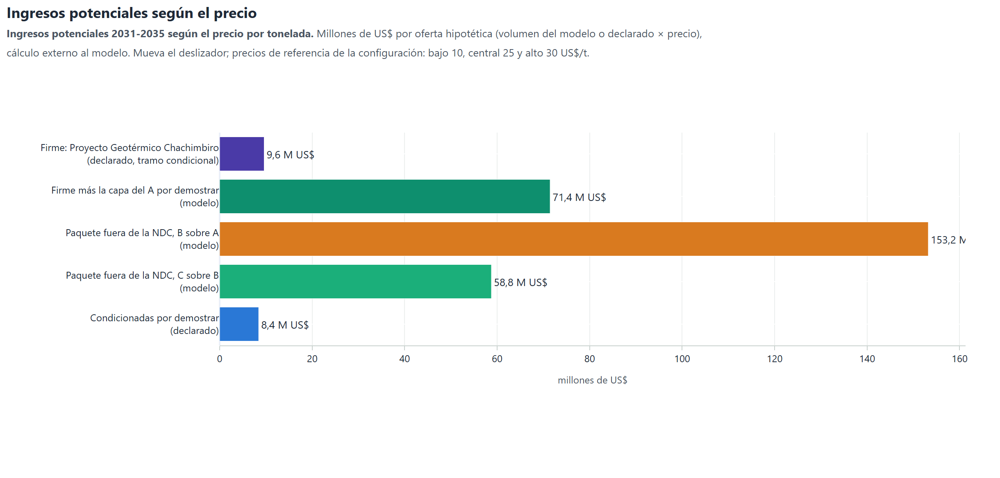

# Ingresos potenciales

Los ingresos son volumen × precio y se calculan fuera del modelo, con los precios de referencia de la
hoja `Art6_Precios`. Las líneas con potencial declarado usan ese valor como volumen. Las capas de la
escalera usan la reducción que calcula el modelo.

Ingresos potenciales según el precio

Ingresos potenciales 2031-2035 según el precio por tonelada. Millones de US$ por oferta hipotética (volumen del modelo o declarado × precio), cálculo externo al modelo. Mueva el deslizador; precios de referencia de la configuración: bajo 10, central 25 y alto 30 US$/t.

#### Qué muestra

Ingresos potenciales 2031-2035 (millones de US$) de cada oferta hipotética: volumen × precio. Es un cálculo externo al modelo sobre sus volúmenes; las líneas con potencial declarado usan ese valor.

#### Cómo leerla

Cada barra es una oferta; el deslizador cambia el precio por tonelada. Los precios de referencia vienen de la hoja Art6_Precios: bajo 10, central 25 y alto 30 US$/t.

#### Qué dice el modelo

A 25 US$/t, la oferta firme rinde 9,6 millones de US$ y la capa del C, 58,8 millones.

#### Para la decisión

La oferta mayor es «Paquete fuera de la NDC, B sobre A (modelo)», con 6 129 kt; la firme, «Firme: Proyecto Geotérmico Chachimbiro (declarado, tramo condicional)», suma 385 kt y es el ingreso que hoy sostendría una negociación. Referencia del precio alto (30 US$/t): primera transferencia de ITMO bajo el Artículo 6.2 (Tailandia a Suiza, 15-12-2023), unos 30 USD por tonelada. Los precios de mercado cambian rápido y deben actualizarse antes de cualquier decisión (fecha del dato en la configuración: 2023).

*Tabla. Ingresos por oferta y precio, 2031-2035 (millones de US$)*

| clave | oferta | kt_2031_2035 | nota | MUSD_Bajo | MUSD_Central | MUSD_Alto |
|---|---|---|---|---|---|---|
| firme | Firme: Proyecto Geotérmico Chachimbiro (declarado, tramo condicional) | 384.8 | única línea con adicionalidad firme; vende tramo condicional | 3.8 | 9.6 | 11.5 |
| firme_capa | Firme más la capa del A por demostrar (modelo) | 2857.9 | agrega la reducción que el modelo atribuye a las palancas del A | 28.6 | 71.4 | 85.7 |
| capa:B | Paquete fuera de la NDC, B sobre A (modelo) | 6129.0 | no consume ninguna meta; adicionalidad por demostrar | 61.3 | 153.2 | 183.9 |
| capa:C | Paquete fuera de la NDC, C sobre B (modelo) | 2350.3 | no consume ninguna meta; adicionalidad por demostrar | 23.5 | 58.8 | 70.5 |
| declarado | Condicionadas por demostrar (declarado) | 337.2 | potencial declarado en el Plan de Implementación de la Segunda NDC; sin EN32, en reserva | 3.4 | 8.4 | 10.1 |
| en_reserva | En reserva, fuera de la oferta: Renovación y Descarbonización del Transporte Público y Comercial en el Ecuador (declarado) | 925.0 | fuera de la oferta: EN32, adicionalidad regulatoria por demostrar (decisión del 13-10-2026) | 9.2 | 23.1 | 27.8 |
| maximo | Máximo teórico con tramo condicional (A contra INCA6) | 25026.3 | incluye Proyecto Hidroeléctrico Santiago y Proyecto hidroeléctrico Cardenillo, sin adicionalidad: no es oferta vendible | 250.3 | 625.7 | 750.8 |

*Tabla. Precios de referencia (hoja Art6_Precios)*

| Precio | US$/t | Referencia | Fuente | Fecha del dato | Estado |
|---|---|---|---|---|---|
| Bajo | 10 | Renovables conectadas a red vendidas como ITMO, extremo bajo; techo aproximado del mercado voluntario de alta calidad | mercado-datos (Ecosystem Marketplace 2025; síntesis de contratos 2024-2026) | 2024-2026 | refrescar |
| Central | 25 | Punto medio del rango bilateral de ITMO de 20 a 50 US$/t; cartera KliK 2025-2030 de CHF 27/t | KliK Foundation; síntesis de contratos KliK/JCM | 2024-2026 | refrescar |
| Alto | 30 | Primera transferencia de ITMO bajo el Artículo 6.2 (Tailandia a Suiza, 15-12-2023), unos 30 USD por tonelada | Primera transferencia de ITMO bajo el Artículo 6.2 entre Tailandia y Suiza (TGO y Fundación KliK), diciembre de 2023; precio de referencia público | 2023 | refrescar |
