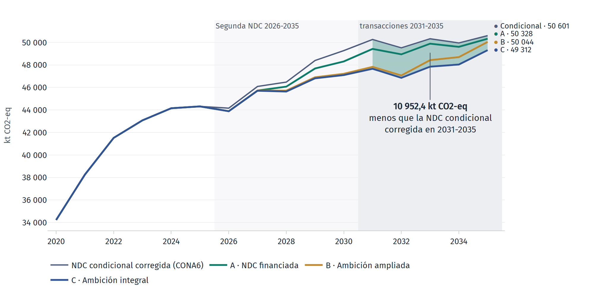

# Escenarios de Artículo 6 del sector energía del Ecuador

#### Reducción de 10 952,4 kt CO2‑eq frente a la NDC condicional corregida en 2031-2035

Emisiones del sector energía con la NDC condicional corregida (CONA6) y con los escenarios de Artículo 6 A, B y C (kt CO2-eq). El área verde es lo que el escenario «Ambición integral» reduce frente a CONA6 en la ventana de transacciones. La oferta transferible, 11 674,4 kt, suma a esa reducción la línea firme, Proyecto Geotérmico Chachimbiro (384,8 kt), y las líneas con potencial declarado (337,2 kt).

El modelo estima cuántas reducciones del sector energía podría transferir el Ecuador como resultados de
mitigación de transferencia internacional (ITMO) en 2031-2035 sin poner en riesgo la meta incondicional de
su Segunda NDC, y qué parte de ese volumen resiste los riesgos del sistema eléctrico.

Parte del modelo OSeMOSYS de energía de la Segunda NDC de Climate Lead Group (Modelo CLG), con una
calibración propia anclada al inventario y al Balance Energético Nacional, y conserva intactos sus cuatro
escenarios.

#### Para decidir

Las cifras de la corrida, el volumen que cabe en el margen de la meta y lo que el riesgo le quita.

- [Cifras principales](1_art6/5_cifras.md)
- [Potencial de ITMO](1_art6/0_potential.md)
- [Pruebas de estrés y sobreventa](1_art6/1_risks.md)
- [Recomendaciones](1_art6/4_recommendations.md)
- [Tablero de resultados](https://ecmaedmcc.github.io/EnergyArt6/_static/tablero_art6.html), con las gráficas interactivas

#### Para reproducir

La instalación, el método y la calibración que sostienen cada cifra.

- [Guía de uso](guide.md)
- [Metodología](methods.md)
- [Modelo del sector energía](0_energy/README.md)
- [Repositorio EnergyArt6 en GitHub](https://github.com/ECMAEDMCC/EnergyArt6)

> Ejercicio exploratorio con fines analíticos. Los escenarios son óptimos de mínimo costo y sus resultados
> son consecuencias de supuestos documentados, sin valor de pronóstico. El tratamiento del ajuste
> correspondiente es conceptual y no constituye una metodología oficial bajo el Artículo 6.

#### Contenido

- [Introducción](introduction.md)
- [Metodología](methods.md)
- [Emisiones nacionales y metas de la Segunda NDC](emissions.md)
- [Modelo del sector energía](0_energy/README.md)
- [Análisis de Artículo 6](1_art6/README.md)
- [Guía de uso](guide.md)
- [Licencia](license.md)
- [Autores](authors.md)
