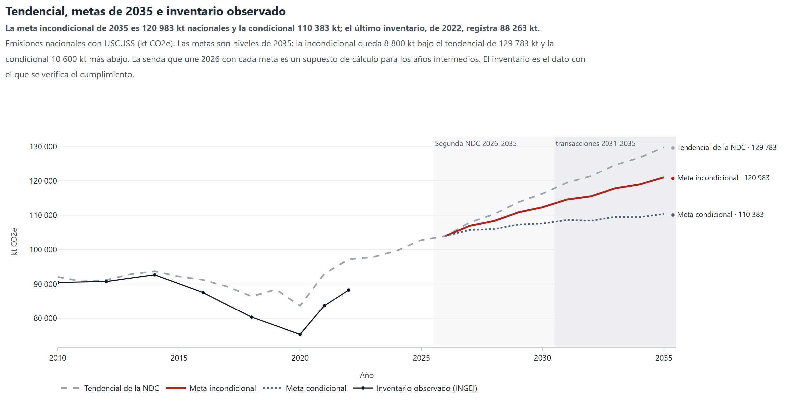
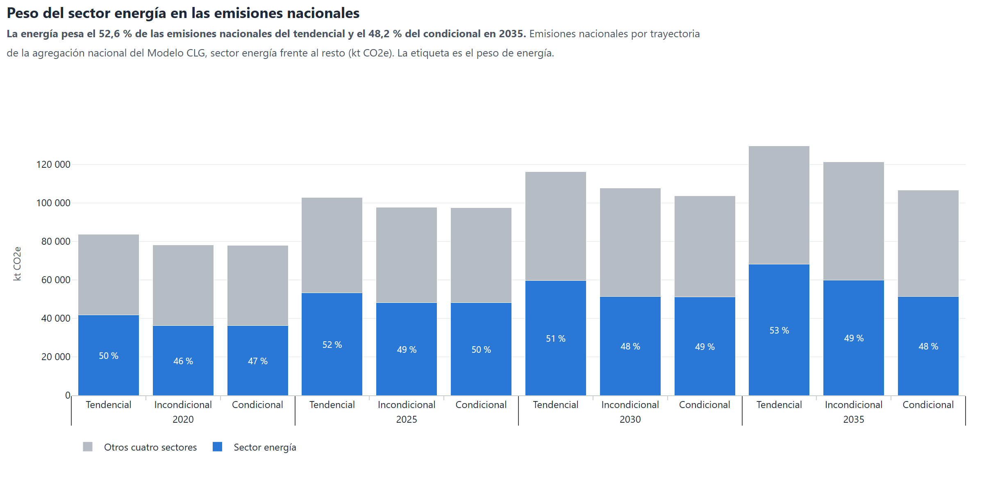

# Emisiones nacionales y metas de la Segunda NDC

El modelo de energía representa uno de los cinco sectores de mitigación de la Segunda NDC. El margen
frente a la meta se mide en el balance nacional. Por eso el análisis usa el tendencial nacional, las metas
publicadas y el inventario observado.

## Meta, línea base y métrica de la Segunda NDC

- Una sola meta, en 2035, para los cinco sectores de mitigación: Energía, Procesos Industriales,
  Agricultura, USCUSS y Residuos. El periodo de implementación va del 1 de enero de 2026 al 31 de
  diciembre de 2035 (sec. 4.3.2).
- Reducción incondicional de 8 800 kt CO2e y condicional de 10 600 kt adicionales frente
  al escenario tendencial al final del periodo (sec. 4.2.4 y 4.4.1). La NDC las publica redondeadas como
  7 % y 8 %. Frente al tendencial de |tendencial_2035| kt equivalen al 6,8 % y al 8,2 %. El
  análisis usa las cifras en kt, porque el indicador de referencia de la NDC se expresa en kt CO2e frente
  a la línea base al final del periodo.
- Año base 2010. Línea base: el tendencial de la Primera NDC proyectado a 2035 y, para USCUSS, las
  proyecciones del INGEI desde 2010. Métrica: GWP-100 del AR5.

## Tendencial, metas e inventario

Tendencial, metas de 2035 e inventario observado

La meta incondicional de 2035 es 120 983 kt nacionales y la condicional 110 383 kt; el último inventario, de 2022, registra 88 263 kt. Emisiones nacionales con USCUSS (kt CO2e). Las metas son niveles de 2035: la incondicional queda 8 800 kt bajo el tendencial de 129 783 kt y la condicional 10 600 kt más abajo. La senda que une 2026 con cada meta es un supuesto de cálculo para los años intermedios. El inventario es el dato con el que se verifica el cumplimiento.

#### Qué muestra

Las referencias de la contabilidad del Artículo 6 en el ámbito nacional con USCUSS: el tendencial de la NDC (129 783 kt en 2035), los niveles de las dos metas (120 983 y 110 383 kt en 2035, con senda lineal desde 2026) y el inventario observado hasta 2022.

#### Cómo leerla

La meta incondicional, la línea roja continua, es la base reservada: el balance de emisiones de 2035, inventario más ajustes correspondientes, no puede superarla. La condicional, punteada, es la oferta sujeta a apoyo, y el espacio entre ambas es el margen del condicional. Cada meta es un nivel de 2035; la senda que la une con 2026 es un supuesto de cálculo para los años intermedios. El inventario, en negro, es el dato con el que se verifica el cumplimiento; el modelo cubre los años que aún no tienen inventario.

#### Qué dice el modelo

El tendencial proviene de la agregación nacional del Modelo CLG para los cinco sectores; los niveles de las metas son el tendencial menos 8 800 y 19 400 kt, con senda lineal desde 2026, supuesto de cálculo. En 2022 el inventario registra 88 263 kt frente a 92 052 kt de la agregación nacional del Modelo CLG para ese año: las dos series parten de bases distintas y requieren conciliación.

#### Para la decisión

Toda cifra de margen y de sobreventa se mide contra el nivel incondicional. La base del margen (modelada, publicada o prorrata) y el método de ajuste correspondiente son decisiones abiertas.

Peso del sector energía en las emisiones nacionales

La energía pesa el 52,6 % de las emisiones nacionales del tendencial y el 48,2 % del condicional en 2035. Emisiones nacionales por trayectoria de la agregación nacional del Modelo CLG, sector energía frente al resto (kt CO2e). La etiqueta es el peso de energía.

#### Qué muestra

Emisiones nacionales de cada trayectoria de la Segunda NDC en 2020, 2025, 2030 y 2035 (kt CO₂e), separadas en sector energía y otros cuatro sectores. Fuente: agregación nacional y salida del sector energía del Modelo CLG (PowerBI de ECU_NDC: escenarios BAU1NDC, NDCINC y NDCCON).

#### Cómo leerla

La parte azul es el sector energía y su etiqueta da el peso en el total nacional; la gris, los otros cuatro sectores.

#### Qué dicen las series de la NDC

En 2035 la energía representa el 52,6 % del tendencial y el 48,2 % del condicional.

#### Para la decisión

La energía pesa el 48,2 % del balance nacional del condicional en 2035, y el análisis traslada a la trayectoria nacional cada tonelada que el sector sube o baja: un riesgo hidroeléctrico pesa sobre la meta del país en la misma cuantía.

*Tabla. Peso del sector energía en las trayectorias nacionales (kt CO2e)*

| trayectoria | anio | nacional_kt | energia_kt | otros_sectores_kt | peso_energia_pct |
|---|---|---|---|---|---|
| Tendencial | 2010 | 92041.9 | 37193.7 | 54848.2 | 40.4 |
| Tendencial | 2011 | 90768.9 | 36752.4 | 54016.5 | 40.5 |
| Tendencial | 2012 | 91173.2 | 38002.7 | 53170.5 | 41.7 |
| Tendencial | 2013 | 92855.6 | 40978.8 | 51876.8 | 44.1 |
| Tendencial | 2014 | 93722.6 | 43144.5 | 50578.1 | 46.0 |
| Tendencial | 2015 | 92172.3 | 43201.2 | 48971.1 | 46.9 |
| Tendencial | 2016 | 91187.2 | 43474.5 | 47712.7 | 47.7 |
| Tendencial | 2017 | 89273.0 | 45161.1 | 44111.9 | 50.6 |
| Tendencial | 2018 | 86417.2 | 46117.6 | 40299.6 | 53.4 |
| Tendencial | 2019 | 88429.4 | 47312.5 | 41116.9 | 53.5 |
| Tendencial | 2020 | 83744.7 | 41921.9 | 41822.8 | 50.1 |
| Tendencial | 2021 | 93021.9 | 46454.8 | 46567.1 | 49.9 |
| Tendencial | 2022 | 97190.7 | 49202.9 | 47987.8 | 50.6 |
| Tendencial | 2023 | 97786.0 | 50604.6 | 47181.4 | 51.8 |
| Tendencial | 2024 | 99673.0 | 51188.2 | 48484.8 | 51.4 |
| Tendencial | 2025 | 102797.7 | 53244.1 | 49553.6 | 51.8 |
| Tendencial | 2026 | 104009.8 | 53160.7 | 50849.1 | 51.1 |
| Tendencial | 2027 | 107932.3 | 55619.6 | 52312.7 | 51.5 |
| Tendencial | 2028 | 110326.7 | 56640.8 | 53685.9 | 51.3 |
| Tendencial | 2029 | 113786.8 | 58679.0 | 55107.8 | 51.6 |
| Tendencial | 2030 | 116235.8 | 59631.5 | 56604.3 | 51.3 |
| Tendencial | 2031 | 119422.5 | 61999.3 | 57423.2 | 51.9 |
| Tendencial | 2032 | 121373.6 | 62980.0 | 58393.6 | 51.9 |
| Tendencial | 2033 | 124636.3 | 65229.0 | 59407.3 | 52.3 |
| Tendencial | 2034 | 126738.5 | 66279.8 | 60458.7 | 52.3 |
| Tendencial | 2035 | 129782.6 | 68228.6 | 61554.0 | 52.6 |
| Incondicional | 2010 | 92042.0 | 37188.9 | 54853.1 | 40.4 |
| Incondicional | 2011 | 90609.4 | 36597.0 | 54012.4 | 40.4 |
| Incondicional | 2012 | 90810.7 | 37642.3 | 53168.4 | 41.5 |
| Incondicional | 2013 | 92415.2 | 40542.4 | 51872.8 | 43.9 |
| Incondicional | 2014 | 93108.8 | 42533.9 | 50574.9 | 45.7 |
| Incondicional | 2015 | 91867.2 | 42894.1 | 48973.1 | 46.7 |
| Incondicional | 2016 | 89622.2 | 41907.1 | 47715.1 | 46.8 |
| Incondicional | 2017 | 85804.3 | 41689.9 | 44114.4 | 48.6 |
| Incondicional | 2018 | 83582.1 | 43294.2 | 40287.9 | 51.8 |
| Incondicional | 2019 | 82594.3 | 41497.5 | 41096.8 | 50.2 |
| Incondicional | 2020 | 78098.2 | 36296.8 | 41801.4 | 46.5 |
| Incondicional | 2021 | 87334.7 | 40783.4 | 46551.3 | 46.7 |
| Incondicional | 2022 | 92052.4 | 44080.7 | 47971.7 | 47.9 |
| Incondicional | 2023 | 93074.5 | 45928.3 | 47146.2 | 49.3 |
| Incondicional | 2024 | 94907.8 | 46461.0 | 48446.8 | 49.0 |
| Incondicional | 2025 | 97789.2 | 48285.0 | 49504.2 | 49.4 |
| Incondicional | 2026 | 97217.1 | 46547.7 | 50669.4 | 47.9 |
| Incondicional | 2027 | 100243.0 | 48133.0 | 52110.0 | 48.0 |
| Incondicional | 2028 | 101996.5 | 48524.5 | 53472.0 | 47.6 |
| Incondicional | 2029 | 105390.1 | 50350.7 | 55039.4 | 47.8 |
| Incondicional | 2030 | 107845.7 | 51292.5 | 56553.2 | 47.6 |
| Incondicional | 2031 | 111014.1 | 53654.6 | 57359.5 | 48.3 |
| Incondicional | 2032 | 112956.0 | 54635.9 | 58320.1 | 48.4 |
| Incondicional | 2033 | 116209.6 | 56885.8 | 59323.8 | 49.0 |
| Incondicional | 2034 | 118309.1 | 57944.1 | 60365.0 | 49.0 |
| Incondicional | 2035 | 121347.0 | 59899.8 | 61447.2 | 49.4 |
| Condicional | 2010 | 92042.0 | 37193.8 | 54848.2 | 40.4 |
| Condicional | 2011 | 90609.4 | 36593.9 | 54015.5 | 40.4 |
| Condicional | 2012 | 90810.7 | 37640.2 | 53170.5 | 41.4 |
| Condicional | 2013 | 92415.2 | 40538.4 | 51876.8 | 43.9 |
| Condicional | 2014 | 93108.8 | 42531.5 | 50577.3 | 45.7 |
| Condicional | 2015 | 91867.2 | 42896.1 | 48971.1 | 46.7 |
| Condicional | 2016 | 89622.2 | 41909.4 | 47712.8 | 46.8 |
| Condicional | 2017 | 85768.3 | 41692.4 | 44075.9 | 48.6 |
| Condicional | 2018 | 83511.1 | 43299.2 | 40211.9 | 51.8 |
| Condicional | 2019 | 82486.3 | 41494.3 | 40992.0 | 50.3 |
| Condicional | 2020 | 77955.2 | 36293.6 | 41661.6 | 46.6 |
| Condicional | 2021 | 87148.7 | 40782.8 | 46365.9 | 46.8 |
| Condicional | 2022 | 91825.4 | 44076.9 | 47748.5 | 48.0 |
| Condicional | 2023 | 92822.9 | 45925.3 | 46897.6 | 49.5 |
| Condicional | 2024 | 94620.5 | 46458.9 | 48161.6 | 49.1 |
| Condicional | 2025 | 97466.0 | 48283.6 | 49182.4 | 49.5 |
| Condicional | 2026 | 95430.2 | 46543.6 | 48886.6 | 48.8 |
| Condicional | 2027 | 97938.6 | 48010.4 | 49928.2 | 49.0 |
| Condicional | 2028 | 99064.1 | 48386.5 | 50677.6 | 48.8 |
| Condicional | 2029 | 101784.1 | 50201.1 | 51583.0 | 49.3 |
| Condicional | 2030 | 103765.4 | 51124.7 | 52640.7 | 49.3 |
| Condicional | 2031 | 105071.7 | 52080.7 | 52991.0 | 49.6 |
| Condicional | 2032 | 104759.3 | 51267.4 | 53491.9 | 48.9 |
| Condicional | 2033 | 105877.2 | 51803.4 | 54073.8 | 48.9 |
| Condicional | 2034 | 105823.4 | 51131.6 | 54691.8 | 48.3 |
| Condicional | 2035 | 106806.0 | 51452.4 | 55353.6 | 48.2 |

## Conciliación con las metas publicadas

La agregación nacional del Modelo CLG reduce 22 976,6 kt CO2e en 2035, 3 576,6 kt
más que la meta condicional publicada. El tendencial es retroactivo, porque excluye obras de la Primera
NDC que ya operan. En el sector energía, esa construcción explica 8 329 kt de la diferencia
entre el tendencial y la referencia incondicional en 2035. El análisis mide el margen con las metas
publicadas (hoja `Art6_Headroom`) y no cuenta la reducción que la NDC no compromete ([Metodología](methods.md)).
